

# Jingjian · Awesome AI Video Prompts

**Hand-picked top-tier AI videos, images and AI-coded works with their prompts — searchable by style, mood and genre**

[Browse the site](https://daiyixiang666.github.io/awesome-ai-video-prompts/en/) · [Tags](https://daiyixiang666.github.io/awesome-ai-video-prompts/en/tags.html) · [中文](README.md) · [works.json](https://daiyixiang666.github.io/awesome-ai-video-prompts/works.json)

  

A hand-picked collection of AI works with outstanding aesthetics and craft, in three sections: **Video** (clips ≤60 s), **Images** and **Coding** (works an LLM built by writing code). Every work credits and links its creator, is tagged by style, regional vibe, genre, mood, camera technique and use case, and includes the full prompt whenever the creator published it.

## Video 157

Single short clips from AI video models (Seedance, Kling, Veo…). [See all →](https://daiyixiang666.github.io/awesome-ai-video-prompts/en/index.html)

<table>
<tr>
<td width="25%" valign="top"><a href="https://daiyixiang666.github.io/awesome-ai-video-prompts/en/w/tt-7547456543185210679.html">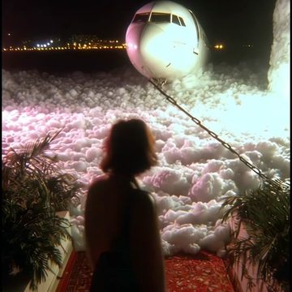</a> <a href="https://daiyixiang666.github.io/awesome-ai-video-prompts/en/w/tt-7547456543185210679.html"><b>Okie Dokie</b></a> Enter The Void · Midjourney</td>
<td width="25%" valign="top"><a href="https://daiyixiang666.github.io/awesome-ai-video-prompts/en/w/tt-7698193075356585230.html">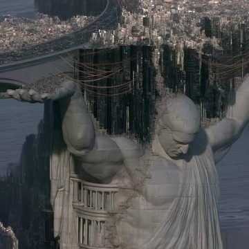</a> <a href="https://daiyixiang666.github.io/awesome-ai-video-prompts/en/w/tt-7698193075356585230.html"><b>Dominion</b></a> Other Realm · Midjourney + Higgsfield</td>
<td width="25%" valign="top"><a href="https://daiyixiang666.github.io/awesome-ai-video-prompts/en/w/tt-7533490775435250974.html">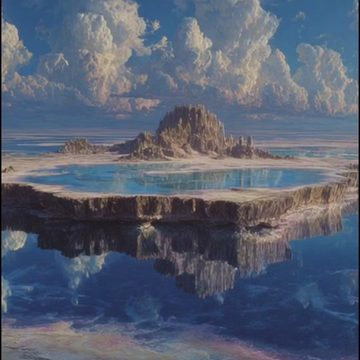</a> <a href="https://daiyixiang666.github.io/awesome-ai-video-prompts/en/w/tt-7533490775435250974.html"><b>Mirror Island</b></a> VisionaryVistas · Midjourney</td>
<td width="25%" valign="top"><a href="https://daiyixiang666.github.io/awesome-ai-video-prompts/en/w/tt-7559386178349206797.html">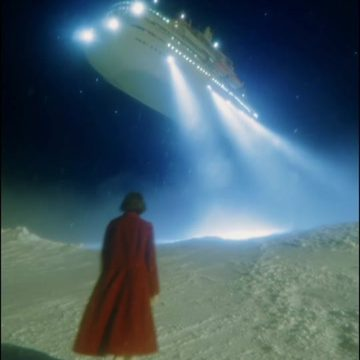</a> <a href="https://daiyixiang666.github.io/awesome-ai-video-prompts/en/w/tt-7559386178349206797.html"><b>Hollow</b></a> Enter The Void · Midjourney</td>
</tr>
<tr>
<td width="25%" valign="top"><a href="https://daiyixiang666.github.io/awesome-ai-video-prompts/en/w/tt-7696915816025197837.html">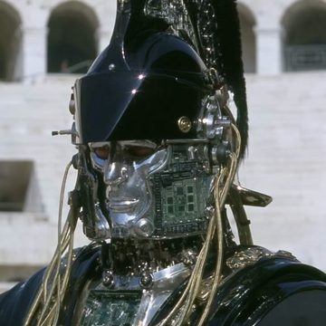</a> <a href="https://daiyixiang666.github.io/awesome-ai-video-prompts/en/w/tt-7696915816025197837.html"><b>Eternal Empire</b></a> Other Realm · Midjourney + Higgsfield</td>
<td width="25%" valign="top"> <a href="https://daiyixiang666.github.io/awesome-ai-video-prompts/en/w/x-2107633088704704597.html"><b>The Long Way Home</b></a> はさまるスタジオ (Hasamaru Studio) · Kling</td>
<td width="25%" valign="top"><a href="https://daiyixiang666.github.io/awesome-ai-video-prompts/en/w/x-2111824828009193814.html">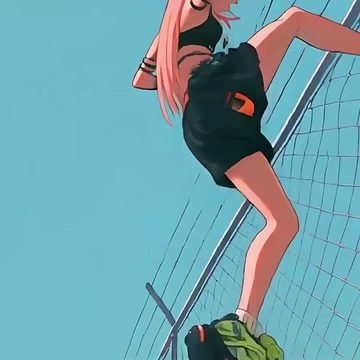</a> <a href="https://daiyixiang666.github.io/awesome-ai-video-prompts/en/w/x-2111824828009193814.html"><b>Rooftop Brawl</b></a> Kōda · Seedance 2.5</td>
<td width="25%" valign="top"><a href="https://daiyixiang666.github.io/awesome-ai-video-prompts/en/w/x-2113142010966384982.html">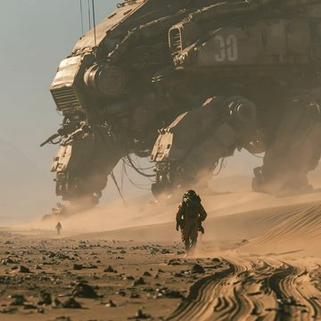</a> <a href="https://daiyixiang666.github.io/awesome-ai-video-prompts/en/w/x-2113142010966384982.html"><b>Slow, Mighty Mech</b></a> ojiji · Midjourney + Kling 4.0</td>
</tr>
</table>

## Images 140

Work from AI image models (Midjourney, GPT Image, Nano Banana…). [See all →](https://daiyixiang666.github.io/awesome-ai-video-prompts/en/images.html)

<table>
<tr>
<td width="25%" valign="top"><a href="https://daiyixiang666.github.io/awesome-ai-video-prompts/en/w/img-x-2103072199393632445.html">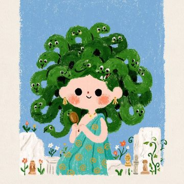</a> <a href="https://daiyixiang666.github.io/awesome-ai-video-prompts/en/w/img-x-2103072199393632445.html"><b>Cute Greek Myths</b></a> Keskin</td>
<td width="25%" valign="top"><a href="https://daiyixiang666.github.io/awesome-ai-video-prompts/en/w/img-x-2114316352773066834.html">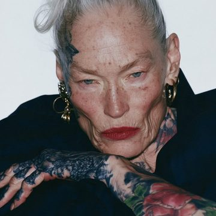</a> <a href="https://daiyixiang666.github.io/awesome-ai-video-prompts/en/w/img-x-2114316352773066834.html"><b>Beauty</b></a> Ege</td>
<td width="25%" valign="top"><a href="https://daiyixiang666.github.io/awesome-ai-video-prompts/en/w/img-x-2112389077714788510.html">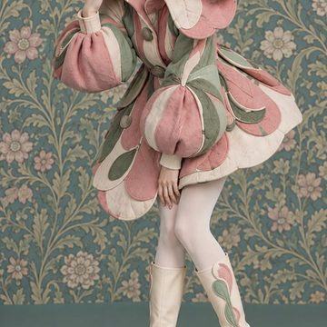</a> <a href="https://daiyixiang666.github.io/awesome-ai-video-prompts/en/w/img-x-2112389077714788510.html"><b>Botanica 2</b></a> HPJJ</td>
<td width="25%" valign="top"><a href="https://daiyixiang666.github.io/awesome-ai-video-prompts/en/w/img-x-2098763810563928265.html">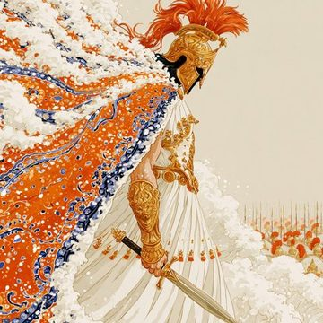</a> <a href="https://daiyixiang666.github.io/awesome-ai-video-prompts/en/w/img-x-2098763810563928265.html"><b>The Odyssey</b></a> Alban Glazman · Midjourney</td>
</tr>
<tr>
<td width="25%" valign="top"><a href="https://daiyixiang666.github.io/awesome-ai-video-prompts/en/w/img-x-2105682224242971020.html">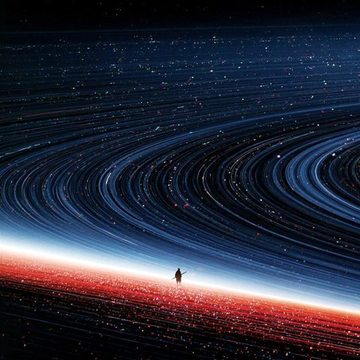</a> <a href="https://daiyixiang666.github.io/awesome-ai-video-prompts/en/w/img-x-2105682224242971020.html"><b>Ring Horizon</b></a> Dogan Ural</td>
<td width="25%" valign="top"><a href="https://daiyixiang666.github.io/awesome-ai-video-prompts/en/w/img-x-2103773571159888284.html">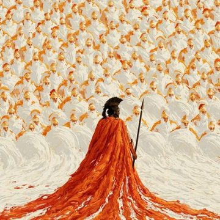</a> <a href="https://daiyixiang666.github.io/awesome-ai-video-prompts/en/w/img-x-2103773571159888284.html"><b>Greek Heroes</b></a> Alban Glazman</td>
<td width="25%" valign="top"><a href="https://daiyixiang666.github.io/awesome-ai-video-prompts/en/w/img-x-2114813976244801665.html">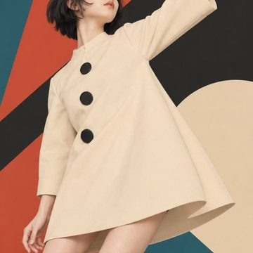</a> <a href="https://daiyixiang666.github.io/awesome-ai-video-prompts/en/w/img-x-2114813976244801665.html"><b>Russian Avant-Garde Fashion</b></a> HPJJ</td>
<td width="25%" valign="top"> <a href="https://daiyixiang666.github.io/awesome-ai-video-prompts/en/w/img-x-2106414656449347776.html"><b>Ring Vortex</b></a> Dogan Ural</td>
</tr>
</table>

## Coding 24

Works an LLM built by writing code (three.js, WebGL, shaders…), including code-rendered videos. [See all →](https://daiyixiang666.github.io/awesome-ai-video-prompts/en/coding.html)

<table>
<tr>
<td width="25%" valign="top"><a href="https://daiyixiang666.github.io/awesome-ai-video-prompts/en/w/web-2102503719762018434.html">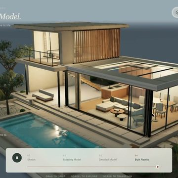</a> <a href="https://daiyixiang666.github.io/awesome-ai-video-prompts/en/w/web-2102503719762018434.html"><b>From Sketch to Home</b></a> Techartist · Opus 5.5 (Claude)</td>
<td width="25%" valign="top"><a href="https://daiyixiang666.github.io/awesome-ai-video-prompts/en/w/web-2112935205703147750.html">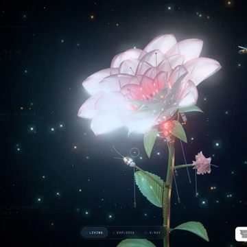</a> <a href="https://daiyixiang666.github.io/awesome-ai-video-prompts/en/w/web-2112935205703147750.html"><b>Mechanical Flowers</b></a> Bee · Gemini 4 Carbon</td>
<td width="25%" valign="top"><a href="https://daiyixiang666.github.io/awesome-ai-video-prompts/en/w/web-2113662031379464549.html">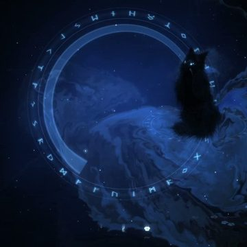</a> <a href="https://daiyixiang666.github.io/awesome-ai-video-prompts/en/w/web-2113662031379464549.html"><b>Mist Cat</b></a> Bee · Gemini 4 Carbon</td>
<td width="25%" valign="top"><a href="https://daiyixiang666.github.io/awesome-ai-video-prompts/en/w/web-2113909026253877485.html">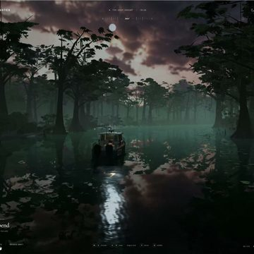</a> <a href="https://daiyixiang666.github.io/awesome-ai-video-prompts/en/w/web-2113909026253877485.html"><b>Misty Swamp</b></a> Chetan Ankola · GPT-6 Astra</td>
</tr>
<tr>
<td width="25%" valign="top"><a href="https://daiyixiang666.github.io/awesome-ai-video-prompts/en/w/web-2109312983402782988.html">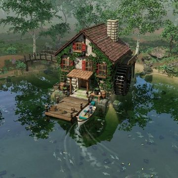</a> <a href="https://daiyixiang666.github.io/awesome-ai-video-prompts/en/w/web-2109312983402782988.html"><b>Still Water Cabin</b></a> Mohamed · Codex (GPT)</td>
<td width="25%" valign="top"><a href="https://daiyixiang666.github.io/awesome-ai-video-prompts/en/w/web-2105250266392224097.html">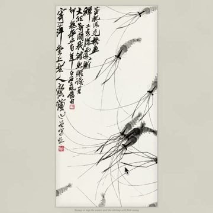</a> <a href="https://daiyixiang666.github.io/awesome-ai-video-prompts/en/w/web-2105250266392224097.html"><b>Qi Baishi&#x27;s Shrimp</b></a> Joshua Guo · Opus 5.5 (Claude)</td>
<td width="25%" valign="top"><a href="https://daiyixiang666.github.io/awesome-ai-video-prompts/en/w/web-2115175640198783107.html">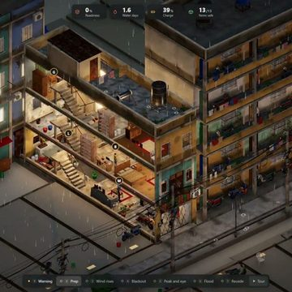</a> <a href="https://daiyixiang666.github.io/awesome-ai-video-prompts/en/w/web-2115175640198783107.html"><b>Vietnamese Tube House Typhoon</b></a> An Xuan · Opus 5.5 (Claude)</td>
<td width="25%" valign="top"><a href="https://daiyixiang666.github.io/awesome-ai-video-prompts/en/w/web-2114035463153742180.html">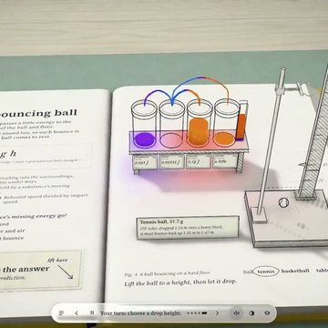</a> <a href="https://daiyixiang666.github.io/awesome-ai-video-prompts/en/w/web-2114035463153742180.html"><b>The Pop-Up Energy Book</b></a> Techartist · Opus 5.5 (Claude)</td>
</tr>
</table>

## Browse by tag

**Visual style**　[Cinematic realism](https://daiyixiang666.github.io/awesome-ai-video-prompts/en/t/style/cinematic-realism.html) 100 · [Surreal / dreamcore](https://daiyixiang666.github.io/awesome-ai-video-prompts/en/t/style/surreal-dream.html) 57 · [Commercial / ad look](https://daiyixiang666.github.io/awesome-ai-video-prompts/en/t/style/commercial.html) 39 · [Film / retro](https://daiyixiang666.github.io/awesome-ai-video-prompts/en/t/style/film-retro.html) 38 · [Documentary handheld](https://daiyixiang666.github.io/awesome-ai-video-prompts/en/t/style/documentary-handheld.html) 33 · [Watercolor storybook](https://daiyixiang666.github.io/awesome-ai-video-prompts/en/t/style/watercolor-storybook.html) 27 · [Game CG](https://daiyixiang666.github.io/awesome-ai-video-prompts/en/t/style/game-cg.html) 24 · [Anime](https://daiyixiang666.github.io/awesome-ai-video-prompts/en/t/style/anime.html) 21  
**Regional vibe**　[No specific region](https://daiyixiang666.github.io/awesome-ai-video-prompts/en/t/region/no-region.html) 122 · [European](https://daiyixiang666.github.io/awesome-ai-video-prompts/en/t/region/european.html) 60 · [Japanese](https://daiyixiang666.github.io/awesome-ai-video-prompts/en/t/region/japanese.html) 52 · [American](https://daiyixiang666.github.io/awesome-ai-video-prompts/en/t/region/american.html) 37 · [Chinese](https://daiyixiang666.github.io/awesome-ai-video-prompts/en/t/region/chinese.html) 18 · [Korean](https://daiyixiang666.github.io/awesome-ai-video-prompts/en/t/region/korean.html) 17 · [Other regions](https://daiyixiang666.github.io/awesome-ai-video-prompts/en/t/region/other-region.html) 14 · [Hong Kong](https://daiyixiang666.github.io/awesome-ai-video-prompts/en/t/region/hong-kong.html) 1  
**Genre**　[Daily life](https://daiyixiang666.github.io/awesome-ai-video-prompts/en/t/genre/daily-life.html) 69 · [Fantasy / myth](https://daiyixiang666.github.io/awesome-ai-video-prompts/en/t/genre/fantasy-myth.html) 63 · [Fashion / beauty](https://daiyixiang666.github.io/awesome-ai-video-prompts/en/t/genre/fashion-beauty.html) 36 · [Nature / landscape](https://daiyixiang666.github.io/awesome-ai-video-prompts/en/t/genre/nature.html) 35 · [Sci-fi](https://daiyixiang666.github.io/awesome-ai-video-prompts/en/t/genre/sci-fi.html) 31 · [Travel / city](https://daiyixiang666.github.io/awesome-ai-video-prompts/en/t/genre/travel-city.html) 31 · [Romance / youth](https://daiyixiang666.github.io/awesome-ai-video-prompts/en/t/genre/romance-youth.html) 28 · [Historical / period](https://daiyixiang666.github.io/awesome-ai-video-prompts/en/t/genre/historical.html) 23  
**Mood**　[Heartwarming](https://daiyixiang666.github.io/awesome-ai-video-prompts/en/t/mood/heartwarming.html) 72 · [Lonely / melancholy](https://daiyixiang666.github.io/awesome-ai-video-prompts/en/t/mood/melancholy.html) 71 · [Lighthearted](https://daiyixiang666.github.io/awesome-ai-video-prompts/en/t/mood/lighthearted.html) 55 · [Epic](https://daiyixiang666.github.io/awesome-ai-video-prompts/en/t/mood/epic.html) 51 · [Tense / thrilling](https://daiyixiang666.github.io/awesome-ai-video-prompts/en/t/mood/tense.html) 30 · [Hype / adrenaline](https://daiyixiang666.github.io/awesome-ai-video-prompts/en/t/mood/hype.html) 27 · [Eerie / unsettling](https://daiyixiang666.github.io/awesome-ai-video-prompts/en/t/mood/eerie.html) 26 · [Romantic](https://daiyixiang666.github.io/awesome-ai-video-prompts/en/t/mood/romantic.html) 26  
**Camera technique**　[Multi-shot edit](https://daiyixiang666.github.io/awesome-ai-video-prompts/en/t/technique/multi-shot.html) 88 · [One-take](https://daiyixiang666.github.io/awesome-ai-video-prompts/en/t/technique/one-take.html) 28 · [Character consistency](https://daiyixiang666.github.io/awesome-ai-video-prompts/en/t/technique/character-consistency.html) 16 · [First-person POV](https://daiyixiang666.github.io/awesome-ai-video-prompts/en/t/technique/pov.html) 16 · [Micro-expression close-up](https://daiyixiang666.github.io/awesome-ai-video-prompts/en/t/technique/micro-expression.html) 14 · [Transformation transition](https://daiyixiang666.github.io/awesome-ai-video-prompts/en/t/technique/transformation-transition.html) 12 · [Slow motion](https://daiyixiang666.github.io/awesome-ai-video-prompts/en/t/technique/slow-motion.html) 11 · [Orbit shot](https://daiyixiang666.github.io/awesome-ai-video-prompts/en/t/technique/orbit-shot.html) 5  
**Use case**　[Narrative short](https://daiyixiang666.github.io/awesome-ai-video-prompts/en/t/use/short-film.html) 63 · [Vlog](https://daiyixiang666.github.io/awesome-ai-video-prompts/en/t/use/vlog.html) 38 · [Ad / TVC](https://daiyixiang666.github.io/awesome-ai-video-prompts/en/t/use/tvc.html) 18 · [Trailer](https://daiyixiang666.github.io/awesome-ai-video-prompts/en/t/use/trailer.html) 11 · [Demo / tutorial](https://daiyixiang666.github.io/awesome-ai-video-prompts/en/t/use/demo-tutorial.html) 11 · [Music video](https://daiyixiang666.github.io/awesome-ai-video-prompts/en/t/use/music-video.html) 9 · [Meme / sketch](https://daiyixiang666.github.io/awesome-ai-video-prompts/en/t/use/meme-sketch.html) 7  

## Curation

- Top-tier only: outstanding aesthetics and craft; no memes, thirst bait, reposts or tool promos.
- Video = AI video models only; Images = AI image models only; anything an LLM made by writing code (three.js, WebGL, code-rendered video) goes to Coding.
- Creators are always credited and linked; prompts are never invented.

## For agents & developers

[`works.json`](https://daiyixiang666.github.io/awesome-ai-video-prompts/works.json) · [`llms.txt`](https://daiyixiang666.github.io/awesome-ai-video-prompts/llms.txt) · [`sitemap.xml`](https://daiyixiang666.github.io/awesome-ai-video-prompts/sitemap.xml)

## Takedown

All works belong to their creators. Rights holders can email **yixiang@umich.edu** or open an issue and we will remove the work promptly.
