

# Jingjian · Awesome AI Video Prompts

**Hand-picked top-tier AI videos, images and AI-coded works with their prompts — searchable by style, mood and genre**

[Browse the site](https://daiyixiang666.github.io/awesome-ai-video-prompts/en/) · [Tags](https://daiyixiang666.github.io/awesome-ai-video-prompts/en/tags.html) · [Submit](https://github.com/daiyixiang666/awesome-ai-video-prompts/issues/new?template=submit.yml) · [中文](README.md) · [works.json](https://daiyixiang666.github.io/awesome-ai-video-prompts/works.json)

  

A hand-picked collection of AI works with outstanding aesthetics and craft, in three sections: **Video** (clips ≤60 s), **Images** and **Coding** (works an LLM built by writing code). Every work credits and links its creator, is tagged by style, regional vibe, genre, mood, camera technique and use case, and includes the full prompt whenever the creator published it.

## Video 167

Single short clips from AI video models (Seedance, Kling, Veo…). [See all →](https://daiyixiang666.github.io/awesome-ai-video-prompts/en/index.html)

<table>
<tr>
<td width="25%" valign="top"><a href="https://daiyixiang666.github.io/awesome-ai-video-prompts/en/w/x-2060322611586834518.html">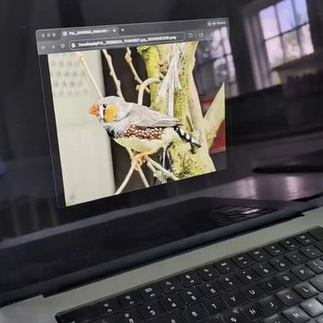</a> <a href="https://daiyixiang666.github.io/awesome-ai-video-prompts/en/w/x-2060322611586834518.html"><b>Bird Hops off the Screen</b></a> Alexander Chen · Gemini Omni</td>
<td width="25%" valign="top"><a href="https://daiyixiang666.github.io/awesome-ai-video-prompts/en/w/x-2110062762218926204.html">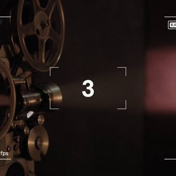</a> <a href="https://daiyixiang666.github.io/awesome-ai-video-prompts/en/w/x-2110062762218926204.html"><b>If AI Was Born in 1985</b></a> Déborah · Grok Imagine</td>
<td width="25%" valign="top"><a href="https://daiyixiang666.github.io/awesome-ai-video-prompts/en/w/x-2110269414834852256.html">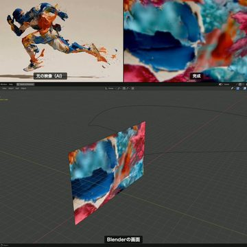</a> <a href="https://daiyixiang666.github.io/awesome-ai-video-prompts/en/w/x-2110269414834852256.html"><b>2D Sprint Shatters into 3D</b></a> aicreataro · MiniMax H3 (+Midjourney, Blender)</td>
<td width="25%" valign="top"><a href="https://daiyixiang666.github.io/awesome-ai-video-prompts/en/w/x-2090573248752934994.html">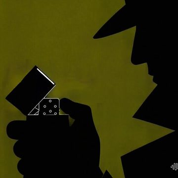</a> <a href="https://daiyixiang666.github.io/awesome-ai-video-prompts/en/w/x-2090573248752934994.html"><b>Foley-Driven Noir Silhouettes</b></a> meropan · MiniMax H3</td>
</tr>
<tr>
<td width="25%" valign="top"> <a href="https://daiyixiang666.github.io/awesome-ai-video-prompts/en/w/x-2115768686753833186.html"><b>Cyberpunk Everyday</b></a> INK</td>
<td width="25%" valign="top"><a href="https://daiyixiang666.github.io/awesome-ai-video-prompts/en/w/x-2112536635435049408.html">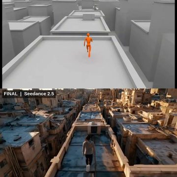</a> <a href="https://daiyixiang666.github.io/awesome-ai-video-prompts/en/w/x-2112536635435049408.html"><b>Previz First, Then Generate</b></a> たくぞー｜AI動画ツール実測レビュー · MiniMax H3 (previz) + Seedance 2.5</td>
<td width="25%" valign="top"> <a href="https://daiyixiang666.github.io/awesome-ai-video-prompts/en/w/x-2077006040776741153.html"><b>Marker Rewrites the Street</b></a> Dheepan Ratnam · Gemini Omni</td>
<td width="25%" valign="top"><a href="https://daiyixiang666.github.io/awesome-ai-video-prompts/en/w/x-2111110794150867287.html">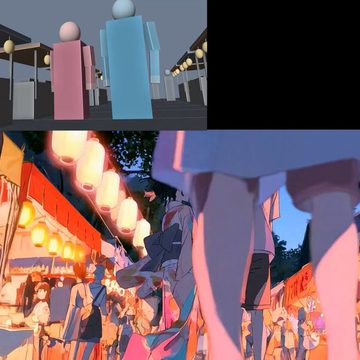</a> <a href="https://daiyixiang666.github.io/awesome-ai-video-prompts/en/w/x-2111110794150867287.html"><b>Blockout to Summer Festival</b></a> みと Visuals×AI · MiniMax H3</td>
</tr>
</table>

## Images 143

Work from AI image models (Midjourney, GPT Image, Nano Banana…). [See all →](https://daiyixiang666.github.io/awesome-ai-video-prompts/en/images.html)

<table>
<tr>
<td width="25%" valign="top"><a href="https://daiyixiang666.github.io/awesome-ai-video-prompts/en/w/img-x-2115055913203855553.html">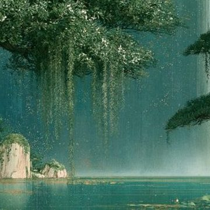</a> <a href="https://daiyixiang666.github.io/awesome-ai-video-prompts/en/w/img-x-2115055913203855553.html"><b>Chinese Garden Hanging Scroll</b></a> Glitter Gal · Midjourney</td>
<td width="25%" valign="top"><a href="https://daiyixiang666.github.io/awesome-ai-video-prompts/en/w/img-x-2114998034773729300.html">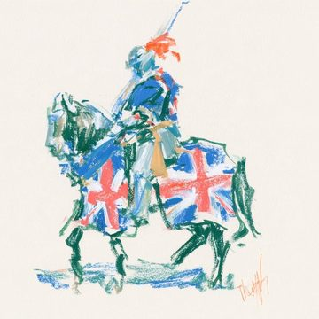</a> <a href="https://daiyixiang666.github.io/awesome-ai-video-prompts/en/w/img-x-2114998034773729300.html"><b>Watercolor Knight Sketches</b></a> Sgt Sref · Midjourney</td>
<td width="25%" valign="top"><a href="https://daiyixiang666.github.io/awesome-ai-video-prompts/en/w/img-x-2110138570740543839.html">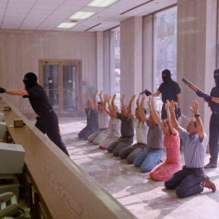</a> <a href="https://daiyixiang666.github.io/awesome-ai-video-prompts/en/w/img-x-2110138570740543839.html"><b>Nineties Movie Stills</b></a> Riccardo Wolf · Krea 3</td>
<td width="25%" valign="top"><a href="https://daiyixiang666.github.io/awesome-ai-video-prompts/en/w/img-x-2103072199393632445.html">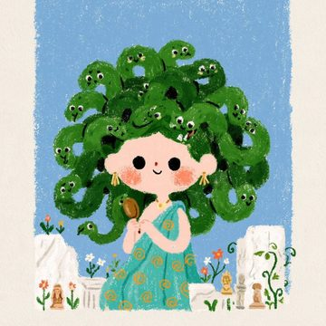</a> <a href="https://daiyixiang666.github.io/awesome-ai-video-prompts/en/w/img-x-2103072199393632445.html"><b>Cute Greek Myths</b></a> Keskin</td>
</tr>
<tr>
<td width="25%" valign="top"><a href="https://daiyixiang666.github.io/awesome-ai-video-prompts/en/w/img-x-2114316352773066834.html">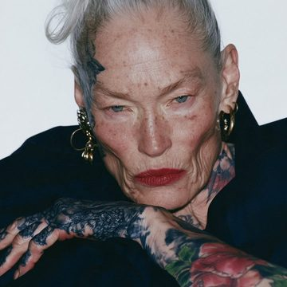</a> <a href="https://daiyixiang666.github.io/awesome-ai-video-prompts/en/w/img-x-2114316352773066834.html"><b>Beauty</b></a> Ege</td>
<td width="25%" valign="top"> <a href="https://daiyixiang666.github.io/awesome-ai-video-prompts/en/w/img-x-2112389077714788510.html"><b>Botanica 2</b></a> HPJJ</td>
<td width="25%" valign="top"><a href="https://daiyixiang666.github.io/awesome-ai-video-prompts/en/w/img-x-2098763810563928265.html">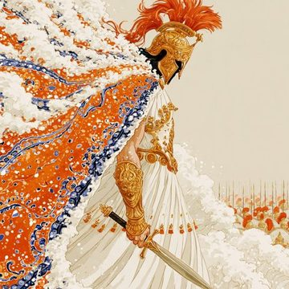</a> <a href="https://daiyixiang666.github.io/awesome-ai-video-prompts/en/w/img-x-2098763810563928265.html"><b>The Odyssey</b></a> Alban Glazman · Midjourney</td>
<td width="25%" valign="top"><a href="https://daiyixiang666.github.io/awesome-ai-video-prompts/en/w/img-x-2105682224242971020.html">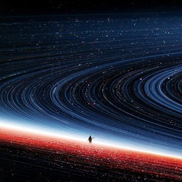</a> <a href="https://daiyixiang666.github.io/awesome-ai-video-prompts/en/w/img-x-2105682224242971020.html"><b>Ring Horizon</b></a> Dogan Ural</td>
</tr>
</table>

## Coding 25

Works an LLM built by writing code (three.js, WebGL, shaders…), including code-rendered videos. [See all →](https://daiyixiang666.github.io/awesome-ai-video-prompts/en/coding.html)

<table>
<tr>
<td width="25%" valign="top"><a href="https://daiyixiang666.github.io/awesome-ai-video-prompts/en/w/web-2114035230113984749.html">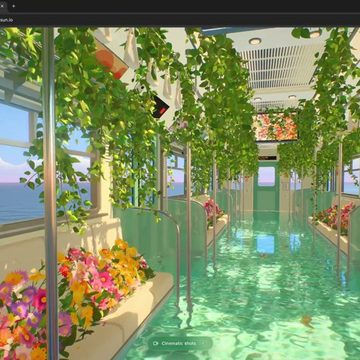</a> <a href="https://daiyixiang666.github.io/awesome-ai-video-prompts/en/w/web-2114035230113984749.html"><b>Summer Pond Tram</b></a> Scott · Opus 5.5 (Claude)</td>
<td width="25%" valign="top"><a href="https://daiyixiang666.github.io/awesome-ai-video-prompts/en/w/web-2102503719762018434.html">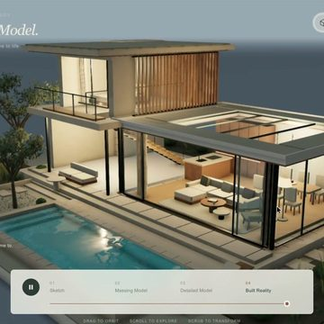</a> <a href="https://daiyixiang666.github.io/awesome-ai-video-prompts/en/w/web-2102503719762018434.html"><b>From Sketch to Home</b></a> Techartist · Opus 5.5 (Claude)</td>
<td width="25%" valign="top"><a href="https://daiyixiang666.github.io/awesome-ai-video-prompts/en/w/web-2112935205703147750.html">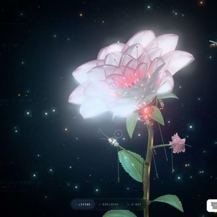</a> <a href="https://daiyixiang666.github.io/awesome-ai-video-prompts/en/w/web-2112935205703147750.html"><b>Mechanical Flowers</b></a> Bee · Gemini 4 Carbon</td>
<td width="25%" valign="top"><a href="https://daiyixiang666.github.io/awesome-ai-video-prompts/en/w/web-2113662031379464549.html">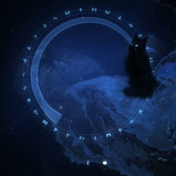</a> <a href="https://daiyixiang666.github.io/awesome-ai-video-prompts/en/w/web-2113662031379464549.html"><b>Mist Cat</b></a> Bee · Gemini 4 Carbon</td>
</tr>
<tr>
<td width="25%" valign="top"><a href="https://daiyixiang666.github.io/awesome-ai-video-prompts/en/w/web-2113909026253877485.html">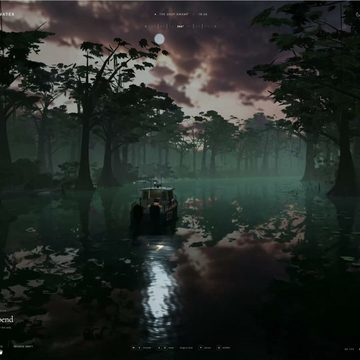</a> <a href="https://daiyixiang666.github.io/awesome-ai-video-prompts/en/w/web-2113909026253877485.html"><b>Misty Swamp</b></a> Chetan Ankola · GPT-6 Astra</td>
<td width="25%" valign="top"><a href="https://daiyixiang666.github.io/awesome-ai-video-prompts/en/w/web-2109312983402782988.html">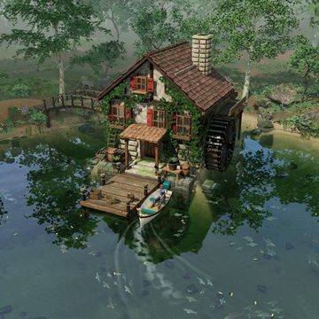</a> <a href="https://daiyixiang666.github.io/awesome-ai-video-prompts/en/w/web-2109312983402782988.html"><b>Still Water Cabin</b></a> Mohamed · Codex (GPT)</td>
<td width="25%" valign="top"><a href="https://daiyixiang666.github.io/awesome-ai-video-prompts/en/w/web-2105250266392224097.html">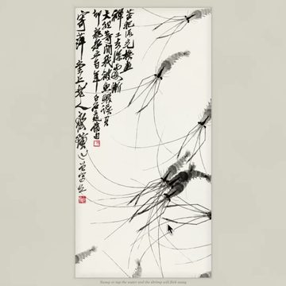</a> <a href="https://daiyixiang666.github.io/awesome-ai-video-prompts/en/w/web-2105250266392224097.html"><b>Qi Baishi&#x27;s Shrimp</b></a> Joshua Guo · Opus 5.5 (Claude)</td>
<td width="25%" valign="top"><a href="https://daiyixiang666.github.io/awesome-ai-video-prompts/en/w/web-2115175640198783107.html">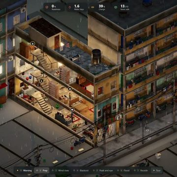</a> <a href="https://daiyixiang666.github.io/awesome-ai-video-prompts/en/w/web-2115175640198783107.html"><b>Vietnamese Tube House Typhoon</b></a> An Xuan · Opus 5.5 (Claude)</td>
</tr>
</table>

## Browse by tag

**Visual style**　[Cinematic realism](https://daiyixiang666.github.io/awesome-ai-video-prompts/en/t/style/cinematic-realism.html) 103 · [Surreal / dreamcore](https://daiyixiang666.github.io/awesome-ai-video-prompts/en/t/style/surreal-dream.html) 62 · [Film / retro](https://daiyixiang666.github.io/awesome-ai-video-prompts/en/t/style/film-retro.html) 41 · [Commercial / ad look](https://daiyixiang666.github.io/awesome-ai-video-prompts/en/t/style/commercial.html) 40 · [Documentary handheld](https://daiyixiang666.github.io/awesome-ai-video-prompts/en/t/style/documentary-handheld.html) 35 · [Watercolor storybook](https://daiyixiang666.github.io/awesome-ai-video-prompts/en/t/style/watercolor-storybook.html) 28 · [Game CG](https://daiyixiang666.github.io/awesome-ai-video-prompts/en/t/style/game-cg.html) 25 · [Anime](https://daiyixiang666.github.io/awesome-ai-video-prompts/en/t/style/anime.html) 24  
**Regional vibe**　[No specific region](https://daiyixiang666.github.io/awesome-ai-video-prompts/en/t/region/no-region.html) 130 · [European](https://daiyixiang666.github.io/awesome-ai-video-prompts/en/t/region/european.html) 61 · [Japanese](https://daiyixiang666.github.io/awesome-ai-video-prompts/en/t/region/japanese.html) 54 · [American](https://daiyixiang666.github.io/awesome-ai-video-prompts/en/t/region/american.html) 39 · [Chinese](https://daiyixiang666.github.io/awesome-ai-video-prompts/en/t/region/chinese.html) 19 · [Korean](https://daiyixiang666.github.io/awesome-ai-video-prompts/en/t/region/korean.html) 17 · [Other regions](https://daiyixiang666.github.io/awesome-ai-video-prompts/en/t/region/other-region.html) 14 · [Hong Kong](https://daiyixiang666.github.io/awesome-ai-video-prompts/en/t/region/hong-kong.html) 1  
**Genre**　[Daily life](https://daiyixiang666.github.io/awesome-ai-video-prompts/en/t/genre/daily-life.html) 72 · [Fantasy / myth](https://daiyixiang666.github.io/awesome-ai-video-prompts/en/t/genre/fantasy-myth.html) 65 · [Nature / landscape](https://daiyixiang666.github.io/awesome-ai-video-prompts/en/t/genre/nature.html) 36 · [Fashion / beauty](https://daiyixiang666.github.io/awesome-ai-video-prompts/en/t/genre/fashion-beauty.html) 36 · [Sci-fi](https://daiyixiang666.github.io/awesome-ai-video-prompts/en/t/genre/sci-fi.html) 33 · [Travel / city](https://daiyixiang666.github.io/awesome-ai-video-prompts/en/t/genre/travel-city.html) 33 · [Romance / youth](https://daiyixiang666.github.io/awesome-ai-video-prompts/en/t/genre/romance-youth.html) 29 · [Historical / period](https://daiyixiang666.github.io/awesome-ai-video-prompts/en/t/genre/historical.html) 25  
**Mood**　[Heartwarming](https://daiyixiang666.github.io/awesome-ai-video-prompts/en/t/mood/heartwarming.html) 76 · [Lonely / melancholy](https://daiyixiang666.github.io/awesome-ai-video-prompts/en/t/mood/melancholy.html) 73 · [Lighthearted](https://daiyixiang666.github.io/awesome-ai-video-prompts/en/t/mood/lighthearted.html) 56 · [Epic](https://daiyixiang666.github.io/awesome-ai-video-prompts/en/t/mood/epic.html) 53 · [Tense / thrilling](https://daiyixiang666.github.io/awesome-ai-video-prompts/en/t/mood/tense.html) 33 · [Hype / adrenaline](https://daiyixiang666.github.io/awesome-ai-video-prompts/en/t/mood/hype.html) 28 · [Romantic](https://daiyixiang666.github.io/awesome-ai-video-prompts/en/t/mood/romantic.html) 27 · [Eerie / unsettling](https://daiyixiang666.github.io/awesome-ai-video-prompts/en/t/mood/eerie.html) 26  
**Camera technique**　[Multi-shot edit](https://daiyixiang666.github.io/awesome-ai-video-prompts/en/t/technique/multi-shot.html) 92 · [One-take](https://daiyixiang666.github.io/awesome-ai-video-prompts/en/t/technique/one-take.html) 29 · [First-person POV](https://daiyixiang666.github.io/awesome-ai-video-prompts/en/t/technique/pov.html) 17 · [Character consistency](https://daiyixiang666.github.io/awesome-ai-video-prompts/en/t/technique/character-consistency.html) 16 · [Micro-expression close-up](https://daiyixiang666.github.io/awesome-ai-video-prompts/en/t/technique/micro-expression.html) 15 · [Transformation transition](https://daiyixiang666.github.io/awesome-ai-video-prompts/en/t/technique/transformation-transition.html) 13 · [Slow motion](https://daiyixiang666.github.io/awesome-ai-video-prompts/en/t/technique/slow-motion.html) 11 · [Beat-synced edit](https://daiyixiang666.github.io/awesome-ai-video-prompts/en/t/technique/beat-sync.html) 6  
**Use case**　[Narrative short](https://daiyixiang666.github.io/awesome-ai-video-prompts/en/t/use/short-film.html) 68 · [Vlog](https://daiyixiang666.github.io/awesome-ai-video-prompts/en/t/use/vlog.html) 38 · [Ad / TVC](https://daiyixiang666.github.io/awesome-ai-video-prompts/en/t/use/tvc.html) 18 · [Demo / tutorial](https://daiyixiang666.github.io/awesome-ai-video-prompts/en/t/use/demo-tutorial.html) 15 · [Trailer](https://daiyixiang666.github.io/awesome-ai-video-prompts/en/t/use/trailer.html) 11 · [Music video](https://daiyixiang666.github.io/awesome-ai-video-prompts/en/t/use/music-video.html) 10 · [Meme / sketch](https://daiyixiang666.github.io/awesome-ai-video-prompts/en/t/use/meme-sketch.html) 7  

## Curation

- Top-tier only: outstanding aesthetics and craft; no memes, thirst bait, reposts or tool promos.
- Video = AI video models only; Images = AI image models only; anything an LLM made by writing code (three.js, WebGL, code-rendered video) goes to Coding.
- Creators are always credited and linked; prompts are never invented.

## For agents & developers

[`works.json`](https://daiyixiang666.github.io/awesome-ai-video-prompts/works.json) · [`llms.txt`](https://daiyixiang666.github.io/awesome-ai-video-prompts/llms.txt) · [`sitemap.xml`](https://daiyixiang666.github.io/awesome-ai-video-prompts/sitemap.xml)

## Takedown

All works belong to their creators. Rights holders can email **yixiang@umich.edu** or open an issue and we will remove the work promptly.
