

# Jingjian · Awesome AI Video Prompts

**Hand-picked top-tier AI videos, images and AI-coded works with their prompts — searchable by style, mood and genre**

[Browse the site](https://daiyixiang666.github.io/awesome-ai-video-prompts/en/) · [Tags](https://daiyixiang666.github.io/awesome-ai-video-prompts/en/tags.html) · [中文](README.md) · [works.json](https://daiyixiang666.github.io/awesome-ai-video-prompts/works.json)

  

A hand-picked collection of AI works with outstanding aesthetics and craft, in three sections: **Video** (clips ≤60 s), **Images** and **Coding** (works an LLM built by writing code). Every work credits and links its creator, is tagged by style, regional vibe, genre, mood, camera technique and use case, and includes the full prompt whenever the creator published it.

## Video 147

Single short clips from AI video models (Seedance, Kling, Veo…). [See all →](https://daiyixiang666.github.io/awesome-ai-video-prompts/en/index.html)

<table>
<tr>
<td width="25%" valign="top"><a href="https://daiyixiang666.github.io/awesome-ai-video-prompts/en/w/x-2114193986789519859.html">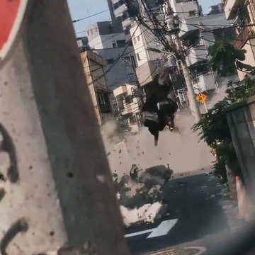</a> <a href="https://daiyixiang666.github.io/awesome-ai-video-prompts/en/w/x-2114193986789519859.html"><b>Gods Do Not Kneel</b></a> Timeless</td>
<td width="25%" valign="top"><a href="https://daiyixiang666.github.io/awesome-ai-video-prompts/en/w/x-2110753787287863579.html">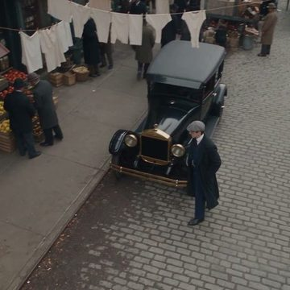</a> <a href="https://daiyixiang666.github.io/awesome-ai-video-prompts/en/w/x-2110753787287863579.html"><b>1920s in One Take</b></a> el.cine</td>
<td width="25%" valign="top"> <a href="https://daiyixiang666.github.io/awesome-ai-video-prompts/en/w/x-2114645514553528460.html"><b>Mushroom Under the Pencil</b></a> OscarAI</td>
<td width="25%" valign="top"><a href="https://daiyixiang666.github.io/awesome-ai-video-prompts/en/w/x-2107572909086761325.html">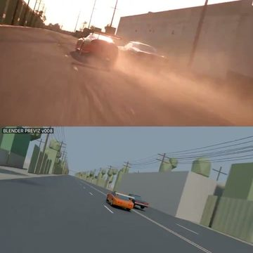</a> <a href="https://daiyixiang666.github.io/awesome-ai-video-prompts/en/w/x-2107572909086761325.html"><b>Street Race on Set</b></a> Rory Flynn · Seedance 2.5</td>
</tr>
<tr>
<td width="25%" valign="top"><a href="https://daiyixiang666.github.io/awesome-ai-video-prompts/en/w/x-2114761501819183337.html">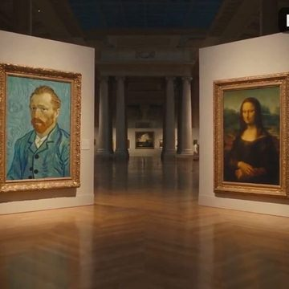</a> <a href="https://daiyixiang666.github.io/awesome-ai-video-prompts/en/w/x-2114761501819183337.html"><b>Masterpieces Elope at Night</b></a> Maria · Seedance 2.5</td>
<td width="25%" valign="top"> <a href="https://daiyixiang666.github.io/awesome-ai-video-prompts/en/w/x-2107345257495138416.html"><b>City Turned White Overnight</b></a> Nawal · Seedance 2.5</td>
<td width="25%" valign="top"><a href="https://daiyixiang666.github.io/awesome-ai-video-prompts/en/w/x-2106251329085874184.html">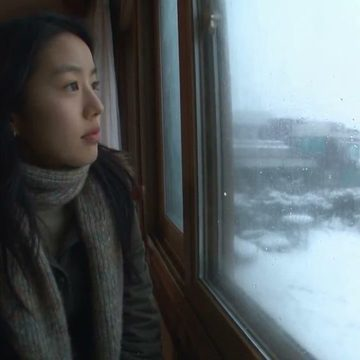</a> <a href="https://daiyixiang666.github.io/awesome-ai-video-prompts/en/w/x-2106251329085874184.html"><b>Seoul&#x27;s First Snow</b></a> Nawal · Seedance 2.5</td>
<td width="25%" valign="top"><a href="https://daiyixiang666.github.io/awesome-ai-video-prompts/en/w/x-2112055308701053088.html">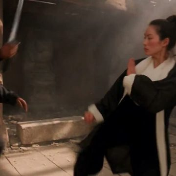</a> <a href="https://daiyixiang666.github.io/awesome-ai-video-prompts/en/w/x-2112055308701053088.html"><b>Duel in the Old Temple</b></a> Ali</td>
</tr>
</table>

## Images 36

Work from AI image models (Midjourney, GPT Image, Nano Banana…). [See all →](https://daiyixiang666.github.io/awesome-ai-video-prompts/en/images.html)

<table>
<tr>
<td width="25%" valign="top"><a href="https://daiyixiang666.github.io/awesome-ai-video-prompts/en/w/img-x-2085072970129576086.html">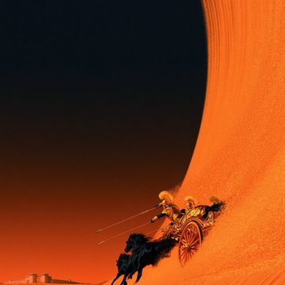</a> <a href="https://daiyixiang666.github.io/awesome-ai-video-prompts/en/w/img-x-2085072970129576086.html"><b>The Fall of Troy</b></a> Keskin</td>
<td width="25%" valign="top"><a href="https://daiyixiang666.github.io/awesome-ai-video-prompts/en/w/img-x-2098815974858281039.html">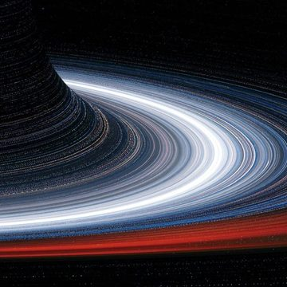</a> <a href="https://daiyixiang666.github.io/awesome-ai-video-prompts/en/w/img-x-2098815974858281039.html"><b>Beneath the Star Ring</b></a> Dogan Ural</td>
<td width="25%" valign="top"><a href="https://daiyixiang666.github.io/awesome-ai-video-prompts/en/w/img-x-2087569736582258701.html">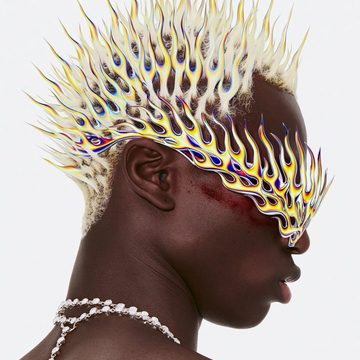</a> <a href="https://daiyixiang666.github.io/awesome-ai-video-prompts/en/w/img-x-2087569736582258701.html"><b>More and More Chrome</b></a> Sycomore · Midjourney</td>
<td width="25%" valign="top"><a href="https://daiyixiang666.github.io/awesome-ai-video-prompts/en/w/img-x-1592949889008533509.html">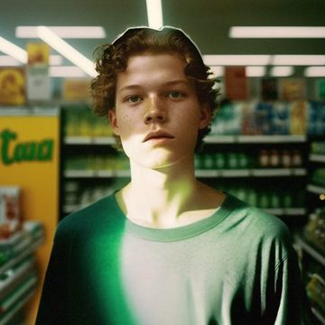</a> <a href="https://daiyixiang666.github.io/awesome-ai-video-prompts/en/w/img-x-1592949889008533509.html"><b>Love at First Aisle</b></a> Julie W. Design · Midjourney v4 + DALL·E 2</td>
</tr>
<tr>
<td width="25%" valign="top"><a href="https://daiyixiang666.github.io/awesome-ai-video-prompts/en/w/img-x-1745381736811475159.html">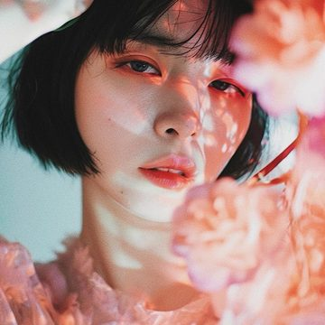</a> <a href="https://daiyixiang666.github.io/awesome-ai-video-prompts/en/w/img-x-1745381736811475159.html"><b>Girl in Flower Shadows</b></a> haru wagnus · Midjourney</td>
<td width="25%" valign="top"> <a href="https://daiyixiang666.github.io/awesome-ai-video-prompts/en/w/img-x-2067609069947420761.html"><b>Ribbons of Playing Field</b></a> Sycomore · Midjourney V8.1</td>
<td width="25%" valign="top"><a href="https://daiyixiang666.github.io/awesome-ai-video-prompts/en/w/img-x-2047629543608025121.html">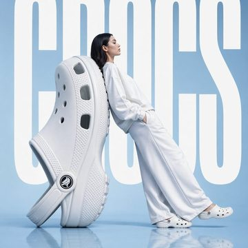</a> <a href="https://daiyixiang666.github.io/awesome-ai-video-prompts/en/w/img-x-2047629543608025121.html"><b>Crocs, Surreally Large</b></a> Heisenberg · GPT Image 2</td>
<td width="25%" valign="top"><a href="https://daiyixiang666.github.io/awesome-ai-video-prompts/en/w/img-x-2070438202855322089.html">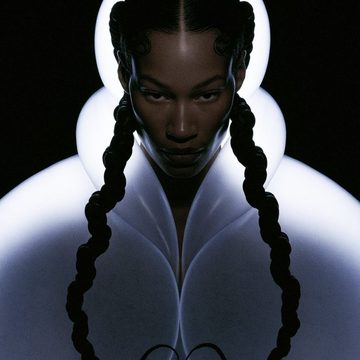</a> <a href="https://daiyixiang666.github.io/awesome-ai-video-prompts/en/w/img-x-2070438202855322089.html"><b>Sculptural Monochrome Portraits</b></a> Sycomore · Midjourney v8.2</td>
</tr>
</table>

## Coding 17

Works an LLM built by writing code (three.js, WebGL, shaders…), including code-rendered videos. [See all →](https://daiyixiang666.github.io/awesome-ai-video-prompts/en/coding.html)

<table>
<tr>
<td width="25%" valign="top"> <a href="https://daiyixiang666.github.io/awesome-ai-video-prompts/en/w/web-2114035463153742180.html"><b>The Pop-Up Energy Book</b></a> Techartist · Opus 5.5 (Claude)</td>
<td width="25%" valign="top"><a href="https://daiyixiang666.github.io/awesome-ai-video-prompts/en/w/web-2109718931409699043.html">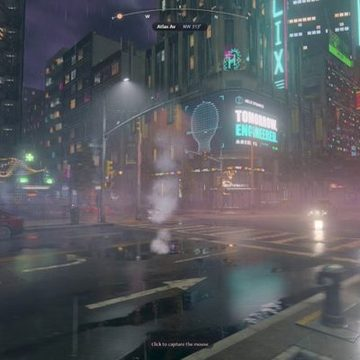</a> <a href="https://daiyixiang666.github.io/awesome-ai-video-prompts/en/w/web-2109718931409699043.html"><b>Neon City in One Run</b></a> Ainthropos · Opus 5.5 (Claude) + Blender MCP</td>
<td width="25%" valign="top"><a href="https://daiyixiang666.github.io/awesome-ai-video-prompts/en/w/web-2111907592129671505.html">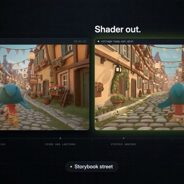</a> <a href="https://daiyixiang666.github.io/awesome-ai-video-prompts/en/w/web-2111907592129671505.html"><b>Video Into Shader</b></a> gokaygokay · Claude Opus 5.5</td>
<td width="25%" valign="top"> <a href="https://daiyixiang666.github.io/awesome-ai-video-prompts/en/w/web-2114370856810107201.html"><b>Physics Campfire</b></a> Leon Lin · Opus 5.5 (Claude)</td>
</tr>
<tr>
<td width="25%" valign="top"><a href="https://daiyixiang666.github.io/awesome-ai-video-prompts/en/w/web-2107285581109547516.html">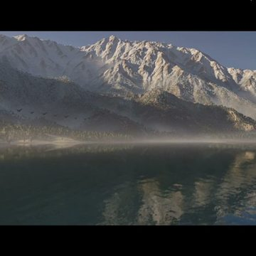</a> <a href="https://daiyixiang666.github.io/awesome-ai-video-prompts/en/w/web-2107285581109547516.html"><b>Impressionist Mountain Lake</b></a> Brian Gruber · Opus 5.5 (Claude)</td>
<td width="25%" valign="top"><a href="https://daiyixiang666.github.io/awesome-ai-video-prompts/en/w/web-2102760783344189761.html">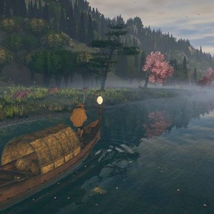</a> <a href="https://daiyixiang666.github.io/awesome-ai-video-prompts/en/w/web-2102760783344189761.html"><b>Night Boat, Cherry River</b></a> Meng To · Claude Opus 5.5</td>
<td width="25%" valign="top"><a href="https://daiyixiang666.github.io/awesome-ai-video-prompts/en/w/web-2107996576228753545.html">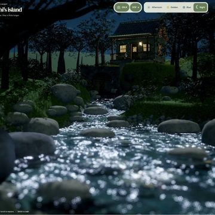</a> <a href="https://daiyixiang666.github.io/awesome-ai-video-prompts/en/w/web-2107996576228753545.html"><b>Moonlit Creek Stones</b></a> Chetan Ankola · GPT-6 Astra</td>
<td width="25%" valign="top"><a href="https://daiyixiang666.github.io/awesome-ai-video-prompts/en/w/web-2096263046918197609.html">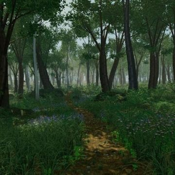</a> <a href="https://daiyixiang666.github.io/awesome-ai-video-prompts/en/w/web-2096263046918197609.html"><b>Verdant Forest</b></a> Leon Lin · GPT-6 Astra</td>
</tr>
</table>

## Browse by tag

**Visual style**　[Cinematic realism](https://daiyixiang666.github.io/awesome-ai-video-prompts/en/t/style/cinematic-realism.html) 81 · [Documentary handheld](https://daiyixiang666.github.io/awesome-ai-video-prompts/en/t/style/documentary-handheld.html) 31 · [Film / retro](https://daiyixiang666.github.io/awesome-ai-video-prompts/en/t/style/film-retro.html) 28 · [Commercial / ad look](https://daiyixiang666.github.io/awesome-ai-video-prompts/en/t/style/commercial.html) 26 · [Surreal / dreamcore](https://daiyixiang666.github.io/awesome-ai-video-prompts/en/t/style/surreal-dream.html) 21 · [Game CG](https://daiyixiang666.github.io/awesome-ai-video-prompts/en/t/style/game-cg.html) 14 · [Black and white](https://daiyixiang666.github.io/awesome-ai-video-prompts/en/t/style/black-and-white.html) 8 · [3D cartoon](https://daiyixiang666.github.io/awesome-ai-video-prompts/en/t/style/3d-cartoon.html) 7  
**Regional vibe**　[No specific region](https://daiyixiang666.github.io/awesome-ai-video-prompts/en/t/region/no-region.html) 65 · [Japanese](https://daiyixiang666.github.io/awesome-ai-video-prompts/en/t/region/japanese.html) 41 · [European](https://daiyixiang666.github.io/awesome-ai-video-prompts/en/t/region/european.html) 35 · [American](https://daiyixiang666.github.io/awesome-ai-video-prompts/en/t/region/american.html) 27 · [Korean](https://daiyixiang666.github.io/awesome-ai-video-prompts/en/t/region/korean.html) 17 · [Chinese](https://daiyixiang666.github.io/awesome-ai-video-prompts/en/t/region/chinese.html) 12 · [Other regions](https://daiyixiang666.github.io/awesome-ai-video-prompts/en/t/region/other-region.html) 2 · [Hong Kong](https://daiyixiang666.github.io/awesome-ai-video-prompts/en/t/region/hong-kong.html) 1  
**Genre**　[Daily life](https://daiyixiang666.github.io/awesome-ai-video-prompts/en/t/genre/daily-life.html) 51 · [Fantasy / myth](https://daiyixiang666.github.io/awesome-ai-video-prompts/en/t/genre/fantasy-myth.html) 30 · [Romance / youth](https://daiyixiang666.github.io/awesome-ai-video-prompts/en/t/genre/romance-youth.html) 24 · [Travel / city](https://daiyixiang666.github.io/awesome-ai-video-prompts/en/t/genre/travel-city.html) 23 · [Product](https://daiyixiang666.github.io/awesome-ai-video-prompts/en/t/genre/product.html) 20 · [Fashion / beauty](https://daiyixiang666.github.io/awesome-ai-video-prompts/en/t/genre/fashion-beauty.html) 20 · [Nature / landscape](https://daiyixiang666.github.io/awesome-ai-video-prompts/en/t/genre/nature.html) 17 · [Historical / period](https://daiyixiang666.github.io/awesome-ai-video-prompts/en/t/genre/historical.html) 16  
**Mood**　[Heartwarming](https://daiyixiang666.github.io/awesome-ai-video-prompts/en/t/mood/heartwarming.html) 47 · [Lighthearted](https://daiyixiang666.github.io/awesome-ai-video-prompts/en/t/mood/lighthearted.html) 41 · [Lonely / melancholy](https://daiyixiang666.github.io/awesome-ai-video-prompts/en/t/mood/melancholy.html) 39 · [Epic](https://daiyixiang666.github.io/awesome-ai-video-prompts/en/t/mood/epic.html) 28 · [Tense / thrilling](https://daiyixiang666.github.io/awesome-ai-video-prompts/en/t/mood/tense.html) 25 · [Romantic](https://daiyixiang666.github.io/awesome-ai-video-prompts/en/t/mood/romantic.html) 18 · [Hype / adrenaline](https://daiyixiang666.github.io/awesome-ai-video-prompts/en/t/mood/hype.html) 15 · [Eerie / unsettling](https://daiyixiang666.github.io/awesome-ai-video-prompts/en/t/mood/eerie.html) 9  
**Camera technique**　[Multi-shot edit](https://daiyixiang666.github.io/awesome-ai-video-prompts/en/t/technique/multi-shot.html) 86 · [One-take](https://daiyixiang666.github.io/awesome-ai-video-prompts/en/t/technique/one-take.html) 28 · [First-person POV](https://daiyixiang666.github.io/awesome-ai-video-prompts/en/t/technique/pov.html) 16 · [Micro-expression close-up](https://daiyixiang666.github.io/awesome-ai-video-prompts/en/t/technique/micro-expression.html) 14 · [Transformation transition](https://daiyixiang666.github.io/awesome-ai-video-prompts/en/t/technique/transformation-transition.html) 12 · [Character consistency](https://daiyixiang666.github.io/awesome-ai-video-prompts/en/t/technique/character-consistency.html) 12 · [Slow motion](https://daiyixiang666.github.io/awesome-ai-video-prompts/en/t/technique/slow-motion.html) 11 · [Orbit shot](https://daiyixiang666.github.io/awesome-ai-video-prompts/en/t/technique/orbit-shot.html) 4  
**Use case**　[Narrative short](https://daiyixiang666.github.io/awesome-ai-video-prompts/en/t/use/short-film.html) 60 · [Vlog](https://daiyixiang666.github.io/awesome-ai-video-prompts/en/t/use/vlog.html) 38 · [Ad / TVC](https://daiyixiang666.github.io/awesome-ai-video-prompts/en/t/use/tvc.html) 18 · [Demo / tutorial](https://daiyixiang666.github.io/awesome-ai-video-prompts/en/t/use/demo-tutorial.html) 10 · [Trailer](https://daiyixiang666.github.io/awesome-ai-video-prompts/en/t/use/trailer.html) 8 · [Meme / sketch](https://daiyixiang666.github.io/awesome-ai-video-prompts/en/t/use/meme-sketch.html) 7 · [Music video](https://daiyixiang666.github.io/awesome-ai-video-prompts/en/t/use/music-video.html) 6  

## Curation

- Top-tier only: outstanding aesthetics and craft; no memes, thirst bait, reposts or tool promos.
- Video = AI video models only; Images = AI image models only; anything an LLM made by writing code (three.js, WebGL, code-rendered video) goes to Coding.
- Creators are always credited and linked; prompts are never invented.

## For agents & developers

[`works.json`](https://daiyixiang666.github.io/awesome-ai-video-prompts/works.json) · [`llms.txt`](https://daiyixiang666.github.io/awesome-ai-video-prompts/llms.txt) · [`sitemap.xml`](https://daiyixiang666.github.io/awesome-ai-video-prompts/sitemap.xml)

## Takedown

All works belong to their creators. Rights holders can email **yixiang@umich.edu** or open an issue and we will remove the work promptly.
