

# Jingjian · Awesome AI Video Prompts

**Hand-picked top-tier AI videos, images and AI-coded works with their prompts — searchable by style, mood and genre**

[Browse the site](https://daiyixiang666.github.io/awesome-ai-video-prompts/en/) · [Tags](https://daiyixiang666.github.io/awesome-ai-video-prompts/en/tags.html) · [中文](README.md) · [works.json](https://daiyixiang666.github.io/awesome-ai-video-prompts/works.json)

  

A hand-picked collection of AI works with outstanding aesthetics and craft, in three sections: **Video** (clips ≤60 s), **Images** and **Coding** (works an LLM built by writing code). Every work credits and links its creator, is tagged by style, regional vibe, genre, mood, camera technique and use case, and includes the full prompt whenever the creator published it.

## Video 122

Single short clips from AI video models (Seedance, Kling, Veo…). [See all →](https://daiyixiang666.github.io/awesome-ai-video-prompts/en/index.html)

<table>
<tr>
<td width="25%" valign="top"><a href="https://daiyixiang666.github.io/awesome-ai-video-prompts/en/w/x-2103947617227194791.html">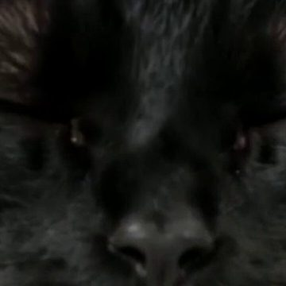</a> <a href="https://daiyixiang666.github.io/awesome-ai-video-prompts/en/w/x-2103947617227194791.html"><b>Introducing Finn the Cat</b></a> Justine Moore · Seedance 2.5</td>
<td width="25%" valign="top"> <a href="https://daiyixiang666.github.io/awesome-ai-video-prompts/en/w/x-2087395593442504937.html"><b>Laughing Until the Tears Come</b></a> KRAQ VOID · Seedance 2.5</td>
<td width="25%" valign="top"><a href="https://daiyixiang666.github.io/awesome-ai-video-prompts/en/w/x-2093574426642264501.html">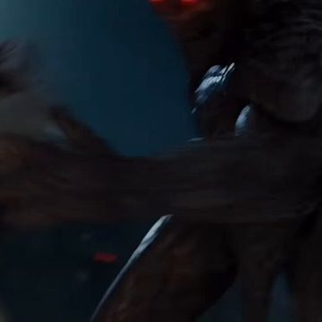</a> <a href="https://daiyixiang666.github.io/awesome-ai-video-prompts/en/w/x-2093574426642264501.html"><b>Swallowing the Sword, Becoming Seraph</b></a> Sᴀɪʀᴀ · Seedance 2.0</td>
<td width="25%" valign="top"><a href="https://daiyixiang666.github.io/awesome-ai-video-prompts/en/w/x-2071174186978951379.html">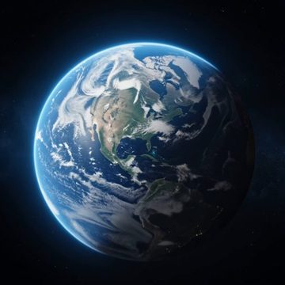</a> <a href="https://daiyixiang666.github.io/awesome-ai-video-prompts/en/w/x-2071174186978951379.html"><b>From Orbit to Coffee Table</b></a> simeon-sanai · Seedance 2.0</td>
</tr>
<tr>
<td width="25%" valign="top"><a href="https://daiyixiang666.github.io/awesome-ai-video-prompts/en/w/x-2090568539325317401.html">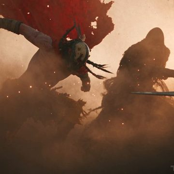</a> <a href="https://daiyixiang666.github.io/awesome-ai-video-prompts/en/w/x-2090568539325317401.html"><b>Duel with Death in the Desert</b></a> TechHalla · Seedance 2.5</td>
<td width="25%" valign="top"><a href="https://daiyixiang666.github.io/awesome-ai-video-prompts/en/w/x-2111670428733452289.html">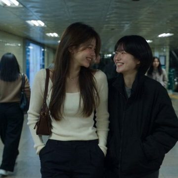</a> <a href="https://daiyixiang666.github.io/awesome-ai-video-prompts/en/w/x-2111670428733452289.html"><b>Stepping In at the Subway</b></a> 𝗦𝗮𝗻𝗶𝗮 · Seedance 2.5</td>
<td width="25%" valign="top"><a href="https://daiyixiang666.github.io/awesome-ai-video-prompts/en/w/x-2013359530919223703.html">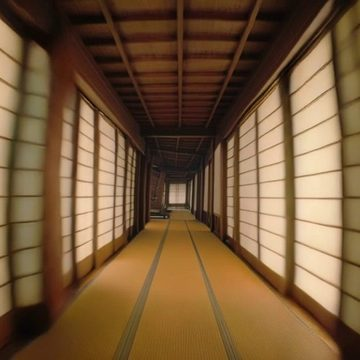</a> <a href="https://daiyixiang666.github.io/awesome-ai-video-prompts/en/w/x-2013359530919223703.html"><b>Falling Through the Wooden Fortress</b></a> MayorkingAI · Kling 2.6</td>
<td width="25%" valign="top"><a href="https://daiyixiang666.github.io/awesome-ai-video-prompts/en/w/x-2089969922617266257.html">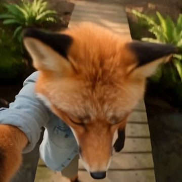</a> <a href="https://daiyixiang666.github.io/awesome-ai-video-prompts/en/w/x-2089969922617266257.html"><b>A Fox&#x27;s Creekside Vlog</b></a> Mr Das · Seedance 2.5</td>
</tr>
</table>

## Images 36

Work from AI image models (Midjourney, GPT Image, Nano Banana…). [See all →](https://daiyixiang666.github.io/awesome-ai-video-prompts/en/images.html)

<table>
<tr>
<td width="25%" valign="top"> <a href="https://daiyixiang666.github.io/awesome-ai-video-prompts/en/w/img-x-2085072970129576086.html"><b>The Fall of Troy</b></a> Keskin</td>
<td width="25%" valign="top"> <a href="https://daiyixiang666.github.io/awesome-ai-video-prompts/en/w/img-x-2098815974858281039.html"><b>Beneath the Star Ring</b></a> Dogan Ural</td>
<td width="25%" valign="top"> <a href="https://daiyixiang666.github.io/awesome-ai-video-prompts/en/w/img-x-2087569736582258701.html"><b>More and More Chrome</b></a> Sycomore · Midjourney</td>
<td width="25%" valign="top"> <a href="https://daiyixiang666.github.io/awesome-ai-video-prompts/en/w/img-x-1592949889008533509.html"><b>Love at First Aisle</b></a> Julie W. Design · Midjourney v4 + DALL·E 2</td>
</tr>
<tr>
<td width="25%" valign="top"> <a href="https://daiyixiang666.github.io/awesome-ai-video-prompts/en/w/img-x-1745381736811475159.html"><b>Girl in Flower Shadows</b></a> haru wagnus · Midjourney</td>
<td width="25%" valign="top"> <a href="https://daiyixiang666.github.io/awesome-ai-video-prompts/en/w/img-x-2067609069947420761.html"><b>Ribbons of Playing Field</b></a> Sycomore · Midjourney V8.1</td>
<td width="25%" valign="top"> <a href="https://daiyixiang666.github.io/awesome-ai-video-prompts/en/w/img-x-2047629543608025121.html"><b>Crocs, Surreally Large</b></a> Heisenberg · GPT Image 2</td>
<td width="25%" valign="top"> <a href="https://daiyixiang666.github.io/awesome-ai-video-prompts/en/w/img-x-2070438202855322089.html"><b>Sculptural Monochrome Portraits</b></a> Sycomore · Midjourney v8.2</td>
</tr>
</table>

## Coding 12

Works an LLM built by writing code (three.js, WebGL, shaders…), including code-rendered videos. [See all →](https://daiyixiang666.github.io/awesome-ai-video-prompts/en/coding.html)

<table>
<tr>
<td width="25%" valign="top"> <a href="https://daiyixiang666.github.io/awesome-ai-video-prompts/en/w/web-2102760783344189761.html"><b>Night Boat, Cherry River</b></a> Meng To · Claude Opus 5.5</td>
<td width="25%" valign="top"> <a href="https://daiyixiang666.github.io/awesome-ai-video-prompts/en/w/web-2107996576228753545.html"><b>Moonlit Creek Stones</b></a> Chetan Ankola · GPT-6 Astra</td>
<td width="25%" valign="top"> <a href="https://daiyixiang666.github.io/awesome-ai-video-prompts/en/w/web-2096263046918197609.html"><b>Verdant Forest</b></a> Leon Lin · GPT-6 Astra</td>
<td width="25%" valign="top"><a href="https://daiyixiang666.github.io/awesome-ai-video-prompts/en/w/web-2106267572136198461.html">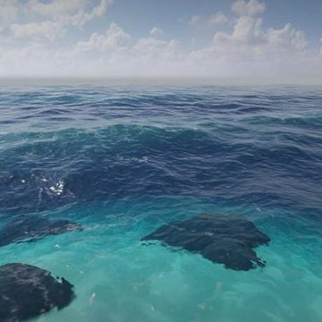</a> <a href="https://daiyixiang666.github.io/awesome-ai-video-prompts/en/w/web-2106267572136198461.html"><b>Nagi, Watching Waves</b></a> Noxel · OpenAI（作者称“dotくん”）</td>
</tr>
<tr>
<td width="25%" valign="top"><a href="https://daiyixiang666.github.io/awesome-ai-video-prompts/en/w/web-2111582260818239777.html">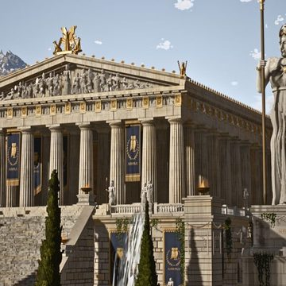</a> <a href="https://daiyixiang666.github.io/awesome-ai-video-prompts/en/w/web-2111582260818239777.html"><b>City of Athena</b></a> Leon Lin · Claude Code (Claude Opus 5.5)</td>
<td width="25%" valign="top"><a href="https://daiyixiang666.github.io/awesome-ai-video-prompts/en/w/web-2104381179151753464.html">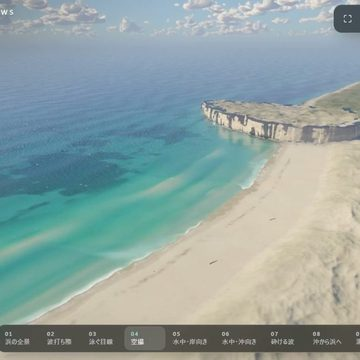</a> <a href="https://daiyixiang666.github.io/awesome-ai-video-prompts/en/w/web-2104381179151753464.html"><b>Light of the Shallows</b></a> ついはじめ | Hajime Tsui · Claude Code (Claude Opus 5.5)</td>
<td width="25%" valign="top"><a href="https://daiyixiang666.github.io/awesome-ai-video-prompts/en/w/web-2074283600103571575.html">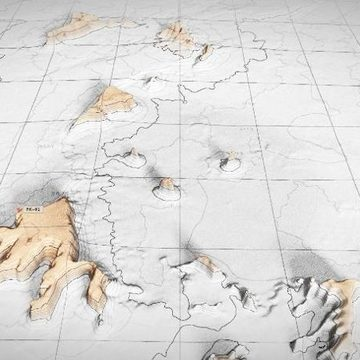</a> <a href="https://daiyixiang666.github.io/awesome-ai-video-prompts/en/w/web-2074283600103571575.html"><b>Contour Earth</b></a> Zsolt Kacso · Claude Code (Fable)</td>
<td width="25%" valign="top"><a href="https://daiyixiang666.github.io/awesome-ai-video-prompts/en/w/web-2077547125668188459.html">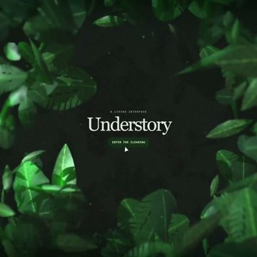</a> <a href="https://daiyixiang666.github.io/awesome-ai-video-prompts/en/w/web-2077547125668188459.html"><b>Understory</b></a> Zsolt Kacso · GPT-5.6 Sol</td>
</tr>
</table>

## Browse by tag

**Visual style**　[Cinematic realism](https://daiyixiang666.github.io/awesome-ai-video-prompts/en/t/style/cinematic-realism.html) 64 · [Documentary handheld](https://daiyixiang666.github.io/awesome-ai-video-prompts/en/t/style/documentary-handheld.html) 29 · [Film / retro](https://daiyixiang666.github.io/awesome-ai-video-prompts/en/t/style/film-retro.html) 28 · [Commercial / ad look](https://daiyixiang666.github.io/awesome-ai-video-prompts/en/t/style/commercial.html) 26 · [Surreal / dreamcore](https://daiyixiang666.github.io/awesome-ai-video-prompts/en/t/style/surreal-dream.html) 16 · [Game CG](https://daiyixiang666.github.io/awesome-ai-video-prompts/en/t/style/game-cg.html) 13 · [Black and white](https://daiyixiang666.github.io/awesome-ai-video-prompts/en/t/style/black-and-white.html) 8 · [3D cartoon](https://daiyixiang666.github.io/awesome-ai-video-prompts/en/t/style/3d-cartoon.html) 3  
**Regional vibe**　[No specific region](https://daiyixiang666.github.io/awesome-ai-video-prompts/en/t/region/no-region.html) 52 · [Japanese](https://daiyixiang666.github.io/awesome-ai-video-prompts/en/t/region/japanese.html) 38 · [European](https://daiyixiang666.github.io/awesome-ai-video-prompts/en/t/region/european.html) 29 · [American](https://daiyixiang666.github.io/awesome-ai-video-prompts/en/t/region/american.html) 23 · [Korean](https://daiyixiang666.github.io/awesome-ai-video-prompts/en/t/region/korean.html) 16 · [Chinese](https://daiyixiang666.github.io/awesome-ai-video-prompts/en/t/region/chinese.html) 10 · [Other regions](https://daiyixiang666.github.io/awesome-ai-video-prompts/en/t/region/other-region.html) 1 · [Hong Kong](https://daiyixiang666.github.io/awesome-ai-video-prompts/en/t/region/hong-kong.html) 1  
**Genre**　[Daily life](https://daiyixiang666.github.io/awesome-ai-video-prompts/en/t/genre/daily-life.html) 47 · [Romance / youth](https://daiyixiang666.github.io/awesome-ai-video-prompts/en/t/genre/romance-youth.html) 23 · [Fantasy / myth](https://daiyixiang666.github.io/awesome-ai-video-prompts/en/t/genre/fantasy-myth.html) 21 · [Fashion / beauty](https://daiyixiang666.github.io/awesome-ai-video-prompts/en/t/genre/fashion-beauty.html) 20 · [Travel / city](https://daiyixiang666.github.io/awesome-ai-video-prompts/en/t/genre/travel-city.html) 19 · [Product](https://daiyixiang666.github.io/awesome-ai-video-prompts/en/t/genre/product.html) 19 · [Historical / period](https://daiyixiang666.github.io/awesome-ai-video-prompts/en/t/genre/historical.html) 15 · [Nature / landscape](https://daiyixiang666.github.io/awesome-ai-video-prompts/en/t/genre/nature.html) 14  
**Mood**　[Heartwarming](https://daiyixiang666.github.io/awesome-ai-video-prompts/en/t/mood/heartwarming.html) 39 · [Lonely / melancholy](https://daiyixiang666.github.io/awesome-ai-video-prompts/en/t/mood/melancholy.html) 35 · [Lighthearted](https://daiyixiang666.github.io/awesome-ai-video-prompts/en/t/mood/lighthearted.html) 32 · [Tense / thrilling](https://daiyixiang666.github.io/awesome-ai-video-prompts/en/t/mood/tense.html) 22 · [Epic](https://daiyixiang666.github.io/awesome-ai-video-prompts/en/t/mood/epic.html) 21 · [Romantic](https://daiyixiang666.github.io/awesome-ai-video-prompts/en/t/mood/romantic.html) 16 · [Hype / adrenaline](https://daiyixiang666.github.io/awesome-ai-video-prompts/en/t/mood/hype.html) 11 · [Eerie / unsettling](https://daiyixiang666.github.io/awesome-ai-video-prompts/en/t/mood/eerie.html) 9  
**Camera technique**　[Multi-shot edit](https://daiyixiang666.github.io/awesome-ai-video-prompts/en/t/technique/multi-shot.html) 74 · [One-take](https://daiyixiang666.github.io/awesome-ai-video-prompts/en/t/technique/one-take.html) 21 · [First-person POV](https://daiyixiang666.github.io/awesome-ai-video-prompts/en/t/technique/pov.html) 13 · [Micro-expression close-up](https://daiyixiang666.github.io/awesome-ai-video-prompts/en/t/technique/micro-expression.html) 11 · [Transformation transition](https://daiyixiang666.github.io/awesome-ai-video-prompts/en/t/technique/transformation-transition.html) 10 · [Slow motion](https://daiyixiang666.github.io/awesome-ai-video-prompts/en/t/technique/slow-motion.html) 10 · [Character consistency](https://daiyixiang666.github.io/awesome-ai-video-prompts/en/t/technique/character-consistency.html) 8 · [Storyboard grid](https://daiyixiang666.github.io/awesome-ai-video-prompts/en/t/technique/storyboard-grid.html) 4  
**Use case**　[Narrative short](https://daiyixiang666.github.io/awesome-ai-video-prompts/en/t/use/short-film.html) 45 · [Vlog](https://daiyixiang666.github.io/awesome-ai-video-prompts/en/t/use/vlog.html) 34 · [Ad / TVC](https://daiyixiang666.github.io/awesome-ai-video-prompts/en/t/use/tvc.html) 18 · [Trailer](https://daiyixiang666.github.io/awesome-ai-video-prompts/en/t/use/trailer.html) 8 · [Demo / tutorial](https://daiyixiang666.github.io/awesome-ai-video-prompts/en/t/use/demo-tutorial.html) 8 · [Music video](https://daiyixiang666.github.io/awesome-ai-video-prompts/en/t/use/music-video.html) 5 · [Meme / sketch](https://daiyixiang666.github.io/awesome-ai-video-prompts/en/t/use/meme-sketch.html) 4  

## Curation

- Top-tier only: outstanding aesthetics and craft; no memes, thirst bait, reposts or tool promos.
- Video = AI video models only; Images = AI image models only; anything an LLM made by writing code (three.js, WebGL, code-rendered video) goes to Coding.
- Creators are always credited and linked; prompts are never invented.

## For agents & developers

[`works.json`](https://daiyixiang666.github.io/awesome-ai-video-prompts/works.json) · [`llms.txt`](https://daiyixiang666.github.io/awesome-ai-video-prompts/llms.txt) · [`sitemap.xml`](https://daiyixiang666.github.io/awesome-ai-video-prompts/sitemap.xml)

## Takedown

All works belong to their creators. Rights holders can email **yixiang@umich.edu** or open an issue and we will remove the work promptly.
