

# Jingjian · Awesome AI Video Prompts

**Hand-picked top-tier AI videos, images and AI-coded works with their prompts — searchable by style, mood and genre**

[Browse the site](https://daiyixiang666.github.io/awesome-ai-video-prompts/en/) · [Tags](https://daiyixiang666.github.io/awesome-ai-video-prompts/en/tags.html) · [Submit](https://github.com/daiyixiang666/awesome-ai-video-prompts/issues/new?template=submit.yml) · [中文](README.md) · [works.json](https://daiyixiang666.github.io/awesome-ai-video-prompts/works.json)

  

A hand-picked collection of AI works with outstanding aesthetics and craft, in three sections: **Video** (clips ≤60 s), **Images** and **Coding** (works an LLM built by writing code). Every work credits and links its creator, is tagged by style, regional vibe, genre, mood, camera technique and use case, and includes the full prompt whenever the creator published it.

## Video 206

Single short clips from AI video models (Seedance, Kling, Veo…). [See all →](https://daiyixiang666.github.io/awesome-ai-video-prompts/en/index.html)

<table>
<tr>
<td width="25%" valign="top"><a href="https://daiyixiang666.github.io/awesome-ai-video-prompts/en/w/tt-7542187538107075895.html">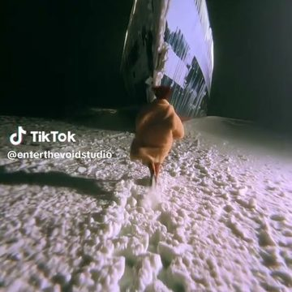</a> <a href="https://daiyixiang666.github.io/awesome-ai-video-prompts/en/w/tt-7542187538107075895.html"><b>Nowhere Place</b></a> Enter The Void · Midjourney Video</td>
<td width="25%" valign="top"><a href="https://daiyixiang666.github.io/awesome-ai-video-prompts/en/w/tt-7541962635017784590.html">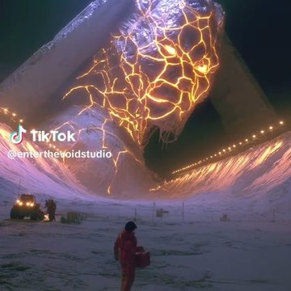</a> <a href="https://daiyixiang666.github.io/awesome-ai-video-prompts/en/w/tt-7541962635017784590.html"><b>Ice Demon</b></a> Enter The Void · Midjourney Video</td>
<td width="25%" valign="top"><a href="https://daiyixiang666.github.io/awesome-ai-video-prompts/en/w/x-2115870219562348882.html">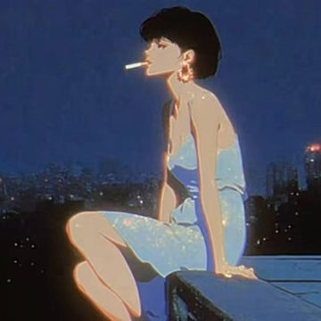</a> <a href="https://daiyixiang666.github.io/awesome-ai-video-prompts/en/w/x-2115870219562348882.html"><b>Rooftop Night</b></a> katt latte 🪩</td>
<td width="25%" valign="top"><a href="https://daiyixiang666.github.io/awesome-ai-video-prompts/en/w/x-2116565003742613955.html">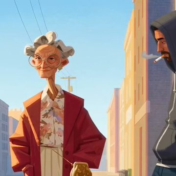</a> <a href="https://daiyixiang666.github.io/awesome-ai-video-prompts/en/w/x-2116565003742613955.html"><b>The Smoke-Busting Grandma</b></a> VERT · PixVerse</td>
</tr>
<tr>
<td width="25%" valign="top"><a href="https://daiyixiang666.github.io/awesome-ai-video-prompts/en/w/x-2119552672198197689.html">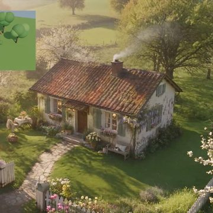</a> <a href="https://daiyixiang666.github.io/awesome-ai-video-prompts/en/w/x-2119552672198197689.html"><b>From Blender Blockout to Cottage</b></a> Eric Ker · Seedance (Blender + Claude)</td>
<td width="25%" valign="top"><a href="https://daiyixiang666.github.io/awesome-ai-video-prompts/en/w/x-2119812414254592011.html">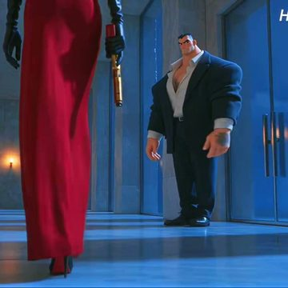</a> <a href="https://daiyixiang666.github.io/awesome-ai-video-prompts/en/w/x-2119812414254592011.html"><b>Only Us Right Now</b></a> Dyyhoang · Seedance 2.5</td>
<td width="25%" valign="top"><a href="https://daiyixiang666.github.io/awesome-ai-video-prompts/en/w/x-2116910642670207471.html">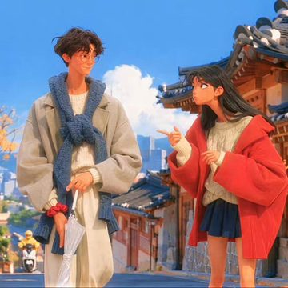</a> <a href="https://daiyixiang666.github.io/awesome-ai-video-prompts/en/w/x-2116910642670207471.html"><b>He Never Said I Love You</b></a> Dyyhoang · Seedance 2.5 (ImagineArt)</td>
<td width="25%" valign="top"><a href="https://daiyixiang666.github.io/awesome-ai-video-prompts/en/w/x-2121797307306000571.html">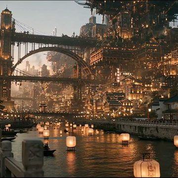</a> <a href="https://daiyixiang666.github.io/awesome-ai-video-prompts/en/w/x-2121797307306000571.html"><b>City of Lantern Rivers</b></a> はさまるスタジオ (Hasamaru Studio)</td>
</tr>
</table>

## Images 276

Work from AI image models (Midjourney, GPT Image, Nano Banana…). [See all →](https://daiyixiang666.github.io/awesome-ai-video-prompts/en/images.html)

<table>
<tr>
<td width="25%" valign="top"> <a href="https://daiyixiang666.github.io/awesome-ai-video-prompts/en/w/img-x-2114701970724286896.html"><b>Tattooed Monk Portrait</b></a> Ege Berkina</td>
<td width="25%" valign="top"><a href="https://daiyixiang666.github.io/awesome-ai-video-prompts/en/w/img-x-2122199044969881917.html">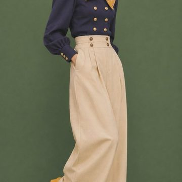</a> <a href="https://daiyixiang666.github.io/awesome-ai-video-prompts/en/w/img-x-2122199044969881917.html"><b>Retro Seventies Fashion Editorial</b></a> HPJJ</td>
<td width="25%" valign="top"> <a href="https://daiyixiang666.github.io/awesome-ai-video-prompts/en/w/img-x-2120971278165414385.html"><b>16K Star Ring Panorama</b></a> Dogan Ural</td>
<td width="25%" valign="top"><a href="https://daiyixiang666.github.io/awesome-ai-video-prompts/en/w/img-x-2120196920610296030.html">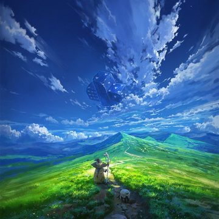</a> <a href="https://daiyixiang666.github.io/awesome-ai-video-prompts/en/w/img-x-2120196920610296030.html"><b>Setting Out</b></a> CycleCircle</td>
</tr>
<tr>
<td width="25%" valign="top"><a href="https://daiyixiang666.github.io/awesome-ai-video-prompts/en/w/img-x-2120280841968398604.html">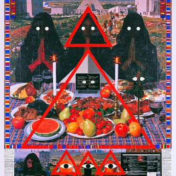</a> <a href="https://daiyixiang666.github.io/awesome-ai-video-prompts/en/w/img-x-2120280841968398604.html"><b>Fear and Worship</b></a> BLΛC</td>
<td width="25%" valign="top"><a href="https://daiyixiang666.github.io/awesome-ai-video-prompts/en/w/img-x-2114820892253462781.html">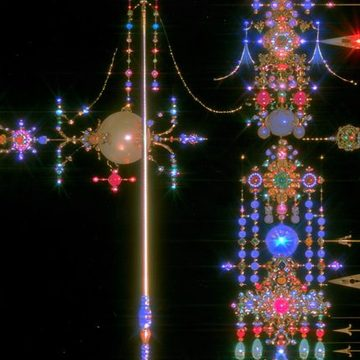</a> <a href="https://daiyixiang666.github.io/awesome-ai-video-prompts/en/w/img-x-2114820892253462781.html"><b>Celestial Relics</b></a> ʇʞz</td>
<td width="25%" valign="top"><a href="https://daiyixiang666.github.io/awesome-ai-video-prompts/en/w/img-x-2121242949313028595.html">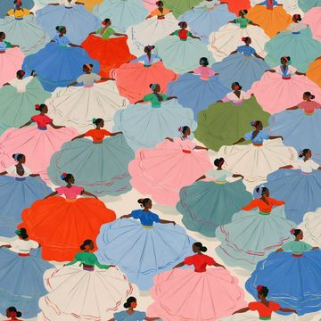</a> <a href="https://daiyixiang666.github.io/awesome-ai-video-prompts/en/w/img-x-2121242949313028595.html"><b>Cuban Postcards</b></a> Ege · Midjourney</td>
<td width="25%" valign="top"><a href="https://daiyixiang666.github.io/awesome-ai-video-prompts/en/w/img-x-2114394223604629600.html">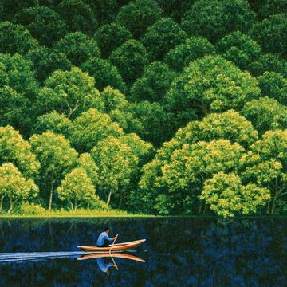</a> <a href="https://daiyixiang666.github.io/awesome-ai-video-prompts/en/w/img-x-2114394223604629600.html"><b>Boat on a Moonlit Lake</b></a> unseenai</td>
</tr>
</table>

## Coding 35

Works an LLM built by writing code (three.js, WebGL, shaders…), including code-rendered videos. [See all →](https://daiyixiang666.github.io/awesome-ai-video-prompts/en/coding.html)

<table>
<tr>
<td width="25%" valign="top"><a href="https://daiyixiang666.github.io/awesome-ai-video-prompts/en/w/web-2117659337057517831.html">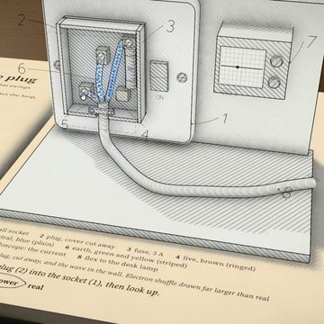</a> <a href="https://daiyixiang666.github.io/awesome-ai-video-prompts/en/w/web-2117659337057517831.html"><b>Animated Electricity Pop-Up Book</b></a> Techartist · Opus 5.5 (Claude)</td>
<td width="25%" valign="top"><a href="https://daiyixiang666.github.io/awesome-ai-video-prompts/en/w/web-2120809570344050705.html">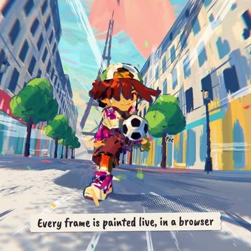</a> <a href="https://daiyixiang666.github.io/awesome-ai-video-prompts/en/w/web-2120809570344050705.html"><b>Brushstroke Shader Breakdown</b></a> Max Vedel · Fable 5.2 (Claude)</td>
<td width="25%" valign="top"><a href="https://daiyixiang666.github.io/awesome-ai-video-prompts/en/w/web-2115846417873039593.html">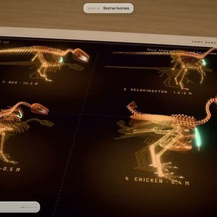</a> <a href="https://daiyixiang666.github.io/awesome-ai-video-prompts/en/w/web-2115846417873039593.html"><b>Living Dinosaur Fossil Book</b></a> Techartist · Opus 5.5 (Claude)</td>
<td width="25%" valign="top"><a href="https://daiyixiang666.github.io/awesome-ai-video-prompts/en/w/web-2110699640664600906.html">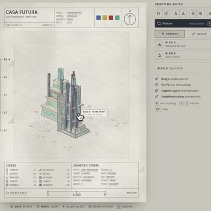</a> <a href="https://daiyixiang666.github.io/awesome-ai-video-prompts/en/w/web-2110699640664600906.html"><b>Pencil Architectural Drawing Shader</b></a> Joshua Guo · Sonnet 5.5 (Claude)</td>
</tr>
<tr>
<td width="25%" valign="top"><a href="https://daiyixiang666.github.io/awesome-ai-video-prompts/en/w/web-2120912764600496481.html">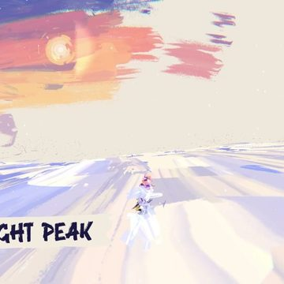</a> <a href="https://daiyixiang666.github.io/awesome-ai-video-prompts/en/w/web-2120912764600496481.html"><b>Brushstroke Ski Run</b></a> Max Vedel · Fable 5.2 (Claude)</td>
<td width="25%" valign="top"><a href="https://daiyixiang666.github.io/awesome-ai-video-prompts/en/w/web-2120088745139638375.html">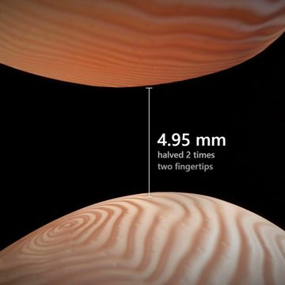</a> <a href="https://daiyixiang666.github.io/awesome-ai-video-prompts/en/w/web-2120088745139638375.html"><b>Fingertips That Never Touch</b></a> An Xuan · Fable 5.2 (Claude Code)</td>
<td width="25%" valign="top"><a href="https://daiyixiang666.github.io/awesome-ai-video-prompts/en/w/web-2120462235571253479.html">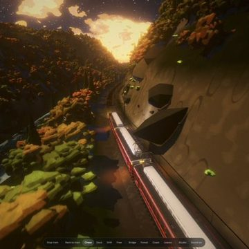</a> <a href="https://daiyixiang666.github.io/awesome-ai-video-prompts/en/w/web-2120462235571253479.html"><b>Maple Ravine Train</b></a> Chetan Ankola · Opus 5.5 (Claude)</td>
<td width="25%" valign="top"><a href="https://daiyixiang666.github.io/awesome-ai-video-prompts/en/w/web-2116192984299344372.html">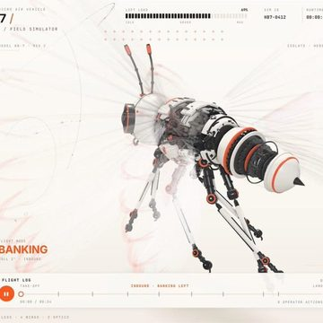</a> <a href="https://daiyixiang666.github.io/awesome-ai-video-prompts/en/w/web-2116192984299344372.html"><b>Exploded Mechanical Mosquito</b></a> Elvar · Opus 5.5 (Claude)</td>
</tr>
</table>

## Browse by tag

**Visual style**　[Cinematic realism](https://daiyixiang666.github.io/awesome-ai-video-prompts/en/t/style/cinematic-realism.html) 144 · [Surreal / dreamcore](https://daiyixiang666.github.io/awesome-ai-video-prompts/en/t/style/surreal-dream.html) 103 · [Film / retro](https://daiyixiang666.github.io/awesome-ai-video-prompts/en/t/style/film-retro.html) 65 · [Watercolor storybook](https://daiyixiang666.github.io/awesome-ai-video-prompts/en/t/style/watercolor-storybook.html) 65 · [Commercial / ad look](https://daiyixiang666.github.io/awesome-ai-video-prompts/en/t/style/commercial.html) 60 · [Anime](https://daiyixiang666.github.io/awesome-ai-video-prompts/en/t/style/anime.html) 51 · [Documentary handheld](https://daiyixiang666.github.io/awesome-ai-video-prompts/en/t/style/documentary-handheld.html) 42 · [Game CG](https://daiyixiang666.github.io/awesome-ai-video-prompts/en/t/style/game-cg.html) 38  
**Regional vibe**　[No specific region](https://daiyixiang666.github.io/awesome-ai-video-prompts/en/t/region/no-region.html) 203 · [Japanese](https://daiyixiang666.github.io/awesome-ai-video-prompts/en/t/region/japanese.html) 98 · [European](https://daiyixiang666.github.io/awesome-ai-video-prompts/en/t/region/european.html) 90 · [American](https://daiyixiang666.github.io/awesome-ai-video-prompts/en/t/region/american.html) 52 · [Chinese](https://daiyixiang666.github.io/awesome-ai-video-prompts/en/t/region/chinese.html) 28 · [Other regions](https://daiyixiang666.github.io/awesome-ai-video-prompts/en/t/region/other-region.html) 24 · [Korean](https://daiyixiang666.github.io/awesome-ai-video-prompts/en/t/region/korean.html) 21 · [Hong Kong](https://daiyixiang666.github.io/awesome-ai-video-prompts/en/t/region/hong-kong.html) 1  
**Genre**　[Fantasy / myth](https://daiyixiang666.github.io/awesome-ai-video-prompts/en/t/genre/fantasy-myth.html) 116 · [Daily life](https://daiyixiang666.github.io/awesome-ai-video-prompts/en/t/genre/daily-life.html) 98 · [Fashion / beauty](https://daiyixiang666.github.io/awesome-ai-video-prompts/en/t/genre/fashion-beauty.html) 60 · [Nature / landscape](https://daiyixiang666.github.io/awesome-ai-video-prompts/en/t/genre/nature.html) 60 · [Sci-fi](https://daiyixiang666.github.io/awesome-ai-video-prompts/en/t/genre/sci-fi.html) 59 · [Travel / city](https://daiyixiang666.github.io/awesome-ai-video-prompts/en/t/genre/travel-city.html) 54 · [Historical / period](https://daiyixiang666.github.io/awesome-ai-video-prompts/en/t/genre/historical.html) 37 · [Romance / youth](https://daiyixiang666.github.io/awesome-ai-video-prompts/en/t/genre/romance-youth.html) 36  
**Mood**　[Lonely / melancholy](https://daiyixiang666.github.io/awesome-ai-video-prompts/en/t/mood/melancholy.html) 120 · [Heartwarming](https://daiyixiang666.github.io/awesome-ai-video-prompts/en/t/mood/heartwarming.html) 116 · [Lighthearted](https://daiyixiang666.github.io/awesome-ai-video-prompts/en/t/mood/lighthearted.html) 92 · [Epic](https://daiyixiang666.github.io/awesome-ai-video-prompts/en/t/mood/epic.html) 85 · [Eerie / unsettling](https://daiyixiang666.github.io/awesome-ai-video-prompts/en/t/mood/eerie.html) 55 · [Tense / thrilling](https://daiyixiang666.github.io/awesome-ai-video-prompts/en/t/mood/tense.html) 46 · [Hype / adrenaline](https://daiyixiang666.github.io/awesome-ai-video-prompts/en/t/mood/hype.html) 44 · [Romantic](https://daiyixiang666.github.io/awesome-ai-video-prompts/en/t/mood/romantic.html) 42  
**Camera technique**　[Multi-shot edit](https://daiyixiang666.github.io/awesome-ai-video-prompts/en/t/technique/multi-shot.html) 121 · [Character consistency](https://daiyixiang666.github.io/awesome-ai-video-prompts/en/t/technique/character-consistency.html) 36 · [One-take](https://daiyixiang666.github.io/awesome-ai-video-prompts/en/t/technique/one-take.html) 34 · [Micro-expression close-up](https://daiyixiang666.github.io/awesome-ai-video-prompts/en/t/technique/micro-expression.html) 21 · [First-person POV](https://daiyixiang666.github.io/awesome-ai-video-prompts/en/t/technique/pov.html) 18 · [Slow motion](https://daiyixiang666.github.io/awesome-ai-video-prompts/en/t/technique/slow-motion.html) 18 · [Transformation transition](https://daiyixiang666.github.io/awesome-ai-video-prompts/en/t/technique/transformation-transition.html) 17 · [Beat-synced edit](https://daiyixiang666.github.io/awesome-ai-video-prompts/en/t/technique/beat-sync.html) 10  
**Use case**　[Narrative short](https://daiyixiang666.github.io/awesome-ai-video-prompts/en/t/use/short-film.html) 87 · [Vlog](https://daiyixiang666.github.io/awesome-ai-video-prompts/en/t/use/vlog.html) 41 · [Trailer](https://daiyixiang666.github.io/awesome-ai-video-prompts/en/t/use/trailer.html) 19 · [Ad / TVC](https://daiyixiang666.github.io/awesome-ai-video-prompts/en/t/use/tvc.html) 19 · [Demo / tutorial](https://daiyixiang666.github.io/awesome-ai-video-prompts/en/t/use/demo-tutorial.html) 17 · [Music video](https://daiyixiang666.github.io/awesome-ai-video-prompts/en/t/use/music-video.html) 13 · [Meme / sketch](https://daiyixiang666.github.io/awesome-ai-video-prompts/en/t/use/meme-sketch.html) 10  

## Curation

- Top-tier only: outstanding aesthetics and craft; no memes, thirst bait, reposts or tool promos.
- Video = AI video models only; Images = AI image models only; anything an LLM made by writing code (three.js, WebGL, code-rendered video) goes to Coding.
- Creators are always credited and linked; prompts are never invented.

## For agents & developers

[`works.json`](https://daiyixiang666.github.io/awesome-ai-video-prompts/works.json) · [`llms.txt`](https://daiyixiang666.github.io/awesome-ai-video-prompts/llms.txt) · [`sitemap.xml`](https://daiyixiang666.github.io/awesome-ai-video-prompts/sitemap.xml)

## Takedown

All works belong to their creators. Rights holders can email **yixiang@umich.edu** or open an issue and we will remove the work promptly.
