

# 镜鉴 · 顶级 AI 视频提示词

**人工精选的顶级 AI 视频、图片与 Coding 作品，附提示词，按画风、氛围、题材检索**

[在线浏览](https://daiyixiang666.github.io/awesome-ai-video-prompts/) · [标签](https://daiyixiang666.github.io/awesome-ai-video-prompts/tags.html) · [投稿](https://github.com/daiyixiang666/awesome-ai-video-prompts/issues/new?template=submit.yml) · [English](README.en.md) · [works.json](https://daiyixiang666.github.io/awesome-ai-video-prompts/works.json)

  

人工筛选的 AI 作品合集，只收高审美、高方法论的作品，分 **视频**（≤60 秒短片）、**图片**、**Coding**（大模型写代码做的作品）三类。每部作品都署名并链接原作者，按画风、地域氛围、题材、情绪、镜头技法、用途打标，作者公开过提示词的附上完整提示词。

## 视频 167

AI 视频生成模型（Seedance、Kling、Veo…）生成的单条短片。 [查看全部 →](https://daiyixiang666.github.io/awesome-ai-video-prompts/index.html)

<table>
<tr>
<td width="25%" valign="top"><a href="https://daiyixiang666.github.io/awesome-ai-video-prompts/w/x-2060322611586834518.html">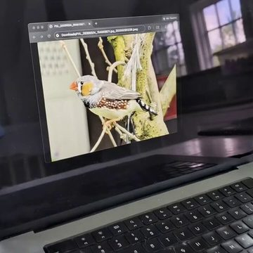</a> <a href="https://daiyixiang666.github.io/awesome-ai-video-prompts/w/x-2060322611586834518.html"><b>鸟从屏幕跳进手心</b></a> Alexander Chen · Gemini Omni</td>
<td width="25%" valign="top"><a href="https://daiyixiang666.github.io/awesome-ai-video-prompts/w/x-2110062762218926204.html">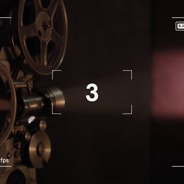</a> <a href="https://daiyixiang666.github.io/awesome-ai-video-prompts/w/x-2110062762218926204.html"><b>若 AI 诞生于 1985</b></a> Déborah · Grok Imagine</td>
<td width="25%" valign="top"><a href="https://daiyixiang666.github.io/awesome-ai-video-prompts/w/x-2110269414834852256.html">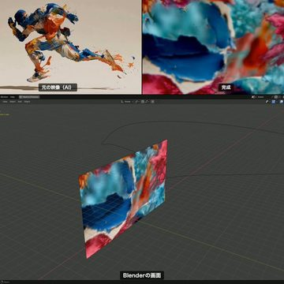</a> <a href="https://daiyixiang666.github.io/awesome-ai-video-prompts/w/x-2110269414834852256.html"><b>二维奔跑炸成三维</b></a> aicreataro · MiniMax H3 (+Midjourney, Blender)</td>
<td width="25%" valign="top"><a href="https://daiyixiang666.github.io/awesome-ai-video-prompts/w/x-2090573248752934994.html">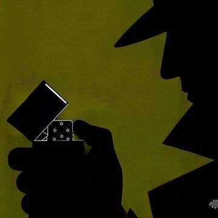</a> <a href="https://daiyixiang666.github.io/awesome-ai-video-prompts/w/x-2090573248752934994.html"><b>拟音驱动的黑色剪影</b></a> meropan · MiniMax H3</td>
</tr>
<tr>
<td width="25%" valign="top"> <a href="https://daiyixiang666.github.io/awesome-ai-video-prompts/w/x-2115768686753833186.html"><b>赛博朋克日常</b></a> INK</td>
<td width="25%" valign="top"><a href="https://daiyixiang666.github.io/awesome-ai-video-prompts/w/x-2112536635435049408.html">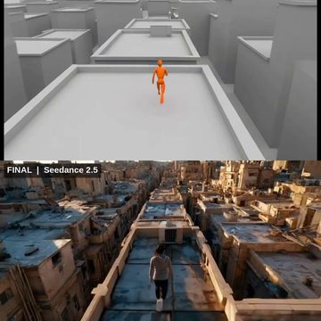</a> <a href="https://daiyixiang666.github.io/awesome-ai-video-prompts/w/x-2112536635435049408.html"><b>先预演再生成</b></a> たくぞー｜AI動画ツール実測レビュー · MiniMax H3 (previz) + Seedance 2.5</td>
<td width="25%" valign="top"> <a href="https://daiyixiang666.github.io/awesome-ai-video-prompts/w/x-2077006040776741153.html"><b>马克笔改写街道</b></a> Dheepan Ratnam · Gemini Omni</td>
<td width="25%" valign="top"><a href="https://daiyixiang666.github.io/awesome-ai-video-prompts/w/x-2111110794150867287.html">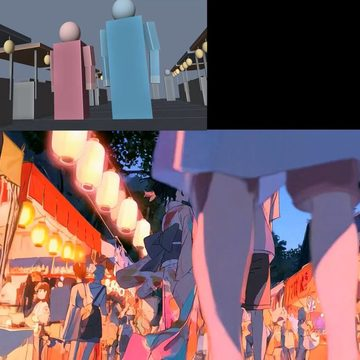</a> <a href="https://daiyixiang666.github.io/awesome-ai-video-prompts/w/x-2111110794150867287.html"><b>白模变夏日祭</b></a> みと Visuals×AI · MiniMax H3</td>
</tr>
</table>

## 图片 143

图片生成模型（Midjourney、GPT Image、Nano Banana…）生成的作品。 [查看全部 →](https://daiyixiang666.github.io/awesome-ai-video-prompts/images.html)

<table>
<tr>
<td width="25%" valign="top"><a href="https://daiyixiang666.github.io/awesome-ai-video-prompts/w/img-x-2115055913203855553.html">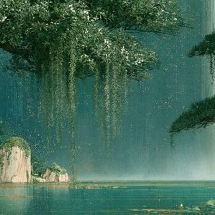</a> <a href="https://daiyixiang666.github.io/awesome-ai-video-prompts/w/img-x-2115055913203855553.html"><b>园林竖幅长卷</b></a> Glitter Gal · Midjourney</td>
<td width="25%" valign="top"><a href="https://daiyixiang666.github.io/awesome-ai-video-prompts/w/img-x-2114998034773729300.html">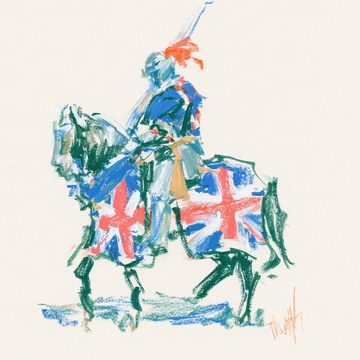</a> <a href="https://daiyixiang666.github.io/awesome-ai-video-prompts/w/img-x-2114998034773729300.html"><b>水彩骑士速写</b></a> Sgt Sref · Midjourney</td>
<td width="25%" valign="top"><a href="https://daiyixiang666.github.io/awesome-ai-video-prompts/w/img-x-2110138570740543839.html">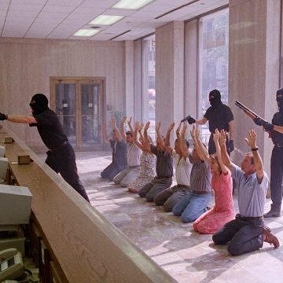</a> <a href="https://daiyixiang666.github.io/awesome-ai-video-prompts/w/img-x-2110138570740543839.html"><b>九十年代电影剧照</b></a> Riccardo Wolf · Krea 3</td>
<td width="25%" valign="top"><a href="https://daiyixiang666.github.io/awesome-ai-video-prompts/w/img-x-2103072199393632445.html">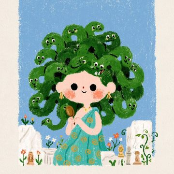</a> <a href="https://daiyixiang666.github.io/awesome-ai-video-prompts/w/img-x-2103072199393632445.html"><b>可爱希腊神话</b></a> Keskin</td>
</tr>
<tr>
<td width="25%" valign="top"><a href="https://daiyixiang666.github.io/awesome-ai-video-prompts/w/img-x-2114316352773066834.html">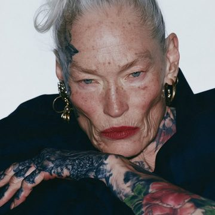</a> <a href="https://daiyixiang666.github.io/awesome-ai-video-prompts/w/img-x-2114316352773066834.html"><b>美</b></a> Ege</td>
<td width="25%" valign="top"><a href="https://daiyixiang666.github.io/awesome-ai-video-prompts/w/img-x-2112389077714788510.html">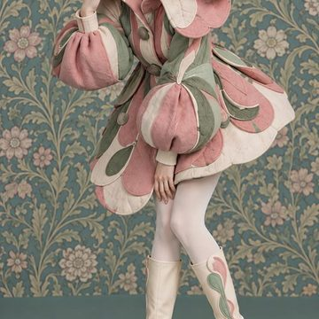</a> <a href="https://daiyixiang666.github.io/awesome-ai-video-prompts/w/img-x-2112389077714788510.html"><b>植物志 2</b></a> HPJJ</td>
<td width="25%" valign="top"><a href="https://daiyixiang666.github.io/awesome-ai-video-prompts/w/img-x-2098763810563928265.html">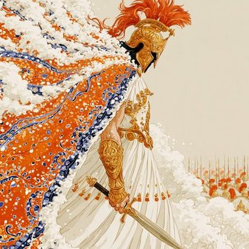</a> <a href="https://daiyixiang666.github.io/awesome-ai-video-prompts/w/img-x-2098763810563928265.html"><b>奥德赛</b></a> Alban Glazman · Midjourney</td>
<td width="25%" valign="top"><a href="https://daiyixiang666.github.io/awesome-ai-video-prompts/w/img-x-2105682224242971020.html">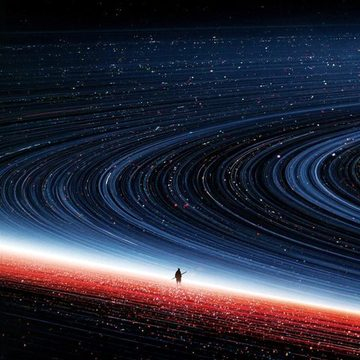</a> <a href="https://daiyixiang666.github.io/awesome-ai-video-prompts/w/img-x-2105682224242971020.html"><b>星环地平线</b></a> Dogan Ural</td>
</tr>
</table>

## Coding 25

大语言模型写代码做出的作品（three.js、WebGL、shader…），包括用代码渲染的视频。 [查看全部 →](https://daiyixiang666.github.io/awesome-ai-video-prompts/coding.html)

<table>
<tr>
<td width="25%" valign="top"><a href="https://daiyixiang666.github.io/awesome-ai-video-prompts/w/web-2114035230113984749.html">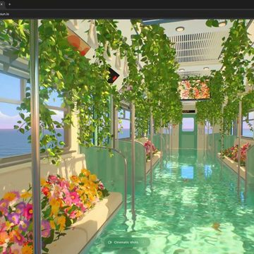</a> <a href="https://daiyixiang666.github.io/awesome-ai-video-prompts/w/web-2114035230113984749.html"><b>夏祭·池塘电车</b></a> Scott · Opus 5.5 (Claude)</td>
<td width="25%" valign="top"><a href="https://daiyixiang666.github.io/awesome-ai-video-prompts/w/web-2102503719762018434.html">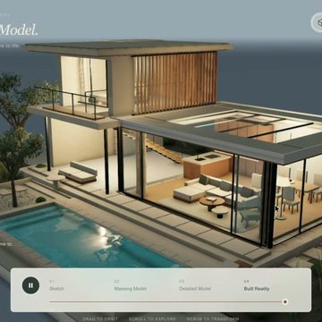</a> <a href="https://daiyixiang666.github.io/awesome-ai-video-prompts/w/web-2102503719762018434.html"><b>从草图到家</b></a> Techartist · Opus 5.5 (Claude)</td>
<td width="25%" valign="top"><a href="https://daiyixiang666.github.io/awesome-ai-video-prompts/w/web-2112935205703147750.html">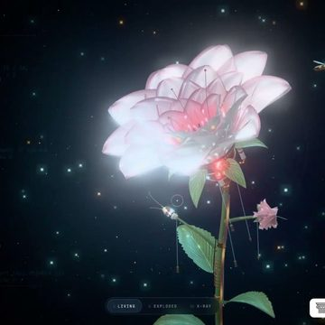</a> <a href="https://daiyixiang666.github.io/awesome-ai-video-prompts/w/web-2112935205703147750.html"><b>机械花</b></a> Bee · Gemini 4 Carbon</td>
<td width="25%" valign="top"><a href="https://daiyixiang666.github.io/awesome-ai-video-prompts/w/web-2113662031379464549.html">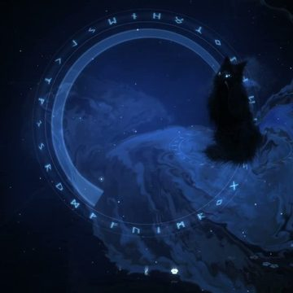</a> <a href="https://daiyixiang666.github.io/awesome-ai-video-prompts/w/web-2113662031379464549.html"><b>云雾猫</b></a> Bee · Gemini 4 Carbon</td>
</tr>
<tr>
<td width="25%" valign="top"><a href="https://daiyixiang666.github.io/awesome-ai-video-prompts/w/web-2113909026253877485.html">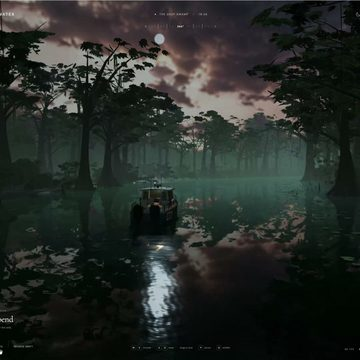</a> <a href="https://daiyixiang666.github.io/awesome-ai-video-prompts/w/web-2113909026253877485.html"><b>雾中沼泽</b></a> Chetan Ankola · GPT-6 Astra</td>
<td width="25%" valign="top"><a href="https://daiyixiang666.github.io/awesome-ai-video-prompts/w/web-2109312983402782988.html">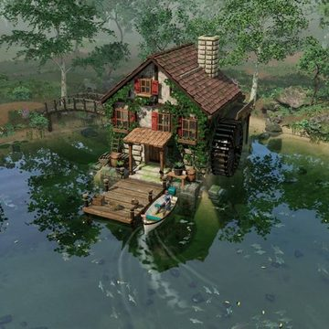</a> <a href="https://daiyixiang666.github.io/awesome-ai-video-prompts/w/web-2109312983402782988.html"><b>静水小屋</b></a> Mohamed · Codex (GPT)</td>
<td width="25%" valign="top"><a href="https://daiyixiang666.github.io/awesome-ai-video-prompts/w/web-2105250266392224097.html">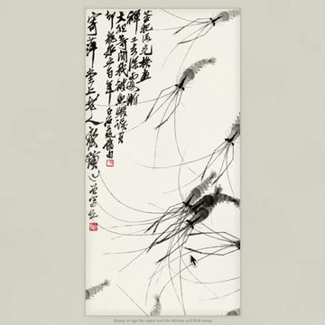</a> <a href="https://daiyixiang666.github.io/awesome-ai-video-prompts/w/web-2105250266392224097.html"><b>齐白石的虾</b></a> Joshua Guo · Opus 5.5 (Claude)</td>
<td width="25%" valign="top"> <a href="https://daiyixiang666.github.io/awesome-ai-video-prompts/w/web-2115175640198783107.html"><b>台风里的越南筒子楼</b></a> An Xuan · Opus 5.5 (Claude)</td>
</tr>
</table>

## 按标签找

**画风**　[写实电影感](https://daiyixiang666.github.io/awesome-ai-video-prompts/t/style/cinematic-realism.html) 103 · [超现实梦境](https://daiyixiang666.github.io/awesome-ai-video-prompts/t/style/surreal-dream.html) 62 · [胶片复古](https://daiyixiang666.github.io/awesome-ai-video-prompts/t/style/film-retro.html) 41 · [广告大片](https://daiyixiang666.github.io/awesome-ai-video-prompts/t/style/commercial.html) 40 · [纪实手持](https://daiyixiang666.github.io/awesome-ai-video-prompts/t/style/documentary-handheld.html) 35 · [水彩绘本](https://daiyixiang666.github.io/awesome-ai-video-prompts/t/style/watercolor-storybook.html) 28 · [游戏CG](https://daiyixiang666.github.io/awesome-ai-video-prompts/t/style/game-cg.html) 25 · [日系动漫](https://daiyixiang666.github.io/awesome-ai-video-prompts/t/style/anime.html) 24  
**地域氛围**　[无明显地域](https://daiyixiang666.github.io/awesome-ai-video-prompts/t/region/no-region.html) 130 · [欧洲](https://daiyixiang666.github.io/awesome-ai-video-prompts/t/region/european.html) 61 · [日系](https://daiyixiang666.github.io/awesome-ai-video-prompts/t/region/japanese.html) 54 · [美式](https://daiyixiang666.github.io/awesome-ai-video-prompts/t/region/american.html) 39 · [中式](https://daiyixiang666.github.io/awesome-ai-video-prompts/t/region/chinese.html) 19 · [韩系](https://daiyixiang666.github.io/awesome-ai-video-prompts/t/region/korean.html) 17 · [其他地域](https://daiyixiang666.github.io/awesome-ai-video-prompts/t/region/other-region.html) 14 · [港风](https://daiyixiang666.github.io/awesome-ai-video-prompts/t/region/hong-kong.html) 1  
**题材**　[日常生活](https://daiyixiang666.github.io/awesome-ai-video-prompts/t/genre/daily-life.html) 72 · [奇幻神话](https://daiyixiang666.github.io/awesome-ai-video-prompts/t/genre/fantasy-myth.html) 65 · [自然风光](https://daiyixiang666.github.io/awesome-ai-video-prompts/t/genre/nature.html) 36 · [时尚美妆](https://daiyixiang666.github.io/awesome-ai-video-prompts/t/genre/fashion-beauty.html) 36 · [科幻](https://daiyixiang666.github.io/awesome-ai-video-prompts/t/genre/sci-fi.html) 33 · [旅行城市](https://daiyixiang666.github.io/awesome-ai-video-prompts/t/genre/travel-city.html) 33 · [爱情青春](https://daiyixiang666.github.io/awesome-ai-video-prompts/t/genre/romance-youth.html) 29 · [历史年代](https://daiyixiang666.github.io/awesome-ai-video-prompts/t/genre/historical.html) 25  
**情绪**　[温暖治愈](https://daiyixiang666.github.io/awesome-ai-video-prompts/t/mood/heartwarming.html) 76 · [孤独忧郁](https://daiyixiang666.github.io/awesome-ai-video-prompts/t/mood/melancholy.html) 73 · [轻松欢快](https://daiyixiang666.github.io/awesome-ai-video-prompts/t/mood/lighthearted.html) 56 · [史诗壮阔](https://daiyixiang666.github.io/awesome-ai-video-prompts/t/mood/epic.html) 53 · [紧张刺激](https://daiyixiang666.github.io/awesome-ai-video-prompts/t/mood/tense.html) 33 · [热血燃](https://daiyixiang666.github.io/awesome-ai-video-prompts/t/mood/hype.html) 28 · [浪漫心动](https://daiyixiang666.github.io/awesome-ai-video-prompts/t/mood/romantic.html) 27 · [诡异不安](https://daiyixiang666.github.io/awesome-ai-video-prompts/t/mood/eerie.html) 26  
**镜头技法**　[多镜头剪辑](https://daiyixiang666.github.io/awesome-ai-video-prompts/t/technique/multi-shot.html) 92 · [一镜到底](https://daiyixiang666.github.io/awesome-ai-video-prompts/t/technique/one-take.html) 29 · [第一人称](https://daiyixiang666.github.io/awesome-ai-video-prompts/t/technique/pov.html) 17 · [角色一致性](https://daiyixiang666.github.io/awesome-ai-video-prompts/t/technique/character-consistency.html) 16 · [微表情特写](https://daiyixiang666.github.io/awesome-ai-video-prompts/t/technique/micro-expression.html) 15 · [变身转场](https://daiyixiang666.github.io/awesome-ai-video-prompts/t/technique/transformation-transition.html) 13 · [慢动作](https://daiyixiang666.github.io/awesome-ai-video-prompts/t/technique/slow-motion.html) 11 · [卡点节奏](https://daiyixiang666.github.io/awesome-ai-video-prompts/t/technique/beat-sync.html) 6  
**用途**　[叙事短片](https://daiyixiang666.github.io/awesome-ai-video-prompts/t/use/short-film.html) 68 · [vlog](https://daiyixiang666.github.io/awesome-ai-video-prompts/t/use/vlog.html) 38 · [广告TVC](https://daiyixiang666.github.io/awesome-ai-video-prompts/t/use/tvc.html) 18 · [演示教程](https://daiyixiang666.github.io/awesome-ai-video-prompts/t/use/demo-tutorial.html) 15 · [预告片](https://daiyixiang666.github.io/awesome-ai-video-prompts/t/use/trailer.html) 11 · [MV](https://daiyixiang666.github.io/awesome-ai-video-prompts/t/use/music-video.html) 10 · [梗段子](https://daiyixiang666.github.io/awesome-ai-video-prompts/t/use/meme-sketch.html) 7  

## 收录标准

- 只收顶级：高审美、高方法论；不收梗图、软色情、搬运、工具广告。
- 视频只收 AI 视频模型生成的作品；图片只收图片模型生成的作品；大模型写代码做的（three.js、WebGL、代码渲染的视频）都归 Coding。
- 始终署名并链接原作者，从不编造提示词。

## 给 AI 与开发者

[`works.json`](https://daiyixiang666.github.io/awesome-ai-video-prompts/works.json) · [`llms.txt`](https://daiyixiang666.github.io/awesome-ai-video-prompts/llms.txt) · [`sitemap.xml`](https://daiyixiang666.github.io/awesome-ai-video-prompts/sitemap.xml)

## 版权与下架

作品版权归原作者所有。如权利人认为收录不当，请发邮件至 **yixiang@umich.edu** 或提 Issue，我们核实后第一时间下架。
