

# 镜鉴 · 顶级 AI 视频提示词

**人工精选的顶级 AI 视频、图片与 Coding 作品，附提示词，按画风、氛围、题材检索**

[在线浏览](https://daiyixiang666.github.io/awesome-ai-video-prompts/) · [标签](https://daiyixiang666.github.io/awesome-ai-video-prompts/tags.html) · [投稿](https://github.com/daiyixiang666/awesome-ai-video-prompts/issues/new?template=submit.yml) · [English](README.en.md) · [works.json](https://daiyixiang666.github.io/awesome-ai-video-prompts/works.json)

  

人工筛选的 AI 作品合集，只收高审美、高方法论的作品，分 **视频**（≤60 秒短片）、**图片**、**Coding**（大模型写代码做的作品）三类。每部作品都署名并链接原作者，按画风、地域氛围、题材、情绪、镜头技法、用途打标，作者公开过提示词的附上完整提示词。

## 视频 206

AI 视频生成模型（Seedance、Kling、Veo…）生成的单条短片。 [查看全部 →](https://daiyixiang666.github.io/awesome-ai-video-prompts/index.html)

<table>
<tr>
<td width="25%" valign="top"><a href="https://daiyixiang666.github.io/awesome-ai-video-prompts/w/tt-7542187538107075895.html">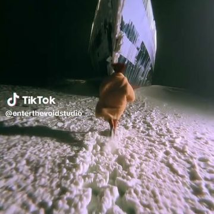</a> <a href="https://daiyixiang666.github.io/awesome-ai-video-prompts/w/tt-7542187538107075895.html"><b>无处之地</b></a> Enter The Void · Midjourney Video</td>
<td width="25%" valign="top"><a href="https://daiyixiang666.github.io/awesome-ai-video-prompts/w/tt-7541962635017784590.html">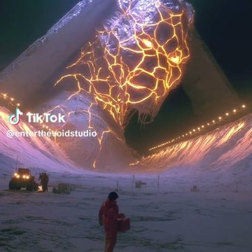</a> <a href="https://daiyixiang666.github.io/awesome-ai-video-prompts/w/tt-7541962635017784590.html"><b>冰之心魔</b></a> Enter The Void · Midjourney Video</td>
<td width="25%" valign="top"><a href="https://daiyixiang666.github.io/awesome-ai-video-prompts/w/x-2115870219562348882.html">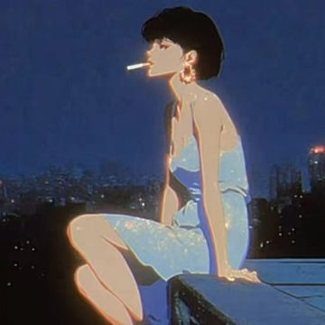</a> <a href="https://daiyixiang666.github.io/awesome-ai-video-prompts/w/x-2115870219562348882.html"><b>天台夜色</b></a> katt latte 🪩</td>
<td width="25%" valign="top"> <a href="https://daiyixiang666.github.io/awesome-ai-video-prompts/w/x-2116565003742613955.html"><b>灭烟奶奶</b></a> VERT · PixVerse</td>
</tr>
<tr>
<td width="25%" valign="top"><a href="https://daiyixiang666.github.io/awesome-ai-video-prompts/w/x-2119552672198197689.html">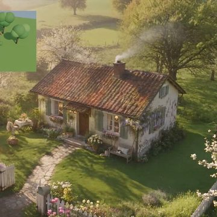</a> <a href="https://daiyixiang666.github.io/awesome-ai-video-prompts/w/x-2119552672198197689.html"><b>从白模到小屋</b></a> Eric Ker · Seedance (Blender + Claude)</td>
<td width="25%" valign="top"><a href="https://daiyixiang666.github.io/awesome-ai-video-prompts/w/x-2119812414254592011.html">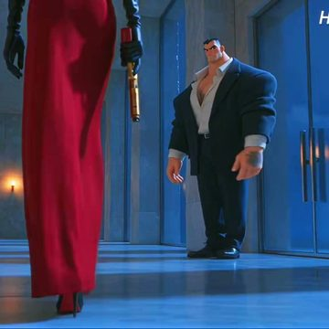</a> <a href="https://daiyixiang666.github.io/awesome-ai-video-prompts/w/x-2119812414254592011.html"><b>此刻只有我们</b></a> Dyyhoang · Seedance 2.5</td>
<td width="25%" valign="top"> <a href="https://daiyixiang666.github.io/awesome-ai-video-prompts/w/x-2116910642670207471.html"><b>他从没说爱你</b></a> Dyyhoang · Seedance 2.5 (ImagineArt)</td>
<td width="25%" valign="top"> <a href="https://daiyixiang666.github.io/awesome-ai-video-prompts/w/x-2121797307306000571.html"><b>灯河奇城</b></a> はさまるスタジオ (Hasamaru Studio)</td>
</tr>
</table>

## 图片 276

图片生成模型（Midjourney、GPT Image、Nano Banana…）生成的作品。 [查看全部 →](https://daiyixiang666.github.io/awesome-ai-video-prompts/images.html)

<table>
<tr>
<td width="25%" valign="top"> <a href="https://daiyixiang666.github.io/awesome-ai-video-prompts/w/img-x-2114701970724286896.html"><b>刺青的僧人</b></a> Ege Berkina</td>
<td width="25%" valign="top"> <a href="https://daiyixiang666.github.io/awesome-ai-video-prompts/w/img-x-2122199044969881917.html"><b>复古碎花大片</b></a> HPJJ</td>
<td width="25%" valign="top"> <a href="https://daiyixiang666.github.io/awesome-ai-video-prompts/w/img-x-2120971278165414385.html"><b>16K 星环长卷</b></a> Dogan Ural</td>
<td width="25%" valign="top"><a href="https://daiyixiang666.github.io/awesome-ai-video-prompts/w/img-x-2120196920610296030.html">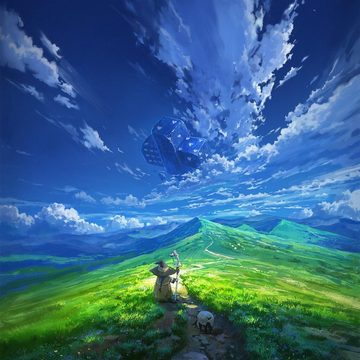</a> <a href="https://daiyixiang666.github.io/awesome-ai-video-prompts/w/img-x-2120196920610296030.html"><b>远行</b></a> CycleCircle</td>
</tr>
<tr>
<td width="25%" valign="top"><a href="https://daiyixiang666.github.io/awesome-ai-video-prompts/w/img-x-2120280841968398604.html">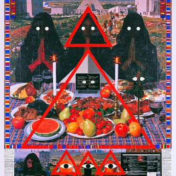</a> <a href="https://daiyixiang666.github.io/awesome-ai-video-prompts/w/img-x-2120280841968398604.html"><b>恐惧与崇拜</b></a> BLΛC</td>
<td width="25%" valign="top"><a href="https://daiyixiang666.github.io/awesome-ai-video-prompts/w/img-x-2114820892253462781.html">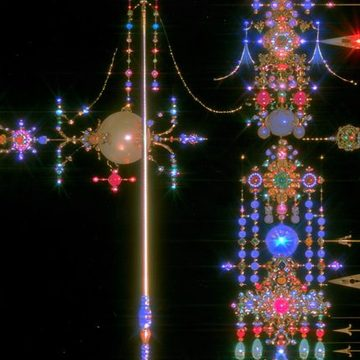</a> <a href="https://daiyixiang666.github.io/awesome-ai-video-prompts/w/img-x-2114820892253462781.html"><b>星辰圣物</b></a> ʇʞz</td>
<td width="25%" valign="top"><a href="https://daiyixiang666.github.io/awesome-ai-video-prompts/w/img-x-2121242949313028595.html">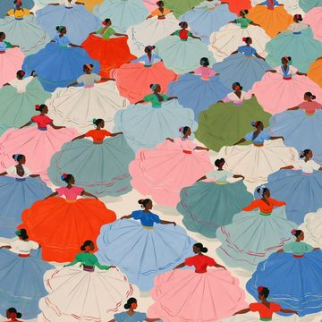</a> <a href="https://daiyixiang666.github.io/awesome-ai-video-prompts/w/img-x-2121242949313028595.html"><b>古巴明信片</b></a> Ege · Midjourney</td>
<td width="25%" valign="top"><a href="https://daiyixiang666.github.io/awesome-ai-video-prompts/w/img-x-2114394223604629600.html">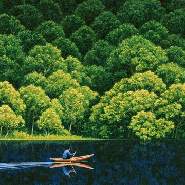</a> <a href="https://daiyixiang666.github.io/awesome-ai-video-prompts/w/img-x-2114394223604629600.html"><b>湖上小舟</b></a> unseenai</td>
</tr>
</table>

## Coding 35

大语言模型写代码做出的作品（three.js、WebGL、shader…），包括用代码渲染的视频。 [查看全部 →](https://daiyixiang666.github.io/awesome-ai-video-prompts/coding.html)

<table>
<tr>
<td width="25%" valign="top"><a href="https://daiyixiang666.github.io/awesome-ai-video-prompts/w/web-2117659337057517831.html">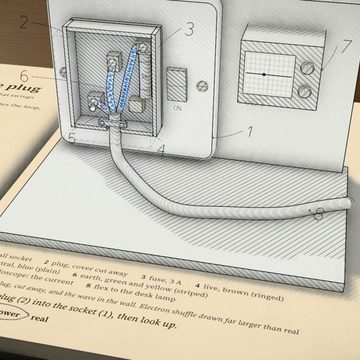</a> <a href="https://daiyixiang666.github.io/awesome-ai-video-prompts/w/web-2117659337057517831.html"><b>会动的电学之书</b></a> Techartist · Opus 5.5 (Claude)</td>
<td width="25%" valign="top"><a href="https://daiyixiang666.github.io/awesome-ai-video-prompts/w/web-2120809570344050705.html">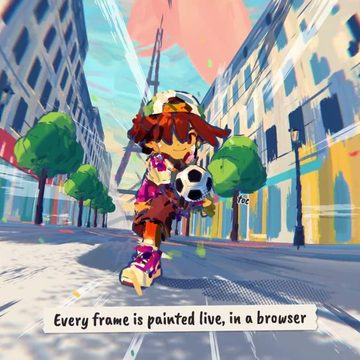</a> <a href="https://daiyixiang666.github.io/awesome-ai-video-prompts/w/web-2120809570344050705.html"><b>笔触着色器拆解</b></a> Max Vedel · Fable 5.2 (Claude)</td>
<td width="25%" valign="top"><a href="https://daiyixiang666.github.io/awesome-ai-video-prompts/w/web-2115846417873039593.html">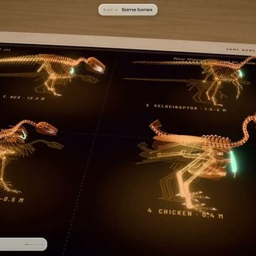</a> <a href="https://daiyixiang666.github.io/awesome-ai-video-prompts/w/web-2115846417873039593.html"><b>活着的恐龙化石</b></a> Techartist · Opus 5.5 (Claude)</td>
<td width="25%" valign="top"><a href="https://daiyixiang666.github.io/awesome-ai-video-prompts/w/web-2110699640664600906.html">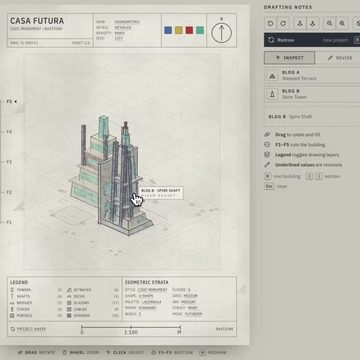</a> <a href="https://daiyixiang666.github.io/awesome-ai-video-prompts/w/web-2110699640664600906.html"><b>铅笔建筑图纸</b></a> Joshua Guo · Sonnet 5.5 (Claude)</td>
</tr>
<tr>
<td width="25%" valign="top"><a href="https://daiyixiang666.github.io/awesome-ai-video-prompts/w/web-2120912764600496481.html">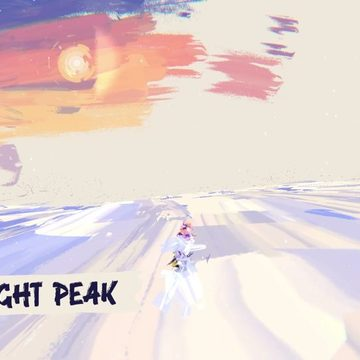</a> <a href="https://daiyixiang666.github.io/awesome-ai-video-prompts/w/web-2120912764600496481.html"><b>笔触滑雪</b></a> Max Vedel · Fable 5.2 (Claude)</td>
<td width="25%" valign="top"><a href="https://daiyixiang666.github.io/awesome-ai-video-prompts/w/web-2120088745139638375.html">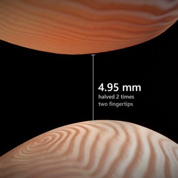</a> <a href="https://daiyixiang666.github.io/awesome-ai-video-prompts/w/web-2120088745139638375.html"><b>指尖永不相触</b></a> An Xuan · Fable 5.2 (Claude Code)</td>
<td width="25%" valign="top"><a href="https://daiyixiang666.github.io/awesome-ai-video-prompts/w/web-2120462235571253479.html">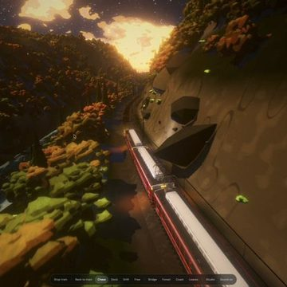</a> <a href="https://daiyixiang666.github.io/awesome-ai-video-prompts/w/web-2120462235571253479.html"><b>枫谷列车</b></a> Chetan Ankola · Opus 5.5 (Claude)</td>
<td width="25%" valign="top"> <a href="https://daiyixiang666.github.io/awesome-ai-video-prompts/w/web-2116192984299344372.html"><b>机械蚊拆解台</b></a> Elvar · Opus 5.5 (Claude)</td>
</tr>
</table>

## 按标签找

**画风**　[写实电影感](https://daiyixiang666.github.io/awesome-ai-video-prompts/t/style/cinematic-realism.html) 144 · [超现实梦境](https://daiyixiang666.github.io/awesome-ai-video-prompts/t/style/surreal-dream.html) 103 · [胶片复古](https://daiyixiang666.github.io/awesome-ai-video-prompts/t/style/film-retro.html) 65 · [水彩绘本](https://daiyixiang666.github.io/awesome-ai-video-prompts/t/style/watercolor-storybook.html) 65 · [广告大片](https://daiyixiang666.github.io/awesome-ai-video-prompts/t/style/commercial.html) 60 · [日系动漫](https://daiyixiang666.github.io/awesome-ai-video-prompts/t/style/anime.html) 51 · [纪实手持](https://daiyixiang666.github.io/awesome-ai-video-prompts/t/style/documentary-handheld.html) 42 · [游戏CG](https://daiyixiang666.github.io/awesome-ai-video-prompts/t/style/game-cg.html) 38  
**地域氛围**　[无明显地域](https://daiyixiang666.github.io/awesome-ai-video-prompts/t/region/no-region.html) 203 · [日系](https://daiyixiang666.github.io/awesome-ai-video-prompts/t/region/japanese.html) 98 · [欧洲](https://daiyixiang666.github.io/awesome-ai-video-prompts/t/region/european.html) 90 · [美式](https://daiyixiang666.github.io/awesome-ai-video-prompts/t/region/american.html) 52 · [中式](https://daiyixiang666.github.io/awesome-ai-video-prompts/t/region/chinese.html) 28 · [其他地域](https://daiyixiang666.github.io/awesome-ai-video-prompts/t/region/other-region.html) 24 · [韩系](https://daiyixiang666.github.io/awesome-ai-video-prompts/t/region/korean.html) 21 · [港风](https://daiyixiang666.github.io/awesome-ai-video-prompts/t/region/hong-kong.html) 1  
**题材**　[奇幻神话](https://daiyixiang666.github.io/awesome-ai-video-prompts/t/genre/fantasy-myth.html) 116 · [日常生活](https://daiyixiang666.github.io/awesome-ai-video-prompts/t/genre/daily-life.html) 98 · [时尚美妆](https://daiyixiang666.github.io/awesome-ai-video-prompts/t/genre/fashion-beauty.html) 60 · [自然风光](https://daiyixiang666.github.io/awesome-ai-video-prompts/t/genre/nature.html) 60 · [科幻](https://daiyixiang666.github.io/awesome-ai-video-prompts/t/genre/sci-fi.html) 59 · [旅行城市](https://daiyixiang666.github.io/awesome-ai-video-prompts/t/genre/travel-city.html) 54 · [历史年代](https://daiyixiang666.github.io/awesome-ai-video-prompts/t/genre/historical.html) 37 · [爱情青春](https://daiyixiang666.github.io/awesome-ai-video-prompts/t/genre/romance-youth.html) 36  
**情绪**　[孤独忧郁](https://daiyixiang666.github.io/awesome-ai-video-prompts/t/mood/melancholy.html) 120 · [温暖治愈](https://daiyixiang666.github.io/awesome-ai-video-prompts/t/mood/heartwarming.html) 116 · [轻松欢快](https://daiyixiang666.github.io/awesome-ai-video-prompts/t/mood/lighthearted.html) 92 · [史诗壮阔](https://daiyixiang666.github.io/awesome-ai-video-prompts/t/mood/epic.html) 85 · [诡异不安](https://daiyixiang666.github.io/awesome-ai-video-prompts/t/mood/eerie.html) 55 · [紧张刺激](https://daiyixiang666.github.io/awesome-ai-video-prompts/t/mood/tense.html) 46 · [热血燃](https://daiyixiang666.github.io/awesome-ai-video-prompts/t/mood/hype.html) 44 · [浪漫心动](https://daiyixiang666.github.io/awesome-ai-video-prompts/t/mood/romantic.html) 42  
**镜头技法**　[多镜头剪辑](https://daiyixiang666.github.io/awesome-ai-video-prompts/t/technique/multi-shot.html) 121 · [角色一致性](https://daiyixiang666.github.io/awesome-ai-video-prompts/t/technique/character-consistency.html) 36 · [一镜到底](https://daiyixiang666.github.io/awesome-ai-video-prompts/t/technique/one-take.html) 34 · [微表情特写](https://daiyixiang666.github.io/awesome-ai-video-prompts/t/technique/micro-expression.html) 21 · [第一人称](https://daiyixiang666.github.io/awesome-ai-video-prompts/t/technique/pov.html) 18 · [慢动作](https://daiyixiang666.github.io/awesome-ai-video-prompts/t/technique/slow-motion.html) 18 · [变身转场](https://daiyixiang666.github.io/awesome-ai-video-prompts/t/technique/transformation-transition.html) 17 · [卡点节奏](https://daiyixiang666.github.io/awesome-ai-video-prompts/t/technique/beat-sync.html) 10  
**用途**　[叙事短片](https://daiyixiang666.github.io/awesome-ai-video-prompts/t/use/short-film.html) 87 · [vlog](https://daiyixiang666.github.io/awesome-ai-video-prompts/t/use/vlog.html) 41 · [预告片](https://daiyixiang666.github.io/awesome-ai-video-prompts/t/use/trailer.html) 19 · [广告TVC](https://daiyixiang666.github.io/awesome-ai-video-prompts/t/use/tvc.html) 19 · [演示教程](https://daiyixiang666.github.io/awesome-ai-video-prompts/t/use/demo-tutorial.html) 17 · [MV](https://daiyixiang666.github.io/awesome-ai-video-prompts/t/use/music-video.html) 13 · [梗段子](https://daiyixiang666.github.io/awesome-ai-video-prompts/t/use/meme-sketch.html) 10  

## 收录标准

- 只收顶级：高审美、高方法论；不收梗图、软色情、搬运、工具广告。
- 视频只收 AI 视频模型生成的作品；图片只收图片模型生成的作品；大模型写代码做的（three.js、WebGL、代码渲染的视频）都归 Coding。
- 始终署名并链接原作者，从不编造提示词。

## 给 AI 与开发者

[`works.json`](https://daiyixiang666.github.io/awesome-ai-video-prompts/works.json) · [`llms.txt`](https://daiyixiang666.github.io/awesome-ai-video-prompts/llms.txt) · [`sitemap.xml`](https://daiyixiang666.github.io/awesome-ai-video-prompts/sitemap.xml)

## 版权与下架

作品版权归原作者所有。如权利人认为收录不当，请发邮件至 **yixiang@umich.edu** 或提 Issue，我们核实后第一时间下架。
