# 镜鉴 · 顶级 AI 视频提示词

[English](README.en.md)

> 人工精选的顶级 AI 影像与提示词，按画风、氛围、题材检索.

**[在线浏览 →](https://daiyixiang666.github.io/awesome-ai-video-prompts/)** · 54 部作品 · 32 附完整提示词 · 更新于 2026-10-26

每一部作品都经过人工筛选，来自 X、TikTok、抖音的顶级 AI 影像创作者；只收单条短镜头（≤31 秒），按 **画风 / 地域氛围 / 题材 / 情绪 / 镜头技法 / 用途** 六个维度打标，并尽可能附上作者公开的完整提示词。

## 目录

- [写实电影感](#cinematic-realism) (10)
- [纪实手持](#documentary-handheld) (18)
- [广告大片](#commercial) (12)
- [胶片复古](#film-retro) (3)
- [超现实梦境](#surreal-dream) (3)
- [赛博霓虹](#cyberpunk-neon) (1)
- [3D卡通](#3d-cartoon) (1)
- [黑白影像](#black-and-white) (2)
- [游戏CG](#game-cg) (2)
- [水彩绘本](#watercolor-storybook) (1)
- [日系动漫](#anime) (1)

<a id="cinematic-realism"></a>
## 写实电影感

### [时停回溯的餐馆](https://daiyixiang666.github.io/awesome-ai-video-prompts/w/x-2083389002552664385.html)

<a href="https://daiyixiang666.github.io/awesome-ai-video-prompts/w/x-2083389002552664385.html">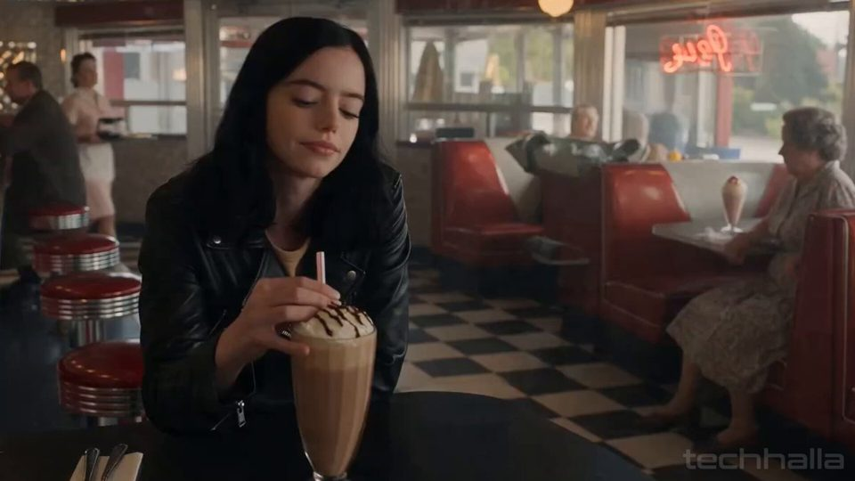</a>

- **作者:** [TechHalla](https://x.com/techhalla/status/2083389002552664385) · X · **Seedance 2.5** · ♥ 2875
- **标签:** `写实电影感` `美式` `历史年代` `轻松欢快` `时间冻结倒放` `一镜到底` `叙事短片`
- 1950年代美式餐馆里，侍者打翻托盘的瞬间时间冻结，飞溅的奶昔、煎蛋悬在空中，镜头穿行其间后整段倒带复原。

<details><summary>提示词</summary>

```text
Photorealistic cinematic 1950s American diner, chrome stools, red vinyl, neon glow and checkerboard floor, shot with modern lived-in realism and soft natural window light. Subtle handheld texture, warm practicals, rich period detail, heavy film grain.

0-4s: [Medium Wide] A striking young woman in her early 20s sits alone at the counter, calm and slightly amused, slowly sipping a tall thick milkshake through a straw. Behind her a young waitress in classic uniform approaches with a tray of eggs and bacon in one hand and a full glass coffee pot in the other. An older lady starts rising from a nearby booth.

4-8s: [Dynamic Tracking] The older lady collides hard into the waitress. Tray, plate, eggs, bacon and coffee pot explode upward in chaotic slow motion. Coffee erupts into long liquid ribbons and perfect suspended droplets. Camera immediately begins a smooth continuous orbit around the impact. Time locks completely at the peak of the spill. Every face freezes in pure shock. Only the girl at the counter keeps moving, completely unfazed.

8-17s: [Slow 360° Orbital] Camera glides in a full elegant orbit through the frozen diner. Coffee hangs in mid-air as glassy ribbons and spheres with perfect volume and surface tension. Bacon strips, eggs and the spinning tray float weightlessly. Patrons and waitress remain locked in startled expressions. The girl at the counter takes one slow, deliberate sip, eyes half-lidded, almost bored, while the entire frozen world (except her) begins an elegant reverse: every droplet, every piece of food and every person rewinds smoothly back to the exact starting positions.

17-24s: [Medium Shot] Rewind lands perfectly. Waitress stands balanced again with tray and coffee pot. The girl lifts her eyes, raises two fingers in a small casual gesture and softly calls the waitress by name. The waitress turns toward her just before the older lady begins to stand, completely avoiding the collision. A tiny private smile crosses the girl’s face.

24-30s: [Extreme Close-Up] Hard cut to her face as she takes one last slow sip. Soft knowing smile, eyes almost closed in quiet satisfaction, like she has done this a hundred times. Shallow depth of field, creamy bokeh of the neon diner behind her.

Photorealistic, ultra-detailed fluid physics, perfect motion blur only on moving elements, stable characters, cinematic lighting, heavy natural film grain, no artifacts, movie-level temporal coherence, high rewatch value.
```

</details>

### [爱德华时代的新娘枪战](https://daiyixiang666.github.io/awesome-ai-video-prompts/w/x-2113468132866355641.html)

<a href="https://daiyixiang666.github.io/awesome-ai-video-prompts/w/x-2113468132866355641.html">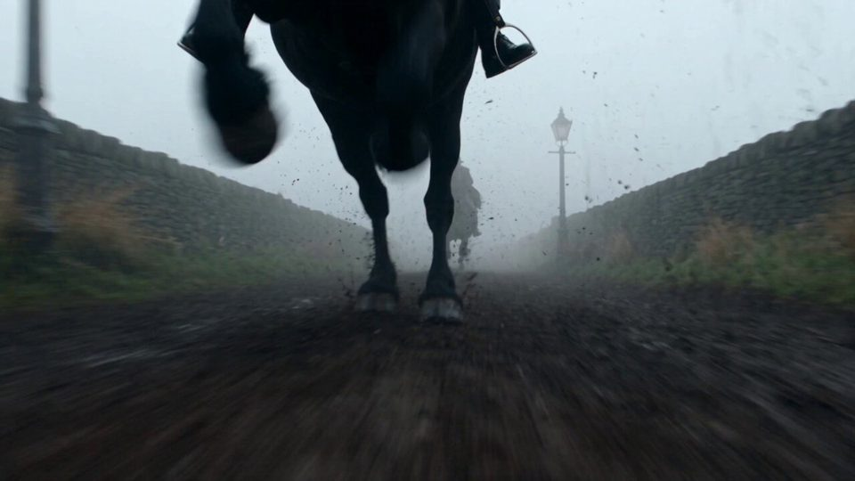</a>

- **作者:** [Shami](https://x.com/ShamiWeb3/status/2113468132866355641) · X · **Seedance 2.5** · ♥ 414
- **标签:** `写实电影感` `欧洲` `历史年代` `武侠打斗` `紧张刺激` `多镜头剪辑` `预告片`
- 雾中马车追逐，穿婚纱的新娘探身开枪，骑手落马，最后新娘站在街灯下。

### [维多利亚的草地梦](https://daiyixiang666.github.io/awesome-ai-video-prompts/w/x-2111638394233045069.html)

<a href="https://daiyixiang666.github.io/awesome-ai-video-prompts/w/x-2111638394233045069.html">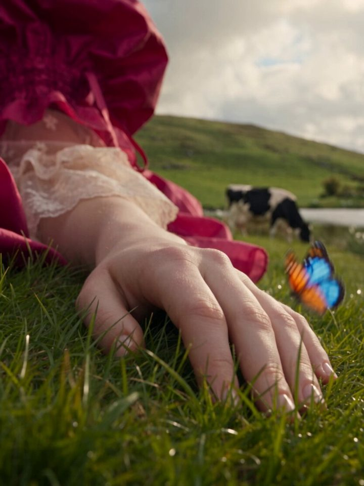</a>

- **作者:** [Maria](https://x.com/thisismariaa25/status/2111638394233045069) · X · **Seedance 2.5** · ♥ 164
- **标签:** `写实电影感` `欧洲` `历史年代` `时尚美妆` `浪漫心动` `慢动作` `MV`
- 身着玫红维多利亚长裙的女孩在草地上躺卧、吹肥皂泡、俯身看水塘，背景有奶牛与古宅。

### [海边的放学路](https://daiyixiang666.github.io/awesome-ai-video-prompts/w/x-2111654730028196093.html)

<a href="https://daiyixiang666.github.io/awesome-ai-video-prompts/w/x-2111654730028196093.html">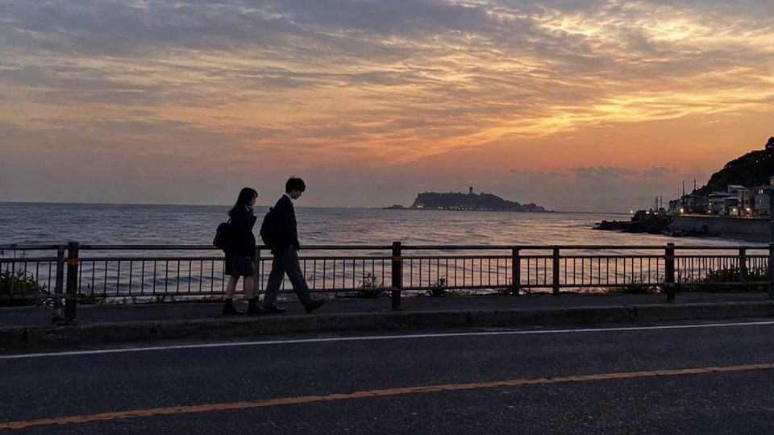</a>

- **作者:** [GENEL | リアルなAI動画制作](https://x.com/genel_ai/status/2111654730028196093) · X · **Kling 4.0** · ♥ 110
- **标签:** `写实电影感` `日系` `爱情青春` `浪漫心动` `孤独忧郁` `对白口型` `叙事短片`
- 日本高中生男女在黄昏海边并肩走，聊着未来的志愿，女生笑着回头，日文字幕。

### [瑞士山道速降](https://daiyixiang666.github.io/awesome-ai-video-prompts/w/x-2111553161525964874.html)

<a href="https://daiyixiang666.github.io/awesome-ai-video-prompts/w/x-2111553161525964874.html">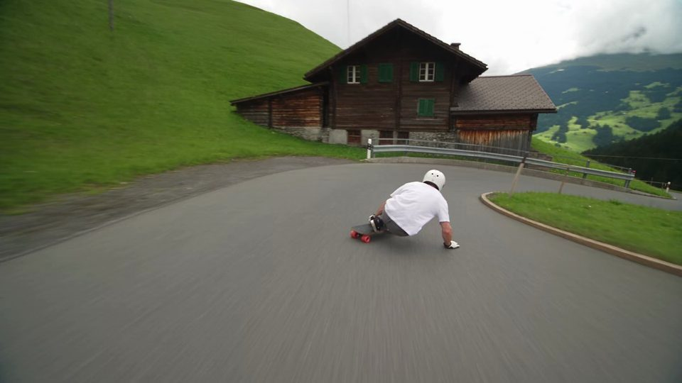</a>

- **作者:** [TSUBAKI](https://x.com/AI__TSUBAKI/status/2111553161525964874) · X · **Seedance 2.5** · ♥ 13
- **标签:** `写实电影感` `欧洲` `运动极限` `紧张刺激` `一镜到底` `vlog`
- 一镜到底：长板选手在瑞士阿尔卑斯山谷的双车道上高速速降，跟拍镜头贴地追随。

<details><summary>提示词</summary>

```text
A single continuous 30-second take with no cuts. Rider, an adult male downhill longboarder, bombs a two-lane mountain road down a green Swiss alpine valley at extreme speed. The road is smooth grey asphalt with a white dashed centre line, a metal guardrail on the valley side, and white-and-black roadside marker posts. On one side, a steep bright-green meadow rises with old wooden Swiss chalets with red-brown shutters and dark timber barns. On the other side, dense dark conifer forest falls away into the valley. Forested mountains with green pasture clearings fill the distance, with low white clouds drifting across the peaks under a bright overcast sky. There are wooden utility poles along the road.

[Rider]
Rider wears a white full-face downhill helmet with a dark visor, so his face is never visible. He wears a plain white T-shirt, slim grey pants and black-and-white low-top skate shoes. He wears black slide gloves with round white hard pucks on the palms. He rides a long downhill board with black grip tape and bright red urethane wheels.

[Image Quality]
Ultra-high-definition 8K, with crisp, razor-sharp detail on Rider, his clothing folds, the glove pucks, the board and the red wheels. The asphalt grain, the meadow grass, the chalet wood and the distant tree lines are finely resolved. It has a clean, high-end action-camera look with no compression artifacts, no noise and no smearing. Rider stays sharp while the roadside streaks with strong directional motion blur.

[Camera and Look]
A low chase camera follows him like real raw-run footage: a wide-angle action lens about 1.5 meters off the ground, 3 to 4 meters behind, with natural high-frequency vibration from the road. The camera never stays dead-centre. It drifts left and right with each corner and keeps Rider on the left or right third, so the next corner and the open road ahead are always readable. The look is ultra-realistic documentary sports footage in natural soft overcast daylight, with no slow motion.

[Speed Rule]
Speed is everything in this video. From the first frame Rider is already travelling at over 100 km/h, and he never visibly slows down. Every corner is taken at full speed. His hand touches the asphalt only as a light, fast dab for balance and grip, never as a braking slide, and the board stays nearly straight. Immediately after each corner he snaps back into a deep tuck and keeps accelerating, so each straight is faster than the last. The motion blur, the white dashes flicking past rapidly and the wind tearing at his T-shirt never ease off.

[Stage 1 / approx. 0–3s] Instant corner
The video opens mid-run at full speed with a fast right-hand curve already arriving. Rider leans hard into it in a low crouch, dabs his gloved right hand on the asphalt with a quick scrape and sweeps through the apex without losing speed. The camera swings around the outside of the curve, and the guardrail whips past in the foreground.
End state: Rider exiting the curve, still at full speed.

[Stage 2 / approx. 3–10s] Acceleration straight
Continue from the previous stage. Rider snaps into a deep aero tuck: front knee bent, back knee tucked behind the front calf, chest low, hands clasped behind his back. The road drops steeply down the valley. The chalets on the meadow side and the utility poles flash past one after another, and the white centre dashes strobe under the camera. His T-shirt ripples violently in the wind.
End state: Rider at an even higher speed, with a left-hand curve rushing toward him.

[Stage 3 / approx. 10–17s] Corner with oncoming car
Continue from the previous stage. Rider dives into the left-hand curve at full speed, dabs his left hand on the asphalt and holds a tight inside line. Right at the exit, a white compact car appears coming uphill in the opposite lane and passes within a few meters in a heavy rush of wind. Rider stays low and committed in his own lane, without flinching or braking. The camera lets the car pass through the edge of the frame and then settles back behind him.
End state: The car is gone and Rider is back in his tuck, still accelerating.

[Stage 4 / approx. 17–23s] Right-left switchback
Continue from the previous stage. A quick right curve flows straight into a left curve. Rider carves through both at full speed, with one fast hand dab on each side and his shoulders rolling with the road. The camera follows close, its horizon tilting slightly with each lean.
End state: Rider exits onto the longest, steepest straight of the run.

[Stage 5 / approx. 23–30s] Top speed
Continue from the previous stage. Rider is in his deepest, tightest tuck, and this is the fastest moment of the whole video. The roadside smears into pure streaks of green and grey while the valley and mountains ahead stay steady. The wheels hum at a high pitch, and the board is perfectly stable.
End state: Rider at absolute top speed, small against the huge green valley, still pulling away down the road.

[Maintain Consistency]
One rider only, always the same Rider with the same white helmet with the visor down, white T-shirt, grey pants, black gloves and red-wheeled board. His face is never shown. He always rides downhill in the same direction of travel. The car stays in the opposite lane and passes once. The take is one continuous shot with no cuts, no slow motion, no slowing down and no on-screen text.

Audio is raw on-board sound only, with no music: <roaring wind buffeting the camera>, <constant hard rumble of urethane wheels on asphalt>, <quick gritty scrapes of the glove pucks on the road>, <a car engine growing louder then a sharp whoosh as it passes>, <the wheel hum rising in pitch as the speed climbs>.
```

</details>

### [冬日唱片店](https://daiyixiang666.github.io/awesome-ai-video-prompts/w/x-2114729417218167119.html)

<a href="https://daiyixiang666.github.io/awesome-ai-video-prompts/w/x-2114729417218167119.html">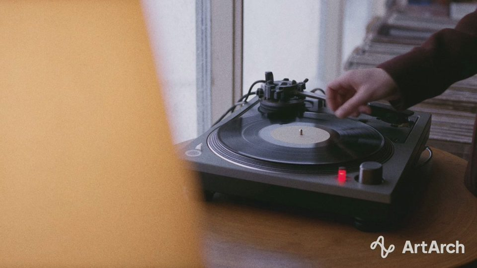</a>

- **作者:** [TSUBAKI](https://x.com/AI__TSUBAKI/status/2114729417218167119) · X · **Kling 4.0** · ♥ 7
- **标签:** `写实电影感` `日系` `音乐舞蹈` `日常生活` `温暖治愈` `多镜头剪辑` `叙事短片`
- 雪夜的唱片店：唱针落下、手指划过唱片架、窗外飘雪、暖色灯光下的室内。

### [屋顶之战](https://daiyixiang666.github.io/awesome-ai-video-prompts/w/x-2021394940757209134.html)

<a href="https://daiyixiang666.github.io/awesome-ai-video-prompts/w/x-2021394940757209134.html">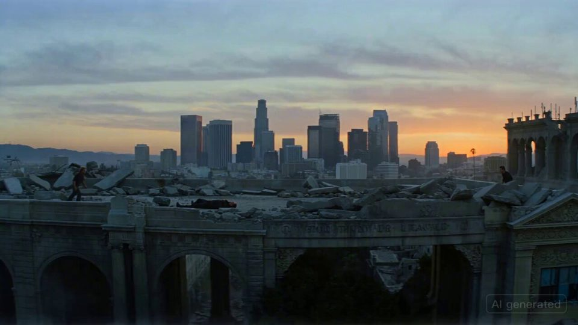</a>

- **作者:** [Ruairi Robinson](https://x.com/RuairiRobinson/status/2021394940757209134) · X · **Seedance 2.0** · ♥ 8863
- **标签:** `写实电影感` `美式` `武侠打斗` `紧张刺激` `热血燃` `多镜头剪辑` `预告片`
- 两位好莱坞巨星脸的角色在洛杉矶天台对打，动作和镜头接近大片。

### [雨中 F1](https://daiyixiang666.github.io/awesome-ai-video-prompts/w/x-2046730453139276011.html)

<a href="https://daiyixiang666.github.io/awesome-ai-video-prompts/w/x-2046730453139276011.html">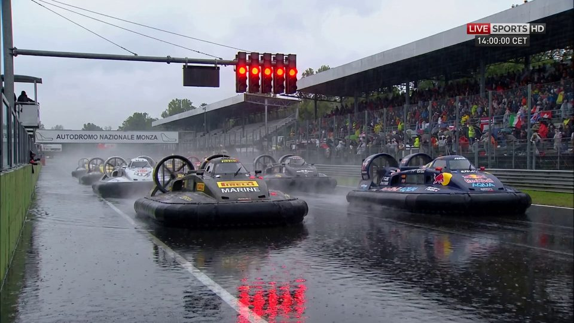</a>

- **作者:** [TechHalla](https://x.com/techhalla/status/2046730453139276011) · X · **Seedance 2.0** · ♥ 8683
- **标签:** `写实电影感` `欧洲` `运动极限` `汽车` `喜剧搞笑` `紧张刺激` `变身转场` `梗段子`
- 暴雨中的 F1 赛道转播画面，赛车变成气垫船，最后鳄鱼爬上赛道追车手。

<details><summary>提示词</summary>

```text
[CINEMATIC SETUP]
Real TV Broadcast style. Shot on 35mm lenses with high-shutter speed to capture water droplets.

Color grade: Natural, overcast race aesthetic matching the lighting in [ref img] .

Audio: Immersive spatial sound with high-pitched engine whirring, heavy water splashing, and dramatic sports commentary muffled by engine noise.

[IMAGE REFERENCES / LEGEND] 
[ref img] : The starting grid at Autodromo Nazionale Monza. Use this for the exact hovercraft designs, the wet track texture, and the "LIVE SPORTS" UI overlay.    

[TIMELINE SECOND BY SECOND] 

0-3s: [Wide shot] Match [ref img]  perfectly. The red lights vanish; the hovercrafts accelerate instantly with massive "rooster tail" water spray. Realistic physics as the crafts lift off the wet asphalt.

3-7s: [Aerial Drone tracking shot] High-angle view following the pack into a sharp curve. Two hovercrafts   lose stability, skip across the water's surface, and land into the grass/mud runoff, creating a debris cloud.

7-11s: [Close-up tracking shot] Focus on the head of the race. A blue "TechHalla Aqua" craft attempts an aggressive overtake. Suddenly, a large crocodile lunges from the trackside water, biting into the thick rubber tire of the chasing craft. The craft jerks and spins out of control.

11-15s: [Ground-level wide shot] The hovercraft comes to a stop. The bald with beard pilot frantically climbs out of the cockpit. The crocodile crawls onto the track toward him. The shot ends with the pilot running toward the camera as the crocodile pursues.
```

</details>

### [Kalshi 疯狂广告](https://daiyixiang666.github.io/awesome-ai-video-prompts/w/x-1932893260399456513.html)

<a href="https://daiyixiang666.github.io/awesome-ai-video-prompts/w/x-1932893260399456513.html">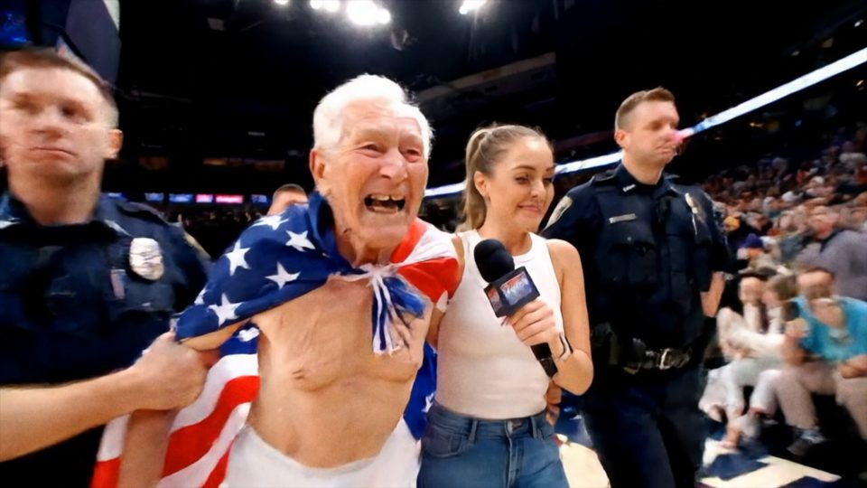</a>

- **作者:** [PJ Ace](https://x.com/PJaccetturo/status/1932893260399456513) · X · **Veo 3** · ♥ 4365
- **标签:** `写实电影感` `广告大片` `美式` `喜剧搞笑` `运动极限` `热血燃` `轻松欢快` `多镜头剪辑` `广告TVC`
- GTA 风格的 NBA 总决赛广告，十个疯癫角色轮番登场，真的在电视网播出。

### [面条宗师](https://daiyixiang666.github.io/awesome-ai-video-prompts/w/x-2036407484836094014.html)

<a href="https://daiyixiang666.github.io/awesome-ai-video-prompts/w/x-2036407484836094014.html">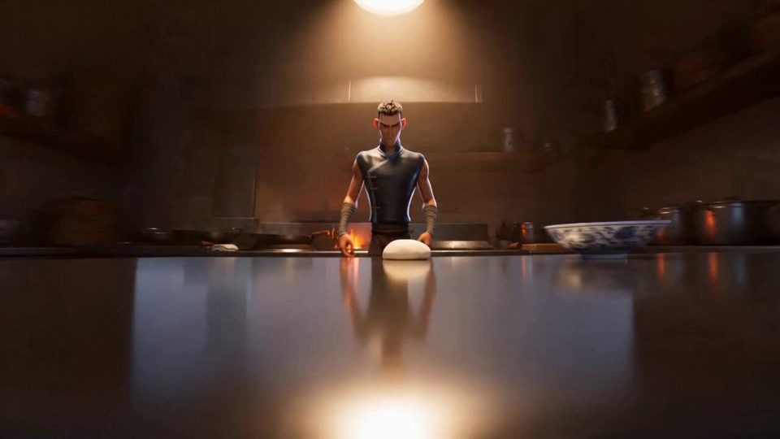</a>

- **作者:** [Latte](https://x.com/0xbisc/status/2036407484836094014) · X · **Seedance 2.0** · ♥ 3121
- **标签:** `写实电影感` `中式` `美食` `武侠打斗` `热血燃` `多镜头剪辑` `慢动作` `叙事短片`
- 功夫厨师在暗调厨房里拉面、甩锅，动作如武打，蒸汽淡出收尾。

<details><summary>提示词</summary>

```text
SUBJECTS:
Subject 1: Lean kung fu chef with short, sharp-cut hair and defined jawline. Wears a modernized Chinese chef outfit fused with martial arts attire: fitted sleeveless upper garment with mandarin collar, dark matte fabric with subtle sheen; forearms wrapped with cloth bands for grip; loose tapered pants allowing wide stances; soft-soled shoes for silent footwork. Limbs slightly exaggerated in length; wrists highly flexible, elbows explosive. Movements follow clear martial rhythm (pause → burst → lock), with grounded footwork and fast pivots.

ENVIRONMENT:
Traditional Chinese open-fire stove setup; iron wok fixed on stove; reflective metal counter; blue-and-white porcelain bowl placed in foreground center. Warm overhead light combined with intense dynamic firelight; light oil smoke and visible heat distortion.

MOOD:
High tension, aggressive, but controlled and precise; performance feels intentional and elegant rather than chaotic.

TIMELINE:
0:00-0:02: Extreme close-up, wide-angle POV. The chef stands on the ground behind the counter (counter always between camera and chef), steps in, compresses posture, then snaps his head up to lock eyes with camera. Both hands grip dough—he stretches it in one clean pull, folds once, then pulls again. The dough transitions from a single mass into a small number of even strands.

0:02-0:05: Cut. Slight handheld motion. The chef keeps full control of the noodle bundle in both hands, stretching and aligning the strands into clean, parallel lines through fold → align → stretch cycles. Around 8–12 thin strands extend in smooth arcs, passing close to the lens in clean, readable motion. He finishes the pull and places the aligned noodle bundle neatly onto the counter in front of him.

0:05-0:07: Move (slight recoil then stabilize). The chef lowers into a sliding step behind the counter. One palm sweeps across the surface—shrimp and greens lift and travel in a controlled arc into the wok. The wok remains on the stove; the chef grips only the handle. Any stray ingredient is clearly caught and redirected into the wok.

0:07-0:10: Continuous shot. The chef controls the wok only through handle movement and qi force—no hands enter the wok. He lifts, tilts, and snaps the wok using wrist power; ingredients rise, rotate, and fall back into the wok. His elbow strikes the stove edge—sparks burst. He compresses the wok into the flame, then reverses to pull the flame upward into a second controlled flare.

0:10-0:12: Match move tracking. The chef pivots while holding the wok handle. With the other hand, he picks up the same noodle bundle from the counter and feeds it directly into the wok in one controlled motion. He immediately resumes tossing using the wok—three clean toss cycles (fast → faster → stop). Shrimp, greens, and noodles integrate visibly; sauce coats evenly.

0:12-0:15: Cut to stabilized POV. Sudden full stop. The chef tilts the wok and slides the finished dish into the porcelain bowl—visible: evenly coated noodles, plump shrimp, glossy greens. He lifts and presents the bowl directly toward the camera until it fills the frame. A finger taps the rim—subtle vibration. Steam rises rapidly, expanding until it fully covers the lens for a clean fade-out.
```

</details>

<a id="documentary-handheld"></a>
## 纪实手持

### [整理榻榭米卧室](https://daiyixiang666.github.io/awesome-ai-video-prompts/w/x-2109135117834989699.html)

<a href="https://daiyixiang666.github.io/awesome-ai-video-prompts/w/x-2109135117834989699.html">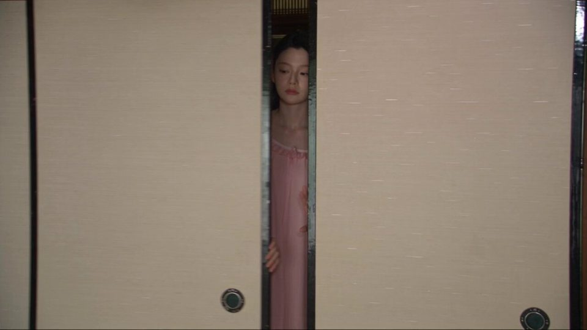</a>

- **作者:** [𝗦𝗮𝗻𝗶𝗮](https://x.com/saniaspeaks_/status/2109135117834989699) · X · **Seedance 2.5** · ♥ 2284
- **标签:** `纪实手持` `胶片复古` `日系` `日常生活` `温暖治愈` `多镜头剪辑` `vlog`
- 早年 DV 视角里，日本女孩把凌乱的被褥抖开、叠好、卷起，扫地后拉开拉门，卧室焕然一新。

<details><summary>提示词</summary>

```text
Create a 30-second ultra-realistic early-2000s Japanese home vlog featuring the same young Japanese girl with consistent face, hairstyle, and outfit.

Scene 1: She enters her bedroom and finds messy futon bedding, twisted blankets, and scattered pillows.

Scene 2: She removes the pillows, folds the blanket neatly, then folds and rolls the futon mattress and puts it away.

Scene 3: She removes the old pillow covers, replaces them with clean ones, fluffs the pillows, and arranges them neatly.

Scene 4: She sweeps the entire bedroom floor, including corners, then wipes away the remaining dust with a cloth.

Scene 5: She straightens the room, opens the curtains, and admires her clean, peaceful bedroom with a satisfied smile. End with a clear wide shot revealing the finished room.

Keep every scene in exact order. Show each action completely with no skipped steps, sudden transitions, or magically moving objects. Maintain consistent props and room layout. Use authentic 2003 Japanese furniture and handheld MiniDV footage with natural lighting, slight camera shake, autofocus shifts, and mild digital noise. Realistic movements and a satisfying final reveal.
```

</details>

### [东京旅行 Vlog](https://daiyixiang666.github.io/awesome-ai-video-prompts/w/x-2071191480215969845.html)

<a href="https://daiyixiang666.github.io/awesome-ai-video-prompts/w/x-2071191480215969845.html">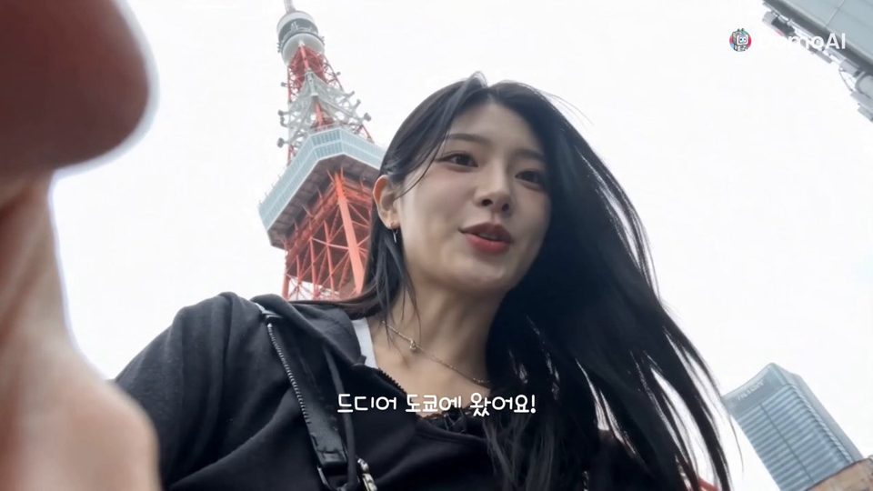</a>

- **作者:** [TSUBAKI](https://x.com/AI__TSUBAKI/status/2071191480215969845) · X · **Seedance 2.0** · ♥ 1043
- **标签:** `纪实手持` `日系` `旅行城市` `轻松欢快` `第一人称` `卡点节奏` `vlog`
- 韩系女孩用自拍视角游东京：东京塔、公园长椅、夜里自动贩卖机、高达像、夜景、奈良小鹿，快节奏音乐剪辑。

<details><summary>提示词</summary>

```text
TOKYO TRAVEL VLOG — 15 SEC MUSIC CUT

Subject: Same girl as the reference images. Young Korean idol-like woman in her early 20s. Long straight black hair with soft natural volume, fair porcelain skin, large bright expressive eyes, delicate V-line face, small nose, natural glossy lips, fresh minimal makeup, effortlessly cute and approachable expression. Casual Japanese streetwear (white hoodie / dark oversized hoodie / oversized jacket). 26mm phone lens, deep focus, realistic skin texture, mild HDR, neutral iPhone color science, unedited candid, no cinematic grading, no studio lighting, no light trails, no motion blur effects.

(0:00–0:01) — walking shot, Tokyo Tower reveal Selfie, low angle. Tower behind her, sky overexposed. Natural smile. Neutral daylight, deep focus. Dialogue: "드디어 도쿄에 왔어요...!" Transition: Hard cut / beat drop

(0:01–0:02) — Shibuya Crossing Mid-stride into crowd. Turns head toward camera. Neon signs sharp behind her. Real night exposure. Transition: Fast cut on beat

(0:02–0:03) — Convenience Store Holds onigiri up to camera, eyebrows raised. Harsh fluorescent interior. Cool white light, realistic skin. Transition: Snap cut on beat

(0:03–0:04) — Yoyogi Park Seated, looking away. Dappled light, lens smudge visible. Music drops one beat — wind, birds — snaps back. Transition: Cut on natural movement

(0:04–0:06) — Takoyaki Reaction Bites, eyes wide, pulls back laughing. Warm practical lantern light. Realistic skin in amber. Dialogue: "뜨거워! 진짜 맛있어!" Transition: Cut on laugh end

(0:06–0:07) — Vending Machine Night Stands before glowing vending machine. Mixed LED light on face. Slight smirk. No glow fx. Transition: Single beat cut

(0:07–0:08) — Train Window Face reflected in window. City blurred naturally outside. She looks out, not at camera. Transition: Snap cut

(0:08–0:09) — Torii Gate Low angle. Walks toward and through shrine gate. Gate fills top of frame. Natural daylight. Transition: Snap cut

(0:09–0:11) — Digital Light Exhibit ★ SIGNATURE Looks up slowly. Blue, violet, gold projection on face. Rack focus — face sharp, lights diffused. Just projection on skin, no bloom. Speed: ~60% slow motion Transition: Soft cut mid-upward motion

(0:11–0:12) — Gundam Reveal Face → camera tilts up → full statue in frame. Small impressed smile. Wide angle, natural daylight. Transition: Sharp cut after smile

(0:12–0:13) — Lantern Alley Follow from behind. Lanterns warm, shadows dark. Natural low light. She glances back once. Transition: Cut on forward movement

(0:13–0:14) — Rooftop Skyline Close selfie → arm extends → skyline revealed. Wind moves hair. Natural night phone exposure. Dialogue: "이런 야경은 처음 보는 것 같아요." Transition: Hard cut on last word

(0:14–0:15) — Nara Deer Park, She crouches, holds out a deer cracker. Deer bows toward her — she bursts out laughing. Another nudges her from behind, she nearly topples. Handheld, slightly off-balance. All real. Dialogue: "잠깐! 진짜 절했어!" Transition: Fade to black
```

</details>

### [首尔巷口的午前](https://daiyixiang666.github.io/awesome-ai-video-prompts/w/x-2086806078105551218.html)

<a href="https://daiyixiang666.github.io/awesome-ai-video-prompts/w/x-2086806078105551218.html">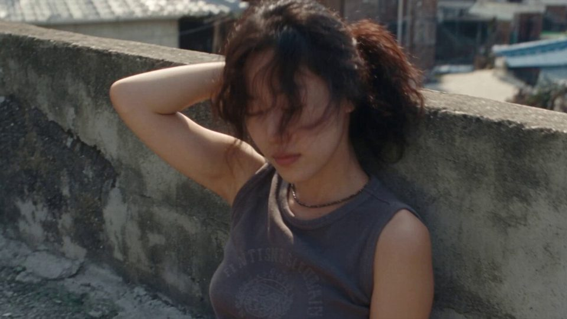</a>

- **作者:** [Saul Goodman](https://x.com/Goodmanprotocol/status/2086806078105551218) · X · **Seedance 2.5** · ♥ 1004
- **标签:** `纪实手持` `韩系` `日常生活` `温暖治愈` `多镜头剪辑` `vlog`
- 韩国女孩在老旧住宅区的普通上午：拢头发、逗猫、晾衣服、在屋顶喝咖啡、走回小巷，朋友随手跟拍。

<details><summary>提示词</summary>

```text
Create a 30-second ultra-realistic candid home-video sequence of a young Korean woman in her early 20s living an ordinary late morning in a quiet Korean residential neighborhood.

SUBJECT:
Young Korean woman, natural everyday appearance, realistic skin texture, minimal makeup, black wavy hair in a messy side ponytail with wispy bangs. Faded charcoal-grey sleeveless crop top, loose high-waisted light-wash jeans, black canvas sneakers, simple black cord necklace. Warm, relaxed personality. Keep her face, body, hairstyle, clothing, and appearance perfectly consistent throughout.

SETTING:
Authentic Korean residential neighborhood — narrow concrete alleys, low-rise homes, small terraces, potted plants, laundry lines, bicycles, utility poles, overhead wires and mature trees. Quiet, lived-in atmosphere. No shops, advertisements, crowds, cafés, or commercial activity.

VISUAL STYLE:
Ultra-realistic documentary home-video footage from an early-2000s consumer DV camcorder. Imperfect handheld operation, natural camera shake, awkward framing, occasional reframing, autofocus hunting, slight lens breathing, exposure pumping between sunlight and shade, subtle motion blur, mild rolling shutter, faded colors, soft contrast, slight digital compression and sensor noise. No stabilization, no cinematic camera moves, no modern color grading. Everything must feel genuinely captured, not AI-generated.

TIMELINE:
00:00–00:05 — Outside her small house, she sits on a low concrete wall adjusting her messy ponytail. Wind moves loose strands of hair. She casually smiles while the camera struggles to lock focus.

00:05–00:10 — She walks into a narrow residential alley. A stray cat approaches. She crouches naturally, pets it and gently feeds it. Autofocus shifts imperfectly between her face and the cat.

00:10–00:15 — In a small front yard, she hangs laundry on a clothesline. Fabric moves naturally in the breeze while sunlight and cloud shadows subtly change the exposure.

00:15–00:20 — She sits on a quiet terrace with a simple ceramic coffee cup, casually watching the neighborhood and brushing loose hair behind her ear. Handheld side angle with natural camera drift.

00:20–00:25 — Close side profile. Someone off-camera casually greets her. She turns, smiles warmly, raises her hand and naturally says, “Annyeong.” The camera reacts slightly late.

00:25–00:30 — She walks slowly down a tree-lined residential lane holding her coffee. She notices the camera, gives a small genuine smile, then looks away and continues walking. The recording abruptly cuts to black mid-motion like an old camcorder being switched off.

AUDIO:
Only authentic location sound: birds, distant motorcycles, light wind, rustling leaves, faint neighborhood chatter, cat sounds, footsteps on concrete, laundry moving on the clothesline and subtle residential ambience. Natural Korean speech only. No music, narration, cinematic sound effects, or artificial sound design.

GOAL:
Make it feel like a forgotten personal home video from the early 2000s — intimate, spontaneous, imperfect, warm, mundane and deeply believable. Prioritize realistic human motion, natural facial expressions, physical interaction, environmental detail and consistent identity over cinematic beauty.
```

</details>

### [2000年代的生日](https://daiyixiang666.github.io/awesome-ai-video-prompts/w/x-2105146792681832481.html)

<a href="https://daiyixiang666.github.io/awesome-ai-video-prompts/w/x-2105146792681832481.html">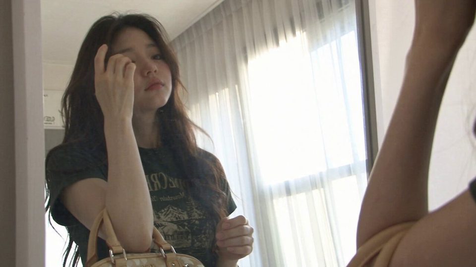</a>

- **作者:** [𝗦𝗮𝗻𝗶𝗮](https://x.com/saniaspeaks_/status/2105146792681832481) · X · **Seedance 2.5** · ♥ 918
- **标签:** `纪实手持` `胶片复古` `韩系` `日常生活` `温暖治愈` `多镜头剪辑` `vlog`
- 早年 DV 拍下的韩国女生生日：闺蜜拥抱、面包店买蛋糕、吹蜡烛、分蛋糕、傍晚街头散步。

<details><summary>提示词</summary>

```text
Create a 30-second ultra-realistic Korean birthday vlog set in South Korea in the early 2000s, filmed casually by a friend on an authentic consumer DV camcorder. It must feel like genuine home-video footage, not a modern video with a retro filter.

EXACT ORDER — 7 SCENES:

0–4s — GETTING READY: The same young Korean birthday girl gets ready in her early-2000s bedroom, fixes her hair, adjusts makeup, picks up her handbag and smiles toward the camera.

4–8s — MEETING FRIENDS: She walks through an authentic Korean neighborhood, meets the same 2–3 friends, they congratulate her and walk together toward a bakery.

8–11s — BAKERY: They enter a small early-2000s Korean bakery, browse cakes and choose one birthday cake.

11–14s — BUYING CAKE: A friend pays with cash. The worker puts the cake into a box and hands it over. The same cake box remains visible as they walk to the café.

14–23s — CAFÉ CELEBRATION: They sit in a cozy early-2000s café. The cake is opened, a candle is lit, everyone sings Happy Birthday, the girl makes a wish and blows it out. They clap and laugh. She then cuts the cake, places pieces on plates, personally gives a piece to each friend, watches them eat, then takes a piece herself. Keep the entire sequence clearly visible and in order.

23–26s — PHOTOS: After eating, they take group photos using a small early-2000s disposable film camera. No smartphones or modern digital cameras. They pose, the shutter clicks and they laugh afterward.

26–30s — EVENING WALK: They leave the café and walk through the same neighborhood as it becomes evening. The girl carries her handbag, a friend carries the empty cake box/bag, and they chat and laugh while the camera follows from behind.

CONTINUITY: Same girl, friends, outfits, hairstyles, handbag and cake throughout. No teleporting, identity drift, outfit changes, disappearing props or reordered actions.

ERA: Everything must look authentically early 2000s Korean—fashion, hair, bakery, café, cars, signs, furniture, cake packaging and technology. No smartphones, AirPods, modern cars, LED screens or contemporary interiors.

CAMERA: Raw consumer DV footage with subtle handheld shake, imperfect framing, autofocus hunting, exposure shifts, soft digital detail, mild CCD/DV noise, motion blur, compression and occasional awkward zooms. Natural candid behavior, realistic skin and movement. No cinematic stabilization, 4K sharpness, beauty filters, VHS effects or professional filmmaking.

FINAL FEEL: A genuine Korean birthday memory from the early 2000s, with every scene and action clearly shown in the exact requested order.
```

</details>

### [一次小小的兜风](https://daiyixiang666.github.io/awesome-ai-video-prompts/w/x-2104776214066188611.html)

<a href="https://daiyixiang666.github.io/awesome-ai-video-prompts/w/x-2104776214066188611.html">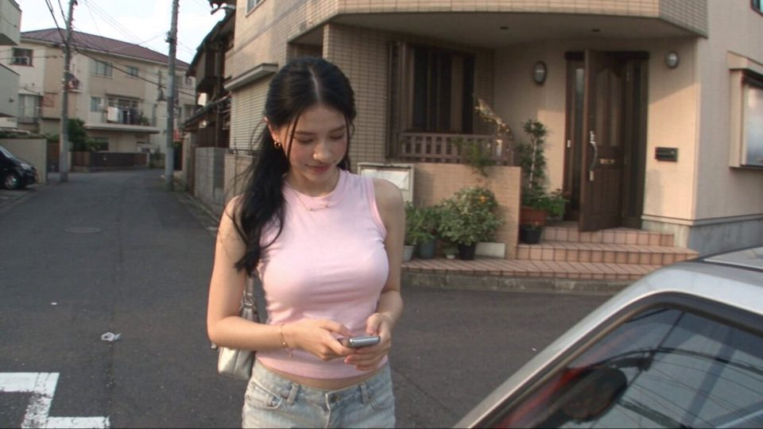</a>

- **作者:** [Smiling Khan](https://x.com/AIwithkhan/status/2104776214066188611) · X · **Seedance 2.5** · ♥ 611
- **标签:** `纪实手持` `胶片复古` `韩系` `爱情青春` `浪漫心动` `多镜头剪辑` `vlog`
- DV 记录的情侣午后兜风：上车、便利店买饮料、河堤边停车，男生替女生擦嘴角后轻吻。

<details><summary>提示词</summary>

```text
Create a 30-second, 1080p ultra-realistic early-2000s consumer DV camcorder home video of a young Korean couple going for a casual afternoon drive through Seoul. The footage should feel like a genuine memory recorded by a friend, imperfect and spontaneous rather than a polished commercial.

=== CHARACTERS ===

GIRL: Young adult Korean woman in her early 20s, naturally beautiful, realistic skin, minimal makeup, long slightly wavy dark hair tied loosely with a few strands framing her face. Ll

BOYFRIEND: Young adult Korean man in his early 20s, natural hairstyle, realistic skin, relaxed expression, wearing a loose white T-shirt, dark jeans and white sneakers. Keep his appearance consistent.

=== STORY ===

She waits outside her apartment building with a small shoulder bag, checking her phone and looking down the street. Her boyfriend arrives in an older compact car and smiles when he sees her. She opens the passenger door, gets inside and playfully looks toward the camera as if embarrassed about being filmed.

They drive slowly through an older Seoul neighborhood. She sits in the passenger seat with the window slightly open, enjoying the breeze while her hair moves naturally. Her boyfriend occasionally glances at her and smiles while keeping his attention on the road.

They stop at a small neighborhood convenience store. She gets out, buys two cold drinks and returns to the car. She hands one to her boyfriend, keeps the other for herself, and they laugh together before continuing the drive.

Later, they park near a quiet riverside road. They get out and walk beside the parked car, talking casually. She takes a sip of her drink, makes a playful expression at the taste, and he laughs. She lightly pushes his shoulder and they continue walking together.

A gentle breeze moves through her hair. He notices a strand across her face and gently moves it aside. She smiles and looks at him for a moment. They stand close together beside the car, sharing a quiet romantic moment.

Near the end, she looks toward the camera and laughs shyly, then turns back toward her boyfriend. He steps closer, she smiles, and they share a brief, natural kiss. They pull back, laugh softly and remain standing close together as the camera keeps recording.

The boyfriend looks toward the camera and jokingly shakes his head while she hides her face against his shoulder, laughing.

=== CAMERA / DV FEEL ===

Raw early-2000s consumer DV camcorder footage. Handheld camera operated by a friend sitting in the back seat and later walking with them. Imperfect framing, subtle handheld shake, autofocus hunting, occasional exposure shifts, faded summer colors, soft digital detail, mild sensor noise, natural motion blur and occasional accidental zooms. No stabilization and no polished cinematic movement.

=== AUDIO ===

Built-in camcorder microphone only. Car engine, road noise, turn signals, window breeze, distant Seoul traffic, convenience-store door chime, refrigerator hum, footsteps, birds, neighborhood voices, fabric movement and natural laughter. Their dialogue should feel casual and partially imperfect like a real home video. No music, no narration, no subtitles.

=== REALISM / CONTINUITY ===

Keep the same couple, faces, hairstyles, outfits, accessories and car throughout. Natural Korean facial features, realistic hands and fingers, believable walking, sitting, driving and kissing. Hair and clothing react naturally to the breeze and movement. Genuine expressions rather than exaggerated acting.

=== NEGATIVE ===

No cinematic commercial look, no gimbal shots, no drone shots, no dramatic lighting, no beauty filters, no plastic skin, no CGI appearance, no anime, no cartoon
```

</details>

### [商场里的日系 Vlog](https://daiyixiang666.github.io/awesome-ai-video-prompts/w/x-2092560049189351476.html)

<a href="https://daiyixiang666.github.io/awesome-ai-video-prompts/w/x-2092560049189351476.html">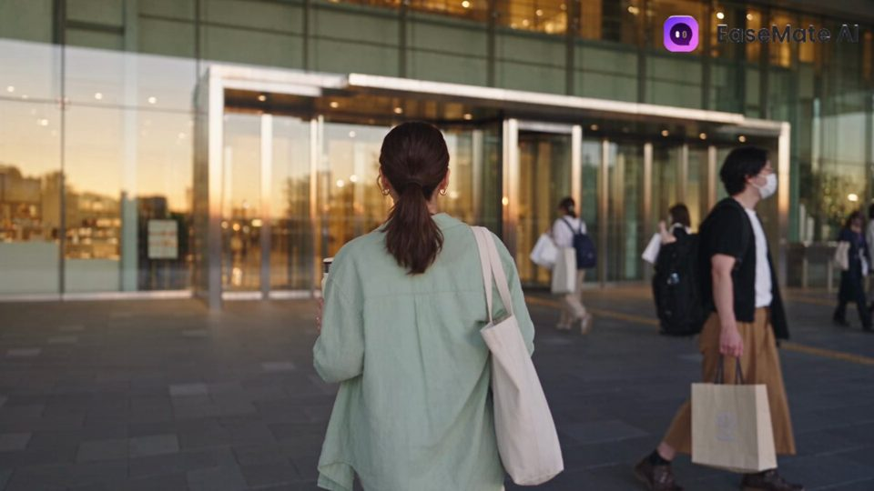</a>

- **作者:** [Sharon Riley](https://x.com/Just_sharon7/status/2092560049189351476) · X · **Seedance 2.5** · ♥ 591
- **标签:** `纪实手持` `日系` `旅行城市` `时尚美妆` `轻松欢快` `多镜头剪辑` `vlog`
- 日本生活方式博主 AOI 逛商场：杂货店、首饰台、点心铺试吃，日落时在广场收尾，配英文字幕。

<details><summary>提示词</summary>

```text
Generate a 30-second horizontal 16:9 ultra-realistic Japanese lifestyle influencer vlog based on the provided first frame and storyboard. ## Overall Concept A warm, realistic Japanese daily vlog following **AOI**, a young lifestyle influencer, during a relaxed afternoon-to-evening shopping trip. She walks through a modern Japanese shopping mall, explores stylish lifestyle and fashion stores, discovers cute everyday products, stops at a café-style food counter, talks naturally to the camera, and ends the vlog outside the mall as the evening lights begin to glow. The atmosphere should feel like an authentic Japanese influencer vlog rather than a commercial: intimate, candid, relaxed, observational, and naturally filmed. ## Main Character Lock Only one main female character: **AOI**. AOI is a young Japanese woman in her mid-20s with dark brown hair tied in a loose low ponytail, soft face-framing bangs, natural makeup, warm expressive eyes, small gold hoop earrings, and a delicate gold necklace. She wears a **light green loose linen overshirt with rolled-up sleeves, a white fitted tank top, beige high-waisted pants, and a cream canvas shoulder bag**. Keep her face, hairstyle, outfit, body proportions, bag, accessories, and personality perfectly consistent throughout the entire video. ## Branded Prop Continuity The phrase **“EASE MATE”** should appear naturally as a fictional lifestyle brand printed on selected products inside the mall and on objects AOI carries. Use tasteful, realistic product branding such as: * A reusable cream-colored **EASE MATE** water bottle * An **EASE MATE** travel tumbler * Small **EASE MATE** packaging on a lifestyle-store shelf * An **EASE MATE** canvas pouch or accessory * A small **EASE MATE** label on one product she briefly examines The branding should look physically printed or embossed onto the products, not like floating text. Keep spelling exactly **EASE MATE**. Do not place the logo everywhere. It should feel like a subtle recurring lifestyle brand. AOI eventually carries the **EASE MATE 📷Screenshot 2026-08-22 at 2.45.33 AM.png bottle** in her free hand during the later scenes while still wearing her cream canvas shoulder bag. ## Visual Style Ultra-realistic Japanese lifestyle vlog. Natural handheld camera, realistic skin texture, soft cinematic lighting, authentic Japanese shopping-mall interiors, warm ambient illumination, realistic reflections, shallow depth of field, subtle background activity, calm intimate daily-life mood. Avoid a glossy advertisement appearance. It should look like a real influencer filmed a casual shopping-day vlog with a high-quality camera. ## Camera Style Mix: * Third-person handheld walking shots * Selfie-style talking shots * Medium observational shots * Close-up product details * Over-the-shoulder shopping shots * Natural focus pulls Camera movement should feel like a real lifestyle influencer vlog: gentle handheld movement, subtle walking motion, natural reframing, realistic autofocus, smooth focus transitions, and motivated camera movement. No sudden impossible camera movements. --- ## Scene and Timing ### 0.0s – 2.5s **Exterior entrance of a modern Japanese shopping mall during late afternoon.** Third-person rear follow shot. AOI walks toward the mall entrance carrying her cream canvas shoulder bag. Warm afternoon sunlight reflects across the glass architecture. Other shoppers move naturally in the distant background. She casually carries a cream-colored reusable bottle with a subtle **EASE MATE** logo in her right hand. She glances briefly toward the camera. **AOI dialogue:** > “I finally made it. I think I’m going to do a little shopping today.” **English subtitle:** > “I finally made it. I think I’m going to do a little shopping today.” Keep subtitles clean and minimal at the bottom of the frame. --- ### 2.5s – 5.0s AOI enters the shopping mall. The camera follows from behind and slightly to the side as automatic glass doors open. Reveal a bright but cozy Japanese mall interior with polished floors, warm storefront lighting, plants, lifestyle shops, fashion boutiques, and small groups of shoppers. AOI looks around naturally. She raises her bottle slightly while walking. The **EASE MATE** branding remains clearly but naturally visible. --- ### 5.0s – 7.5s AOI enters a stylish Japanese lifestyle store. Medium side shot. She slowly browses shelves filled with ceramic mugs, bottles, candles, notebooks, small home accessories, and travel products. She notices an elegant cream-colored **EASE MATE** tumbler. She reaches toward it naturally with her right hand. **AOI dialogue:** > “Oh, this is actually really cute.” **English subtitle:** > “Oh, this is actually really cute.” Natural facial expression and understated smile. --- ### 7.5s – 9.5s Close-up product shot. AOI holds the **EASE MATE** tumbler in both hands. Show realistic stainless-steel or ceramic texture, subtle reflections, small printed **EASE MATE** branding, realistic fingers, and natural hand positioning. She rotates the tumbler slightly to inspect it. The background shelves fall into a soft cinematic blur. --- ### 9.5s – 12.0s Selfie-style close-up. AOI turns the camera toward herself while standing inside the lifestyle store. She holds the EASE MATE tumbler beside her face. She speaks naturally in Japanese. **AOI dialogue:** > “I came in just to look, but now I kind of want this.” **English subtitle:** > “I came in just to look, but now I kind of want this.” She gives a small amused smile. Natural blinking, subtle head movement, realistic mouth motion. --- ### 12.0s – 14.0s Cut to another section of the mall. AOI walks past a fashionable Japanese clothing store. She pauses beside a display table containing small accessories. She notices an **EASE MATE** canvas pouch. Close-up of her hand picking it up. She examines the stitched logo. The camera performs a gentle rack focus from AOI's fingers to the **EASE MATE** branding. --- ### 14.0s – 16.5s Medium shot. AOI walks toward a mall café and food area carrying: * Cream canvas shoulder bag * EASE MATE bottle * Small EASE MATE shopping item She looks toward the food counters. **AOI dialogue:** > “Okay, shopping makes me hungry.” **English subtitle:** > “Okay, shopping makes me hungry.” She gives the camera a playful but subtle smile. --- ### 16.5s – 19.0s Warm Japanese café-style food counter. A vendor prepares a freshly cooked round golden-brown street-style snack. Steam rises naturally from the cooking surface. Warm amber lighting illuminates the food. AOI waits beside the counter, watching with interest. The EASE MATE bottle remains naturally visible in her hand or placed beside her bag. No exaggerated food movements. --- ### 19.0s – 21.0s Close-up of AOI receiving the freshly cooked snack in a small paper wrapper. She carefully holds it with both hands. Steam rises naturally. The snack remains consistent in shape, color, texture, and size. AOI looks toward the camera with a quiet smile. **AOI dialogue:** > “This smells so good.” **English subtitle:** > “This smells so good.” --- ### 21.0s – 23.5s Selfie-style close-up. AOI takes a small bite of the snack. She pauses naturally and reacts with a soft happy expression. No exaggerated reaction. **AOI dialogue:** > “Mmm... that’s really good.” **English subtitle:** > “Mmm... that’s really good.” Natural chewing, realistic mouth movement, subtle eye expression. --- ### 23.5s – 26.0s Third-person medium walking shot. AOI walks through the mall toward the exterior exit. She carries the snack in one hand and the **EASE MATE bottle** in the other. Her cream canvas shoulder bag remains on her shoulder. Mall lights reflect softly across the polished floor. She passes storefronts and distant shoppers. The camera follows smoothly from behind and slightly to the side. --- ### 26.0s – 28.0s Exterior evening shot. AOI exits the shopping mall. The sky is transitioning from late afternoon to evening. Streetlights, storefronts, passing pedestrians, and mall signage create soft cinematic bokeh. AOI slows down and turns toward the camera. She holds up the EASE MATE bottle casually. **AOI dialogue:** > “Not a bad little shopping trip.” **English subtitle:** > “Not a bad little shopping trip.” --- ### 28.0s – 30.0s Final selfie-style close-up. AOI stands outside the mall under warm evening lights. She smiles naturally at the camera and gives a small gentle wave. Her **EASE MATE** bottle is visible near the lower edge of the frame. Warm Japanese city lights create soft background bokeh. **AOI dialogue:** > “See you next time.” **English subtitle:** > “See you next time.” Hold the final expression for a moment before ending naturally. --- ## Dialogue and Subtitle Rules All spoken dialogue should sound like **natural conversational Japanese**, with realistic Japanese pronunciation and believable mouth movement. The English subtitles should communicate the exact meaning of AOI's dialogue and remain short enough to read comfortably. Subtitles should be clean, small, unobtrusive, and positioned near the bottom center. No additional captions, titles, UI elements, or decorative text. The only visible product text should be naturally occurring **EASE MATE** branding on products and packaging. ## Continuity Rules Keep AOI as exactly the same person throughout the entire video. Keep the same: * Face * Hairstyle * Hair color * Outfit * Body proportions * Gold earrings * Gold necklace * Cream canvas shoulder bag * EASE MATE bottle Maintain logical object placement. Do not teleport objects between hands. Do not make objects disappear without a motivated action. The EASE MATE products must remain physically consistent. The snack must retain the same shape and appearance after AOI receives it. Supporting shoppers and staff may appear naturally in the background, but they must remain secondary. No additional main female character. ## Motion Quality Natural walking. Natural hand gestures. Correct finger and hand anatomy. Realistic object interaction. Believable Japanese speech and lip movement. Natural blinking. Subtle facial expressions. Smooth handheld camera motion. Realistic autofocus behavior. Soft cinematic focus pulls. Continuous motivated transitions. No jittery cuts. No sudden teleportation. No morphing. ## Negative Prompt No anime, no cartoon, no fantasy, no dancing, no action scene, no duplicate AOI, no face changing, no identity drift, no hairstyle changing, no outfit changing, no extra main woman, no warped hands, no extra fingers, no broken fingers, no floating objects, no object teleportation, no unstable products, no changing product designs, no changing EASE MATE spelling, no food morphing, no exaggerated lip-sync, no exaggerated acting, no subtitles other than the specified English dialogue subtitles, no random text, no watermark, no commercial over-polish, no artificial glossy skin, no plastic-looking face, no unnatural camera movement.
```

</details>

### [农场的一个夏日午后](https://daiyixiang666.github.io/awesome-ai-video-prompts/w/x-2098742251472261330.html)

<a href="https://daiyixiang666.github.io/awesome-ai-video-prompts/w/x-2098742251472261330.html">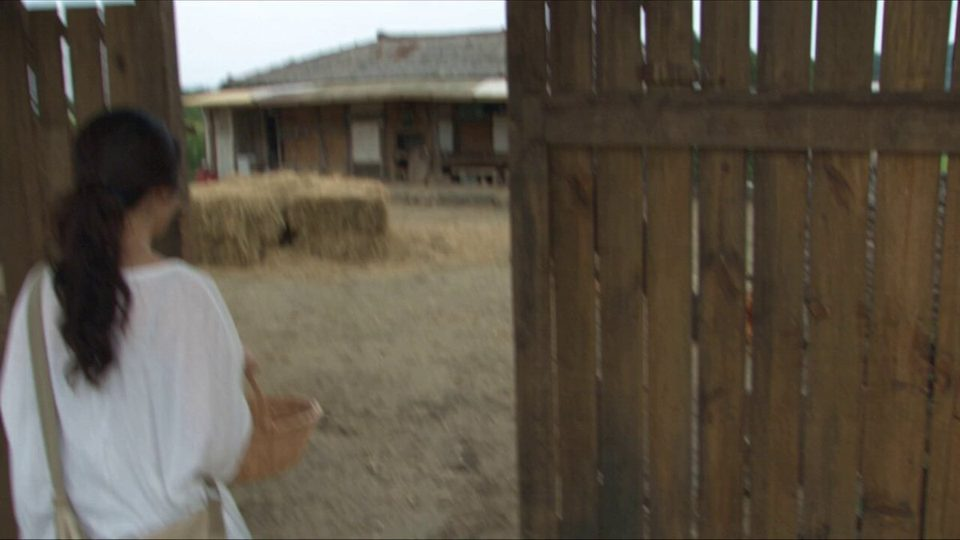</a>

- **作者:** [𝗦𝗮𝗻𝗶𝗮](https://x.com/saniaspeaks_/status/2098742251472261330) · X · **Seedance 2.5** · ♥ 421
- **标签:** `纪实手持` `韩系` `日常生活` `宠物动物` `温暖治愈` `多镜头剪辑` `vlog`
- 韩国女孩探访传统农场：喂鸡、给奶牛喂饲料、摘番茄、提着篮子笑着回头。

<details><summary>提示词</summary>

```text
Create a 30-second, 1080p ultra-realistic personal home-video showing an ordinary summer afternoon in the life of a young Korean woman visiting a small traditional farm and helping with the animals. No reference image.

A naturally pretty beautiful Korean woman in her early 20s, realistic natural skin texture, minimal makeup, relaxed and cheerful personality. Long black hair tied in a loose low ponytail. She wears a loose white cotton T-shirt, light olive-green cargo pants, brown ankle boots, and a beige canvas crossbody bag. Keep the same face, hairstyle, clothing, body proportions, and overall appearance throughout the entire video.

A small traditional countryside farm outside Seoul during a warm summer afternoon. Wooden fences, green fields, an old farmhouse, barn, hay bales, vegetable patches, chickens, cows, buckets, farming tools, trees and natural countryside surroundings. The farm feels ordinary and lived-in, not like a tourist attraction.

The camera is ALWAYS positioned IN FRONT OF THE GIRL, never behind her. A friend stands or walks in front of her, casually filming her with a handheld consumer DV camcorder/smartphone. Her front face must remain clearly visible during the important moments. The camera naturally moves backward while she walks toward it. Use imperfect handheld movement, small shakes, slightly uneven framing, autofocus hunting, occasional exposure changes, natural motion blur, soft digital detail, mild image noise, faded early-2000s home-video colors, and occasional accidental zooms.

Absolutely NO rear-view shots, NO filming from behind, NO drone, NO gimbal, NO cinematic tracking shots, NO polished commercial look, NO beauty filter. It should genuinely feel like a friend casually recorded this afternoon.

TIMELINE

0:00–0:05 — Arriving at the Farm

The girl walks toward the farm entrance while the friend walks backward in front of her filming. She smiles naturally and looks around at the animals and fields. She says casually in Korean:

“오늘 농장에 왔어요.”

Natural footsteps, birds, insects and distant farm sounds.

0:05–0:10 — Feeding the Cow

Still filmed from the front, the girl approaches a calm cow and holds out fresh vegetables. The cow gently eats from her hand. She laughs naturally and looks at the camera, then back at the cow.

0:10–0:15 — Helping With Vegetables

Hard cut. The camera remains in front of her as she walks through a vegetable patch and picks fresh vegetables. She holds them up toward the camera with a happy smile.

0:15–0:20 — Chickens

Hard cut. Several chickens suddenly walk across the path in front of her. The camera stays facing her from the front as she laughs and carefully steps around them. One chicken comes close to her boots.

0:20–0:25 — Farmhouse Break

She sits outside the farmhouse with a basket of freshly picked vegetables and eats a piece of fresh fruit. She looks relaxed and slightly tired from working. She smiles at the camera and says:

“생각보다 재밌어요.”

0:25–0:30 — Walking Away / Goodbye
She gets up and walks toward the camera, then stops near the farm entrance. The friend keeps filming from directly in front of her. She gives a small wave and says:

“다음에 또 올게요. 안녕!”

She walks past the camera as the recording ends naturally.

AUDIO:
Only authentic location sound: birds, chickens, cows, insects, footsteps, leaves, distant farm activity and natural conversation. No background music, no narration, no artificial sound effects.

FINAL LOOK:
Completely believable real-life home-video footage. Slightly imperfect, spontaneous, unpolished and human. Front-facing camera coverage throughout the story, with the girl's face clearly visible.
```

</details>

### [修好了旧电视](https://daiyixiang666.github.io/awesome-ai-video-prompts/w/x-2108414240721916212.html)

<a href="https://daiyixiang666.github.io/awesome-ai-video-prompts/w/x-2108414240721916212.html">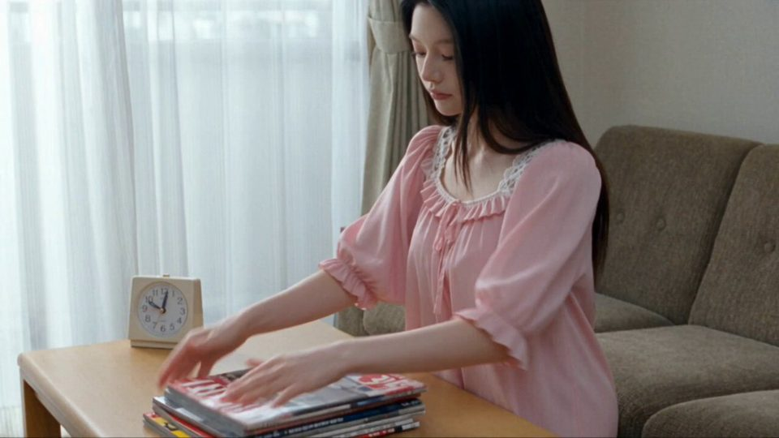</a>

- **作者:** [𝗦𝗮𝗻𝗶𝗮](https://x.com/saniaspeaks_/status/2108414240721916212) · X · **Seedance 2.5** · ♥ 391
- **标签:** `纪实手持` `日系` `日常生活` `温暖治愈` `多镜头剪辑` `vlog`
- 日本公寓里，女孩打开老式显像管电视却黑屏，检查插头、重接线缆，最后电视亮起，她满意地拿着遥控器。

<details><summary>提示词</summary>

```text
Create a highly realistic early-2000s Japanese home vlog featuring the same Japanese girl in her cozy apartment. She tries turning on an old CRT television, but the screen stays black. She checks the plug, unplugs the TV, and carefully inspects the cable. Her first attempt to reconnect it fails, so she tries again and realizes the cable needs proper replacement. After fixing it safely, she plugs the TV back in and presses the power button. The screen lights up, and she smiles with relief. Keep every action in chronological order, with authentic 2003-era furniture, clothing, and electronics. Use handheld MiniDV camcorder footage, natural lighting, slight camera shake, realistic movements, and consistent character appearance throughout.
```

</details>

### [气球挂在树上](https://daiyixiang666.github.io/awesome-ai-video-prompts/w/x-2110752410021044724.html)

<a href="https://daiyixiang666.github.io/awesome-ai-video-prompts/w/x-2110752410021044724.html">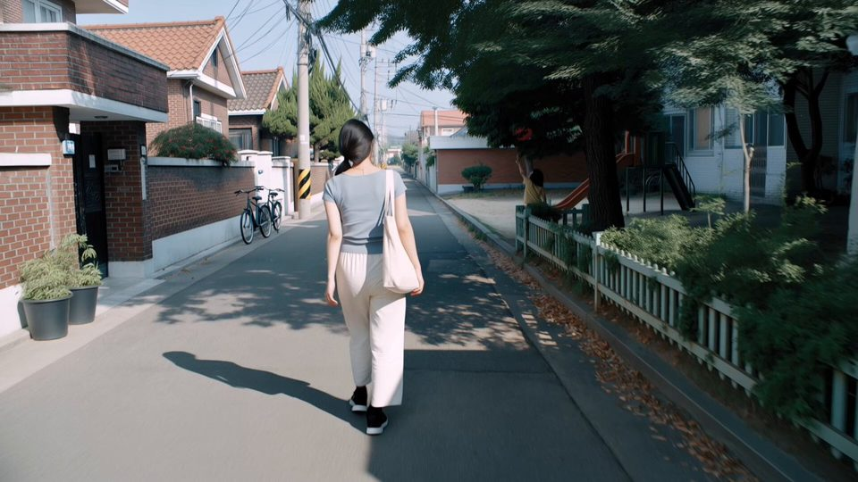</a>

- **作者:** [TSUBAKI](https://x.com/AI__TSUBAKI/status/2110752410021044724) · X · **Kling 4.0** · ♥ 173
- **标签:** `纪实手持` `胶片复古` `韩系` `日常生活` `温暖治愈` `多镜头剪辑` `vlog`
- DV 记录的首尔周日午后：女孩走在住宅区，帮小女孩够下卡在树上的红气球，然后回家关门。

<details><summary>提示词</summary>

```text
30-second, 4K, 16:9 ultra-realistic home video shot on an early-2000s consumer DV camcorder.

A quiet Sunday afternoon in an older Seoul residential neighborhood, filmed by a friend walking with her.

One continuous handheld recording with a couple of casual cuts, like someone pausing and restarting the tape.

SUBJECT
A young Korean woman in her early 20s, the same person in every moment.
Natural beauty, realistic skin texture, minimal makeup.
Black wavy hair in a messy side ponytail over her left shoulder.
Fitted pastel-blue short top, loose cream pajama-style pants, black sneakers, a thin simple silver necklace.
A small beige reusable canvas shopping bag hangs on her left shoulder the whole time.
Her face, hair, outfit and bag stay exactly the same throughout.

LITTLE GIRL
A Korean girl about 6 years old, short bob haircut, yellow T-shirt, denim shorts, small pink sneakers.

THE BALLOON
One round red helium balloon on a thin white string.
Only one balloon exists in the video.

LOCATION
A quiet older Seoul neighborhood on a mild sunny afternoon.
Narrow residential lane, low brick houses, red-brick villas, potted plants by doorways, parked bicycles, utility poles with tangled overhead wires, mature trees.
A small neighborhood playground with a slide, a sandbox and a few low trees along a short fence.

CAMERA & LOOK
Raw handheld early-2000s DV camcorder footage.
Shaky hand movement, autofocus hunting, faded slightly cyan-tinted colors, exposure shifts between sun and shade, motion blur, soft standard-definition-like detail upscaled, occasional accidental zoom in and out, imperfect off-center framing.
The camera operator sometimes reacts a little late.

AUDIO
Natural neighborhood ambience recorded by the camcorder mic: birds, children playing in the distance, a bicycle bell, footsteps on asphalt, wind hitting the mic, faint distant traffic.
No music.

0–5s — LANE
She walks slowly through the quiet residential lane, shopping bag on her left shoulder, the camera following slightly behind and to her right.
Sunlight flickers through the trees.

5–10s — PLAYGROUND
She passes the small playground.
The camera accidentally zooms in and finds the little girl on tiptoe under a low tree branch, reaching up but unable to touch the red balloon caught in the leaves, its string dangling just out of reach.
The woman slows down, notices her, and walks over.

10–17s — FREEING THE BALLOON
Medium shot from the side.
Standing beside the girl, the woman reaches up with her right hand, gently untangles the string from the branch and pulls the red balloon down.
The string is clearly held in her right hand.
She bends down and places the string into the girl's small hand; the girl grips it tightly and the balloon floats above her head.

17–21s — THANK YOU
Same continuous shot, both of them in frame, the camera slightly off to the side.
The girl looks up holding the balloon and says brightly in English: "Thank you!"
The woman smiles and replies softly: "You're welcome."
The girl runs back toward the slide, still holding the balloon string, the red balloon bobbing above her.

21–26s — WALKING HOME
Cut.
The woman walks on down the lane, smiling to herself, bag on her left shoulder.
A light breeze moves loose strands of her hair, and a few dry leaves skitter across the street.
The camera follows a few steps behind, wobbling.

26–30s — HOME
She reaches the gate of a small red-brick house, opens it, then turns back toward the camera and says with a relaxed smile: "Pretty nice Sunday."
She steps inside and the gate swings shut.
Hard cut to black.
```

</details>

### [首尔漫游三十秒](https://daiyixiang666.github.io/awesome-ai-video-prompts/w/x-2108376905678291065.html)

<a href="https://daiyixiang666.github.io/awesome-ai-video-prompts/w/x-2108376905678291065.html">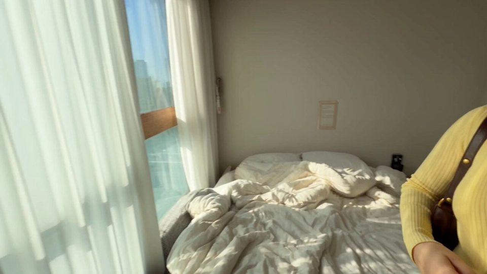</a>

- **作者:** [Maria](https://x.com/thisismariaa25/status/2108376905678291065) · X · **Seedance 2.5** · ♥ 136
- **标签:** `纪实手持` `韩系` `旅行城市` `轻松欢快` `多镜头剪辑` `vlog`
- 外国女孩在首尔一日游：出门、街角咖啡、市场吃小吃、韩屋小店、汉江边转圈。

### [深夜厨房的手机录像](https://daiyixiang666.github.io/awesome-ai-video-prompts/w/x-2087544594384773346.html)

<a href="https://daiyixiang666.github.io/awesome-ai-video-prompts/w/x-2087544594384773346.html">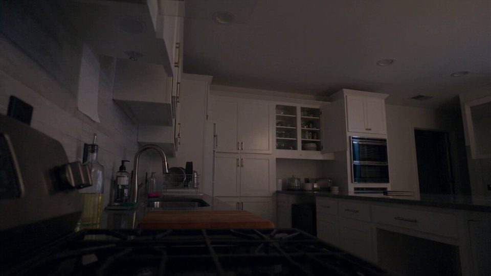</a>

- **作者:** [Ray](https://x.com/AIWithRay/status/2087544594384773346) · X · **Seedance 2.5** · ♥ 93
- **标签:** `纪实手持` `无明显地域` `美食` `日常生活` `孤独忧郁` `多镜头剪辑` `vlog`
- 深夜男生在厨房做饭：切菜、下锅翻炒、盛盘，最后坐到镜头前大口吃，像手机随手放在台面录的。

<details><summary>提示词</summary>

```text
FORMAT: 30-second horizontal 16:9 realistic smartphone video.

Create an authentic, imperfect everyday late-night kitchen phone recording, as if a friend casually left a phone recording on the counter. Use a standard smartphone camera with mild autofocus hunting, subtle exposure shifts, natural motion blur, compression artifacts, and slightly uneven handheld framing. No polished commercial look.

00–05s — WALKING IN

The character walks into a quiet home kitchen carrying a small grocery bag. They set it on the counter, sigh quietly, and pull out a few simple ingredients.

They glance at the phone for a second before turning back toward the counter.

Camera remains several feet away at counter height, as if casually recording from a nearby surface.

05–10s — GETTING STARTED

They wash their hands, turn on the kitchen light, and begin preparing the ingredients.

A cutting board shifts slightly against the counter. They pause to move it into a better position.

The character looks tired but relaxed, occasionally brushing their hair away from their forehead.

10–15s — COOKING

They place a pan on the stove and begin cooking.

Steam gradually becomes visible. The phone autofocus briefly shifts between the character and the foreground pan before settling again.

They stir the food, taste a tiny amount, think for a moment, then add a little more seasoning.

No readable labels or packaging should be visible.

15–20s — SMALL MISTAKE

The character gets distracted for a moment and notices the food starting to cook more quickly than expected.

They immediately lower the heat and give a small amused shake of their head.

They quietly mutter something like:

“Yeah… almost forgot about that.”

The delivery should feel spontaneous and understated.

20–25s — FINISHING

They finish preparing the food, turn off the stove, and carefully transfer the meal onto a plate.

They wipe a small splash from the counter with a paper towel.

Natural movements only—nothing overly choreographed.

25–30s — QUIET ENDING

They sit at the kitchen table with the finished meal.

They take one bite, pause, and give a small satisfied smile.

They look toward the phone and quietly say:

“Honestly… not bad.”

They pick up the fork again and continue eating as the camera keeps recording for another moment before the clip naturally ends.

AUDIO

Natural kitchen ambience only: refrigerator hum, ventilation, running water, utensil sounds, pan sizzling, footsteps, clothing movement, cupboard and drawer sounds, plate and fork noises, and subtle room ambience.

No music.

Dialogue should sound spontaneous and conversational, with natural pauses and imperfect delivery.

VISUAL REALISM

Authentic smartphone footage, ordinary warm household lighting, realistic skin texture, natural shadows, mild phone-camera sharpening, subtle compression noise, imperfect exposure, slight autofocus changes, believable reflections, natural steam, realistic food textures, and ordinary kitchen imperfections.

STRICTLY AVOID: cinematic color grading, beauty filters, artificial skin smoothing, dramatic slow motion, music, subtitles, captions, logos, readable text, perfect lighting, excessive camera shake, exaggerated acting, unrealistic food or steam, duplicated objects, warped hands, unnatural facial expressions, scene cuts, time jumps, or skipping the described actions.
```

</details>

### [清晨五点半的涩谷](https://daiyixiang666.github.io/awesome-ai-video-prompts/w/x-2111601335884005519.html)

<a href="https://daiyixiang666.github.io/awesome-ai-video-prompts/w/x-2111601335884005519.html">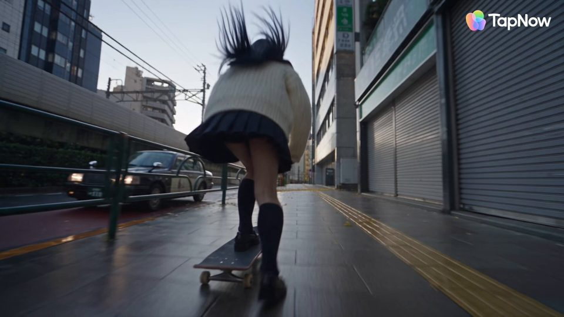</a>

- **作者:** [TSUBAKI](https://x.com/AI__TSUBAKI/status/2111601335884005519) · X · **Seedance 2.5** · ♥ 58
- **标签:** `纪实手持` `日系` `运动极限` `旅行城市` `热血燃` `多镜头剪辑` `vlog`
- 黎明时分的街头滑板：女孩在空旷的车站与高架下滑行、跳台阶、越过栏杆，最后对镜头笑。

<details><summary>提示词</summary>

```text
@Image1
 = the skater (character sheet)

Use the character sheet as the strict reference for the skater's identity, facial features, hairstyle, body type, outfit, and personality. Keep the face, proportions, outfit silhouette, hairstyle, and natural imperfections exactly as shown.

IMPORTANT:
Do not redesign the outfit.
Do not over-stylize the skater.
Do not make the skater look like a fashion model or a superhero.
The skater must feel like an ordinary, real person pulling off insane skateboard tricks.

Create a 15-second, 16:9 widescreen, ultra-cinematic street skateboarding video set in Shibuya, Tokyo, in late October, at blue-hour dawn around 5:30 AM.

ONE CONTINUOUS TAKE. No cuts, no edits, no transitions — a single unbroken handheld shot from start to finish.

The skater rides only on the sidewalk the entire time, never on the roadway.

The city is almost empty and silent.
Shop shutters are still down. An occasional Tokyo taxi glides past on the road beside the sidewalk.
The sidewalk tiles are still wet from overnight rain, and the first morning light slowly spreads across them.
Crisp, cool autumn air. A few fallen yellow ginkgo leaves scattered on the wet sidewalk.

IMPORTANT:
The environment must feel unmistakably like real Shibuya.

Include:
Wide Shibuya sidewalks with wet paving tiles and yellow tactile paving strips
Metal guardrails and bollards along the curb
Dark navy Tokyo taxis (JPN Taxi) passing on the road alongside
The empty Shibuya Scramble Crossing visible in the distance
Pedestrian signals and traffic lights
Closed metal shutters along the storefronts
Dense mixed-use buildings with exterior emergency stairs
Giant switched-off billboard screens
A Tokyo Metro station entrance on the sidewalk
Stickers and graffiti on utility poles and shutters
Overhead power lines
Cool, slightly damp late-autumn dawn atmosphere

Core feeling:
Extreme speed
Urban freedom
Youthful energy
Raw realism
Dangerous momentum
A playful face reveal at the very end

Camera work:
Extremely immersive handheld chase shot from BEHIND the skater, low-angle throughout.
From 0 to 12 seconds, the camera operator sprints along the sidewalk at full speed, chasing the skater from behind at close range, with the lens kept low — just above the sidewalk tiles to knee height — looking forward past the skater's legs and board toward the empty sidewalk ahead. We see the skater's back, hair whipping in the wind, and the board, with the buildings and the brightening sky ahead.

IMPORTANT:
Until the final moment, the camera stays behind the skater — directly behind, or rear three-quarter at most. It never overtakes the skater, never runs ahead, and never shoots from the front or the side. The skater's face is not shown until the final moment.

Techniques, all within the single continuous take:
Ultra-low-angle rear tracking, the lens skimming just above the wet tiles
Following close behind the board, with the wheels and tail filling the foreground
Shifting between directly-behind and rear three-quarter angles
Dynamic reframing as the skater swerves left and right
Motion blur
Impact shake on every landing
Imperfect, reactive framing
Camera chasing dangerously close behind the skater down the stairs alongside the handrail, brushing past guardrails and walls

The viewer should physically feel speed, danger, and momentum.

Avoid perfectly centered framing. Use the width of the 16:9 frame: keep the skater on the left or right third, with the sidewalk ahead opening up on the other side, and let the tactile paving strips, the tile joints, the curb line, the guardrails, and the rail converge toward the vanishing point as strong diagonal leading lines.

Allowed:
Momentary cropping
Framing drift
Chaotic handheld movement
Aggressive camera corrections

Action — a continuous line of tricks down the empty Shibuya sidewalk, one flowing into the next without stopping, all seen from behind until the final moment:

0–2s: The skater pushes hard down the sidewalk, building dangerous speed past the closed shutters, hair streaming back toward the lens.
2–4s: Kickflip over a fallen ginkgo-leaf patch, the board flipping right in front of the low camera, clean catch, lands rolling.
4–6s: Long nose manual balanced along the yellow tactile paving strip, then pops out.
6–9s: Approaches a long metal handrail beside a set of concrete stairs, pops into the air, and lands a perfect boardslide down the full length of the rail, the camera chasing down the stairs right behind.
9–10s: Pops out of the rail with a 360 shove-it — the board spins a full turn beneath the skater's feet while the body keeps facing forward — and lands hard on the sidewalk below.
10–12s: Rolls straight into a quick 360 flip, lands it, and carves into a sharp powerslide across the wet tiles, spraying a thin mist of water, coming to a stop.
12–15s: The face reveal. The skater stomps on the tail so the board pops up into their hand, then turns around to face back toward the camera. The camera catches up and stops at close range, still slightly low. The skater looks straight into the lens, breaks into a big, genuine smile, and flashes a cute peace sign with a slight playful head tilt. The face is sharp and fully visible for the first time, framed on the right third, with the long Shibuya sidewalk and the glowing dawn sky behind.

Every trick must be landed cleanly with real weight and board contact.
The peace-sign moment must feel natural and spontaneous, like a real person goofing for a friend's camera — not a posed model shot.

Trick feeling:
Real, dangerous, world-class, varied.

Physics:
No floaty physics.
No superhero movement.
No anime-style exaggeration.
Realistic hang time, realistic board flip speed, wheels and trucks clearly hitting the ground on each landing.

Lighting:
Cinematic late-October blue-hour dawn in Shibuya.
Combine:
Cool early-morning ambient light
Soft sunrise glow on the upper floors of the buildings, and soft dawn light falling on the skater's face in the final moment
Reflections of leftover neon and signal lights on the wet sidewalk tiles
Cool, damp autumn air
Realistic dawn exposure

Texture:
Realistic skin pores
Realistic wet paving-tile texture
Slight sweat
Sensor noise
Cinematic grain
Natural clothing movement

Sound:
Hip-hop music: a hard-hitting boom-bap / trap-influenced instrumental with heavy kicks, crisp snares, and a deep bassline, cinematic and gritty.
Tricks hit on the beat — each landing syncs with a kick or snare.
A massive beat drop exactly at the moment the skater lands on the handrail boardslide.
The beat hits one final accent exactly as the peace sign goes up.
Layered with real diegetic sound: wheels rolling on wet tiles, the pop of the tail, trucks grinding on the metal rail, hard landings, the skater's heavy breathing and a short laugh at the end.

Overall vibe:
A legendary viral Shibuya skate clip, secretly shot at dawn.
```

</details>

### [2000年代的校园祭](https://daiyixiang666.github.io/awesome-ai-video-prompts/w/x-2113603516866384168.html)

<a href="https://daiyixiang666.github.io/awesome-ai-video-prompts/w/x-2113603516866384168.html">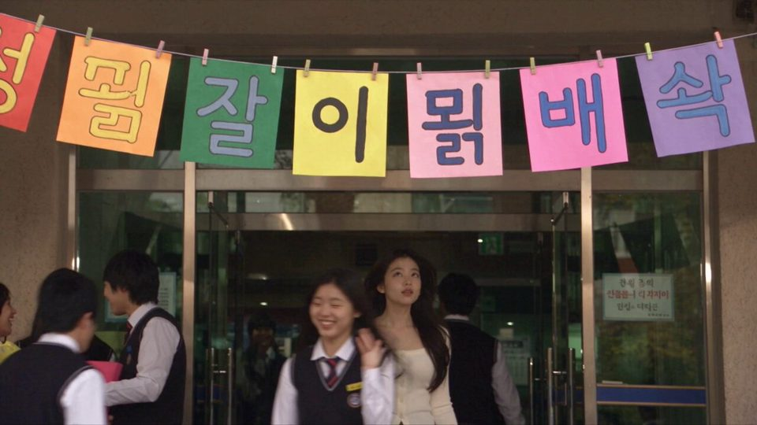</a>

- **作者:** [𝗦𝗮𝗻𝗶𝗮](https://x.com/saniaspeaks_/status/2113603516866384168) · X · **Seedance 2.5** · ♥ 57
- **标签:** `纪实手持` `胶片复古` `韩系` `爱情青春` `日常生活` `轻松欢快` `多镜头剪辑` `vlog`
- 韩国高中校园祭：学生入场、投币小游戏、套圈摊位、闺蜜合影，夜晚灯串下的操场。

### [车窗外的长板速降](https://daiyixiang666.github.io/awesome-ai-video-prompts/w/x-2102710980257947902.html)

<a href="https://daiyixiang666.github.io/awesome-ai-video-prompts/w/x-2102710980257947902.html">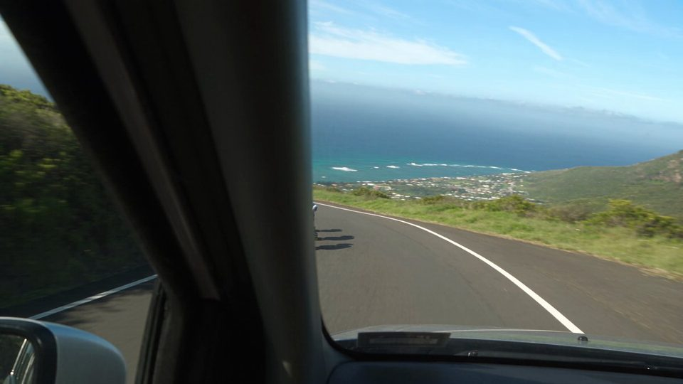</a>

- **作者:** [Matthieu](https://x.com/matthieu_ai/status/2102710980257947902) · X · ♥ 11
- **标签:** `纪实手持` `无明显地域` `运动极限` `紧张刺激` `一镜到底` `vlog`
- 从行驶车辆的副驾用手机跟拍三名长板选手在海岸山路上速降。

<details><summary>提示词</summary>

```text
VERTICAL 3:4 smartphone video filmed HANDHELD from inside a moving car, passenger seat, following three longboarders racing downhill on a winding coastal mountain road. The phone is held by a real person, not mounted: subtle arm movement, natural breathing shake, tiny framing corrections, windshield edge and A-pillar occasionally visible, a thin slice of dashboard and hood at the bottom of frame. Consumer smartphone camera look, realistic JPEG processing, natural sharpening, slight HDR, autofocus breathing and occasional focus hunting, subtle rolling-shutter distortion, realistic exposure shifts, imperfect but believable stabilization.

CONTINUOUS SINGLE TAKE — no cuts, no transitions. The car is moving downhill behind the riders throughout the shot. We begin slightly farther away as the three riders enter a sweeping downhill section, then the car gradually closes the distance. The riders become larger in frame as they accelerate. The camera operator instinctively tracks them with small handheld movements.

The three young longboarders race together at high speed, performing realistic downhill carving. Their bodies lean deeply into each corner, knees compressing naturally, shoulders and hips shifting with their boards, arms adjusting for balance. Wheels spin rapidly and realistically. Clothing and hair react naturally to the wind. Their movements obey believable weight, momentum, traction and gravity — no exaggerated or impossible motion.

The road winds dramatically along a lush coastal mountain above a breathtaking turquoise ocean and vibrant seaside city. Green hills descend toward the water, with buildings visible far below. Bright natural daylight, blue sky with detailed clouds, sparkling ocean, atmospheric coastal haze.

Throughout the SINGLE TAKE, use subtle DIGITAL PINCH-ZOOMS only, as if the person filming is instinctively trying to capture the action. Start with a relatively wide view showing the riders and landscape. Slowly punch in as they approach a fast corner. Briefly zoom closer onto the lead rider's wheels carving across the asphalt, then follow the three riders as they sweep through the turn. Zoom back out naturally when the landscape opens up again.

The camera occasionally struggles to keep perfect framing because the car and riders are moving quickly. Slight motion blur, realistic shutter behavior, small focus shifts, exposure adaptation, lens flare from sunlight, windshield reflections and tiny imperfections reinforce the feeling that this was genuinely captured on a consumer smartphone rather than professionally filmed.

Camera perspective remains physically plausible for someone filming from inside a moving car. The road, car movement and riders maintain consistent relative motion. No impossible drone movement, no floating camera, no cinematic crane shots, no cuts.

The final section becomes more spectacular as the three riders accelerate toward a long downhill straight overlooking the ocean. The car follows behind while the riders gradually pull farther ahead. The phone operator zooms out slightly to reveal the enormous coastal landscape, allowing the riders to become smaller against the turquoise sea and city below.

Photorealistic live-action footage. Real-world physics. Authentic smartphone optics. Natural daylight. Consumer phone camera. Handheld imperfections. Realistic motion blur. Realistic wheel rotation. Realistic wind interaction. Natural skin, clothing and environmental textures. Immersive and spontaneous rather than polished commercial footage.

15 seconds, 24fps, vertical 3:4, high-detail photorealism, realistic smartphone dynamic range, no text, no subtitles, no logos, no watermark, no CGI look, no artificial slow motion, no cuts.
```

</details>

### [首尔小巷日常](https://daiyixiang666.github.io/awesome-ai-video-prompts/w/x-2071977017474789557.html)

<a href="https://daiyixiang666.github.io/awesome-ai-video-prompts/w/x-2071977017474789557.html">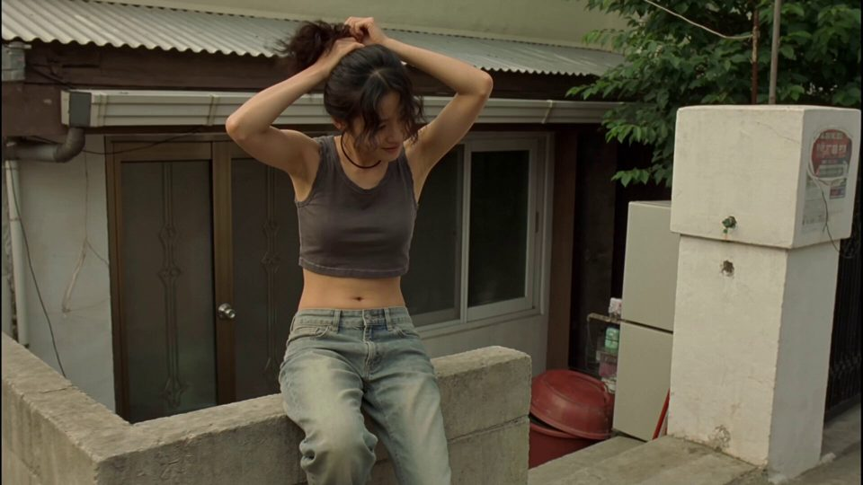</a>

- **作者:** [Johnn](https://x.com/john_my07/status/2071977017474789557) · X · **Seedance 2.0** · ♥ 1.6万
- **标签:** `纪实手持` `韩系` `日常生活` `轻松欢快` `一镜到底` `vlog`
- 韩国居民区小巷里的年轻女生日常 vlog，光影、皮肤和手持感几乎无法分辨真假。

<details><summary>提示词</summary>

```text
Main subject: young Korean woman, early 20s, natural everyday appearance, faded charcoal-grey sleeveless crop top, loose high-waisted light-wash jeans, black canvas sneakers, black cord necklace, black wavy hair in a messy side ponytail with wispy bangs. Realistic skin texture, minimal makeup, warm and approachable personality. Maintain consistent identity, clothing, hairstyle, and appearance throughout the entire video.
Location: Authentic Korean residential neighborhood during a calm late morning. Narrow concrete alleys, low-rise homes, small terraces, potted plants, laundry lines, bicycles, utility poles, overhead wires, mature trees casting moving shadows, quiet residential atmosphere. No stores, advertisements, cafés, crowds, or commercial activity.
Visual Style: Ultra-realistic documentary realism. Genuine candid behavior. Natural body language. Unscripted slice-of-life feeling. Strong environmental authenticity. Rich real-world details and believable human motion.
Camera Style: Early-2000s consumer DV camcorder aesthetic. Friend casually recording everyday moments. Heavy handheld shake, imperfect framing, frequent autofocus hunting, lens breathing, exposure pumping when moving between sun and shade, occasional motion blur, subtle rolling shutter, mild digital compression artifacts, faded colors, soft contrast, slight sensor noise. No stabilization. No cinematic camera moves. No modern color grading.
00:00–00:02
Outside a small house entrance. She sits on a low concrete wall adjusting her ponytail with both hands raised. A light breeze moves loose strands of hair. She smiles naturally while the camera struggles to hold focus.
00:02–00:04
The camera follows her into a narrow alley lined with potted plants and concrete walls. She notices a stray cat approaching and crouches down. Framing drifts off-center as the operator tries to keep up.
00:04–00:06
She gently pets and feeds the cat. Autofocus repeatedly shifts between her face and the animal. Morning sunlight flickers through leaves overhead.
00:06–00:08
Small front yard beside her house. She hangs laundry on a clothesline while fabrics sway in the breeze. Exposure changes as clouds briefly pass overhead.
00:08–00:10
On a quiet terrace with a ceramic coffee cup. She sits comfortably watching the neighborhood, occasionally brushing hair behind her ear. Loose handheld side angle with natural camera drift.
00:10–00:12
Close side profile. Someone off-camera greets her. She turns, raises her hand, smiles warmly, and casually says, “Annyeong.” The camera catches the moment slightly late.
00:12–00:15
Walking slowly down a tree-lined residential lane holding her coffee cup. She notices the camera, gives a small genuine smile, then looks away and continues walking. Recording cuts abruptly to black mid-motion as if the camcorder was switched off.

Audio: Natural ambient sound only — morning birds, distant motorcycles, light wind, leaves rustling, faint neighborhood chatter, cat sounds, footsteps on concrete, fabric moving on clotheslines, subtle residential ambience. No music. No sound design. No narration.

Goal: Authentic Korean neighborhood life captured like a forgotten home video from the early 2000s — candid, imperfect, realistic, warm, and deeply believable.
```

</details>

### [千禧DV家务日](https://daiyixiang666.github.io/awesome-ai-video-prompts/w/dy-7685295396415098491.html)

<a href="https://daiyixiang666.github.io/awesome-ai-video-prompts/w/dy-7685295396415098491.html">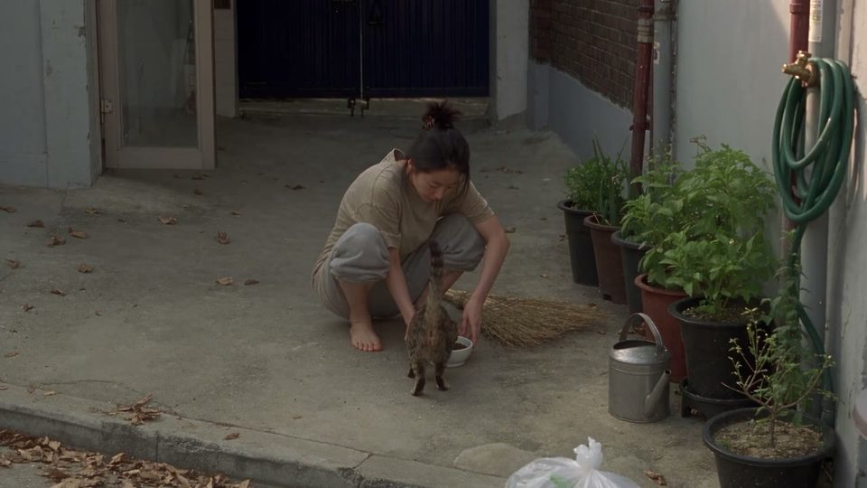</a>

- **作者:** [Noema.form](https://www.douyin.com/video/7685295396415098491) · 抖音 · **Seedance 2.5** · ♥ 1.3万
- **标签:** `纪实手持` `胶片复古` `中式` `日常生活` `温暖治愈` `多镜头剪辑` `vlog`
- 2000年代初家用DV质感，一位年轻女性在老街区家门口扫地、喂猫、浇花的周日。

<details><summary>提示词</summary>

```text
创建一个30秒、1080p、超写实的2000年代初DV家庭录像，记录一位年轻东亚女性在一个老街区的家中安静地做着周日家务。纯观察视角，无对话，无叙事起伏——仅展现富有节奏与肌理感的日常写实生活。
主体人物
年轻东亚女性，与参考一致，20岁出头，自然清秀，真实的皮肤肌理，素颜，黑发用抓夹随意挽在脑后，身穿宽松褪色T恤、挽起裤脚的卫裤、光脚或穿居家拖鞋。全程保持其身份、服装、发型和身形比例高度一致。
场景设定
一栋老屋门前的台阶与狭小的院子/巷道。水泥台阶、低矮的门、盆栽植物、花园水管、垃圾桶、零散的落叶。充满平凡的生活气息，无地标建筑或品牌标识。
动作时序（富有节奏感，无对话）
她用一把短扫帚清扫门前台阶，灰尘与落叶在光线中散落飞扬。
她蹲下身，往碗里倒入少量猫粮，喂给在近旁等待的流浪猫；小猫吃着，她静静看了一会儿。
她站起身，用小洒水壶给靠墙的盆栽浇水，水分肉眼可见地浸深了土壤的颜色。
她提起一袋打包好的垃圾，走了几步放到路边/垃圾桶旁。
她在衣服上擦了擦手，环顾打扫整洁的台阶和院子片刻，随后呼出一口气、舒展了一下身体。
她短暂地看了一眼镜头，露出一抹略显疲惫的淡淡微笑——没有说话——随后转身走回屋内。
镜头在扫干净的空台阶上停留片刻，随后黑屏切断。
镜头风格
早期2000年代原汁原味的手持DV摄像机质感：画面晃动、自动对焦拉风箱、褪色、曝光跳变、动态模糊、偏软的数字细节、偶发性意外变焦。纯观察式、纪录片风格的构图——长镜头凝视，单一动作内部不切镜头，拒绝精致修饰的电影感摄影。
音频
仅限自然环境音——扫帚刷毛摩擦水泥地面的声音、倒水声、小猫进食声、远方的鸟鸣、风声、远处的踏板摩托车声或狗吠、塑料袋窸窣声、轻微的脚步声。无对话，无配乐。
前后连贯性
扫帚、洒水壶和垃圾袋在各自的动作中保持道具一致。小猫进食时始终留在画面内，不消失、不出现克隆双胞胎。道具无瞬间传送或凭空消失。全程保持平滑、写实、从容不迫的动作动态。
```

</details>

### [乡间周末Vlog](https://daiyixiang666.github.io/awesome-ai-video-prompts/w/dy-7697901110615801061.html)

<a href="https://daiyixiang666.github.io/awesome-ai-video-prompts/w/dy-7697901110615801061.html"></a>

- **作者:** [Noema.form](https://www.douyin.com/video/7697901110615801061) · 抖音 · **Seedance 2.5** · ♥ 1.1万
- **标签:** `纪实手持` `中式` `旅行城市` `日常生活` `轻松欢快` `多镜头剪辑` `角色一致性` `vlog`
- 朋友手持跟拍的乡间周末：出发、小镇买水、田埂看蝴蝶、河边日落。

<details><summary>提示词</summary>

```text
一段30秒、16:9、超写实的日常旅行 Vlog，由一位朋友手持智能手机或微单相机，全程跟随女主角拍摄，记录她在乡间度过的轻松周末。
使用图片的女性作为唯一固定女主角。整段视频严格保持她的面部身份、五官特征、发型、身材比例和整体气质一致。女主角穿着舒适的浅色休闲上衣、宽松牛仔裤，背着小巧的帆布包，服装在所有镜头中保持一致。
摄影机像真实朋友随手拍摄的旅行记录，而不是专业摄影团队的商业作品。允许自然的手持晃动、随意的构图、短暂失焦、曝光微调与不完美的镜头移动。人物不刻意表演，不持续看向镜头，所有行为都像真实旅行过程中自然发生。
（0–5秒）：出发的早晨
清晨，女主角站在一辆停靠路边的普通轿车旁，低头整理帆布包里的随身物品。
摄影机从朋友的视角慢慢靠近。她察觉有人拍摄，抬头笑了一下，随手将被风吹乱的头发别到耳后，然后打开车门坐进副驾驶。
镜头切换到车内，透过前挡风玻璃看到郊区道路与远处的绿树。阳光自然地掠过她的侧脸，汽车平稳行驶。
（5–12秒）：抵达乡间小镇
女主角来到一座安静的小镇，沿着普通的街道慢慢散步。
道路两旁是低矮的居民住宅、开着门的杂货铺和停放的电动车。偶尔有当地居民骑车经过。
她在一家路边小店买了一瓶冰镇饮料，接过饮料后低头查看瓶身，随后回头对着摄影机笑着说了句什么。
朋友一边走一边跟拍，她突然加快两步走向路边摆放的水果摊，拿起一颗桃子仔细看了看，随后放回原处。
摄影机偶尔被经过的行人短暂遮挡，画面像未经精心剪辑的私人旅行记录。
（12–20秒）：乡间午后
午后的阳光照在乡间小路上，女主角沿着一条狭窄的田间道路行走。
道路旁是大片绿色农田、低矮的树木与零散的乡村住宅。
摄影机从她身后跟随，微风吹动她的头发与衣角。她突然停下，转身示意朋友看远处的景色，脸上带着自然兴奋的笑容。
随后，她蹲在路边观察一只停留在草叶上的蝴蝶。摄影机也跟着俯下，短暂失焦后重新对准她的侧脸。
她起身时因为蹲得太久稍微踉跄了一下，自己忍不住笑了出来，朋友也轻轻笑起来。
（20–27秒）：傍晚的自由时光
女主角与两位朋友来到乡间的一处小河边。
几个人坐在草地上，旁边放着简单的零食、饮料和随身背包。
摄影机从朋友视角随意扫过大家聊天的画面。一位朋友递给女主角一包零食，她接过后笑着摇摇头，又把零食递给身旁的人。
随后，她站起来，沿着河岸慢慢行走。朋友拿着相机跟上，她突然转身面向镜头，倒退着走了两步，笑着提醒拍摄者注意脚下。
镜头微微晃动，捕捉到真实朋友之间轻松自然的互动。
（27–30秒）：一天的结束
接近日落时分，女主角坐在一处低矮的河岸台阶上，双手抱着膝盖，安静地看着远方。
温暖的夕阳照亮她的侧脸，微风轻轻吹动头发。
摄影机从朋友站立的位置缓缓后退，稍微调整构图，将她、河面、远处的树木与傍晚天空一起收入画面。
她忽然回头看向拍摄的朋友，露出一个轻松的笑容。
画面自然结束，仿佛一段真实旅行记忆中偶然保留下来的最后几秒钟。
视觉风格与拍摄要求：
真实的朋友跟拍旅行 Vlog，智能手机或轻便微单的日常拍摄质感。自然日光、真实肤色、适度的动态范围、轻微传感器噪点与正常的自动曝光变化。保留真实镜头中偶尔出现的失焦、运动模糊和微小构图误差。拍摄视角始终来自同行朋友，采用自然的手持跟拍、侧面记录、短暂近景和随意的环境扫拍。人物的动作、表情、视线与反应自然连贯。保留真实生活中的动作停顿、无意识的小动作和朋友之间即兴的互动。所有场景均处于真实合理的生活空间中，人物与环境比例准确，物体交互符合真实物理规律。不使用电影化灯光、广告级调色、夸张景深、慢动作、无人机镜头、稳定器式丝滑运镜或人工设计的转场。
```

</details>

### [韩国男生的夏天](https://daiyixiang666.github.io/awesome-ai-video-prompts/w/x-2091396663718117706.html)

<a href="https://daiyixiang666.github.io/awesome-ai-video-prompts/w/x-2091396663718117706.html">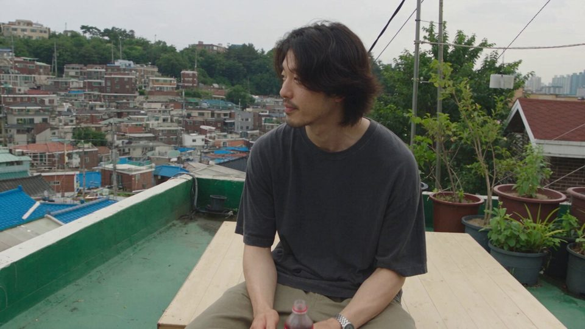</a>

- **作者:** [Duet | AI](https://x.com/Sheldon056/status/2091396663718117706) · X · **Seedance 2.5** · ♥ 7048
- **标签:** `纪实手持` `韩系` `日常生活` `温暖治愈` `多镜头剪辑` `vlog`
- 韩国年轻男生平凡夏日的家庭录像，屋顶、街巷、慵懒的午后，私密又松弛。

<details><summary>提示词</summary>

```text
Create a 30-second, 1080p ultra-realistic documentary-style personal home video showing an ordinary summer day in the life of a young Korean man. The footage should feel spontaneous, intimate, imperfect, and genuinely observed rather than performed.
MAIN SUBJECT
The same young Korean man in his early 20s throughout the entire video.
Naturally handsome, realistic skin texture, minimal styling, relaxed expression, slightly tired but peaceful eyes.
He has naturally messy medium-length dark hair with a few strands falling over his forehead and very subtle stubble.
He wears a loose washed-black T-shirt, relaxed olive-beige trousers, worn white sneakers, and a simple silver wristwatch.
Keep his face, identity, body proportions, hairstyle, clothing, watch, and overall appearance completely consistent from beginning to end.
LOCATION
A quiet older residential neighborhood in Seoul during a warm summer afternoon.
Narrow concrete alleys, low-rise homes, rooftop terraces, external staircases, potted plants, laundry lines, parked bicycles, utility poles, overhead wires, mature trees, concrete walls, small residential courtyards, and distant city sounds.
The neighborhood should feel authentic and lived-in.
No crowds, tourist attractions, advertisements, recognizable brands, or commercial activity.
CAMERA / VISUAL STYLE
Authentic casual personal-video footage captured with an older consumer digital camera.
Handheld camera operated by a friend walking nearby.
Natural camera shake, imperfect framing, occasional autofocus changes, slight exposure adjustments when moving between sunlight and shade, soft image detail, mild motion blur, subtle digital noise, slightly muted colors, imperfect white balance, and natural compression.
The camera operator occasionally reacts a little late, cuts off part of the subject, or briefly loses focus.
No stabilization, gimbal movement, drone shots, cinematic camera choreography, dramatic lighting, slow motion, modern commercial color grading, or polished cinematography.
The footage should feel like someone simply decided to record his friend during an ordinary day.
---
00:00–00:05 — MORNING ROOFTOP
He sits casually on a small rooftop beside an old plastic chair.
A cold bottled drink rests beside him.
He looks quietly across the neighborhood while the wind moves his hair and T-shirt.
He takes a sip, notices something happening in the distance, and smiles faintly.
He briefly notices the camera and gives a subtle nod before looking away.
The camera takes a moment to find focus on his face.
---
00:05–00:10 — WALKING THROUGH THE ALLEY
He gets up and walks downstairs into the neighborhood.
He walks casually through a narrow concrete alley with his hands in his pockets.
He passes parked bicycles, potted plants, laundry hanging from balconies, and old residential walls.
The camera follows several steps behind him.
He occasionally looks back toward the camera but never deliberately poses.
His footsteps remain naturally synchronized with his movement.
---
00:10–00:14 — SMALL EVERYDAY MOMENT
He notices an old basketball resting near a wall.
He picks it up, casually bounces it twice, then takes a simple shot toward a nearby hoop.
The shot misses.
He laughs quietly, shakes his head, and leaves the ball where he found it.
The camera briefly loses focus during the movement and recovers naturally.
No exaggerated athletic movement.
---
00:14–00:19 — LOCAL SHOP
He walks to a tiny neighborhood shop and buys a cold drink.
He exchanges a few natural words with the shopkeeper but the conversation is not clearly audible.
He steps outside, opens the bottle, takes a drink, and leans casually against the wall.
He watches bicycles and pedestrians passing in the distance.
The camera remains handheld and slightly imperfect.
---
00:19–00:23 — SUMMER RAIN
A sudden summer shower begins.
He looks toward the sky with mild surprise.
Instead of immediately running for shelter, he smiles and slowly walks into the rain.
The rain becomes heavier.
His hair becomes wet and falls naturally across his forehead.
He eventually starts running down the alley, laughing genuinely.
He briefly spins around while running, then continues toward a covered walkway.
His clothes become visibly damp.
Maintain realistic rain interaction, wet fabric, wet hair, reflections, and foot contact with the ground.
---
00:23–00:27 — QUIET MOMENT
He reaches the covered walkway and catches his breath.
Rain falls heavily behind him.
He wipes water from his forehead and looks quietly toward the street.
For a moment, everything becomes still.
He notices the camera again.
He gives a small genuine smile, not a posed expression.
---
00:27–00:30 — WALKING AWAY
The rain becomes lighter.
He walks away down the wet residential lane.
The camera follows from behind.
Reflections shimmer across the concrete.
He turns his head once, gives a tiny wave toward the camera, smiles, and continues walking.
The camera remains pointed toward the empty street for a brief moment.
At approximately 00:29, the recording abruptly cuts to black mid-motion.
No fade-out.
---
PHYSICAL REALISM
Maintain believable real-world physics throughout.
Hands, fingers, feet, clothing, hair, rain, bottle, basketball, and background objects must behave naturally.
No extra fingers, fused hands, duplicated limbs, distorted anatomy, floating objects, teleportation, disappearing objects, or sudden transformations.
The bottle remains a separate physical object and never intersects with his face.
The basketball behaves naturally and remains where it lands.
Parked bicycles and background objects remain stationary unless physically moved.
His feet remain properly connected to the ground while walking and running.
Keep the environment and subject consistent between shots.
---
AUDIO
Natural environmental audio only.
Footsteps on concrete, distant traffic, birds, leaves moving in the wind, bicycles, faint neighborhood conversations, shop sounds, bottle opening, basketball bouncing, rain hitting concrete, water dripping from rooftops, and subtle camera-handling noise.
No music.
No narration.
No soundtrack.
No artificial sound effects.
No spoken dialogue is necessary.
---
FINAL FEEL
The result should feel like a forgotten personal recording of an ordinary summer day.
Not a commercial.
Not a fashion film.
Not a music video.
Not a professional cinematic production.
The emotional appeal should come from small human moments: sitting alone, wandering through familiar streets, missing a basketball shot, drinking something cold, getting caught in the rain, laughing, and walking home.
Quiet, masculine, youthful, nostalgic, slightly melancholic, warm, spontaneous, and deeply human.
Prioritize natural behavior, consistent identity, believable physics, imperfect handheld framing, authentic environmental details, and the feeling that the camera happened to be there.
```

</details>

<a id="commercial"></a>
## 广告大片

### [花园别墅里的时装屋](https://daiyixiang666.github.io/awesome-ai-video-prompts/w/x-2105502091817206152.html)

<a href="https://daiyixiang666.github.io/awesome-ai-video-prompts/w/x-2105502091817206152.html">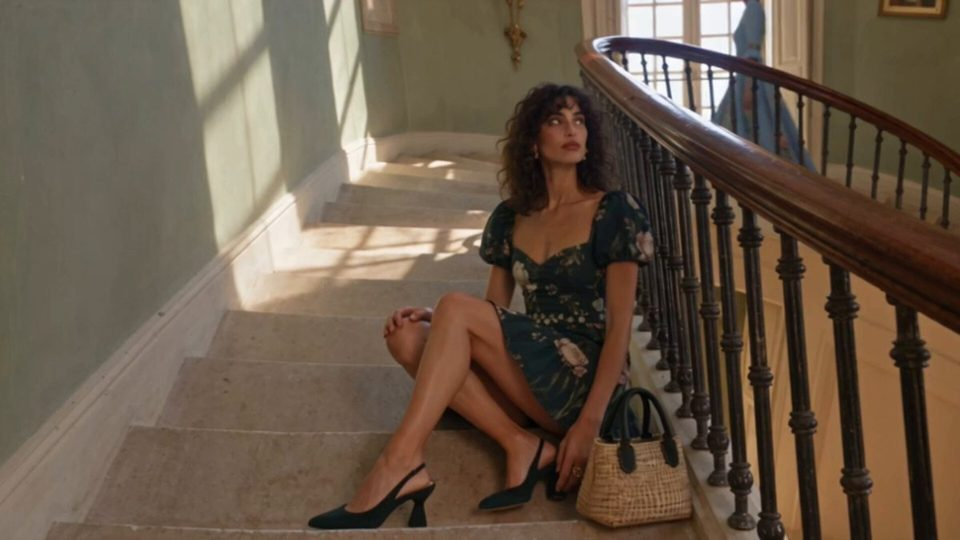</a>

- **作者:** [Maria](https://x.com/thisismariaa25/status/2105502091817206152) · X · **Seedance 2.5** · ♥ 2186
- **标签:** `广告大片` `欧洲` `时尚美妆` `浪漫心动` `多镜头剪辑` `广告TVC`
- 虚构品牌 Casa Fiora 的时装短片：意大利别墅中模特穿着花卉连衣裙走楼梯、倚沙发、穿过门廊，旋转楼梯收尾。

### [莓果磨砂膏的落定](https://daiyixiang666.github.io/awesome-ai-video-prompts/w/x-2029019321364824452.html)

<a href="https://daiyixiang666.github.io/awesome-ai-video-prompts/w/x-2029019321364824452.html"></a>

- **作者:** [K](https://x.com/ChillaiKalan__/status/2029019321364824452) · X · **Veo 3.1** · ♥ 583
- **标签:** `广告大片` `无明显地域` `时尚美妆` `产品` `轻松欢快` `慢动作` `广告TVC`
- 红色渐变背景前，空罐盛满粉色盐粒，覆盆子、草莓、白花依次落下堆叠，最后贴标成品定格。

<details><summary>提示词</summary>

```text
Use the uploaded image as the exact visual reference for jar design, label, strawberries, raspberries, flowers, leaves, condensation droplets, red gradient background, and reflective surface.

Camera:
Locked front-facing camera.
No zoom.
No rotation.
No angle change.
Studio composition remains centered.

Style:
Premium beauty commercial.
Smooth assembling sequence.
Ultra realistic.
Slow motion but not dramatic.

Scene – Start (Empty Setup):
Start with an empty red gradient background and glossy reflective surface.
No jar.
No fruits.
No flowers.
No water droplets.

Assembling Sequence:

1. The glass jar base smoothly slides into frame from below and settles perfectly centered.
2. The lid gently lowers from above and aligns perfectly on the jar.
3. Condensation droplets subtly appear on the glass surface as if forming naturally.
4. Raspberries roll in softly from left and right, stopping naturally around the base.
5. Strawberry halves slide into position at the front.
6. Whole strawberries gently drop from above into the open jar top and settle naturally.
7. Small white flowers softly fall into place between the strawberries.
8. Green leaves slide in behind the jar to frame it.
9. Final micro water droplets appear on fruits for freshness effect.

All movements smooth and controlled.
No bouncing.
No exaggerated motion.
No dramatic lighting changes.

Lighting:
Keep original studio lighting.
Deep red background glow remains consistent.
Soft reflections on the glossy surface.

Sound (if supported):
Soft subtle assembling sound design.
Gentle fruit placement sounds.
Light glass contact sound.
No music or very subtle premium ambient tone.

End Frame:
Fully assembled composition exactly matching the reference image.
Everything perfectly arranged.
Hold for 1–2 seconds.
Ultra clean luxury skincare commercial finish.
```

</details>

### [柠檬色的指甲油广告](https://daiyixiang666.github.io/awesome-ai-video-prompts/w/x-2051462778192642494.html)

<a href="https://daiyixiang666.github.io/awesome-ai-video-prompts/w/x-2051462778192642494.html">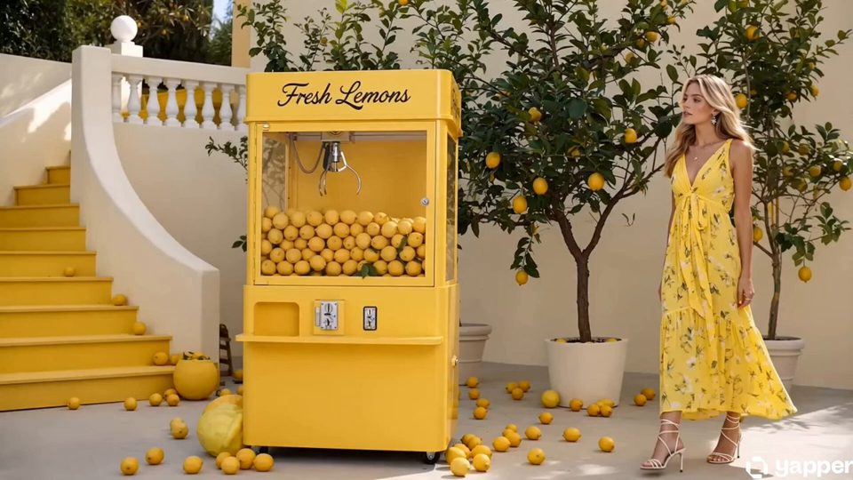</a>

- **作者:** [Shami](https://x.com/ShamiWeb3/status/2051462778192642494) · X · **Seedance 2.0 Fast** · ♥ 403
- **标签:** `广告大片` `美式` `时尚美妆` `产品` `轻松欢快` `多镜头剪辑` `广告TVC`
- 黄色抓娃娃机里装满柠檬，金发女子挤柠檬、展示指甲，最后柠檬环绕 Sally Hansen 黄色甲油瓶。

<details><summary>提示词</summary>

```text
Scene 1 (0–5s):
Elegant claw machine entirely in shiny yellow and gold tones, labeled “Fresh Lemons” in luxurious script. Inside are perfectly fresh bright yellow lemons with green leaves. The blonde woman stands nearby, observing with a calm, confident expression. Soft dramatic lighting, reflective glass surfaces, premium luxury feel.
Music: Slow, alluring intro, soft ambient synths with delicate chime notes and a subtle bass pulse, creating curiosity and elegance.
Scene 2 (5–10s):
Close-up cinematic shot of her hands. She interacts with fresh lemons, gently squeezing one, lemon juice dripping over her glossy yellow nails. Water droplets sparkle in slow motion. Her blonde hair softly moves in the background blur. Ultra-detailed macro focus on nails, juice, and texture.
Music: Beat gently builds. smooth sensual rhythm with light percussion and liquid-like sound effects syncing with the dripping juice, enhancing the tactile luxury feel.
Scene 3 (10–15s):
Dynamic luxury product shots of Sally Hansen nail polish bottles in elegant yellow/gold packaging surrounded by fresh lemons, citrus slices, and dewdrops. Her hands briefly enter frame, showcasing matching yellow nails. Slow, smooth camera movements, shallow depth of field, high-end beauty commercial finish.
Music: Full alluring climax, glossy, upbeat yet sophisticated groove with soft electronic beats and shimmering accents, ending with a clean, satisfying audio finish.
Overall style:
Hyper-realistic yet stylized luxury beauty commercial, scroll-stopping visuals, premium fashion photography mixed with playful citrus storytelling, vibrant but elegant tone, cinematic lighting, 4K, shot on Arri Alexa, ultra-detailed commercial product aesthetic, with a cohesive, seductive audio-visual rhythm.
```

</details>

### [图书馆里的降噪](https://daiyixiang666.github.io/awesome-ai-video-prompts/w/x-2107066395712504144.html)

<a href="https://daiyixiang666.github.io/awesome-ai-video-prompts/w/x-2107066395712504144.html">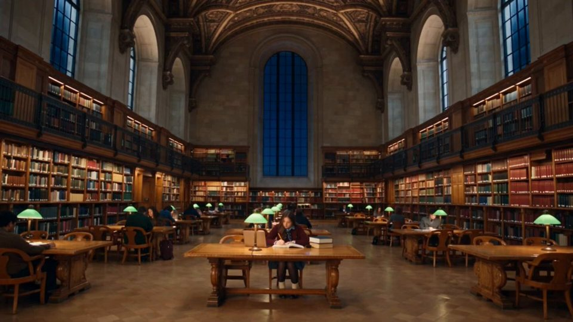</a>

- **作者:** [Maria](https://x.com/thisismariaa25/status/2107066395712504144) · X · **Seedance 2.5** · ♥ 256
- **标签:** `广告大片` `无明显地域` `产品` `温暖治愈` `微表情特写` `多镜头剪辑` `广告TVC`
- 图书馆中女生被翻书、笔尖、咳嗽声干扰，戴上耳机后世界瞬间安静，结尾落版 Sony 耳机。

### [网球场的 Polo 风](https://daiyixiang666.github.io/awesome-ai-video-prompts/w/x-2106564967046828508.html)

<a href="https://daiyixiang666.github.io/awesome-ai-video-prompts/w/x-2106564967046828508.html">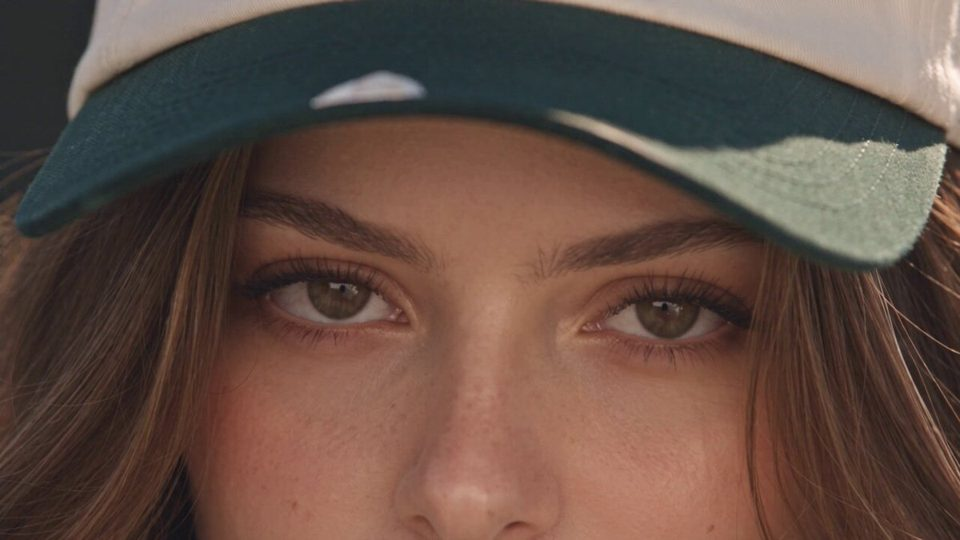</a>

- **作者:** [Maria](https://x.com/thisismariaa25/status/2106564967046828508) · X · **Seedance 2.5** · ♥ 201
- **标签:** `广告大片` `美式` `时尚美妆` `运动极限` `轻松欢快` `多镜头剪辑` `广告TVC`
- Polo 风格的乡村俱乐部大片：网球场、白色球鞋特写、挥拍、领口 logo 细节，开头叠字 LOVE. SET. POLO.

### [香水火箭发射](https://daiyixiang666.github.io/awesome-ai-video-prompts/w/x-2114672427964010805.html)

<a href="https://daiyixiang666.github.io/awesome-ai-video-prompts/w/x-2114672427964010805.html">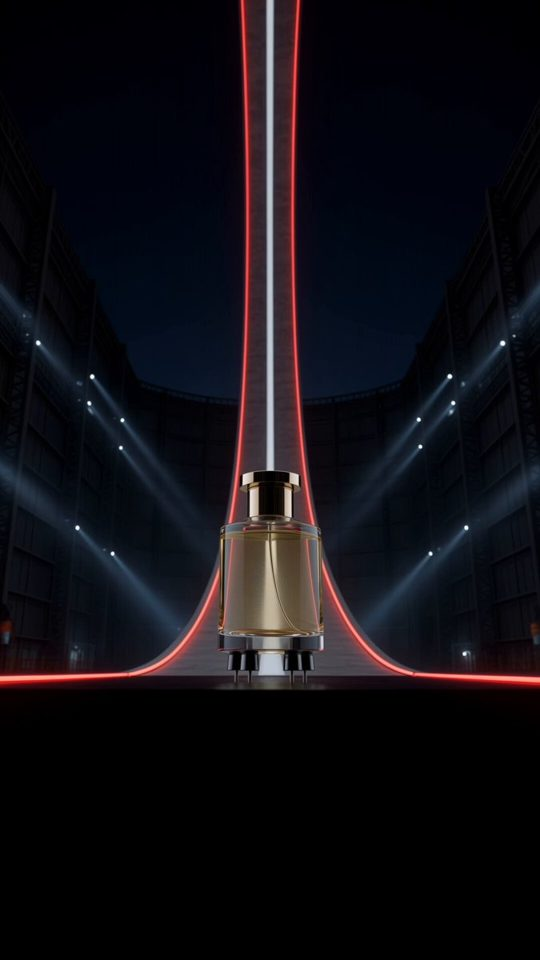</a>

- **作者:** [Ray](https://x.com/AIWithRay/status/2114672427964010805) · X · **Kling 4.0** · ♥ 140
- **标签:** `广告大片` `无明显地域` `产品` `时尚美妆` `热血燃` `一镜到底` `广告TVC`
- 机库舞台上，香水瓶沿发光的混凝土回环赛道冲出，底部喷出火焰升空。

<details><summary>提示词</summary>

```text
Cinematic, photoreal night scene on a black stage inside a giant hangar. A towering concrete loop ramp/road with glowing red edge lights and a white center stripe dominates the background. In front of it stands a premium transparent glass perfume bottle, unlabeled, no logo, filled with pale golden fragrance, featuring elegant beveled edges, a polished metallic cap, realistic glass refraction, crisp reflections, and subtle condensation droplets. The bottle engages four small rocket nozzles under its base; soft white exhaust with bright orange cores appears. The bottle glides forward, then blasts up the glowing ramp, hugging the curve, leaving faint light trails and red neon reflections across its glass surface. At the apex it shoots off the ramp and transitions to a sleek electric-thruster flight, like a futuristic luxury flying car, then ends in a close hero shot of the perfume bottle hovering and roaring upward vertically with four bright jets, volumetric spotlights and fog below, sparks and vapor interaction, dramatic rim light, golden highlights, crisp reflections, shallow depth of field, 4K, high-end luxury perfume and car commercial look. No text, no brand, no label. Duration 9–10 seconds. Aspect ratio 9:16. Negative cues: no logos, no text, no labels, no hands, no spillage, no deformation, no duplicate bottles, no cartoon look, no melting glass, no detached cap, no liquid leakage, no extreme motion-blur smears. Beat sheet (timing guide) 0–2s: Low-angle push-in on the massive loop ramp; perfume bottle centered, engines arming beneath the base with subtle heat shimmer and glowing orange cores. 2–6s: Dynamic follow-cam as the bottle rockets up the ramp; speed ramping, neon edge lights streaking, dramatic red reflections sliding across the glass. 6–8s: Bottle leaves the ramp, switches to electric thrusters; quick cinematic orbit as it hovers midair, revealing the golden fragrance and metallic cap. 8–10s: Tight hero shot of the perfume bottle ascending vertically with four bright jets, swirling fog, volumetric spotlights, realistic vapor, and luxurious golden reflections. End with the bottle sharply focused and centered against the dark hangar.
```

</details>

### [一颗土豆变成薯片](https://daiyixiang666.github.io/awesome-ai-video-prompts/w/x-2083033159437025427.html)

<a href="https://daiyixiang666.github.io/awesome-ai-video-prompts/w/x-2083033159437025427.html">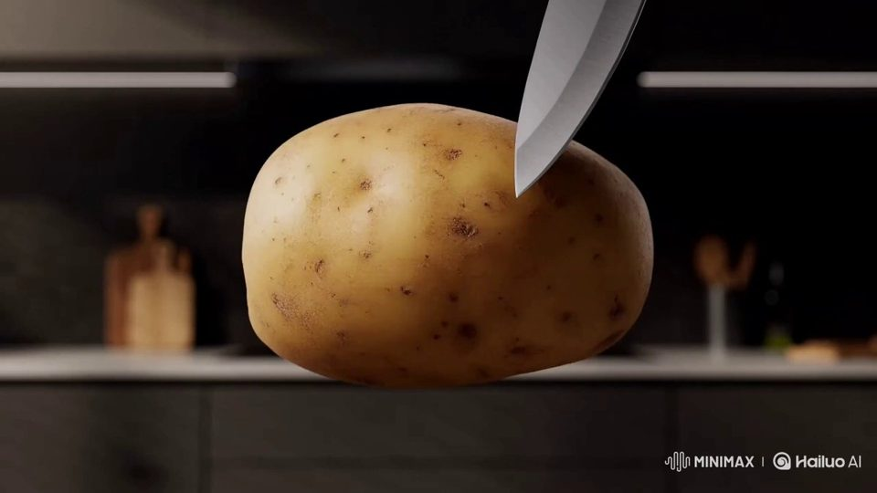</a>

- **作者:** [Ray](https://x.com/AIWithRay/status/2083033159437025427) · X · **MiniMax H3** · ♥ 101
- **标签:** `广告大片` `无明显地域` `美食` `产品` `轻松欢快` `变身转场` `慢动作` `广告TVC`
- 土豆高速旋转削皮、切片、落入油锅炸成薯片，飞入包装袋，最后 Crunch Valley 薯片袋定格。

<details><summary>提示词</summary>

```text
Ultra-realistic cinematic 3D commercial, 15 seconds, hyper-detailed food commercial, dynamic speed ramp, macro photography, dramatic studio lighting, ultra-fast transitions, motion blur, shallow depth of field, realistic physics, crisp textures, premium advertising quality, 16:9.

Sequence: A whole fresh potato spins at incredible speed in mid-air above a modern kitchen counter. A stationary razor-sharp chef's knife instantly peels the potato as the spinning motion sends the skin flying away in elegant spiral ribbons. The perfectly peeled potato freezes vertically in mid-air, then effortlessly slices itself into dozens of ultra-thin, perfectly even potato chips suspended for a brief moment. The slices glide one by one into a vat of bubbling hot vegetable oil, creating dramatic splashes and shimmering golden bubbles. Within seconds, the chips become perfectly golden, light, and crispy. They burst upward from the oil in slow motion and land on a rustic wooden table as a vibrant cloud of savory seasoning explodes around them. An automated packaging machine immediately fills a sleek, glossy Crunch Valley potato chips bag, injects nitrogen gas for freshness, and heat-seals it. The packaging features a bold modern Crunch Valley logo in white lettering with gold accents on a vibrant red bag, premium branding, realistic printed details, and a luxurious commercial design. Final hero shot: the perfectly sealed Crunch Valley potato chips bag stands centered on the table while the camera performs a fast cinematic push-in through floating seasoning particles under warm cinematic lighting, with ultra-realistic reflections, razor-sharp focus, premium food advertising aesthetics, and a dramatic end frame held for maximum impact.
```

</details>

### [宜家秒装](https://daiyixiang666.github.io/awesome-ai-video-prompts/w/x-1946530149299634618.html)

<a href="https://daiyixiang666.github.io/awesome-ai-video-prompts/w/x-1946530149299634618.html">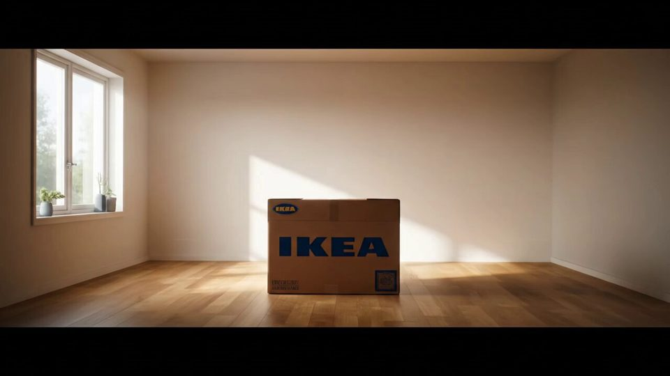</a>

- **作者:** [Salma](https://x.com/Salmaaboukarr/status/1946530149299634618) · X · **Veo 3** · ♥ 1.2万
- **标签:** `广告大片` `欧洲` `产品` `温暖治愈` `一镜到底` `变身转场` `广告TVC`
- 密封的宜家纸箱一震，家具瞬间自动组装成温馨卧室，一镜到底。

<details><summary>提示词</summary>

```text
{
  "description": "Cinematic shot of a sunlit Scandinavian bedroom. A sealed IKEA box trembles, opens, and flat pack furniture assembles rapidly into a serene, styled room highlighted by a yellow IKEA throw on the bed. No text.",
  "style": cinematic",
  "camera": "fixed wide angle",
  "lighting": "natural warm with cool accents",
  "room": "Scandinavian bedroom",
  "elements": [
    "IKEA box (logo visible)",
    "bed with yellow throw",
    "bedside tables",
    "lamps",
    "wardrobe",
    "shelves",
    "mirror",
    "art",
    "rug",
    "curtains",
    "reading chair",
    "plants"
  ],
  "motion": "box opens, furniture assembles precisely and rapidly",
  "ending": "calm, modern space with yellow IKEA accent",
  "text": "none",
  "keywords": [
    "16:9",
    "IKEA",
    "Scandinavian",
    "fast assembly",
    "no text",
    "warm & cool tones"
  ]
}
```

</details>

### [一句话洗发水广告](https://daiyixiang666.github.io/awesome-ai-video-prompts/w/x-2021631203473084655.html)

<a href="https://daiyixiang666.github.io/awesome-ai-video-prompts/w/x-2021631203473084655.html"></a>

- **作者:** [Mark Gadala-Maria](https://x.com/markgadala/status/2021631203473084655) · X · **Seedance 2.0** · ♥ 5490
- **标签:** `广告大片` `无明显地域` `时尚美妆` `产品` `浪漫心动` `慢动作` `多镜头剪辑` `广告TVC`
- 只用一句话提示词生成的洗发水广告，布光、模特与产品镜头都有商业片质感。

<details><summary>提示词</summary>

```text
a high quality shampoo ad for women
```

</details>

### [Hello Kitty 房间爆炸](https://daiyixiang666.github.io/awesome-ai-video-prompts/w/x-1946641844005490809.html)

<a href="https://daiyixiang666.github.io/awesome-ai-video-prompts/w/x-1946641844005490809.html">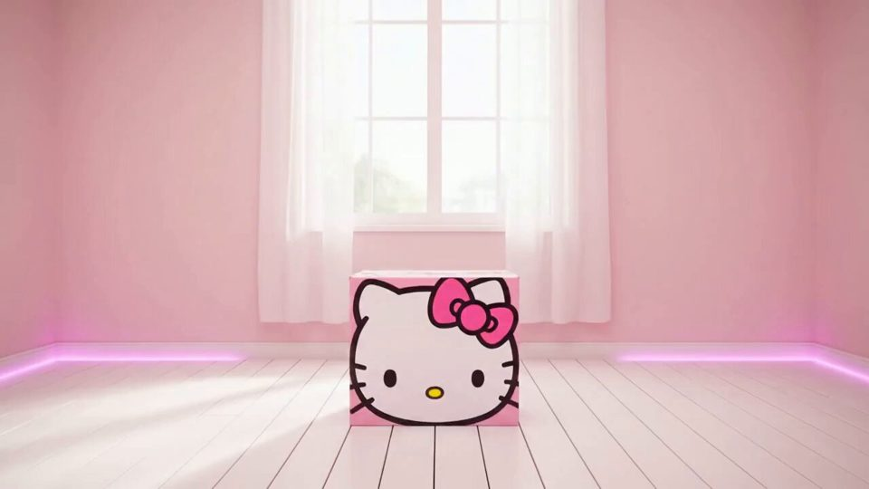</a>

- **作者:** [Justine Moore](https://x.com/venturetwins/status/1946641844005490809) · X · **Veo 3** · ♥ 4212
- **标签:** `广告大片` `日系` `产品` `轻松欢快` `一镜到底` `变身转场` `广告TVC`
- 粉色空房间里的 Hello Kitty 礼盒炸开，瞬间布满主题家具。

<details><summary>提示词</summary>

```text
{"description": "Photorealistic cinematic shot of an empty pastel-pink bedroom with white wood floors and soft daylight streaming in. A sealed Hello Kitty box with a pink bow sits in the center. It wiggles, then bursts open in a bright, sparkly puff. The room transforms instantly No text.", 
"style": "photorealistic cinematic", 
"camera": "fixed wide angle, front-facing for symmetrical reveal", 
"lighting": "soft, diffused natural light with subtle pink glow accents", 
"room": "blank pastel bedroom transformed into a Hello Kitty sanctuary", 
"elements": [ "Hello Kitty box (logo and bow visible)", "Hello Kitty bedding and pillows", 
"plushies (Hello Kitty, My Melody, Cinnamoroll, Kuromi)", "wall art or framed posters", "floating shelves with figurines and pastel accessories", "vanity with mirror and pink chair", "Hello Kitty lamp or neon sign", "heart rug or fluffy floor mat", "bow-shaped throw pillows" ], 
"motion": "box opens, cute Sanrio items explode out and assemble rapidly and precisely", "ending": "soft, cozy Hello Kitty room glowing with pink warmth and charm", 
"text": "none", 
"keywords": [ "16:9", "Hello Kitty", "Sanrio", "pastel bedroom", "fast assembly", "no text", "photorealistic", "pink explosion", "cozy kawaii" 
] 
}
```

</details>

### [咖啡爆炸分解](https://daiyixiang666.github.io/awesome-ai-video-prompts/w/x-2008566612266483822.html)

<a href="https://daiyixiang666.github.io/awesome-ai-video-prompts/w/x-2008566612266483822.html"></a>

- **作者:** [M-studioAi](https://x.com/Strength04_X/status/2008566612266483822) · X · **Kling + Nano Banana Pro** · ♥ 2423
- **标签:** `广告大片` `无明显地域` `美食` `产品` `轻松欢快` `环绕运镜` `变身转场` `广告TVC`
- 一杯浓缩咖啡旋转着分解成悬浮的原料信息图，再合拢回杯中。

<details><summary>提示词</summary>

```text
Motion Prompt: The Cup start to round spin while ingredients separate gently and precisely, maintaining alignment and scale. The motion is smooth, with no extra effects.

Image 1 :-  A high-quality, professional product photograph of a white ceramic coffee cup filled with black espresso. The coffee has a rich, golden crema on top with tiny bubbles. Minimalist style, shot against a pure solid white background with soft, natural shadows. 8k resolution, sharp focus, clean aesthetic.

Image 2 :- Create a hyper-realistic exploded vertical infographic composition of a morning coffee. At the top, a glossy coffee crema splash frozen mid-air with tiny bubbles and droplets. Below it, a rich dark espresso liquid layer, followed by scattered roasted coffee beans with visible texture and oil shine. Underneath, fine sugar crystals gently floating, and at the bottom a minimal ceramic coffee cup base. Pure white background, soft studio lighting, subtle shadows under each floating element, ultra-sharp focus, DSLR macro photography, clean infographic text labels with thin pointer lines, premium lifestyle aesthetic, 8K quality.
```

</details>

### [美禄开箱 ASMR](https://daiyixiang666.github.io/awesome-ai-video-prompts/w/x-2076202198888022135.html)

<a href="https://daiyixiang666.github.io/awesome-ai-video-prompts/w/x-2076202198888022135.html">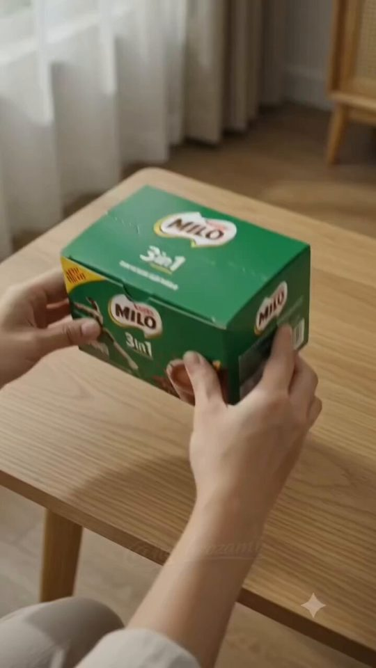</a>

- **作者:** [Ciri](https://x.com/Ciri_ai/status/2076202198888022135) · X · **GPT Image 2 + Seedance 2.0** · ♥ 2207
- **标签:** `广告大片` `无明显地域` `美食` `产品` `温暖治愈` `第一人称` `广告TVC`
- 第一人称手部视角的产品开箱 ASMR 广告，节奏轻快、质感干净。

<details><summary>提示词</summary>

```text
Create a clean, premium storyboard infographic for a product ASMR unboxing video.

Design specifications:

White background with a modern, minimalist layout.

Title at the top:

STORYBOARD

Product name in bold green (replace with: [PRODUCT NAME])

Subtitle: ASMR UNBOXING

Include four information boxes below the title:

Duration: 30 Seconds

Style: POV Hands, ASMR

Audience: 18–35 years old

Audio Suggestion: Soft ASMR • Crinkles • Tapping • Pouring

Create 12 storyboard panels arranged in a 3-column × 4-row grid.

Each panel should contain:

A numbered green badge (1–12)

Timestamp (0–2.5s, 2.5–5s, etc.)

A realistic cinematic image showing the scene

Handwritten white doodle text like:

TA-DA!

POP!

WOW!

PICK!

CRINKLE~

TEAR!

POUR~

HOT WATER

STIR~

SMOOTH!

BEST!

Three text sections below every image:

VISUAL:

ACTION:

DIALOGUE:

Use realistic product photography, warm wooden table, soft natural lighting, shallow depth of field, POV hands only (no face visible), premium commercial advertising style.

Storyboard sequence:

1 (0–2.5s) Visual: Product box on wooden table. Action: Hands enter frame and point to the box. Dialogue: "Have you tried this before?"

2 (2.5–5s) Visual: Opening the box. Action: Lift the top flap slowly. Dialogue: "Let's unbox it together."

3 (5–7.5s) Visual: Multiple individual sachets neatly arranged. Action: Fully reveal the inside. Dialogue: "Wow, look how many!"

4 (7.5–10s) Visual: Pick up one sachet. Action: Remove a single stick pack. Dialogue: "Let's start with one."

5 (10–12.5s) Visual: Close-up of sachet. Action: Hold and gently crinkle it. Dialogue: "That crinkle sound is satisfying."

6 (12.5–15s) Visual: Tear open the top. Action: Slow ASMR tearing. Dialogue: "Just a small tear."

7 (15–17.5s) Visual: Powder visible inside. Action: Show the powder close-up. Dialogue: "Looks delicious."

8 (17.5–20s) Visual: Pour powder into mug. Action: Slow pouring. Dialogue: "Pour everything in."

9 (20–22.5s) Visual: Hot water being poured. Action: Steam visible. Dialogue: "Add hot water."

10 (22.5–25s) Visual: Stir drink. Action: Slow circular stirring. Dialogue: "Mix it well."

11 (25–27.5s) Visual: Finished drink. Action: Show creamy texture from above. Dialogue: "Looks smooth and creamy."

12 (27.5–30s) Visual: Product box beside finished drink with thumbs up. Action: Hand gives thumbs up. Dialogue: "Easy, delicious, and ready!"

Footer:

Total Duration: 30 Seconds

Format: Vertical (9:16)

Style: POV Hands, ASMR Unboxing

Typography should resemble a professional creative agency storyboard, with clean spacing, green accents, rounded panel borders, and high-end presentation suitable for client pitches.
```

</details>

<a id="film-retro"></a>
## 胶片复古

### [1974年的苏联夏天](https://daiyixiang666.github.io/awesome-ai-video-prompts/w/x-2108014516789563534.html)

<a href="https://daiyixiang666.github.io/awesome-ai-video-prompts/w/x-2108014516789563534.html">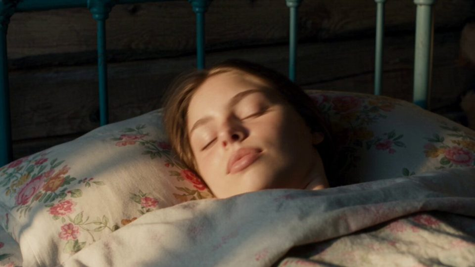</a>

- **作者:** [Maria](https://x.com/thisismariaa25/status/2108014516789563534) · X · **Seedance 2.5** · ♥ 247
- **标签:** `胶片复古` `欧洲` `历史年代` `日常生活` `温暖治愈` `多镜头剪辑` `叙事短片`
- 苏联乡村的一天：清晨窗边、骑车的邻居、门廊吃面包喂猫、田间骑行、河边泡脚、日落回家。

### [送错了](https://daiyixiang666.github.io/awesome-ai-video-prompts/w/tt-7690981557946961182.html)

<a href="https://daiyixiang666.github.io/awesome-ai-video-prompts/w/tt-7690981557946961182.html">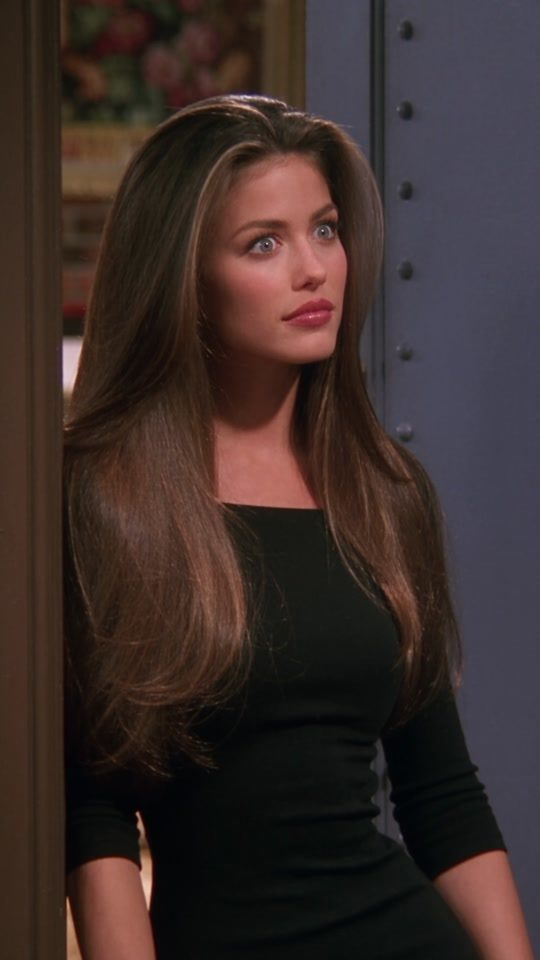</a>

- **作者:** [dreamfall.art](https://www.tiktok.com/@dreamfall.art/video/7690981557946961182) · TikTok · ♥ 34.3万
- **标签:** `胶片复古` `美式` `爱情青春` `浪漫心动` `微表情特写` `叙事短片`
- 90年代纽约质感的都市爱情小品：一次送错的快递引出的心动瞬间。

### [另一种人生](https://daiyixiang666.github.io/awesome-ai-video-prompts/w/tt-7679822438661704990.html)

<a href="https://daiyixiang666.github.io/awesome-ai-video-prompts/w/tt-7679822438661704990.html">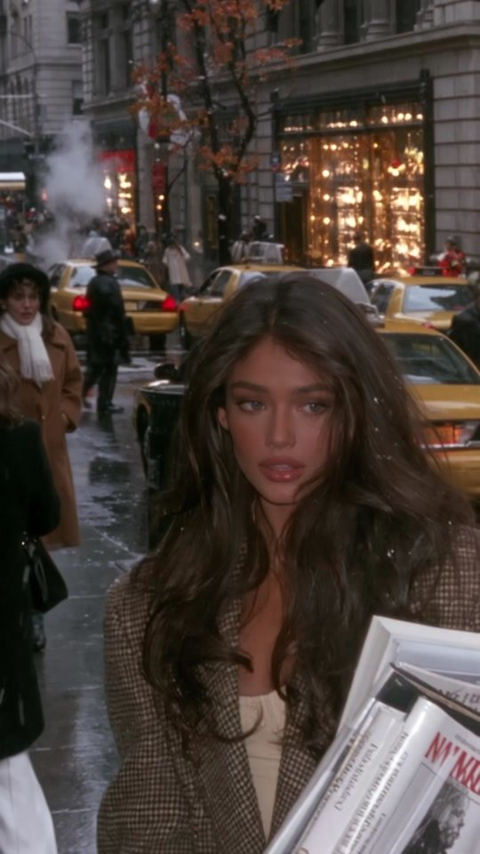</a>

- **作者:** [dreamfall.art](https://www.tiktok.com/@dreamfall.art/video/7679822438661704990) · TikTok · ♥ 8.6万
- **标签:** `胶片复古` `写实电影感` `美式` `爱情青春` `孤独忧郁` `浪漫心动` `多镜头剪辑` `叙事短片`
- 90年代纽约街头，一张名片、一辆出租车与错过的缘分。

<a id="surreal-dream"></a>
## 超现实梦境

### [黑暗奇幻·写实](https://daiyixiang666.github.io/awesome-ai-video-prompts/w/tt-7501787033094917406.html)

<a href="https://daiyixiang666.github.io/awesome-ai-video-prompts/w/tt-7501787033094917406.html">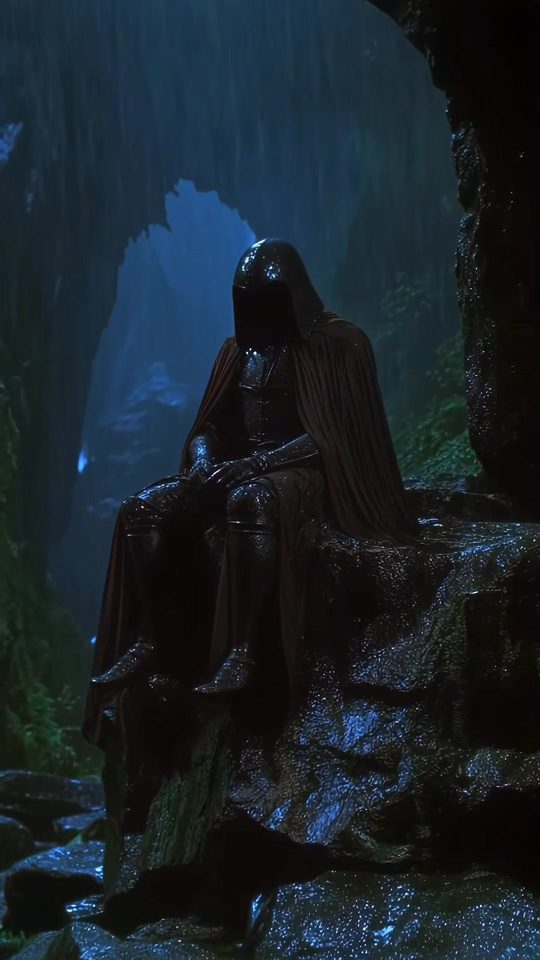</a>

- **作者:** [Morgath](https://www.tiktok.com/@morgath_/video/7501787033094917406) · TikTok · **Midjourney** · ♥ 160万
- **标签:** `超现实梦境` `欧洲` `奇幻神话` `孤独忧郁` `诡异不安` `MV`
- Morgath 的黑暗奇幻怀旧短片：深蓝洞穴中静坐的黑骑士，配氛围音乐。

### [宇宙碎片](https://daiyixiang666.github.io/awesome-ai-video-prompts/w/tt-7611466285204950285.html)

<a href="https://daiyixiang666.github.io/awesome-ai-video-prompts/w/tt-7611466285204950285.html">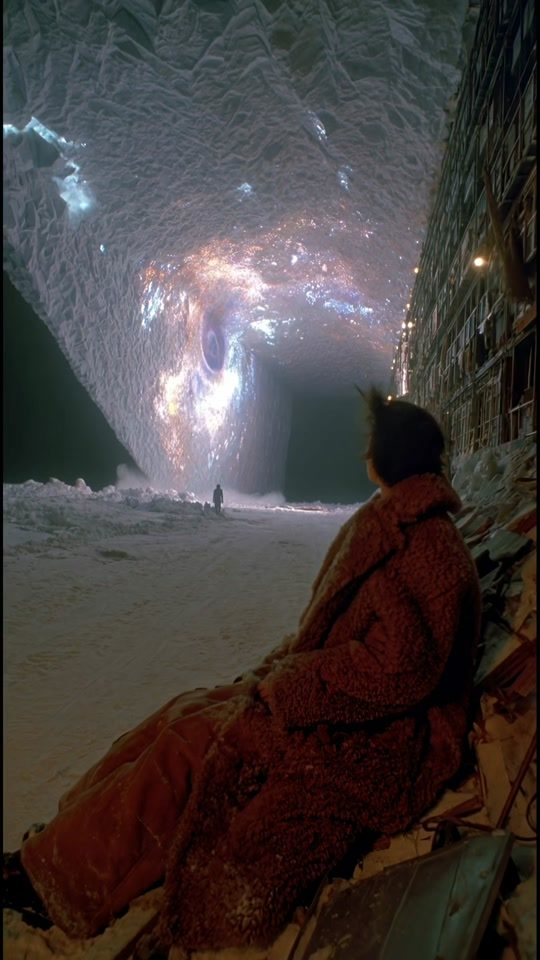</a>

- **作者:** [Enter The Void](https://www.tiktok.com/@enterthevoidstudio/video/7611466285204950285) · TikTok · **Midjourney** · ♥ 13.3万
- **标签:** `超现实梦境` `无明显地域` `科幻` `史诗壮阔` `孤独忧郁` `MV`
- Enter The Void 的清醒梦风格短片：沙漠中的红袍人仰望裂开的星云墙。

### [万神殿陨落](https://daiyixiang666.github.io/awesome-ai-video-prompts/w/x-2089362073021300852.html)

<a href="https://daiyixiang666.github.io/awesome-ai-video-prompts/w/x-2089362073021300852.html">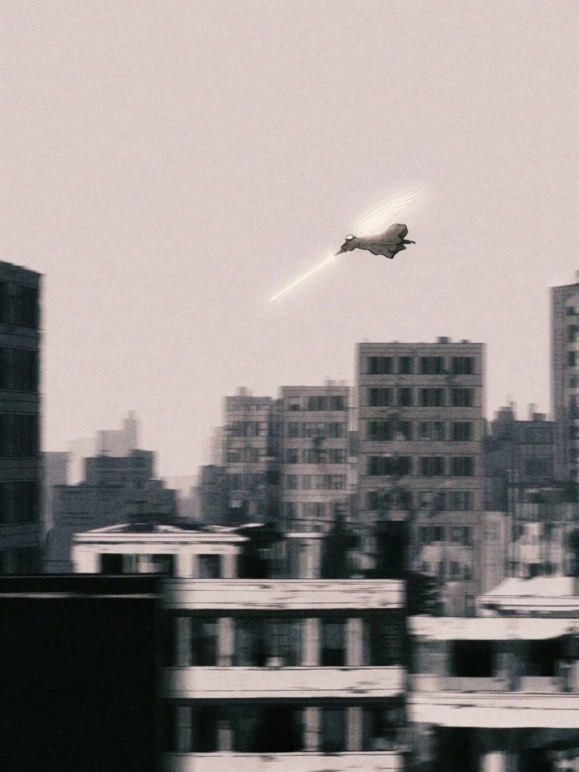</a>

- **作者:** [Timeless](https://x.com/Timeless_aiart/status/2089362073021300852) · X · **Midjourney + Seedance 2.5** · ♥ 2881
- **标签:** `超现实梦境` `无明显地域` `科幻` `灾难` `史诗壮阔` `多镜头剪辑` `预告片`
- 15 秒的末日城市段落，飞行器掠过高楼，淡彩画风极具氛围。

<a id="cyberpunk-neon"></a>
## 赛博霓虹

### [午夜青蛙](https://daiyixiang666.github.io/awesome-ai-video-prompts/w/tt-7630157915751451926.html)

<a href="https://daiyixiang666.github.io/awesome-ai-video-prompts/w/tt-7630157915751451926.html">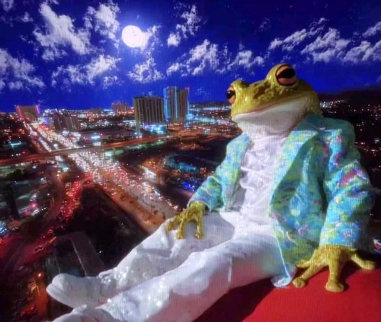</a>

- **作者:** [melogix](https://www.tiktok.com/@melogixx/video/7630157915751451926) · TikTok · **Midjourney** · ♥ 3.9万
- **标签:** `赛博霓虹` `超现实梦境` `无明显地域` `宠物动物` `轻松欢快` `MV`
- 80年代霓虹夜景下，穿亮片外套的青蛙在城市上空慵懒躺着。

<a id="3d-cartoon"></a>
## 3D卡通

### [疾速憨豆](https://daiyixiang666.github.io/awesome-ai-video-prompts/w/x-2106342374805057562.html)

<a href="https://daiyixiang666.github.io/awesome-ai-video-prompts/w/x-2106342374805057562.html">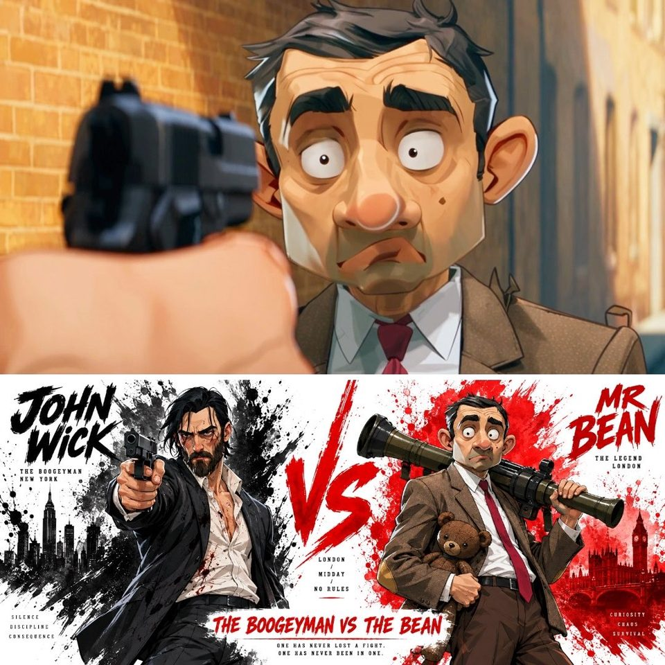</a>

- **作者:** [TechieSA](https://x.com/TechieBySA/status/2106342374805057562) · X · **Seedance 2.5** · ♥ 2.1万
- **标签:** `3D卡通` `欧洲` `喜剧搞笑` `武侠打斗` `轻松欢快` `多镜头剪辑` `梗段子`
- 约翰·威克遇上憨豆先生，卡通渲染风的 20 秒动作喜剧，角色反差笑点密集。

<details><summary>提示词</summary>

```text
Cinematic anime clip, 20 seconds. Narrow London street at midday — bright clear sunshine, warm golden daylight, brick walls, puddles on the ground, quiet street.
JOHN WICK: Tall lean athletic male, long dark slightly messy hair, short dark beard, black suit, white shirt open at collar. Cold, precise, deadly serious. Increasingly frustrated and confused throughout.
MR BEAN: Use uploaded character sheet as strict visual reference. Fights completely seriously like this is totally normal. Never scared, never panicking.
0:00–0:02 — Wick and Bean facing each other on the sunny street. Wick throwing a combat knife precisely at Bean. Bean bending down to tie his shoelace at the exact moment — knife embedding into the brick wall directly behind where his head just was. Bean standing back up, noticing the knife, touching it curiously, shrugging. Looking at Wick.
0:02–0:04 — Both facing each other properly. Wick raising his fists in a precise fighting stance. Bean raising his fists too — completely wrong technique, elbows out, chin up. Wick driving a fast combination at Bean. Bean raising his umbrella — umbrella opening automatically on impact with a loud pop, blocking everything. Bean looking at the umbrella impressed.
0:04–0:06 — Wick grabbing the umbrella, throwing it aside. Bean pulling out his teddy bear, holding it up like a shield. Close up on Wick's face — staring at the teddy bear. Swinging a punch anyway, connecting with it. Bean stumbling back, checking the bear for damage, looking at Wick with genuine indignation.
0:06–0:08 — Bean swinging the teddy bear at Wick like a club. Wick catching it. Brief tug of war in broad daylight. Bean wrenching it back, tucking it safely inside his jacket. Wick lunging, grabbing Bean's collar. Bean pulling out a large raw fish, slapping Wick directly across the face. Loud wet slap. Fish scales on Wick's cheek. Expression of a man processing something that has never happened to him before.
0:08–0:11 — Wick wiping his face, charging furiously. Bean struggling to pull something from his jacket. Bean pulling out an enormous raw turkey, stumbling from the weight, holding it up just as Wick reaches him — Wick running directly into the turkey at full speed. Bean swinging the turkey like a club. Wick backing up dodging left right, genuinely unable to get past a man swinging a raw turkey in broad daylight.
0:11–0:13 — Wick catching the turkey, wrestling it away, hurling it aside. Both standing facing each other breathing hard. Bright sunshine above. Wick raising his pistol at Bean's face. Bean completely calm, nodding to himself, reaching slowly into his jacket with both hands.
0:13–0:15 — Bean pulling out a full bazooka from inside his jacket with great effort, hoisting it onto his shoulder, aiming directly at Wick. Bright sunshine catching the barrel. Close up on Wick's face — eyes moving from the bazooka to Bean's face. Complete and total disbelief.
0:15–0:17 — Wide from above. Both standing in bright London sunshine. Wick with his pistol. Bean with a bazooka. Neither moving. Close up on Bean's face — tongue poking out in concentration, one eye closed, aiming carefully. Pulling the trigger.
0:17–0:19 — Extreme close up on Wick's face. Eyes going wide. Rocket light reflecting in his eyes. Mouth opening very slightly.
0:19–0:20 — Cut to black. Enormous explosion. Silence. Then Bean's teddy bear squeaking once in the darkness.
Cel-shaded 3D anime, Unreal Engine quality, narrow London street midday bright clear sunshine warm golden daylight brick walls throughout, bold flat color blocking, hard edge shadows, thick black outlines, film grain, orchestral score switching constantly between deadly serious and absurd comedy building to absolute chaos then cutting to silence on black, camera switching constantly — wide from above, medium side shots, extreme close ups on faces and weapons, behind shots — Wick always black suit white shirt cold precise deadly serious.
```

</details>

<a id="black-and-white"></a>
## 黑白影像

### [白教堂华尔兹](https://daiyixiang666.github.io/awesome-ai-video-prompts/w/x-2088546485982171432.html)

<a href="https://daiyixiang666.github.io/awesome-ai-video-prompts/w/x-2088546485982171432.html">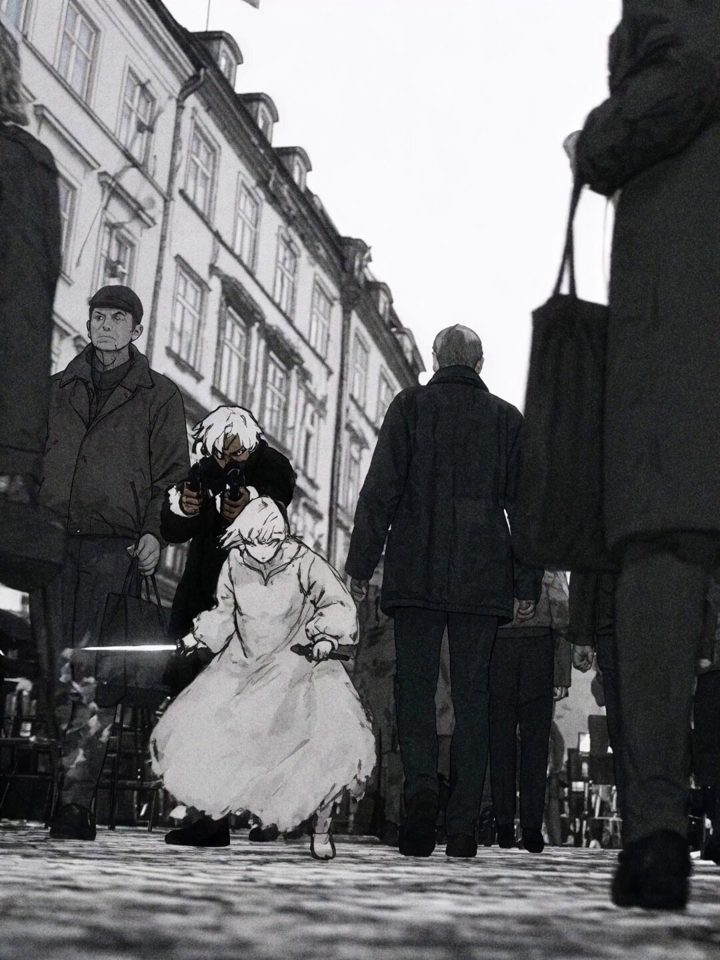</a>

- **作者:** [Timeless](https://x.com/Timeless_aiart/status/2088546485982171432) · X · **Midjourney + Seedance 2.5** · ♥ 1.1万
- **标签:** `黑白影像` `欧洲` `历史年代` `音乐舞蹈` `诡异不安` `多镜头剪辑` `MV`
- 维多利亚伦敦街头的黑白哥特华尔兹，构图和服装像插画动起来。

### [消失的华沙](https://daiyixiang666.github.io/awesome-ai-video-prompts/w/x-2088148361903824927.html)

<a href="https://daiyixiang666.github.io/awesome-ai-video-prompts/w/x-2088148361903824927.html">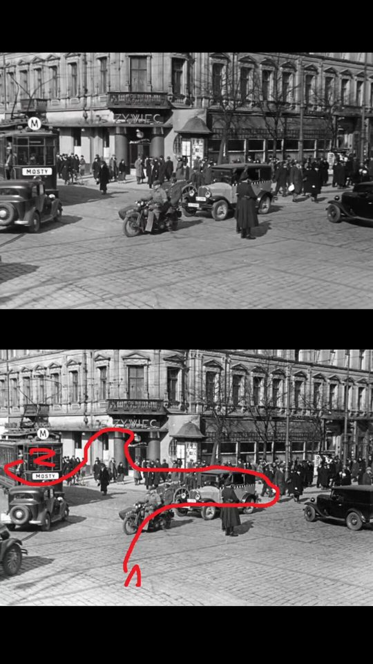</a>

- **作者:** [Maciej Dobrodziej](https://x.com/M_Dobrodziej/status/2088148361903824927) · X · **Seedance 2.5** · ♥ 2944
- **标签:** `黑白影像` `欧洲` `历史年代` `孤独忧郁` `时间冻结倒放` `一镜到底` `叙事短片`
- 用一张 1930 年代华沙老照片，冻结整条街，镜头穿行于行人、电车和招牌之间。

<a id="game-cg"></a>
## 游戏CG

### [潜入教室](https://daiyixiang666.github.io/awesome-ai-video-prompts/w/x-2098766209839923543.html)

<a href="https://daiyixiang666.github.io/awesome-ai-video-prompts/w/x-2098766209839923543.html">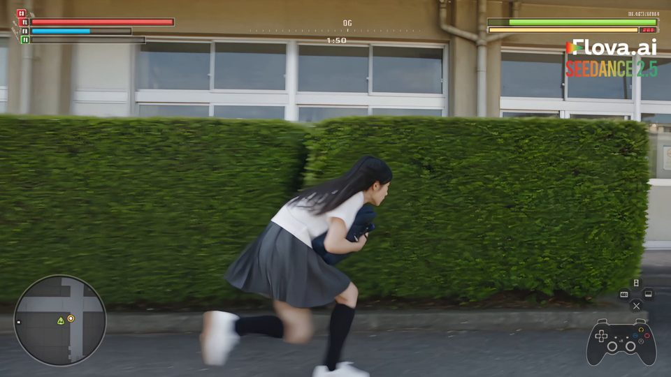</a>

- **作者:** [TSUBAKI](https://x.com/AI__TSUBAKI/status/2098766209839923543) · X · **Seedance 2.5** · ♥ 9983
- **标签:** `游戏CG` `日系` `游戏电竞` `喜剧搞笑` `紧张刺激` `一镜到底` `梗段子`
- 把迟到溜进教室拍成 3A 第三人称潜行游戏画面，HUD、镜头跟随都很到位。

<details><summary>提示词</summary>

```text
SCENE CONTEXT
A 30-second realistic AAA third-person stealth-action game sequence set in a Japanese high school on a bright weekday morning. The player character, NAGI, arrived 12 minutes late and must reach her classroom seat without being spotted by any teacher.

ACTIVE REFERENCES

@Image1
 = NAGI. 
@Image1
 defines NAGI's face, hairstyle and uniform: Japanese high-school girl, 17, long straight black hair with blunt bangs, white short-sleeve sailor blouse with pink collar stripes and a satin pink ribbon, grey pleated skirt, black knee-high socks, white sneakers. Voice: light, breathy young female voice, speaking Japanese in a hushed whisper. 100% matches the reference. Use only her appearance — do not use the grey studio background.

CAST SEPARATION
Four distinct adults appear, each with a different silhouette, age and hair so they read as four separate people:
- GATE TEACHER: man in his 40s, 170 cm, average build, full head of short black hair parted at the side, thin metal-framed glasses, white dress shirt with a loosened navy tie. Appears only at the gate.
- LOCKER TEACHER: woman in her 20s, 160 cm, slim, brown hair in a high ponytail, beige cardigan over a white blouse, carrying printouts. Appears only in the shoe-locker bay.
- PRINCIPAL: man in his 60s, 160 cm, stout and round-shouldered, completely bald with a shiny scalp and a fringe of white hair above the ears, round gold-rimmed glasses, charcoal three-piece suit with a lapel badge. Appears only at the corridor T-junction.
- HOMEROOM TEACHER: man in his early 30s, 182 cm, lean and broad-shouldered, thick full black hair swept back, short beard, navy tracksuit with two white side stripes, chalk dust on his sleeve, no glasses. Appears only in the classroom.
The PRINCIPAL is the only bald character in the entire video. The HOMEROOM TEACHER keeps a full head of thick black hair and a beard, stands more than 20 cm taller than the PRINCIPAL, and is clearly a different, much younger man.

LOCATION MAP
One unbroken spatial route the camera travels with her: front gate hedge → gate gap → shoe-locker bay → corridor T-junction → cleaning-locker alcove → classroom rear sliding door → her desk. Foreground: polished linoleum floor and steel shoe lockers, sunlit and reflective. Background: window wall on camera-right onto a sports ground, dust suspended in the sunbeams. Light enters from camera-right through the windows along the entire route.

CLASSROOM GEOMETRY
The classroom is oriented like a standard Japanese classroom: the blackboard and the teacher's lectern are at the FRONT of the room, the window wall runs along one side, and the rear sliding door, the back wall bulletin board and the cleaning lockers are at the BACK. Every student desk faces the blackboard. NAGI enters through the rear door and sits at a back-row desk, facing forward toward the blackboard for the whole classroom section — the blackboard is always in front of her, never behind her.

FIRST FRAME / BLOCKING
First frame is already in motion: NAGI sprints in from lower-left toward camera-right, school bag clutched to her chest, and drops into a crouch-slide behind a trimmed hedge beside the closed school gate. Camera behind her right shoulder. Game HUD fully visible from frame one.

FORMAT MODE
One continuous unbroken take from 0.0s to 27.0s with no cuts of any kind, then a single HARD CUT at 27.0s to one final locked reverse shot that runs to 30.0s. Exactly one cut exists in the whole video, at 27.0s. The camera does not cut anywhere else.

OPTICS
One lens for the continuous section: 47° third-person over-the-shoulder framing as the baseline, breathing in to 29° on reaction beats and out to 63° for the corridor takedown and the cardboard box. All FOV changes in that section happen as smooth continuous zoom breathing, never as a jump. The final shot after the cut is a fixed 29° frontal framing of NAGI, no drift.

CAMERA
For the continuous section the camera is a physical object flying with her. Chest-height, 1.5 meters behind NAGI, slightly camera-right of her spine, swinging with a soft spring delay half a beat behind her turns like an analog-stick gameplay camera. It dips to knee height when she crouches, rises when she stands, slides sideways along the locker wall with her, swings wide to the corridor-left to open up the takedown, drifts back behind her for the box, and follows her low through the classroom rear door gap to settle behind her shoulder as she sits. After the cut, the camera is repositioned to the FRONT of the classroom, standing beside the teacher's lectern next to the blackboard and looking back down the aisle at NAGI — locked off, eye level, completely static, no movement.

ACTION

[Beat 1 — 0.0s to 6.0s] NAGI crouch-slides behind the hedge, back flat to the leaves, chest heaving. She leans out 20 cm to peek at the GATE TEACHER checking his watch, then pulls back. She whispers in Japanese: {ちこく…バレたら終わりだ}. HUD flashes 【LATE — 12 MIN】 and the mission banner 【OBJECTIVE: REACH CLASS 2-B UNDETECTED】. She slips through the gate gap behind his back while he faces away, and the camera follows her through the gap without stopping.

[Beat 2 — 6.0s to 12.0s] The camera stays with her into the shoe-locker bay. NAGI presses her spine flat against the steel lockers and shuffles sideways at 2 km/h, sneakers rolling heel-to-toe in silence; the camera tracks sideways with her at the same speed. The LOCKER TEACHER walks past the end of the row carrying printouts. NAGI holds her breath, pupils tracking her without moving her head, and whispers: {止まって…気づかないで}. The minimap vision cone sweeps past NAGI's marker and turns away. HUD shows 【SNEAKING MODE】. The LOCKER TEACHER exits frame-left, NAGI exhales and moves on into the corridor with the camera still on her shoulder.

[Beat 3 — 12.0s to 18.0s] The PRINCIPAL steps around the T-junction two meters in front of her. A red exclamation marker snaps above his bald head with a sharp alert sting, the HUD edge pulses red, 【ALERT】. The camera swings wide to corridor-left as NAGI reacts in one motion: drops her bag, steps inside his guard, hooks his right wrist, spins under his arm into a soft CQC hold around his shoulders, then lowers him carefully to the floor and props him seated against the wall, asleep with his gold-rimmed glasses askew. She bows quickly and whispers: {ごめんなさい、校長先生！}. HUD prints 【CQC TAKEDOWN】 and 【PRINCIPAL: Z z z】. She scoops her bag back up and the camera falls in behind her again.

[Beat 4 — 18.0s to 24.0s] Two office staff in grey work vests, both with short dark hair, turn into the far end of the corridor walking toward camera. NAGI grabs a flattened cardboard box by the cleaning-locker alcove, pops it open and drops it over herself in one second, freezing dead still mid-corridor; the camera drifts to a stop with her, still running. Only her white sneakers show under the cardboard rim. The two staff walk past; one slows, looks at the box for a full beat, shrugs and keeps walking. From inside the box NAGI whispers: {箱…最強}. HUD prints 【BOX EQUIPPED】 then 【ENEMY LOST CONTACT】, alert bar drains to green. The box shuffles forward on two sneakered feet and the camera moves with it.

[Beat 5 — 24.0s to 27.0s] She ditches the box behind a pillar, slides the classroom rear door open 15 cm and crawls low along the back row under the window line; the camera drops low and slips through the same door gap with her, staying behind her shoulder. She folds into an empty back-row desk facing forward toward the blackboard. Over her shoulder in the far distance, the HOMEROOM TEACHER stands at the blackboard writing, his back to the room. She sits bolt upright, hands flat on the desk.

27.0s HARD CUT

[Beat 6 — 27.0s to 30.0s] Locked static reverse shot from the front of the classroom beside the lectern, looking back down the aisle: NAGI sits at her back-row desk facing camera, shoulders squared, hands flat on the desk, chest still rising fast. Behind her are rows of empty student desks, the back wall bulletin board and the closed rear sliding door — no blackboard behind her. Off camera behind the lens, the HOMEROOM TEACHER says in Japanese: {なぎ、出席とるぞ}. NAGI answers brightly, looking straight down the lens: {はい！}. HUD prints 【MISSION COMPLETE】, 【STEALTH RANK: S】, 【ADRENALINE +150】. Final frame: NAGI facing camera, a tiny triumphant smile pulling at one corner of her mouth.

PERFORMANCE
Photographic human realism indistinguishable from live-action footage: skin with visible pores, fine vellus hair catching the light, subsurface scattering in the earlobes and fingertips, capillary flush across her cheeks and ears from running, individual flyaway strands lifting off her hair, wet living eyes with true window catch-lights and a faint red inner rim, clean matte skin. Visible fast breathing at the collarbone, eyes darting a half-second before her head turns. Tension shown by muscle: shoulders drawn up to her ears, fingers clamped white on the bag strap, jaw set, then a full-body shoulder drop on each escape. All adults have equally real skin, real hair follicles and natural asymmetric faces.

PHYSICS
Her skirt pleats swing and settle with inertia on every stop; hair lags and sweeps across her face on fast turns. The cardboard box has real mass — it wobbles when it lands on her shoulders and its bottom edge drags with a light scrape. The PRINCIPAL's body has believable weight as she lowers him; his shoes squeak once on the linoleum. Contact shadows stay glued under every foot, every knee, every box corner.

LIGHTING
One continuous light logic across the whole video: hard morning sun at 5600K entering from the window wall on camera-right, throwing long window-frame stripes across the floor that NAGI passes through light and shadow as she travels the route. Soft bounce fill off the pale linoleum lifts her face. In the final reverse shot the same window wall now sits on camera-left, raking light across her cheek from that side, with soft bounce off the desks. Fine dust suspended in the sunbeams. Exposure rolls smoothly as she moves between bright and shadowed stretches, and the color temperature matches exactly across the cut.

HUD
GTA-style real-time game HUD locked to fixed screen positions for the whole 30 seconds, with every on-screen word written in English: circular minimap bottom-left with the player arrow and yellow vision cones for each adult, health and stamina bars top-left, alert-state bar shifting green to amber to red, controller button prompts bottom-right, English mission objective text top-center, floating red exclamation markers over alerted characters, notification cards sliding in from screen-right. The HUD stays in the same screen positions across the cut. No subtitles or caption bars anywhere on screen. The HUD is a clean flat graphic overlay composited on top of fully photographic live-action-grade footage.

AUDIO
(tense minimalist stealth synth loop with a pulsing heartbeat under it, running unbroken across the cut and resolving to a short bright victory fanfare at the end) <sneaker squeaks on linoleum> <steel locker creak> <sharp alert sting on the exclamation marker> <cardboard rustle and scrape> <chalk on blackboard> <distant volleyball whistle from the sports ground> <fast heartbeat rising through the takedown and the box>. Ambience carries continuously through the cut. All dialogue is spoken in Japanese.

STYLE
Photoreal live-action realism, real human beings and real fabric, natural skin tones with true-to-life color science, physically correct materials, realistic human proportions and anatomy, real optical depth of field, real floor reflections, subtle handheld gameplay motion blur, fine film grain at 5%, sharp detail intent.

OUTPUT SETTINGS
16:9, real-time speed throughout, one continuous 27-second take plus one 3-second locked shot after a single hard cut.

POSITIVE LOCKS
Exactly one cut in the entire video, at 27.0s — everything before it is a single unbroken take with the camera connected to NAGI. NAGI keeps the same face, long black hair with blunt bangs, white pink-striped sailor uniform, grey pleated skirt, black knee-highs and white sneakers throughout, with dry clean skin. The school bag stays with her except during the takedown, then returns to her arms. The cardboard box appears only in the corridor beat. The bald PRINCIPAL in the charcoal suit appears only at the T-junction; the tall bearded HOMEROOM TEACHER with thick black hair in the navy tracksuit appears only in the classroom, and the two are unmistakably different men. In the classroom NAGI always faces the blackboard; in the final shot the camera stands at the blackboard end of the room, so empty desks and the rear door fill the space behind her. All on-screen text is English. The last 3 seconds hold a locked frontal eye-level shot of NAGI facing camera. HUD elements stay in the same screen corners throughout. One single NAGI on screen at all times. All spoken lines are in Japanese. Sunlight direction stays consistent for all 30 seconds.
```

</details>

### [浮岛废墟](https://daiyixiang666.github.io/awesome-ai-video-prompts/w/x-2022996066472513856.html)

<a href="https://daiyixiang666.github.io/awesome-ai-video-prompts/w/x-2022996066472513856.html">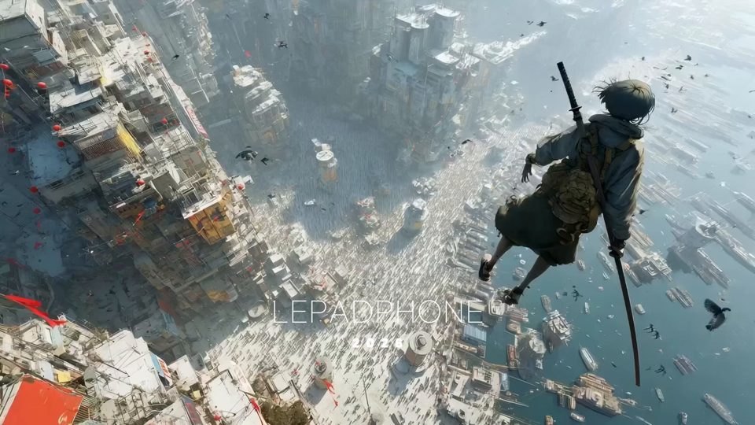</a>

- **作者:** [padphone](https://x.com/lepadphone/status/2022996066472513856) · X · **Seedance 2.0** · ♥ 3051
- **标签:** `游戏CG` `日系` `奇幻神话` `史诗壮阔` `叙事短片`
- 武士穿行于漂浮的城市废墟之间，奇幻世界观的大场面。

<a id="watercolor-storybook"></a>
## 水彩绘本

### [林中奔逃](https://daiyixiang666.github.io/awesome-ai-video-prompts/w/x-2021299278455681206.html)

<a href="https://daiyixiang666.github.io/awesome-ai-video-prompts/w/x-2021299278455681206.html">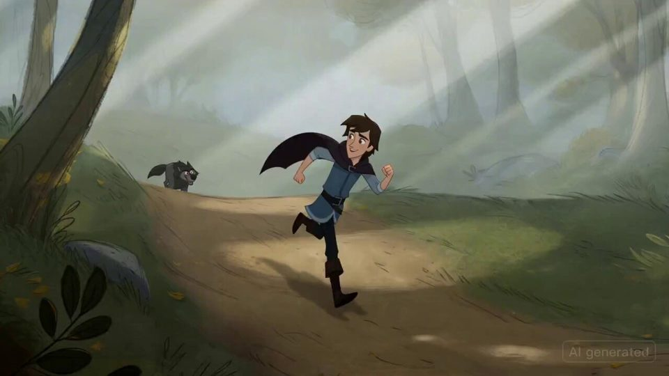</a>

- **作者:** [Brett Stuart](https://x.com/bstuartTI/status/2021299278455681206) · X · **Seedance 2.0** · ♥ 5366
- **标签:** `水彩绘本` `无明显地域` `奇幻神话` `紧张刺激` `多镜头剪辑` `叙事短片`
- 一张起始图+一条含 5 个分镜的提示词生成的手绘水彩风逃亡段落。

<a id="anime"></a>
## 日系动漫

### [猪排饭](https://daiyixiang666.github.io/awesome-ai-video-prompts/w/x-2098845134326808734.html)

<a href="https://daiyixiang666.github.io/awesome-ai-video-prompts/w/x-2098845134326808734.html">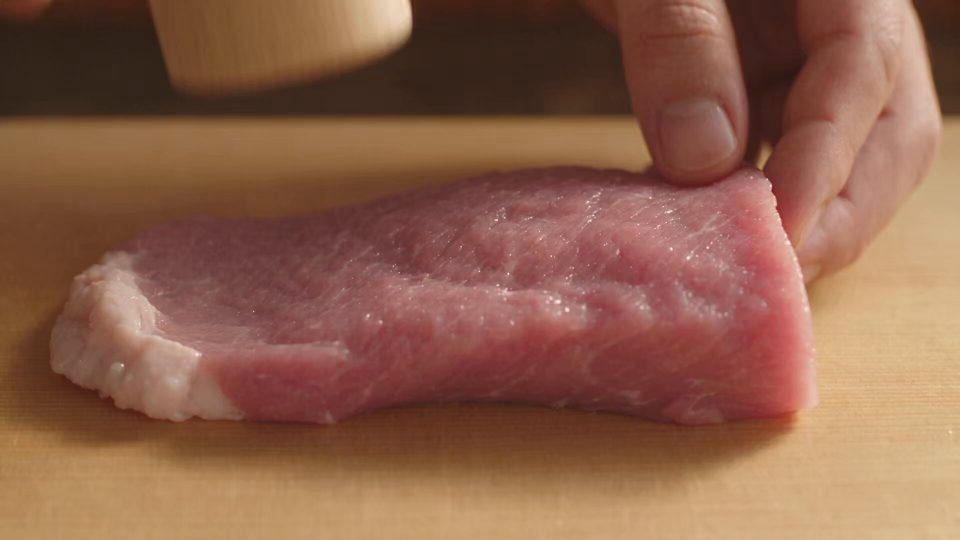</a>

- **作者:** [Saul Goodman](https://x.com/Goodmanprotocol/status/2098845134326808734) · X · **Seedance 2.5** · ♥ 4937
- **标签:** `日系动漫` `日系` `美食` `温暖治愈` `卡点节奏` `多镜头剪辑` `叙事短片`
- 日式动画风的快节奏猪排饭烹饪短片，食物特写、蒸汽与匹配剪辑俱佳。

<details><summary>提示词</summary>

```text
Create a 30-second fast-paced cinematic Japanese anime cooking video showing the preparation of authentic katsudon, entirely from the text description below.

IMPORTANT: Do not display, recreate, trace, reference, or imitate any storyboard, sketch, reference image, panel, annotation, or source material. Generate only original anime-style animation.

STYLE

High-quality Japanese anime film style, cinematic summer lighting, ultra-detailed food textures, realistic cooking physics, visible steam and moisture, shallow depth of field, macro close-ups, smooth camera movement, warm Japanese kitchen atmosphere. Fast rhythmic editing with natural match cuts based on movement, shape, texture, and composition.

TIMELINE

0–2.5s — Prepare Pork
Close-up of hands pounding a thick pork loin with a wooden mallet on a cutting board. The meat gradually flattens and its fibers loosen. Sprinkle salt and pepper evenly. Crisp rhythmic impacts.

2.5–5s — Bread the Pork
Quick match cuts: press the pork into flour, dip into beaten egg, then firmly coat with coarse panko breadcrumbs. Show realistic egg dripping and breadcrumbs adhering to the surface.

5–7.5s — Fry
Lower the breaded pork into hot golden oil. Intense bubbling surrounds the cutlet as the crust turns golden brown and crispy. Warm cinematic lighting and detailed oil movement.

7.5–9.5s — Slice
Place the fried tonkatsu on a wooden board. A sharp knife cuts it into even strips. The crispy crust cracks naturally, revealing juicy white pork with gentle steam escaping.

9.5–12s — Simmer Dashi & Onion
Thinly sliced onions gently simmer in amber dashi inside a shallow pan. Small bubbles rise while the onions become translucent. Chopsticks gently move them through the broth.

12–14s — Add Tonkatsu
Place the sliced tonkatsu carefully over the simmering onions using chopsticks. The broth begins soaking into the crispy edges while steam rises.

14–16.5s — Pour Egg
Slowly pour beaten golden egg over the tonkatsu and onions. The egg spreads naturally through the gaps and begins setting around the hot edges.

16.5–19s — Set the Egg
Close-up of the egg gently coagulating over low heat. Edges become soft and golden while the center remains glossy, slightly runny, and trembling. No stirring.

19–21s — Prepare Rice
A white ceramic donburi bowl receives a generous mound of steaming Japanese short-grain rice. The rice looks fluffy and slightly glossy.

21–24s — Assemble
Carefully slide the egg-and-tonkatsu mixture from the pan onto the rice. The egg settles naturally in a soft wave while dashi lightly absorbs into the rice.

24–26s — Final Close-Up
The finished katsudon rests on the counter. Glossy egg slowly settles over the tonkatsu and rice, gently trembling. Slow cinematic push-in.

26–30s — Hero Reveal
Present the finished katsudon in a traditional blue-and-white ceramic bowl on a wooden surface. Golden egg covers crispy tonkatsu over glossy rice, topped with fresh mitsuba. Steam rises as the camera slowly arcs around the bowl for a beautiful anime-food-film ending.

AUDIO

Bright 1980s-inspired Japanese city-pop instrumental, 110–120 BPM, with subtle koto and light chime percussion. Synchronize realistic ASMR cooking sounds: mallet impacts, knife slicing, frying sizzle, bubbling dashi, chopsticks, egg pouring, steam, and a soft ceramic clink.

End with one delicate wind-chime tone during the final reveal.

NEGATIVE

No storyboard, reference image, sketch, panels, borders, numbers, arrows, annotations, subtitles, captions, UI, logos, or text overlays. No unrelated ingredients or dishes. Katsudon only. Keep the food, hands, utensils, lighting, and environment visually consistent throughout.
```

</details>

## 收录标准

- 只收顶级：高审美、高方法论的单条短镜头；不收梗图、软色情、搬运。
- 始终署名并链接原作者。

## 版权与下架

如权利人认为收录不当，请发邮件至 **yixiang@umich.edu** 或提 Issue，我们核实后第一时间下架。

## 机器可读

- [`works.json`](https://daiyixiang666.github.io/awesome-ai-video-prompts/works.json) · [`llms.txt`](https://daiyixiang666.github.io/awesome-ai-video-prompts/llms.txt) · [`sitemap.xml`](https://daiyixiang666.github.io/awesome-ai-video-prompts/sitemap.xml)
