

# 镜鉴 · 顶级 AI 视频提示词

**人工精选的顶级 AI 视频、图片与 Coding 作品，附提示词，按画风、氛围、题材检索**

[在线浏览](https://daiyixiang666.github.io/awesome-ai-video-prompts/) · [标签](https://daiyixiang666.github.io/awesome-ai-video-prompts/tags.html) · [投稿](https://github.com/daiyixiang666/awesome-ai-video-prompts/issues/new?template=submit.yml) · [English](README.en.md) · [works.json](https://daiyixiang666.github.io/awesome-ai-video-prompts/works.json)

  

人工筛选的 AI 作品合集，只收高审美、高方法论的作品，分 **视频**（≤60 秒短片）、**图片**、**Coding**（大模型写代码做的作品）三类。每部作品都署名并链接原作者，按画风、地域氛围、题材、情绪、镜头技法、用途打标，作者公开过提示词的附上完整提示词。

## 视频 177

AI 视频生成模型（Seedance、Kling、Veo…）生成的单条短片。 [查看全部 →](https://daiyixiang666.github.io/awesome-ai-video-prompts/index.html)

<table>
<tr>
<td width="25%" valign="top"><a href="https://daiyixiang666.github.io/awesome-ai-video-prompts/w/x-2116621100859662589.html">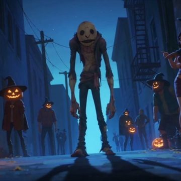</a> <a href="https://daiyixiang666.github.io/awesome-ai-video-prompts/w/x-2116621100859662589.html"><b>糟糕的万圣派对</b></a> Anima · Seedance 2.5</td>
<td width="25%" valign="top"><a href="https://daiyixiang666.github.io/awesome-ai-video-prompts/w/x-2116723904014340590.html">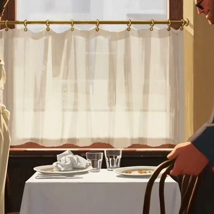</a> <a href="https://daiyixiang666.github.io/awesome-ai-video-prompts/w/x-2116723904014340590.html"><b>绅士</b></a> Keneth Tran | AI Animation · Seedance 2.5</td>
<td width="25%" valign="top"> <a href="https://daiyixiang666.github.io/awesome-ai-video-prompts/w/x-2116882508700942698.html"><b>公交车上的鹿角人</b></a> goo.vision</td>
<td width="25%" valign="top"><a href="https://daiyixiang666.github.io/awesome-ai-video-prompts/w/x-2117061682162029022.html">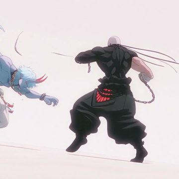</a> <a href="https://daiyixiang666.github.io/awesome-ai-video-prompts/w/x-2117061682162029022.html"><b>影と社</b></a> Kōda · Seedance 2.5</td>
</tr>
<tr>
<td width="25%" valign="top"><a href="https://daiyixiang666.github.io/awesome-ai-video-prompts/w/x-2114679577738162359.html">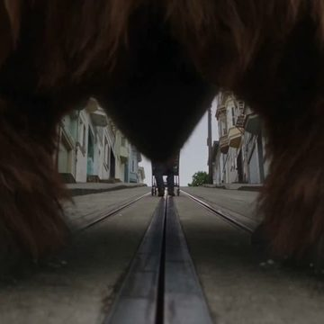</a> <a href="https://daiyixiang666.github.io/awesome-ai-video-prompts/w/x-2114679577738162359.html"><b>旧金山的猩猩</b></a> el.cine</td>
<td width="25%" valign="top"><a href="https://daiyixiang666.github.io/awesome-ai-video-prompts/w/x-2116868040537276831.html">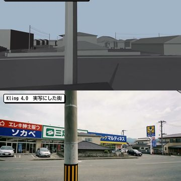</a> <a href="https://daiyixiang666.github.io/awesome-ai-video-prompts/w/x-2116868040537276831.html"><b>地图数据造出的实景城</b></a> boke_ai · Kling 4.0</td>
<td width="25%" valign="top"><a href="https://daiyixiang666.github.io/awesome-ai-video-prompts/w/x-2114007429146964169.html">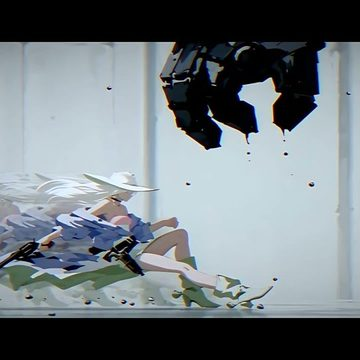</a> <a href="https://daiyixiang666.github.io/awesome-ai-video-prompts/w/x-2114007429146964169.html"><b>枪手与巨人</b></a> Kōda · Seedance 2.5</td>
<td width="25%" valign="top"> <a href="https://daiyixiang666.github.io/awesome-ai-video-prompts/w/x-2117249822554276133.html"><b>仅限女士</b></a> ToaiDanh · Seedance 2.5</td>
</tr>
</table>

## 图片 189

图片生成模型（Midjourney、GPT Image、Nano Banana…）生成的作品。 [查看全部 →](https://daiyixiang666.github.io/awesome-ai-video-prompts/images.html)

<table>
<tr>
<td width="25%" valign="top"> <a href="https://daiyixiang666.github.io/awesome-ai-video-prompts/w/img-x-2117206100873232801.html"><b>地铁里的人</b></a> Gizem Akdag</td>
<td width="25%" valign="top"><a href="https://daiyixiang666.github.io/awesome-ai-video-prompts/w/img-x-2104110405933277694.html">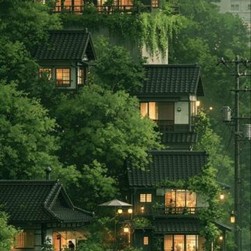</a> <a href="https://daiyixiang666.github.io/awesome-ai-video-prompts/w/img-x-2104110405933277694.html"><b>治愈系街景</b></a> Glitter Gal · Midjourney</td>
<td width="25%" valign="top"> <a href="https://daiyixiang666.github.io/awesome-ai-video-prompts/w/img-x-2117329592629477849.html"><b>夜湖白花</b></a> unseen</td>
<td width="25%" valign="top"> <a href="https://daiyixiang666.github.io/awesome-ai-video-prompts/w/img-x-2116994324378349712.html"><b>行星环下的家</b></a> Dogan Ural</td>
</tr>
<tr>
<td width="25%" valign="top"><a href="https://daiyixiang666.github.io/awesome-ai-video-prompts/w/img-x-2115869155530535134.html">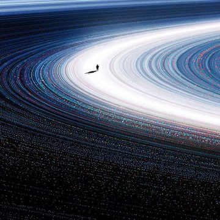</a> <a href="https://daiyixiang666.github.io/awesome-ai-video-prompts/w/img-x-2115869155530535134.html"><b>星环之下</b></a> Dogan Ural</td>
<td width="25%" valign="top"> <a href="https://daiyixiang666.github.io/awesome-ai-video-prompts/w/img-x-2116616673587597478.html"><b>星轨之下</b></a> Dogan Ural</td>
<td width="25%" valign="top"> <a href="https://daiyixiang666.github.io/awesome-ai-video-prompts/w/img-x-2102333715795804395.html"><b>过剩</b></a> AlexandrIA · Midjourney</td>
<td width="25%" valign="top"> <a href="https://daiyixiang666.github.io/awesome-ai-video-prompts/w/img-x-2117009575547404766.html"><b>毛毡小剧场</b></a> HPJJ · GPT Image (ChatGPT)</td>
</tr>
</table>

## Coding 28

大语言模型写代码做出的作品（three.js、WebGL、shader…），包括用代码渲染的视频。 [查看全部 →](https://daiyixiang666.github.io/awesome-ai-video-prompts/coding.html)

<table>
<tr>
<td width="25%" valign="top"><a href="https://daiyixiang666.github.io/awesome-ai-video-prompts/w/web-2116192984299344372.html">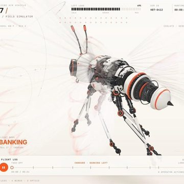</a> <a href="https://daiyixiang666.github.io/awesome-ai-video-prompts/w/web-2116192984299344372.html"><b>机械蚊拆解台</b></a> Elvar · Opus 5.5 (Claude)</td>
<td width="25%" valign="top"><a href="https://daiyixiang666.github.io/awesome-ai-video-prompts/w/web-2108369354991759658.html">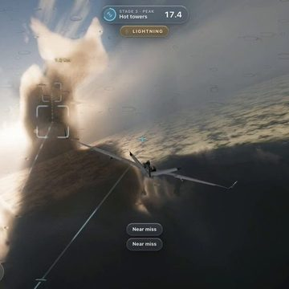</a> <a href="https://daiyixiang666.github.io/awesome-ai-video-prompts/w/web-2108369354991759658.html"><b>穿越飓风之眼</b></a> Techartist · Claude Opus 5.5</td>
<td width="25%" valign="top"> <a href="https://daiyixiang666.github.io/awesome-ai-video-prompts/w/web-2113310927093436587.html"><b>会翻页的能量之书</b></a> Techartist · Opus 5.5 (Claude)</td>
<td width="25%" valign="top"> <a href="https://daiyixiang666.github.io/awesome-ai-video-prompts/w/web-2114035230113984749.html"><b>夏祭·池塘电车</b></a> Scott · Opus 5.5 (Claude)</td>
</tr>
<tr>
<td width="25%" valign="top"><a href="https://daiyixiang666.github.io/awesome-ai-video-prompts/w/web-2102503719762018434.html">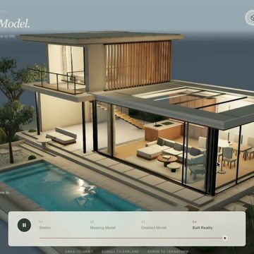</a> <a href="https://daiyixiang666.github.io/awesome-ai-video-prompts/w/web-2102503719762018434.html"><b>从草图到家</b></a> Techartist · Opus 5.5 (Claude)</td>
<td width="25%" valign="top"> <a href="https://daiyixiang666.github.io/awesome-ai-video-prompts/w/web-2112935205703147750.html"><b>机械花</b></a> Bee · Gemini 4 Carbon</td>
<td width="25%" valign="top"> <a href="https://daiyixiang666.github.io/awesome-ai-video-prompts/w/web-2113662031379464549.html"><b>云雾猫</b></a> Bee · Gemini 4 Carbon</td>
<td width="25%" valign="top"> <a href="https://daiyixiang666.github.io/awesome-ai-video-prompts/w/web-2113909026253877485.html"><b>雾中沼泽</b></a> Chetan Ankola · GPT-6 Astra</td>
</tr>
</table>

## 按标签找

**画风**　[写实电影感](https://daiyixiang666.github.io/awesome-ai-video-prompts/t/style/cinematic-realism.html) 119 · [超现实梦境](https://daiyixiang666.github.io/awesome-ai-video-prompts/t/style/surreal-dream.html) 75 · [广告大片](https://daiyixiang666.github.io/awesome-ai-video-prompts/t/style/commercial.html) 47 · [胶片复古](https://daiyixiang666.github.io/awesome-ai-video-prompts/t/style/film-retro.html) 45 · [水彩绘本](https://daiyixiang666.github.io/awesome-ai-video-prompts/t/style/watercolor-storybook.html) 42 · [纪实手持](https://daiyixiang666.github.io/awesome-ai-video-prompts/t/style/documentary-handheld.html) 37 · [日系动漫](https://daiyixiang666.github.io/awesome-ai-video-prompts/t/style/anime.html) 34 · [游戏CG](https://daiyixiang666.github.io/awesome-ai-video-prompts/t/style/game-cg.html) 29  
**地域氛围**　[无明显地域](https://daiyixiang666.github.io/awesome-ai-video-prompts/t/region/no-region.html) 155 · [日系](https://daiyixiang666.github.io/awesome-ai-video-prompts/t/region/japanese.html) 74 · [欧洲](https://daiyixiang666.github.io/awesome-ai-video-prompts/t/region/european.html) 66 · [美式](https://daiyixiang666.github.io/awesome-ai-video-prompts/t/region/american.html) 44 · [中式](https://daiyixiang666.github.io/awesome-ai-video-prompts/t/region/chinese.html) 22 · [韩系](https://daiyixiang666.github.io/awesome-ai-video-prompts/t/region/korean.html) 17 · [其他地域](https://daiyixiang666.github.io/awesome-ai-video-prompts/t/region/other-region.html) 15 · [港风](https://daiyixiang666.github.io/awesome-ai-video-prompts/t/region/hong-kong.html) 1  
**题材**　[奇幻神话](https://daiyixiang666.github.io/awesome-ai-video-prompts/t/genre/fantasy-myth.html) 81 · [日常生活](https://daiyixiang666.github.io/awesome-ai-video-prompts/t/genre/daily-life.html) 79 · [自然风光](https://daiyixiang666.github.io/awesome-ai-video-prompts/t/genre/nature.html) 50 · [科幻](https://daiyixiang666.github.io/awesome-ai-video-prompts/t/genre/sci-fi.html) 45 · [时尚美妆](https://daiyixiang666.github.io/awesome-ai-video-prompts/t/genre/fashion-beauty.html) 43 · [旅行城市](https://daiyixiang666.github.io/awesome-ai-video-prompts/t/genre/travel-city.html) 39 · [爱情青春](https://daiyixiang666.github.io/awesome-ai-video-prompts/t/genre/romance-youth.html) 31 · [历史年代](https://daiyixiang666.github.io/awesome-ai-video-prompts/t/genre/historical.html) 27  
**情绪**　[孤独忧郁](https://daiyixiang666.github.io/awesome-ai-video-prompts/t/mood/melancholy.html) 94 · [温暖治愈](https://daiyixiang666.github.io/awesome-ai-video-prompts/t/mood/heartwarming.html) 86 · [轻松欢快](https://daiyixiang666.github.io/awesome-ai-video-prompts/t/mood/lighthearted.html) 68 · [史诗壮阔](https://daiyixiang666.github.io/awesome-ai-video-prompts/t/mood/epic.html) 61 · [紧张刺激](https://daiyixiang666.github.io/awesome-ai-video-prompts/t/mood/tense.html) 39 · [诡异不安](https://daiyixiang666.github.io/awesome-ai-video-prompts/t/mood/eerie.html) 35 · [热血燃](https://daiyixiang666.github.io/awesome-ai-video-prompts/t/mood/hype.html) 35 · [浪漫心动](https://daiyixiang666.github.io/awesome-ai-video-prompts/t/mood/romantic.html) 33  
**镜头技法**　[多镜头剪辑](https://daiyixiang666.github.io/awesome-ai-video-prompts/t/technique/multi-shot.html) 99 · [一镜到底](https://daiyixiang666.github.io/awesome-ai-video-prompts/t/technique/one-take.html) 30 · [角色一致性](https://daiyixiang666.github.io/awesome-ai-video-prompts/t/technique/character-consistency.html) 22 · [第一人称](https://daiyixiang666.github.io/awesome-ai-video-prompts/t/technique/pov.html) 17 · [微表情特写](https://daiyixiang666.github.io/awesome-ai-video-prompts/t/technique/micro-expression.html) 16 · [慢动作](https://daiyixiang666.github.io/awesome-ai-video-prompts/t/technique/slow-motion.html) 14 · [变身转场](https://daiyixiang666.github.io/awesome-ai-video-prompts/t/technique/transformation-transition.html) 14 · [宫格分镜](https://daiyixiang666.github.io/awesome-ai-video-prompts/t/technique/storyboard-grid.html) 8  
**用途**　[叙事短片](https://daiyixiang666.github.io/awesome-ai-video-prompts/t/use/short-film.html) 71 · [vlog](https://daiyixiang666.github.io/awesome-ai-video-prompts/t/use/vlog.html) 38 · [广告TVC](https://daiyixiang666.github.io/awesome-ai-video-prompts/t/use/tvc.html) 18 · [演示教程](https://daiyixiang666.github.io/awesome-ai-video-prompts/t/use/demo-tutorial.html) 16 · [预告片](https://daiyixiang666.github.io/awesome-ai-video-prompts/t/use/trailer.html) 14 · [MV](https://daiyixiang666.github.io/awesome-ai-video-prompts/t/use/music-video.html) 12 · [梗段子](https://daiyixiang666.github.io/awesome-ai-video-prompts/t/use/meme-sketch.html) 8  

## 收录标准

- 只收顶级：高审美、高方法论；不收梗图、软色情、搬运、工具广告。
- 视频只收 AI 视频模型生成的作品；图片只收图片模型生成的作品；大模型写代码做的（three.js、WebGL、代码渲染的视频）都归 Coding。
- 始终署名并链接原作者，从不编造提示词。

## 给 AI 与开发者

[`works.json`](https://daiyixiang666.github.io/awesome-ai-video-prompts/works.json) · [`llms.txt`](https://daiyixiang666.github.io/awesome-ai-video-prompts/llms.txt) · [`sitemap.xml`](https://daiyixiang666.github.io/awesome-ai-video-prompts/sitemap.xml)

## 版权与下架

作品版权归原作者所有。如权利人认为收录不当，请发邮件至 **yixiang@umich.edu** 或提 Issue，我们核实后第一时间下架。
