# 镜鉴 · 顶级 AI 视频提示词

[English](README.en.md)

> 人工精选的顶级 AI 视频、图片与 Coding 作品，附提示词，按画风、氛围、题材检索.

**[在线浏览 →](https://daiyixiang666.github.io/awesome-ai-video-prompts/)** · 170 部作品 · 100 附完整提示词 · 更新于 2026-10-27

每一部作品都经过人工筛选，来自 X、TikTok、抖音的顶级 AI 影像创作者；分 **视频 / 图片 / Coding** 三类（视频只收 ≤60 秒的短片），按 **画风 / 地域氛围 / 题材 / 情绪 / 镜头技法 / 用途** 六个维度打标，并尽可能附上作者公开的完整提示词。

## 目录

- 视频 · [广告大片](#video-commercial) (17)
- 视频 · [写实电影感](#video-cinematic-realism) (47)
- 视频 · [超现实梦境](#video-surreal-dream) (9)
- 视频 · [游戏CG](#video-game-cg) (4)
- 视频 · [纪实手持](#video-documentary-handheld) (26)
- 视频 · [3D卡通](#video-3d-cartoon) (2)
- 视频 · [胶片复古](#video-film-retro) (10)
- 视频 · [日系动漫](#video-anime) (2)
- 视频 · [黑白影像](#video-black-and-white) (3)
- 视频 · [赛博霓虹](#video-cyberpunk-neon) (1)
- 视频 · [水彩绘本](#video-watercolor-storybook) (1)
- 图片 · [超现实梦境](#image-surreal-dream) (5)
- 图片 · [广告大片](#image-commercial) (7)
- 图片 · [写实电影感](#image-cinematic-realism) (8)
- 图片 · [黑白影像](#image-black-and-white) (4)
- 图片 · [胶片复古](#image-film-retro) (9)
- 图片 · [纪实手持](#image-documentary-handheld) (2)
- 图片 · [赛博霓虹](#image-cyberpunk-neon) (1)
- Coding · [游戏CG](#web-game-cg) (6)
- Coding · [写实电影感](#web-cinematic-realism) (3)
- Coding · [黑白影像](#web-black-and-white) (1)
- Coding · [3D卡通](#web-3d-cartoon) (1)
- Coding · [超现实梦境](#web-surreal-dream) (1)

<a id="video-commercial"></a>
## 视频 · 广告大片

### [猫咪版苹果发布会](https://daiyixiang666.github.io/awesome-ai-video-prompts/w/x-2103947617227194791.html)

<a href="https://daiyixiang666.github.io/awesome-ai-video-prompts/w/x-2103947617227194791.html">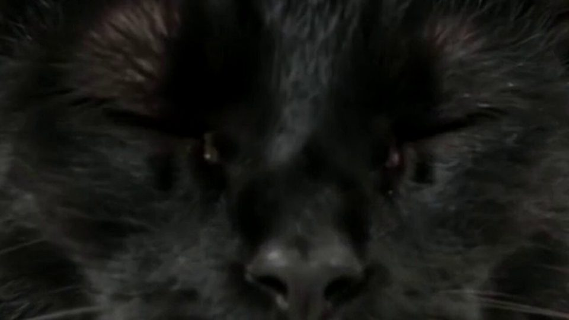</a>

- **作者:** [Justine Moore](https://x.com/venturetwins/status/2103947617227194791) · X · **Seedance 2.5** · ♥ 7.8万
- **标签:** `广告大片` `美式` `宠物动物` `喜剧搞笑` `轻松欢快` `多镜头剪辑` `梗段子`
- 把一只黑猫 Finn 包装成苹果新品：白底棚拍、极简字幕、"Precision hearing"等卖点。

### [恐龙巧克力广告](https://daiyixiang666.github.io/awesome-ai-video-prompts/w/x-2105575705295958044.html)

<a href="https://daiyixiang666.github.io/awesome-ai-video-prompts/w/x-2105575705295958044.html"></a>

- **作者:** [Maria](https://x.com/thisismariaa25/status/2105575705295958044) · X · **Pollo AI (Seedance)** · ♥ 236
- **标签:** `广告大片` `美式` `产品` `喜剧搞笑` `紧张刺激` `多镜头剪辑` `广告TVC`
- 丛林探险女孩遭遇霸王龙，掰下一块巧克力化解危机，结尾品牌落版。

### [跑鞋广告：Velocity](https://daiyixiang666.github.io/awesome-ai-video-prompts/w/x-2104507598695489678.html)

<a href="https://daiyixiang666.github.io/awesome-ai-video-prompts/w/x-2104507598695489678.html">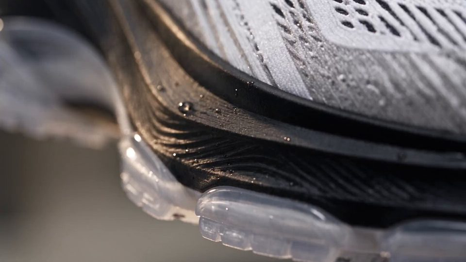</a>

- **作者:** [M-studioAi](https://x.com/Strength04_X/status/2104507598695489678) · X · **Seedance 2.5** · ♥ 178
- **标签:** `广告大片` `无明显地域` `产品` `运动极限` `热血燃` `卡点节奏` `慢动作` `广告TVC`
- 15 秒高端跑鞋广告：微距鞋面、雨夜溅水、奔跑特写、白色展台定格。

<details><summary>提示词</summary>

```text
REFERENCE IMAGE PROMPT:

Create a photorealistic premium performance running shoe product reference image for a high-end sports advertising campaign.

Show one modern performance running shoe with a white technical mesh upper, sculpted black midsole, translucent outsole sections, subtle silver structural details, aerodynamic heel construction, and distinctive lace arrangement.

Place the shoe diagonally on a minimal dark architectural surface with subtle wet reflections.

Use dramatic early-morning directional lighting with a clean edge highlight, soft atmospheric haze, realistic material response, visible mesh texture, realistic rubber and foam surfaces, natural contact shadow, shallow depth of field, premium sports photography, and high-end commercial product styling.

The complete shoe must be visible from a three-quarter side angle.

Keep proportions, sole geometry, upper construction, lace placement, color distribution, and material transitions extremely clear for identity consistency.

No people, no feet, no additional shoes, no text, no logo, no watermark, no extra objects.

16:9 horizontal composition, photorealistic, ultra-detailed, realistic professional advertising photography.

TITLE:
Velocity — Premium Performance Running Shoe Commercial

FORMAT:
• Single 15.000-second live-action sports commercial
• 16:9 horizontal cinematic format
• Premium performance footwear campaign
• 9 precisely timed shots
• High-energy but controlled visual language
• Product and movement remain the central focus
• Photorealistic sports cinematography

PROMPT HEADER:

Create a 15.000-second, 16:9 horizontal live-action premium running shoe commercial.

REFERENCE AND IDENTITY:

Use [
@Image
 1] as the only product identity reference.

The subject is a modern performance running shoe with a white technical mesh upper, sculpted black midsole, translucent outsole sections, subtle silver structural details, aerodynamic heel geometry, and distinctive lace construction.

Preserve the exact silhouette, upper construction, sole geometry, lace arrangement, material transitions, proportions, color distribution, and distinctive design elements from [
@Image
 1].

The shoe must remain visually identical throughout all shots.

Do not redesign the sole, change the upper pattern, invent logos, alter proportions, change colors, or add unnecessary details.

GLOBAL STYLE:

Create a premium modern sports campaign combining realistic outdoor running photography with controlled studio product cinematography.

Visual progression should move from quiet precision to high-speed athletic energy and finally return to a clean product hero.

Use an early-morning urban environment with wet asphalt, subtle mist, soft sunrise light, realistic reflections, shallow depth of field, natural atmospheric perspective, and physically accurate motion blur.

Running sequences must show believable human biomechanics.

Foot placement, ankle rotation, knee movement, weight transfer, shoe compression, and ground contact must remain realistic.

Use fast but controlled camera movement.

Avoid exaggerated superhero movement or impossible jumps.

No cartoon styling, no plastic CGI, no floating feet, no distorted legs, no impossible body positions.

Only English may appear.

TYPOGRAPHY:

Use clean modern condensed sans-serif typography in white.

Use only the following text:

• "MOVE WITH PURPOSE."
• "BUILT FOR MOMENTUM."
• "EVERY STEP COUNTS."
• "KEEP MOVING."

Do not add any other readable text.

SHOT 1 — 0.000–1.100 SECONDS:

Use an extreme macro shot of the shoe outsole.

Only the front portion of the sole is visible.

Tiny droplets of water sit between the tread patterns.

A small amount of condensation moves naturally.

The camera performs a very slow forward push.

Keep the background completely abstract.

No text.

Hard cut exactly at 1.100 seconds.

SHOT 2 — 1.100–2.700 SECONDS:

Use a low-angle close-up of the complete shoe resting on wet asphalt.

The shoe is positioned three-quarter toward camera.

Soft morning light creates a clean rim around the upper.

Water reflections appear underneath.

From 1.100–2.000 seconds, the camera slowly tracks from heel toward toe.

From 2.000–2.700 seconds, stop movement and hold the product.

Display "MOVE WITH PURPOSE." at upper left.

Hard cut exactly at 2.700 seconds.

SHOT 3 — 2.700–4.200 SECONDS:

Use a side-profile running shot.

Show only the lower body from approximately mid-thigh downward.

An athletic adult runs from screen left to screen right.

The referenced shoe is clearly visible during one complete running stride.

Show realistic heel-to-midfoot-to-toe transition.

The sole compresses naturally during ground contact.

Use subtle slow motion without freezing the movement.

Camera tracks parallel with the runner.

No face.

No text.

Hard cut exactly at 4.200 seconds.

SHOT 4 — 4.200–5.600 SECONDS:

Use an extreme slow-motion ground-contact shot.

The shoe lands on wet pavement.

Water droplets splash outward naturally.

The midsole compresses slightly under body weight.

The foot immediately transitions into forward propulsion.

Use realistic physics and accurate contact shadow.

Camera remains extremely low to the ground.

Display "BUILT FOR MOMENTUM." at lower center.

Hard cut exactly at 5.600 seconds.

SHOT 5 — 5.600–7.300 SECONDS:

Use a dynamic rear three-quarter tracking shot.

The runner accelerates through a modern city street.

Only lower body and shoes remain visible.

The background passes naturally with realistic motion blur.

Keep the referenced shoe sharply recognizable.

The camera moves at matching speed without excessive shake.

From 6.600–7.300 seconds, camera moves slightly closer to the shoe.

No text.

Hard cut exactly at 7.300 seconds.

SHOT 6 — 7.300–9.000 SECONDS:

Use a controlled studio transition.

The running shoe lands on a clean matte platform inside a bright architectural studio.

The environment changes from outdoor urban running to minimal premium product photography through a hard cut.

The shoe remains the same physical product.

A soft directional light travels across the upper, revealing mesh texture, stitching, sole construction, and material transitions.

Display "EVERY STEP COUNTS." at right-center.

Hard cut exactly at 9.000 seconds.

SHOT 7 — 9.000–11.200 SECONDS:

Use a macro side profile of the shoe.

The camera performs a smooth 180-degree product arc.

Reveal the heel structure, midsole geometry, upper mesh, and outsole.

Keep the shoe completely stationary.

Lighting should reveal different materials without changing their colors.

The shoe must remain grounded on the platform.

No text.

Hard cut exactly at 11.200 seconds.

SHOT 8 — 11.200–13.000 SECONDS:

Return to the outdoor environment.

Use a wide low-angle shot of the runner moving toward the camera along a wet road.

The runner performs several natural steps.

The shoes remain clearly visible.

At approximately 12.300 seconds, the runner passes close to the camera.

Use realistic perspective and motion blur.

Do not slow the runner unrealistically.

Display "KEEP MOVING." at upper center.

Hard cut exactly at 13.000 seconds.

SHOT 9 — 13.000–15.000 SECONDS:

Hard cut to a final premium product hero.

The shoe is positioned diagonally on a clean architectural platform.

Background is minimal off-white with a soft gradient.

The shoe remains completely still.

A subtle moving highlight travels across the upper and then across the sole.

From 13.000–14.000 seconds, camera performs a slow micro push-in.

From 14.000–15.000 seconds, camera locks completely.

No people.

No additional shoes.

No extra objects.

No text.

End exactly at 15.000 seconds.

ABSOLUTE TIMELINE:

0.000–1.100 / 1.100–2.700 / 2.700–4.200 / 4.200–5.600 /
5.600–7.300 / 7.300–9.000 / 9.000–11.200 / 11.200–13.000 /
13.000–15.000

Every boundary is mandatory.

Do not shift, merge, shorten, extend, or reorder any shot.

FINAL PRIORITY:

Prioritize exact timing, exact shot order, product identity consistency, realistic running biomechanics, authentic ground contact, believable shoe compression, realistic water physics, controlled motion blur, premium sports cinematography, physically accurate materials, restrained camera movement, clean typography, and strong product visibility.

NEGATIVE PROMPT:

timing drift, shifted cut points, merged shots, missing shots, extra shots, changed shoe design, different sole, changed upper, wrong colors, altered proportions, fake branding, duplicate shoes, floating feet, distorted legs, broken ankles, extra toes, extra limbs, impossible running posture, unrealistic jumping, superhero movement, sliding feet, missing ground contact, floating shoe, plastic materials, CGI appearance, cartoon style, illustration, excessive motion blur, excessive camera shake, random zoom, warped perspective, unstable background, dirty studio, inconsistent lighting, unrealistic water, excessive splash, low resolution, overexposure, underexposure, visible face, extra people, extra objects, incorrect typography, misspelled text, extra text, logos, watermarks, subtitles, Chinese text, background music, added SFX
```

</details>

### [头戴耳机广告](https://daiyixiang666.github.io/awesome-ai-video-prompts/w/x-2107396283489304889.html)

<a href="https://daiyixiang666.github.io/awesome-ai-video-prompts/w/x-2107396283489304889.html">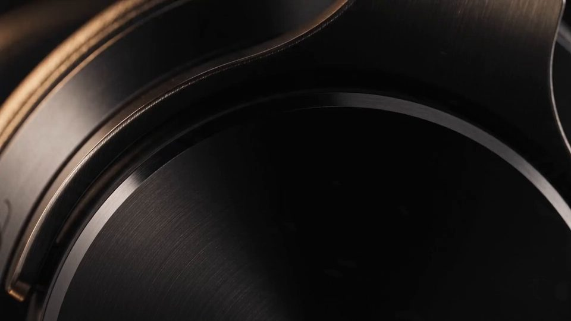</a>

- **作者:** [M-studioAi](https://x.com/Strength04_X/status/2107396283489304889) · X · **Seedance 2.5** · ♥ 164
- **标签:** `广告大片` `无明显地域` `产品` `孤独忧郁` `多镜头剪辑` `广告TVC`
- 30 秒无线耳机广告：机舱窗边、城市夜景、桌面产品镜头，克制高级的质感。

<details><summary>提示词</summary>

```text
REFERENCE IMAGE PROMPT — Create a photorealistic premium wireless over-ear headphone reference image.

One pair of sophisticated matte-black over-ear headphones with a brushed-metal headband, precision-machined circular earcups, soft memory-foam cushions, elegant folding hinges, tactile physical buttons, and premium stitching.

Add one tiny original abstract symbol made from two simple parallel curved lines.

The symbol must not resemble any existing company logo or trademark.

Place headphones on a dark architectural pedestal.

Premium studio lighting, realistic metal reflections, detailed leather-like cushion texture, soft shadows, cinematic product photography.

No brand name.
No real logo.
No recognizable trademark.
No person.
No phone.
No accessories.
No readable text.
No watermark.

16:9 horizontal.
Photorealistic.
Ultra-detailed.
Luxury technology advertising photography.

Video Prompt- TITLE:
SILENCE, REFINED — Premium Wireless Headphones Commercial

FORMAT:
30.000 seconds
16:9
Photorealistic live-action
Ultra-premium technology advertisement
12 precisely timed shots

BRANDING RULE:

Do not use any real brand name, fictional brand name, trademark, recognizable logo, or existing product identity.

The headphones may contain one tiny original abstract symbol made from two simple parallel curved lines.

The symbol must be generic and must not resemble any existing trademark or logo.

No brand name anywhere in the video.

PRODUCT:

Premium over-ear wireless headphones with a brushed-metal headband, soft memory-foam ear cushions, matte-black finish, precision-machined earcups, physical control buttons, and premium folding mechanism.

REFERENCE:

Use [
@Image
 1] as the only product identity reference.

Preserve exactly:
earcup shape,
headband geometry,
cushion thickness,
button placement,
hinge mechanism,
material,
color,
proportions,
and overall silhouette.

APPROVED SPECIFICATIONS:

40MM CUSTOM DRIVERS
ACTIVE NOISE CANCELLATION
40 HOURS BATTERY
30-HOUR BATTERY WITH ANC
BLUETOOTH 5.4
LDAC HIGH-RES AUDIO
MULTIPOINT CONNECTION
FAST CHARGE: 10 MINUTES = 5 HOURS

GLOBAL STYLE:

Luxury audio campaign.

Dark studio, premium apartment, airplane cabin, nighttime city, warm architectural lighting, realistic skin, realistic hair, authentic reflections, soft fabric textures, cinematic macro photography.

Technical captions appear only when the corresponding feature is demonstrated.

SHOT 1 — 0.000–2.200:

Extreme macro of the brushed-metal earcup.

A narrow highlight moves across the curved surface.

Slow cinematic camera slide.

No text.

SHOT 2 — 2.200–4.600:

Complete three-quarter hero reveal.

Headphones rotate slowly on a black pedestal.

Display:

"40MM CUSTOM DRIVERS"

lower-left.

SHOT 3 — 4.600–6.900:

Adult puts the headphones on inside a busy modern café.

Background contains natural crowd movement.

As the headphones are placed over the ears, the environment gradually becomes visually isolated.

Display:

"ACTIVE NOISE CANCELLATION"

upper-right.

SHOT 4 — 6.900–9.100:

Close-up of the headphones during a long travel sequence.

Adult sits beside an airplane window.

Headphones remain visible.

Display:

"40 HOURS BATTERY"

lower-left.

SHOT 5 — 9.100–11.300:

Extreme macro of Bluetooth pairing.

Phone and headphones connect naturally through a legitimate interface.

Display:

"BLUETOOTH 5.4"

upper-right.

No fake holographic interface.

SHOT 6 — 11.300–13.600:

Premium music listening environment.

High-resolution music playback on a smartphone.

Headphones remain the visual focus.

Display:

"LDAC HIGH-RES AUDIO"

lower-right.

SHOT 7 — 13.600–15.800:

Adult switches between laptop and smartphone while wearing headphones.

Audio device changes naturally.

Display:

"MULTIPOINT CONNECTION"

upper-left.

SHOT 8 — 15.800–18.000:

Macro of USB-C charging connection.

Cable connects naturally.

Charging indicator appears on the actual headphones interface.

Display:

"FAST CHARGE: 10 MINUTES = 5 HOURS"

lower-right.

SHOT 9 — 18.000–20.500:

Close-up of ear cushion.

Headphones are placed gently over a leather chair.

Camera moves across soft memory foam and stitching.

No new specification.

SHOT 10 — 20.500–23.000:

Night city lifestyle shot.

Adult walks through an illuminated modern street wearing headphones.

Camera tracks from behind into a three-quarter profile.

No new text.

SHOT 11 — 23.000–26.500:

Return to dark studio.

Headphones rotate slowly.

Reveal:

earcups,
headband,
hinges,
buttons,
cushions,
original abstract symbol.

No brand name.

No specification.

SHOT 12 — 26.500–30.000:

Final hero shot.

Headphones centered on black pedestal.

Soft light travels across the metal.

At 28.000:

"SILENCE, REFINED"

At 29.000:

"40 HOURS"

No brand name.

No other text.

End exactly at 30.000 seconds.

NEGATIVE PROMPT:

real brand names, fictional brand names, trademark, existing logos, copied logos, Apple, Sony, Bose, JBL, Sennheiser, Beats, Samsung, recognizable headphone designs, trademark imitation, copyrighted branding, fake specifications, misspelled captions, floating text, holographic UI, distorted ears, distorted hands, extra fingers, duplicate headphones, unrealistic reflections, CGI appearance, plastic materials, cartoon style, watermark, extra readable text
```

</details>

### [智能眼镜广告](https://daiyixiang666.github.io/awesome-ai-video-prompts/w/x-2104903386730762505.html)

<a href="https://daiyixiang666.github.io/awesome-ai-video-prompts/w/x-2104903386730762505.html">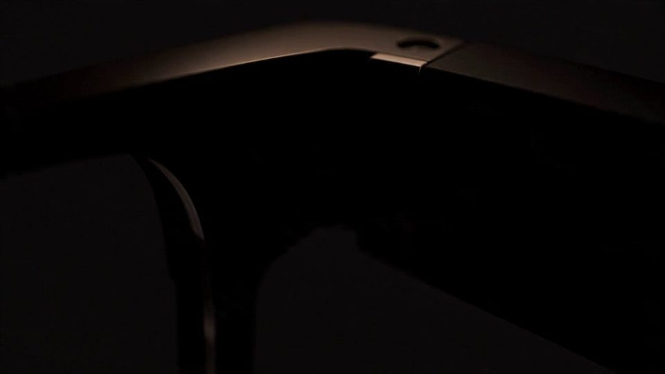</a>

- **作者:** [M-studioAi](https://x.com/Strength04_X/status/2104903386730762505) · X · **Seedance 2.5** · ♥ 157
- **标签:** `广告大片` `无明显地域` `产品` `时尚美妆` `史诗壮阔` `多镜头剪辑` `广告TVC`
- 30 秒智能眼镜广告：金属铰链微距、城市街头佩戴、展台悬浮定格，配极简字幕。

<details><summary>提示词</summary>

```text
REFERENCE IMAGE PROMPT : 

Create a photorealistic luxury smart glasses product reference image for identity-consistent cinematic video generation.

Show one premium pair of futuristic smart glasses with a slim matte-black frame, elegant transparent lenses, refined metallic temple details, precise hinge construction, minimal integrated sensor details, and a sophisticated lightweight silhouette.

Place the glasses upright at a slight three-quarter angle on a warm-gray architectural pedestal.

Use premium studio lighting with a soft key light, narrow edge lighting along the temples, subtle reflections across the lenses, realistic glass refraction, natural contact shadow, accurate material response, fine manufacturing details, and high-end consumer technology photography.

Make the complete glasses clearly visible.

The frame geometry, lens shape, temple thickness, hinge design, nose bridge, sensor placement, proportions, and matte-black finish must be extremely clear for identity consistency.

Exactly one pair of glasses.

No person.
No face.
No hands.
No holograms.
No interface graphics.
No text.
No logo.
No watermark.
No extra objects.

16:9 horizontal composition, photorealistic, premium technology advertising photography, ultra-detailed physical materials.

Prompt - TITLE:
SEE THE FUTURE — Premium Smart Glasses Commercial

FORMAT:
30.000 seconds
16:9 horizontal
Photorealistic live-action
Premium technology advertising
11 precisely timed shots
Cinematic urban + studio visual language
Hard cuts only unless specifically stated

PROMPT HEADER:

Create a 30.000-second premium live-action commercial for a futuristic pair of luxury smart glasses.

The commercial follows one person moving through a modern city at sunrise, gradually transitioning from real-world lifestyle cinematography into an elegant futuristic product presentation.

REFERENCE AND IDENTITY:

Use [
@Image
 1] as the only product identity reference.

The product is a premium pair of lightweight smart glasses with a slim matte-black frame, subtle metallic temples, transparent optical lenses, tiny integrated sensor details, refined nose bridge, and minimalist luxury construction.

Preserve the exact frame geometry, lens shape, temple thickness, hinge design, nose bridge, surface finish, sensor placement, proportions, and color from [
@Image
 1].

The glasses must remain physically identical throughout every shot.

Do not add screens inside the lenses, holograms, futuristic interfaces, extra cameras, glowing components, or invented buttons unless visible in the reference.

GLOBAL STYLE:

Premium futuristic lifestyle advertising photographed with real cameras.

Visual language:
clean architecture,
early sunrise,
glass buildings,
soft golden sunlight,
cool shadows,
shallow depth of field,
realistic skin,
natural reflections,
subtle lens flare,
accurate glass refraction,
physically believable human movement.

The futuristic feeling must come from cinematography and environment rather than obvious CGI.

No cartoon styling.
No plastic CGI.
No floating objects.
No exaggerated holograms.

TYPOGRAPHY:

Use elegant modern sans-serif typography in soft white.

Only these phrases may appear:

"LOOK AHEAD."
"SEE MORE."
"BUILT AROUND YOU."
"THE NEXT VIEW."

Do not add any other readable text.

SHOT 1 — 0.000–2.300 SECONDS:

Extreme macro shot of one temple hinge.

The frame begins almost completely dark.

Soft sunrise light slowly travels across the matte-black surface.

Reveal tiny machining details and the precise hinge construction.

Camera performs an extremely slow forward push.

No text.

Hard cut exactly at 2.300 seconds.

SHOT 2 — 2.300–4.800 SECONDS:

Three-quarter close-up of the complete glasses resting on a pale architectural surface.

Morning sunlight passes through the lenses.

Subtle reflections of nearby buildings appear naturally across the glass.

Camera makes a slow lateral movement from left to right.

Display:

"LOOK AHEAD."

Hard cut exactly at 4.800 seconds.

SHOT 3 — 4.800–7.200 SECONDS:

Wide cinematic city shot.

An adult walks through a modern glass-and-concrete plaza during early morning.

The person wears the referenced glasses.

Camera tracks backward smoothly.

Sunlight creates a subtle edge highlight around the frame.

Do not emphasize facial identity.

No text.

Hard cut exactly at 7.200 seconds.

SHOT 4 — 7.200–9.600 SECONDS:

Medium close-up from the side.

The subject pauses beside a glass building.

One hand gently adjusts the glasses by touching the temple.

Show realistic finger placement and natural skin movement.

The frame remains perfectly rigid.

Background pedestrians remain naturally blurred.

Display:

"SEE MORE."

Hard cut exactly at 9.600 seconds.

SHOT 5 — 9.600–12.000 SECONDS:

Extreme close-up of the lenses.

The subject turns slightly toward the sunlight.

The lenses catch a controlled reflection of the surrounding architecture.

No holographic interface.

No digital graphics.

Focus shifts from the near lens edge toward the eye area behind the lens.

Camera remains almost fixed.

Hard cut exactly at 12.000 seconds.

SHOT 6 — 12.000–14.500 SECONDS:

Hard cut to a modern café interior.

The subject sits beside a large window.

The glasses remain clearly visible.

The subject naturally looks toward the street while holding a coffee cup.

Steam rises physically from the cup.

Use realistic morning light and shallow depth of field.

Display:

"BUILT AROUND YOU."

Hard cut exactly at 14.500 seconds.

SHOT 7 — 14.500–17.200 SECONDS:

Close-up of the glasses being removed.

The subject lifts them from the face with one hand and places them gently on a wooden table.

The glasses make realistic contact with the surface.

Frame remains stable.

No product deformation.

No text.

Hard cut exactly at 17.200 seconds.

SHOT 8 — 17.200–20.000 SECONDS:

Macro tabletop shot.

The glasses rest on the wooden surface.

Camera performs a slow 120-degree arc around the product.

Reveal:

frame,
lenses,
nose bridge,
temples,
hinges,
surface texture.

Sunlight moves naturally across the lenses.

No text.

Hard cut exactly at 20.000 seconds.

SHOT 9 — 20.000–22.800 SECONDS:

Hard cut to a rooftop at golden hour.

The subject puts the glasses back on.

Camera moves from behind the shoulder toward a three-quarter frontal composition.

City skyline remains softly defocused.

Wind moves clothing naturally.

No exaggerated motion.

Hard cut exactly at 22.800 seconds.

SHOT 10 — 22.800–26.000 SECONDS:

Premium studio transition.

The glasses now stand upright on a minimal matte architectural pedestal.

Background becomes warm gray.

A thin moving highlight travels across the frame.

Camera performs a slow 60-degree orbit.

Display:

"THE NEXT VIEW."

Hard cut exactly at 26.000 seconds.

SHOT 11 — 26.000–30.000 SECONDS:

Final hero packshot.

The complete glasses are centered against a clean warm-gray background.

Camera fully locked.

From 26.000–27.500 seconds, a soft highlight reveals the frame.

From 27.500–29.000 seconds, the highlight moves across both lenses.

From 29.000–30.000 seconds, the product remains completely still.

No person.
No hands.
No interface.
No extra objects.
No additional text.

End exactly at 30.000 seconds.

ABSOLUTE TIMELINE:

0.000–2.300 /
2.300–4.800 /
4.800–7.200 /
7.200–9.600 /
9.600–12.000 /
12.000–14.500 /
14.500–17.200 /
17.200–20.000 /
20.000–22.800 /
22.800–26.000 /
26.000–30.000

Every boundary is mandatory.

Never merge, skip, reorder, shorten, or extend any shot.

FINAL PRIORITY:

Exact timing, exact shot order, identical smart-glasses design, realistic human interaction, physically accurate lenses, realistic reflections, authentic urban environments, premium technology cinematography, restrained futuristic aesthetic, natural lighting, stable typography, and photographic realism.

NEGATIVE PROMPT:

timing drift, missing shots, extra shots, merged shots, reordered shots, changed glasses, different frame, altered lens shape, extra cameras, glowing sensors, holograms, HUD graphics, floating glasses, distorted frame, warped lenses, plastic material, CGI appearance, cartoon style, illustration, distorted face, extra fingers, extra hands, broken anatomy, unrealistic movement, excessive lens flare, excessive bloom, random zoom, camera shake, unstable exposure, changing typography, misspelled text, extra text, Chinese text, subtitles, logos, watermark, low resolution, duplicate glasses, additional products, artificial reflections
```

</details>

### [花园别墅里的时装屋](https://daiyixiang666.github.io/awesome-ai-video-prompts/w/x-2105502091817206152.html)

<a href="https://daiyixiang666.github.io/awesome-ai-video-prompts/w/x-2105502091817206152.html"></a>

- **作者:** [Maria](https://x.com/thisismariaa25/status/2105502091817206152) · X · **Seedance 2.5** · ♥ 2186
- **标签:** `广告大片` `欧洲` `时尚美妆` `浪漫心动` `多镜头剪辑` `广告TVC`
- 虚构品牌 Casa Fiora 的时装短片：意大利别墅中模特穿着花卉连衣裙走楼梯、倚沙发、穿过门廊，旋转楼梯收尾。

### [莓果磨砂膏的落定](https://daiyixiang666.github.io/awesome-ai-video-prompts/w/x-2029019321364824452.html)

<a href="https://daiyixiang666.github.io/awesome-ai-video-prompts/w/x-2029019321364824452.html"></a>

- **作者:** [K](https://x.com/ChillaiKalan__/status/2029019321364824452) · X · **Veo 3.1** · ♥ 583
- **标签:** `广告大片` `无明显地域` `时尚美妆` `产品` `轻松欢快` `慢动作` `广告TVC`
- 红色渐变背景前，空罐盛满粉色盐粒，覆盆子、草莓、白花依次落下堆叠，最后贴标成品定格。

<details><summary>提示词</summary>

```text
Use the uploaded image as the exact visual reference for jar design, label, strawberries, raspberries, flowers, leaves, condensation droplets, red gradient background, and reflective surface.

Camera:
Locked front-facing camera.
No zoom.
No rotation.
No angle change.
Studio composition remains centered.

Style:
Premium beauty commercial.
Smooth assembling sequence.
Ultra realistic.
Slow motion but not dramatic.

Scene – Start (Empty Setup):
Start with an empty red gradient background and glossy reflective surface.
No jar.
No fruits.
No flowers.
No water droplets.

Assembling Sequence:

1. The glass jar base smoothly slides into frame from below and settles perfectly centered.
2. The lid gently lowers from above and aligns perfectly on the jar.
3. Condensation droplets subtly appear on the glass surface as if forming naturally.
4. Raspberries roll in softly from left and right, stopping naturally around the base.
5. Strawberry halves slide into position at the front.
6. Whole strawberries gently drop from above into the open jar top and settle naturally.
7. Small white flowers softly fall into place between the strawberries.
8. Green leaves slide in behind the jar to frame it.
9. Final micro water droplets appear on fruits for freshness effect.

All movements smooth and controlled.
No bouncing.
No exaggerated motion.
No dramatic lighting changes.

Lighting:
Keep original studio lighting.
Deep red background glow remains consistent.
Soft reflections on the glossy surface.

Sound (if supported):
Soft subtle assembling sound design.
Gentle fruit placement sounds.
Light glass contact sound.
No music or very subtle premium ambient tone.

End Frame:
Fully assembled composition exactly matching the reference image.
Everything perfectly arranged.
Hold for 1–2 seconds.
Ultra clean luxury skincare commercial finish.
```

</details>

### [柠檬色的指甲油广告](https://daiyixiang666.github.io/awesome-ai-video-prompts/w/x-2051462778192642494.html)

<a href="https://daiyixiang666.github.io/awesome-ai-video-prompts/w/x-2051462778192642494.html"></a>

- **作者:** [Shami](https://x.com/ShamiWeb3/status/2051462778192642494) · X · **Seedance 2.0 Fast** · ♥ 403
- **标签:** `广告大片` `美式` `时尚美妆` `产品` `轻松欢快` `多镜头剪辑` `广告TVC`
- 黄色抓娃娃机里装满柠檬，金发女子挤柠檬、展示指甲，最后柠檬环绕 Sally Hansen 黄色甲油瓶。

<details><summary>提示词</summary>

```text
Scene 1 (0–5s):
Elegant claw machine entirely in shiny yellow and gold tones, labeled “Fresh Lemons” in luxurious script. Inside are perfectly fresh bright yellow lemons with green leaves. The blonde woman stands nearby, observing with a calm, confident expression. Soft dramatic lighting, reflective glass surfaces, premium luxury feel.
Music: Slow, alluring intro, soft ambient synths with delicate chime notes and a subtle bass pulse, creating curiosity and elegance.
Scene 2 (5–10s):
Close-up cinematic shot of her hands. She interacts with fresh lemons, gently squeezing one, lemon juice dripping over her glossy yellow nails. Water droplets sparkle in slow motion. Her blonde hair softly moves in the background blur. Ultra-detailed macro focus on nails, juice, and texture.
Music: Beat gently builds. smooth sensual rhythm with light percussion and liquid-like sound effects syncing with the dripping juice, enhancing the tactile luxury feel.
Scene 3 (10–15s):
Dynamic luxury product shots of Sally Hansen nail polish bottles in elegant yellow/gold packaging surrounded by fresh lemons, citrus slices, and dewdrops. Her hands briefly enter frame, showcasing matching yellow nails. Slow, smooth camera movements, shallow depth of field, high-end beauty commercial finish.
Music: Full alluring climax, glossy, upbeat yet sophisticated groove with soft electronic beats and shimmering accents, ending with a clean, satisfying audio finish.
Overall style:
Hyper-realistic yet stylized luxury beauty commercial, scroll-stopping visuals, premium fashion photography mixed with playful citrus storytelling, vibrant but elegant tone, cinematic lighting, 4K, shot on Arri Alexa, ultra-detailed commercial product aesthetic, with a cohesive, seductive audio-visual rhythm.
```

</details>

### [图书馆里的降噪](https://daiyixiang666.github.io/awesome-ai-video-prompts/w/x-2107066395712504144.html)

<a href="https://daiyixiang666.github.io/awesome-ai-video-prompts/w/x-2107066395712504144.html"></a>

- **作者:** [Maria](https://x.com/thisismariaa25/status/2107066395712504144) · X · **Seedance 2.5** · ♥ 256
- **标签:** `广告大片` `无明显地域` `产品` `温暖治愈` `微表情特写` `多镜头剪辑` `广告TVC`
- 图书馆中女生被翻书、笔尖、咳嗽声干扰，戴上耳机后世界瞬间安静，结尾落版 Sony 耳机。

### [网球场的 Polo 风](https://daiyixiang666.github.io/awesome-ai-video-prompts/w/x-2106564967046828508.html)

<a href="https://daiyixiang666.github.io/awesome-ai-video-prompts/w/x-2106564967046828508.html"></a>

- **作者:** [Maria](https://x.com/thisismariaa25/status/2106564967046828508) · X · **Seedance 2.5** · ♥ 201
- **标签:** `广告大片` `美式` `时尚美妆` `运动极限` `轻松欢快` `多镜头剪辑` `广告TVC`
- Polo 风格的乡村俱乐部大片：网球场、白色球鞋特写、挥拍、领口 logo 细节，开头叠字 LOVE. SET. POLO.

### [香水火箭发射](https://daiyixiang666.github.io/awesome-ai-video-prompts/w/x-2114672427964010805.html)

<a href="https://daiyixiang666.github.io/awesome-ai-video-prompts/w/x-2114672427964010805.html"></a>

- **作者:** [Ray](https://x.com/AIWithRay/status/2114672427964010805) · X · **Kling 4.0** · ♥ 140
- **标签:** `广告大片` `无明显地域` `产品` `时尚美妆` `热血燃` `一镜到底` `广告TVC`
- 机库舞台上，香水瓶沿发光的混凝土回环赛道冲出，底部喷出火焰升空。

<details><summary>提示词</summary>

```text
Cinematic, photoreal night scene on a black stage inside a giant hangar. A towering concrete loop ramp/road with glowing red edge lights and a white center stripe dominates the background. In front of it stands a premium transparent glass perfume bottle, unlabeled, no logo, filled with pale golden fragrance, featuring elegant beveled edges, a polished metallic cap, realistic glass refraction, crisp reflections, and subtle condensation droplets. The bottle engages four small rocket nozzles under its base; soft white exhaust with bright orange cores appears. The bottle glides forward, then blasts up the glowing ramp, hugging the curve, leaving faint light trails and red neon reflections across its glass surface. At the apex it shoots off the ramp and transitions to a sleek electric-thruster flight, like a futuristic luxury flying car, then ends in a close hero shot of the perfume bottle hovering and roaring upward vertically with four bright jets, volumetric spotlights and fog below, sparks and vapor interaction, dramatic rim light, golden highlights, crisp reflections, shallow depth of field, 4K, high-end luxury perfume and car commercial look. No text, no brand, no label. Duration 9–10 seconds. Aspect ratio 9:16. Negative cues: no logos, no text, no labels, no hands, no spillage, no deformation, no duplicate bottles, no cartoon look, no melting glass, no detached cap, no liquid leakage, no extreme motion-blur smears. Beat sheet (timing guide) 0–2s: Low-angle push-in on the massive loop ramp; perfume bottle centered, engines arming beneath the base with subtle heat shimmer and glowing orange cores. 2–6s: Dynamic follow-cam as the bottle rockets up the ramp; speed ramping, neon edge lights streaking, dramatic red reflections sliding across the glass. 6–8s: Bottle leaves the ramp, switches to electric thrusters; quick cinematic orbit as it hovers midair, revealing the golden fragrance and metallic cap. 8–10s: Tight hero shot of the perfume bottle ascending vertically with four bright jets, swirling fog, volumetric spotlights, realistic vapor, and luxurious golden reflections. End with the bottle sharply focused and centered against the dark hangar.
```

</details>

### [一颗土豆变成薯片](https://daiyixiang666.github.io/awesome-ai-video-prompts/w/x-2083033159437025427.html)

<a href="https://daiyixiang666.github.io/awesome-ai-video-prompts/w/x-2083033159437025427.html"></a>

- **作者:** [Ray](https://x.com/AIWithRay/status/2083033159437025427) · X · **MiniMax H3** · ♥ 101
- **标签:** `广告大片` `无明显地域` `美食` `产品` `轻松欢快` `变身转场` `慢动作` `广告TVC`
- 土豆高速旋转削皮、切片、落入油锅炸成薯片，飞入包装袋，最后 Crunch Valley 薯片袋定格。

<details><summary>提示词</summary>

```text
Ultra-realistic cinematic 3D commercial, 15 seconds, hyper-detailed food commercial, dynamic speed ramp, macro photography, dramatic studio lighting, ultra-fast transitions, motion blur, shallow depth of field, realistic physics, crisp textures, premium advertising quality, 16:9.

Sequence: A whole fresh potato spins at incredible speed in mid-air above a modern kitchen counter. A stationary razor-sharp chef's knife instantly peels the potato as the spinning motion sends the skin flying away in elegant spiral ribbons. The perfectly peeled potato freezes vertically in mid-air, then effortlessly slices itself into dozens of ultra-thin, perfectly even potato chips suspended for a brief moment. The slices glide one by one into a vat of bubbling hot vegetable oil, creating dramatic splashes and shimmering golden bubbles. Within seconds, the chips become perfectly golden, light, and crispy. They burst upward from the oil in slow motion and land on a rustic wooden table as a vibrant cloud of savory seasoning explodes around them. An automated packaging machine immediately fills a sleek, glossy Crunch Valley potato chips bag, injects nitrogen gas for freshness, and heat-seals it. The packaging features a bold modern Crunch Valley logo in white lettering with gold accents on a vibrant red bag, premium branding, realistic printed details, and a luxurious commercial design. Final hero shot: the perfectly sealed Crunch Valley potato chips bag stands centered on the table while the camera performs a fast cinematic push-in through floating seasoning particles under warm cinematic lighting, with ultra-realistic reflections, razor-sharp focus, premium food advertising aesthetics, and a dramatic end frame held for maximum impact.
```

</details>

### [宜家秒装](https://daiyixiang666.github.io/awesome-ai-video-prompts/w/x-1946530149299634618.html)

<a href="https://daiyixiang666.github.io/awesome-ai-video-prompts/w/x-1946530149299634618.html"></a>

- **作者:** [Salma](https://x.com/Salmaaboukarr/status/1946530149299634618) · X · **Veo 3** · ♥ 1.2万
- **标签:** `广告大片` `欧洲` `产品` `温暖治愈` `一镜到底` `变身转场` `广告TVC`
- 密封的宜家纸箱一震，家具瞬间自动组装成温馨卧室，一镜到底。

<details><summary>提示词</summary>

```text
{
  "description": "Cinematic shot of a sunlit Scandinavian bedroom. A sealed IKEA box trembles, opens, and flat pack furniture assembles rapidly into a serene, styled room highlighted by a yellow IKEA throw on the bed. No text.",
  "style": cinematic",
  "camera": "fixed wide angle",
  "lighting": "natural warm with cool accents",
  "room": "Scandinavian bedroom",
  "elements": [
    "IKEA box (logo visible)",
    "bed with yellow throw",
    "bedside tables",
    "lamps",
    "wardrobe",
    "shelves",
    "mirror",
    "art",
    "rug",
    "curtains",
    "reading chair",
    "plants"
  ],
  "motion": "box opens, furniture assembles precisely and rapidly",
  "ending": "calm, modern space with yellow IKEA accent",
  "text": "none",
  "keywords": [
    "16:9",
    "IKEA",
    "Scandinavian",
    "fast assembly",
    "no text",
    "warm & cool tones"
  ]
}
```

</details>

### [一句话洗发水广告](https://daiyixiang666.github.io/awesome-ai-video-prompts/w/x-2021631203473084655.html)

<a href="https://daiyixiang666.github.io/awesome-ai-video-prompts/w/x-2021631203473084655.html"></a>

- **作者:** [Mark Gadala-Maria](https://x.com/markgadala/status/2021631203473084655) · X · **Seedance 2.0** · ♥ 5490
- **标签:** `广告大片` `无明显地域` `时尚美妆` `产品` `浪漫心动` `慢动作` `多镜头剪辑` `广告TVC`
- 只用一句话提示词生成的洗发水广告，布光、模特与产品镜头都有商业片质感。

<details><summary>提示词</summary>

```text
a high quality shampoo ad for women
```

</details>

### [Hello Kitty 房间爆炸](https://daiyixiang666.github.io/awesome-ai-video-prompts/w/x-1946641844005490809.html)

<a href="https://daiyixiang666.github.io/awesome-ai-video-prompts/w/x-1946641844005490809.html"></a>

- **作者:** [Justine Moore](https://x.com/venturetwins/status/1946641844005490809) · X · **Veo 3** · ♥ 4212
- **标签:** `广告大片` `日系` `产品` `轻松欢快` `一镜到底` `变身转场` `广告TVC`
- 粉色空房间里的 Hello Kitty 礼盒炸开，瞬间布满主题家具。

<details><summary>提示词</summary>

```text
{"description": "Photorealistic cinematic shot of an empty pastel-pink bedroom with white wood floors and soft daylight streaming in. A sealed Hello Kitty box with a pink bow sits in the center. It wiggles, then bursts open in a bright, sparkly puff. The room transforms instantly No text.", 
"style": "photorealistic cinematic", 
"camera": "fixed wide angle, front-facing for symmetrical reveal", 
"lighting": "soft, diffused natural light with subtle pink glow accents", 
"room": "blank pastel bedroom transformed into a Hello Kitty sanctuary", 
"elements": [ "Hello Kitty box (logo and bow visible)", "Hello Kitty bedding and pillows", 
"plushies (Hello Kitty, My Melody, Cinnamoroll, Kuromi)", "wall art or framed posters", "floating shelves with figurines and pastel accessories", "vanity with mirror and pink chair", "Hello Kitty lamp or neon sign", "heart rug or fluffy floor mat", "bow-shaped throw pillows" ], 
"motion": "box opens, cute Sanrio items explode out and assemble rapidly and precisely", "ending": "soft, cozy Hello Kitty room glowing with pink warmth and charm", 
"text": "none", 
"keywords": [ "16:9", "Hello Kitty", "Sanrio", "pastel bedroom", "fast assembly", "no text", "photorealistic", "pink explosion", "cozy kawaii" 
] 
}
```

</details>

### [咖啡爆炸分解](https://daiyixiang666.github.io/awesome-ai-video-prompts/w/x-2008566612266483822.html)

<a href="https://daiyixiang666.github.io/awesome-ai-video-prompts/w/x-2008566612266483822.html"></a>

- **作者:** [M-studioAi](https://x.com/Strength04_X/status/2008566612266483822) · X · **Kling + Nano Banana Pro** · ♥ 2423
- **标签:** `广告大片` `无明显地域` `美食` `产品` `轻松欢快` `环绕运镜` `变身转场` `广告TVC`
- 一杯浓缩咖啡旋转着分解成悬浮的原料信息图，再合拢回杯中。

<details><summary>提示词</summary>

```text
Motion Prompt: The Cup start to round spin while ingredients separate gently and precisely, maintaining alignment and scale. The motion is smooth, with no extra effects.

Image 1 :-  A high-quality, professional product photograph of a white ceramic coffee cup filled with black espresso. The coffee has a rich, golden crema on top with tiny bubbles. Minimalist style, shot against a pure solid white background with soft, natural shadows. 8k resolution, sharp focus, clean aesthetic.

Image 2 :- Create a hyper-realistic exploded vertical infographic composition of a morning coffee. At the top, a glossy coffee crema splash frozen mid-air with tiny bubbles and droplets. Below it, a rich dark espresso liquid layer, followed by scattered roasted coffee beans with visible texture and oil shine. Underneath, fine sugar crystals gently floating, and at the bottom a minimal ceramic coffee cup base. Pure white background, soft studio lighting, subtle shadows under each floating element, ultra-sharp focus, DSLR macro photography, clean infographic text labels with thin pointer lines, premium lifestyle aesthetic, 8K quality.
```

</details>

### [美禄开箱 ASMR](https://daiyixiang666.github.io/awesome-ai-video-prompts/w/x-2076202198888022135.html)

<a href="https://daiyixiang666.github.io/awesome-ai-video-prompts/w/x-2076202198888022135.html"></a>

- **作者:** [Ciri](https://x.com/Ciri_ai/status/2076202198888022135) · X · **GPT Image 2 + Seedance 2.0** · ♥ 2207
- **标签:** `广告大片` `无明显地域` `美食` `产品` `温暖治愈` `第一人称` `广告TVC`
- 第一人称手部视角的产品开箱 ASMR 广告，节奏轻快、质感干净。

<details><summary>提示词</summary>

```text
Create a clean, premium storyboard infographic for a product ASMR unboxing video.

Design specifications:

White background with a modern, minimalist layout.

Title at the top:

STORYBOARD

Product name in bold green (replace with: [PRODUCT NAME])

Subtitle: ASMR UNBOXING

Include four information boxes below the title:

Duration: 30 Seconds

Style: POV Hands, ASMR

Audience: 18–35 years old

Audio Suggestion: Soft ASMR • Crinkles • Tapping • Pouring

Create 12 storyboard panels arranged in a 3-column × 4-row grid.

Each panel should contain:

A numbered green badge (1–12)

Timestamp (0–2.5s, 2.5–5s, etc.)

A realistic cinematic image showing the scene

Handwritten white doodle text like:

TA-DA!

POP!

WOW!

PICK!

CRINKLE~

TEAR!

POUR~

HOT WATER

STIR~

SMOOTH!

BEST!

Three text sections below every image:

VISUAL:

ACTION:

DIALOGUE:

Use realistic product photography, warm wooden table, soft natural lighting, shallow depth of field, POV hands only (no face visible), premium commercial advertising style.

Storyboard sequence:

1 (0–2.5s) Visual: Product box on wooden table. Action: Hands enter frame and point to the box. Dialogue: "Have you tried this before?"

2 (2.5–5s) Visual: Opening the box. Action: Lift the top flap slowly. Dialogue: "Let's unbox it together."

3 (5–7.5s) Visual: Multiple individual sachets neatly arranged. Action: Fully reveal the inside. Dialogue: "Wow, look how many!"

4 (7.5–10s) Visual: Pick up one sachet. Action: Remove a single stick pack. Dialogue: "Let's start with one."

5 (10–12.5s) Visual: Close-up of sachet. Action: Hold and gently crinkle it. Dialogue: "That crinkle sound is satisfying."

6 (12.5–15s) Visual: Tear open the top. Action: Slow ASMR tearing. Dialogue: "Just a small tear."

7 (15–17.5s) Visual: Powder visible inside. Action: Show the powder close-up. Dialogue: "Looks delicious."

8 (17.5–20s) Visual: Pour powder into mug. Action: Slow pouring. Dialogue: "Pour everything in."

9 (20–22.5s) Visual: Hot water being poured. Action: Steam visible. Dialogue: "Add hot water."

10 (22.5–25s) Visual: Stir drink. Action: Slow circular stirring. Dialogue: "Mix it well."

11 (25–27.5s) Visual: Finished drink. Action: Show creamy texture from above. Dialogue: "Looks smooth and creamy."

12 (27.5–30s) Visual: Product box beside finished drink with thumbs up. Action: Hand gives thumbs up. Dialogue: "Easy, delicious, and ready!"

Footer:

Total Duration: 30 Seconds

Format: Vertical (9:16)

Style: POV Hands, ASMR Unboxing

Typography should resemble a professional creative agency storyboard, with clean spacing, green accents, rounded panel borders, and high-end presentation suitable for client pitches.
```

</details>

<a id="video-cinematic-realism"></a>
## 视频 · 写实电影感

### [憋笑到落泪](https://daiyixiang666.github.io/awesome-ai-video-prompts/w/x-2087395593442504937.html)

<a href="https://daiyixiang666.github.io/awesome-ai-video-prompts/w/x-2087395593442504937.html">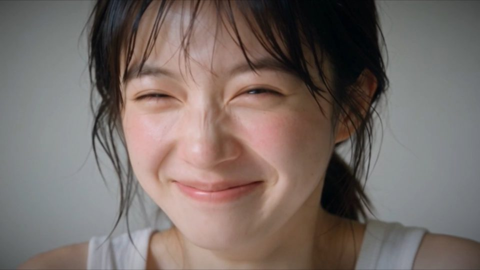</a>

- **作者:** [KRAQ VOID](https://x.com/kraqvoid/status/2087395593442504937) · X · **Seedance 2.5** · ♥ 1624
- **标签:** `写实电影感` `日系` `日常生活` `温暖治愈` `催泪伤感` `微表情特写` `一镜到底` `叙事短片`
- 固定机位的视频通话式特写，女孩努力憋笑，嘴角颤抖、眼眶泛红，最后笑着流泪双手合十。

<details><summary>提示词</summary>

```text
Cinematic emotional close-up portrait. The same woman from the input images, maintaining the exact fixed front camera angle and framing throughout the entire 20 seconds, as if seen through a webcam during a formal video call. Locked-off camera, static shot, no panning, no zoom, one continuous take. No music, quiet room ambience only — soft breathing, tiny suppressed nasal sounds, fabric rustle. No dialogue, no mouthed words, no lip movement resembling speech.

This is the hardest she has ever tried not to laugh in her life. The suppression builds slowly with a delayed onset, then comes in waves: she almost wins, then loses, then loses completely.

[Timeline & Expression Progression]

0s-4s: She sits upright with a calm, attentive, composed expression, eyes fixed slightly below the lens as if watching a shared screen. Her eyes flick briefly to one side — she noticed something — then return. For a moment, nothing. Her face stays neutral. Then a slow swallow moves down her throat. Her gaze drops for half a second. One corner of her mouth pulls sideways, once, and she quietly resets it flat.

4s-8s: The laughter starts rising against her will. She keeps her face still, but the effort shows in small places: her lips press together a little too firmly, her jaw tightens, her blinking speeds up. She exhales a slow, careful breath through her nose to steady herself. It almost works — then a single faint tremor crosses her lower lip and her eyes start to smile before her mouth does, warmth leaking into her gaze while the rest of her face fights to stay flat.
8s-12s: The dam breaks. A tiny snort escapes through her nose, and that sound itself finishes her — silent laughter erupts, her whole face crumpling with joy, eyes squeezing into crescents, nose scrunching, shoulders bouncing. She claps her palm fully over her mouth and ducks her head, ponytail swinging, trying to hide below the frame while her shoulders keep shaking.
12s-16s: She surfaces back into frame, breathless, fanning her flushed face with one hand. Genuine tears of laughter glisten at the outer corners of her eyes. She takes an exaggerated deep breath, puffs it out through rounded lips, and forces her posture straight — but her lips keep twitching and one final broken silent giggle slips out, making her wince at herself.
16s-20s: The apology, wordless. Still fighting a residual smile, she brings both palms together in front of her chest in a small praying gesture, fingertips pointing up. She tilts her head slightly to one side, scrunches her nose in a sheepish, self-aware grin, and bows forward into a small, quick apologetic nod toward the lens — eyes closing softly as she bows, stray bangs falling forward. She rises back up with her hands still pressed together, lips closed in a warm sheepish smile, eyes still wet and shining, and settles with one last soft exhale through her nose.
[Quality & Visual Details]
Fixed front portrait framing, natural soft diffused daylight from the front, gentle shadow modeling on her cheekbones. Photorealistic skin texture with a faint flush spreading across her cheeks as she laughs, visible glisten of laughter-tears catching the light, highly detailed eyes with natural catchlights, natural teeth, fine stray hairs moving as she ducks and bows. Visible micro-movements of throat, jaw, lip corner, and brow throughout — every stage of suppression readable on her face. 8k resolution, masterpiece quality.
```

</details>

### [吞剑化天使](https://daiyixiang666.github.io/awesome-ai-video-prompts/w/x-2093574426642264501.html)

<a href="https://daiyixiang666.github.io/awesome-ai-video-prompts/w/x-2093574426642264501.html">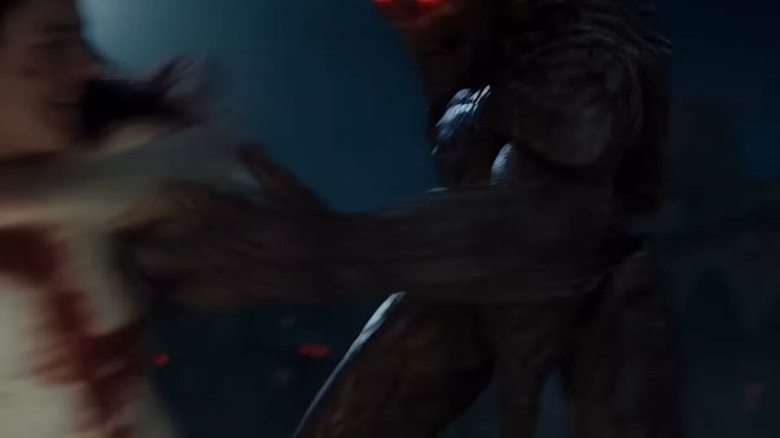</a>

- **作者:** [Sᴀɪʀᴀ](https://x.com/itsSaira_1/status/2093574426642264501) · X · **Seedance 2.0** · ♥ 1290
- **标签:** `写实电影感` `游戏CG` `无明显地域` `奇幻神话` `热血燃` `诡异不安` `变身转场` `预告片`
- 血染白裙的女子吞下一柄光剑，双目发光后化身六翼天使，在废墟中斩杀恶魔。变身过程一气呵成。

<details><summary>提示词</summary>

```text
Cinematic dark fantasy video. A young woman in a blood-stained white dress swallows a glowing sword of pure white light. Divine energy bursts from her, her eyes flash solid blinding white, and massive white feathered angel wings erupt from her back with a floating halo above her head. She transforms into a radiant archangel holding a luminous glowing weapon, fighting shadowy demonic monsters with glowing red eyes in ancient stone ruins under a full moon. Beams of holy light crash from the sky into the ground, vaporizing the dark creatures. Ultra-detailed, 8k resolution, cinematic lighting, epic motion effects, unreal engine 5 render style.
​AI Image Prompt (For Midjourney / DALL-E 3 / Stable Diffusion)
​Epic dark fantasy screenshot, a female archangel warrior in a blood-splattered white dress standing in ancient stone ruins under a full moon. She has glowing white eyes, a luminous halo, and massive magnificent white wings fully spread out. She holds a vertical staff of blinding white light touching the ground. Massive pillars of celestial light beam down into a circular courtyard surrounding her, dark fantasy mood, hyper-realistic detail, 8k resolution, cinematic film still. --ar 16:9
```

</details>

### [从太空落到咖啡桌](https://daiyixiang666.github.io/awesome-ai-video-prompts/w/x-2071174186978951379.html)

<a href="https://daiyixiang666.github.io/awesome-ai-video-prompts/w/x-2071174186978951379.html"></a>

- **作者:** [simeon-sanai](https://x.com/Naiknelofar788/status/2071174186978951379) · X · **Seedance 2.0** · ♥ 1019
- **标签:** `写实电影感` `广告大片` `美式` `旅行城市` `史诗壮阔` `一镜到底` `演示教程`
- 一镜到底：从深空地球俯冲穿云、掠过纽约楼群，最终停在街角咖啡馆里咬汉堡的女子。4K原片。

<details><summary>提示词</summary>

```text
Scene: A seamless ultra-cinematic one-take shot starting from deep space and ending in an intimate café moment. The sequence emphasizes speed, scale, and immersive transition from cosmic to human scale.

Subject / Character: Final subject is @img1 — a young woman sitting in an open-air café named “LUMOS”, wearing denim shorts and a white shirt, casually eating a hamburger with a drink beside her.

Action Timeline (TOTAL: 15s):

0–4s (Space → Earth Approach):
Wide cinematic shot of Earth in deep space. Camera accelerates forward smoothly. Earth rapidly grows in frame. Subtle light streaks, atmospheric glow becomes visible. Motion builds gradually but feels grand.

4–8s (Atmospheric Entry → Fast Descent):
Camera pierces atmosphere with intense glow and motion blur. Clouds rush past. Continents and terrain sweep underneath at high speed. Strong sense of acceleration.

8–11s (City Dive → Street Flow):
Camera locks onto a city and dives sharply. Skyscrapers rise fast. Transition into street-level movement — fluid glide through streets, passing buildings, corners, and urban elements with dynamic motion.

11–12s (Café Target Lock):
Camera spots outdoor café with large “LUMOS” sign. Rapid but smooth deceleration begins. Focus tightens.

12–15s (Final Scene – Character):
Camera settles into a medium shot of @img1. She sits casually, eating a hamburger, drink on table. Natural motion (taking a bite, relaxed posture). Warm, calm contrast to previous high-speed sequence.

Camera:
One continuous shot, no cuts. Extreme speed ramping: slow → ultra-fast → controlled slowdown. Wide lens in space → natural cinematic lens at final shot. Smooth stabilization with slight handheld realism at the end.

Audio:
Cinematic rise from deep space ambience → intense whooshing during descent → city ambience → soft café sounds (light chatter, ambient noise).

Style:
Cinematic color grading: cool tones in space/descent → gradually warmer tones at street/café. High contrast, subtle film grain, volumetric lighting, atmospheric particles, ultra-detailed, 8K, photorealistic.
```

</details>

### [沙漠死神对决](https://daiyixiang666.github.io/awesome-ai-video-prompts/w/x-2090568539325317401.html)

<a href="https://daiyixiang666.github.io/awesome-ai-video-prompts/w/x-2090568539325317401.html">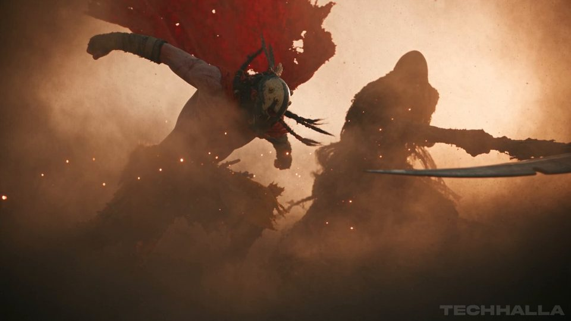</a>

- **作者:** [TechHalla](https://x.com/techhalla/status/2090568539325317401) · X · **Seedance 2.5** · ♥ 882
- **标签:** `写实电影感` `游戏CG` `无明显地域` `武侠打斗` `奇幻神话` `热血燃` `多镜头剪辑` `慢动作` `预告片`
- 金色沙暴中，红披风战士与持镰黑影高速缠斗，最后黑影由灰烬重聚。逆光剪影与沙尘层次极佳。

<details><summary>提示词</summary>

```text
Hyper-kinetic desert combat spectacle, extreme high-intensity CGI action, thick volumetric cinematic haze and golden-hour dust storms, aggressive anamorphic 35mm lens with heavy motion blur, relentless handheld tracking and whip pans, deep shadows, heat distortion, ultra-realistic particle systems.

Use the first provided image as exact reference for the ethereal dark reaper silhouette, flowing tattered robes, skull-scythe and arid desert environment. Use the second multi-view character sheet as exact appearance lock for the muscular tribal warrior (mask, red cape, yellow tattered bone-adorned skirt, dreadlocks, scarred body, barefoot).

0-4s: [Extreme Wide Crash-In] Instant violent collision. Warrior explodes forward through dense dust cloud, red cape whipping. Reaper swings massive scythe in wide horizontal arc. Impact detonates shockwave of sand and embers. No pause.

4-8s: [Dynamic Low Tracking] Rapid exchange. Warrior ducks under scythe, delivers spinning elbow to reaper’s ribs, then upward knee. Reaper phases partially, reforms mid-strike, counters with spectral claw rake across warrior’s chest. Fabric and ash particles explode outward.

8-13s: [Orbiting Medium + Dutch Angle] Acrobatic mid-air clash. Warrior vaults off scythe shaft, red cape fully extended, lands dual-fist hammer blow to reaper’s hood. Reaper retaliates with vertical scythe slam that cracks the ground; warrior rolls, rises into spinning back-kick that shreds more robe into black ribbons.

13-18s: [Handheld Close Combat Frenzy] Brutal ground scramble. Warrior grapples the scythe pole, headbutts the mask, then rips free and unleashes three distinct strikes: upward palm, horizontal elbow, downward axe-kick. Reaper absorbs then unleashes tendril-whip of shadow that lashes warrior’s back, drawing blood and dust.

18-23s: [Slow-Motion Impact Montage] Escalating power. Warrior catches scythe mid-swing, twists, drives knee into reaper’s midsection twice, then spinning heel kick that sends the figure airborne. Reaper crashes down in explosion of ash and sand, robes half-dissolved. Warrior advances without mercy.

23-28s: [Wide to Tight Push-In] Finishing sequence. Warrior seizes the collapsing reaper by the remaining hood, delivers a savage rising uppercut followed by a final two-handed overhead smash. Reaper’s entire form shatters into swirling black ash and ember particles that scatter across the desert floor. Warrior stands over the dissipating cloud, breathing hard.

28-30s: [Hard Cut Reverse Extreme Close-Up] Blurred warrior fills foreground, chest heaving, sweat and dust streaking his mask, mouth open in ragged breath. Sharp deep background: the dark figure slowly reconstitutes from residual ash, scythe reforming in hand, rising and stalking forward with predatory stillness.

Photorealistic, ultra-detailed fabric physics and particle simulation, perfect motion blur, volumetric haze at maximum density, coherent anatomy and proportions, stable character consistency, cinematic color grade, movie-level VFX polish.
```

</details>

### [地铁站里的出手](https://daiyixiang666.github.io/awesome-ai-video-prompts/w/x-2111670428733452289.html)

<a href="https://daiyixiang666.github.io/awesome-ai-video-prompts/w/x-2111670428733452289.html">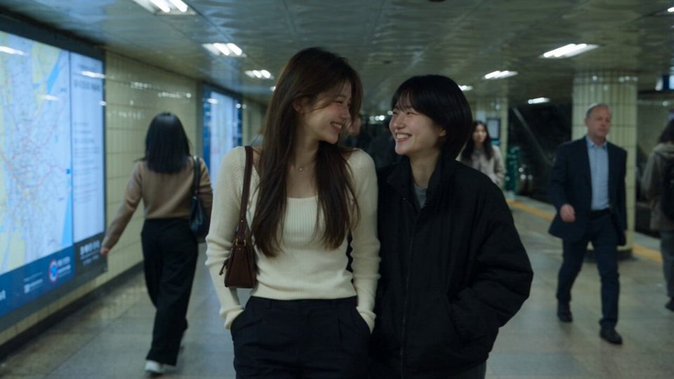</a>

- **作者:** [𝗦𝗮𝗻𝗶𝗮](https://x.com/saniaspeaks_/status/2111670428733452289) · X · **Seedance 2.5** · ♥ 860
- **标签:** `写实电影感` `韩系` `日常生活` `催泪伤感` `多镜头剪辑` `微表情特写` `叙事短片`
- 首尔地铁站人潮中，女孩看到有人被欺负，挺身上前，最后与对方相拥落泪。

### [狐狸的溪边vlog](https://daiyixiang666.github.io/awesome-ai-video-prompts/w/x-2089969922617266257.html)

<a href="https://daiyixiang666.github.io/awesome-ai-video-prompts/w/x-2089969922617266257.html">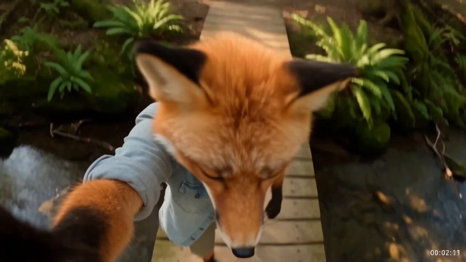</a>

- **作者:** [Mr Das](https://x.com/MrDasCreates/status/2089969922617266257) · X · **Seedance 2.5** · ♥ 757
- **标签:** `写实电影感` `无明显地域` `宠物动物` `喜剧搞笑` `轻松欢快` `第一人称` `一镜到底` `vlog`
- 拟人狐狸手持运动相机自拍，沿林间木栈道走到溪边，边走边讲解，最后挥手告别。

<details><summary>提示词</summary>

```text
Create a single continuous self-filmed vlog recorded on a handheld action camera in 16:9 aspect ratio. The camera is always held by the anthropomorphic fox, creating a natural first-person selfie perspective with light wind-induced shake, occasional soft lens flares from sunlight filtering through trees, realistic focus pulls, and dynamic walking/leaning motion. No cuts, transitions, or cinematic effects. Include a subtle realistic digital timestamp in the bottom-right corner that progresses naturally throughout the video.
Visual Style: Bright modern 4K digital look with vibrant yet soft natural colors, warm late-afternoon golden sunlight mixed with dappled shade, gentle water reflections and soft mist rising from the stream, subtle water droplets or mist on the lens near the water, and crisp details on fur and leaves. Slight handheld energy but smooth enough for casual vlogging. Widescreen 16:9 framing.
Character: Ember, a 24-year-old anthropomorphic red fox (bipedal, human-like proportions) with soft fluffy reddish-orange fur, white chest and muzzle, bright amber eyes, pointed ears, and a long bushy tail that sways naturally. He wears a simple light denim jacket with rolled sleeves over a soft cream t-shirt and comfortable cargo shorts. Personality: curious, warm, slightly playful and soft-spoken.
Location: Starts on a wooden footbridge over a clear mountain stream in a lush temperate forest, surrounded by mossy rocks, ferns, wildflowers, and overhanging maple and pine branches. Soft green and golden foliage, clear water with gentle ripples and small fish darting below.
Sequence (exactly 30 seconds, continuous take with timestamps):
0:00 – 0:05
Ember lifts the camera, smiles softly at the lens with his ears perking up, and says in a warm, slightly raspy voice:
“Hey friends… you won’t believe this spot I found.”
0:05 – 0:13
He walks slowly along the wooden bridge, lowering the camera slightly to show the clear stream and small fish swimming just below the surface while continuing:
“The water is so clear… I can see every little fish moving around.”
0:13 – 0:20
He crouches carefully at the edge, reaches one paw toward the water without touching it, and watches the fish dart past, laughing lightly:
“They’re swimming right up to me. Hi little guys.”
0:20 – 0:26
He turns the camera to capture both his face and the stream, then sits on a flat mossy rock at the water’s edge, letting his tail curl beside him. He gazes at the water for a few seconds and says quietly:
“Moments like this make everything feel peaceful.”
0:26 – 0:30
He stands up, waves one paw at the camera with a gentle smile, and says:
“Thanks for exploring with me. See you next time.”
The camera naturally lowers a little as he walks further along the path beside the stream.
```

</details>

### [浪人斩巨兽](https://daiyixiang666.github.io/awesome-ai-video-prompts/w/x-2021327636153401793.html)

<a href="https://daiyixiang666.github.io/awesome-ai-video-prompts/w/x-2021327636153401793.html">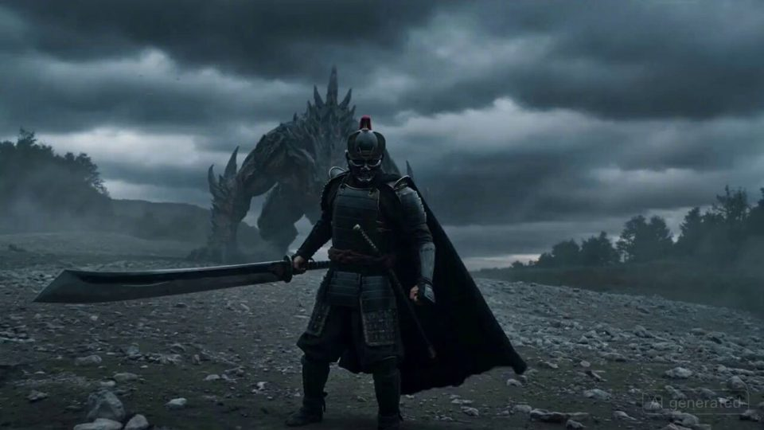</a>

- **作者:** [Travis Davids](https://x.com/MrDavids1/status/2021327636153401793) · X · **Seedance 2.0** · ♥ 654
- **标签:** `写实电影感` `日系` `武侠打斗` `奇幻神话` `热血燃` `史诗壮阔` `多镜头剪辑` `演示教程`
- 雷雨战场上，持巨刀的面具浪人迎战山般的巨兽，劈开其胸膛。

<details><summary>提示词</summary>

```text
An intense fight scene between a masked ronin with a huge sword and a massive creature during a violent thunder storm. The earth is shattering as the ronin fights the colossal monster, slicing it's chest and eventually defeats it. The scene is chaotic with handheld motion and camera shake.
```

</details>

### [便利店微缩冒险](https://daiyixiang666.github.io/awesome-ai-video-prompts/w/x-2106397932304191969.html)

<a href="https://daiyixiang666.github.io/awesome-ai-video-prompts/w/x-2106397932304191969.html">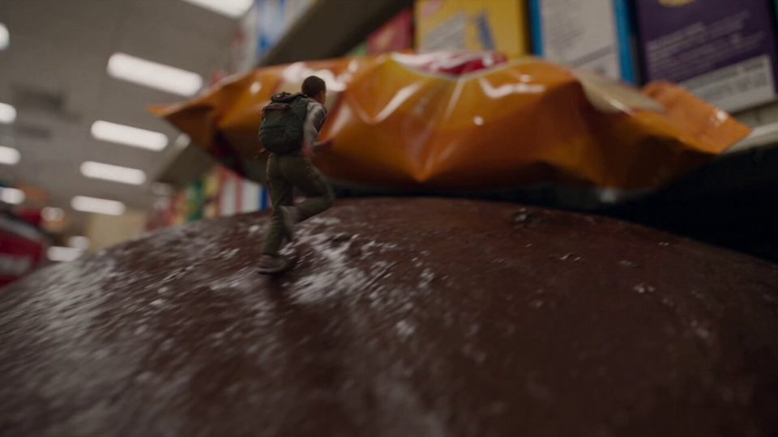</a>

- **作者:** [Smiling Khan](https://x.com/AIwithkhan/status/2106397932304191969) · X · **Seedance 2.5** · ♥ 623
- **标签:** `写实电影感` `无明显地域` `奇幻神话` `喜剧搞笑` `轻松欢快` `紧张刺激` `多镜头剪辑` `叙事短片`
- 微缩小人在便利店里攀爬货架、滑过饮料瓶、躲避收银传送带，最后跳上招牌俯瞰城市。

<details><summary>提示词</summary>

```text
STYLE: Photorealistic live-action miniature-person FX, cinematic macro photography, ultra-shallow depth of field, realistic convenience store, dynamic handheld camera, dramatic practical lighting, realistic physics, detailed textures, premium viral commercial aesthetic, 4K.

Create a 30-second cinematic adventure featuring one athletic miniature woman at approximately 1 : 5 scale. Maintain her exact face, hairstyle, outfit, body proportions, backpack, and scale throughout.

She races across towering snack shelves, jumping over oversized packages and gaps. A giant candy box falls, creating an avalanche of rolling candies that she uses as stepping stones before landing on a massive chocolate bar. She climbs a huge drink bottle, runs up its curved surface, jumps over the cap, and lands on a hanging promotional display. She then rides a moving shopping cart through checkout, dodging the scanner and jumping onto the conveyor belt. At the refrigerated section, she runs across frozen-food packages, slides beneath a closing freezer door, and swings onto the display using the handle. Finally, she climbs onto a giant store sign and looks across the enormous store filled with products and shoppers as the camera pulls back to reveal just how tiny she is.

Use dynamic macro tracking, dramatic low angles, smooth aerial-style movements, strong foreground parallax, realistic reflections, shadows, depth of field, product packaging, natural human movement, believable physics, seamless transitions, and cinematic lighting.

End with the cinematic title: “SMALL SCALE. BIG ADVENTURE.” followed by “EVERY AISLE IS A NEW WORLD.”

SFX: Footsteps, packaging crinkles, candy rattles, plastic flexing, cart wheels, scanner beeps, conveyor hum, freezer sounds, rushing air, and cinematic impact.

NEGATIVE: No cartoon, anime, toy-like appearance, animation, duplicated character, face or outfit changes, distorted anatomy, floating, scale changes, narration, or subtitles.
```

</details>

### [云中石龙](https://daiyixiang666.github.io/awesome-ai-video-prompts/w/x-2079683948452442225.html)

<a href="https://daiyixiang666.github.io/awesome-ai-video-prompts/w/x-2079683948452442225.html">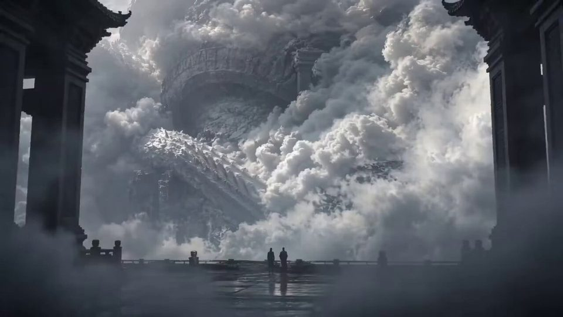</a>

- **作者:** [Cip⚡️](https://x.com/cipgerx/status/2079683948452442225) · X · **Seedance 2.0** · ♥ 485
- **标签:** `写实电影感` `无明显地域` `奇幻神话` `史诗壮阔` `慢动作` `预告片`
- 两人站在崖边，摩天楼般的石龙从翻涌云海中缓缓抬头。

### [龙马戏虎](https://daiyixiang666.github.io/awesome-ai-video-prompts/w/x-2034340994942922852.html)

<a href="https://daiyixiang666.github.io/awesome-ai-video-prompts/w/x-2034340994942922852.html">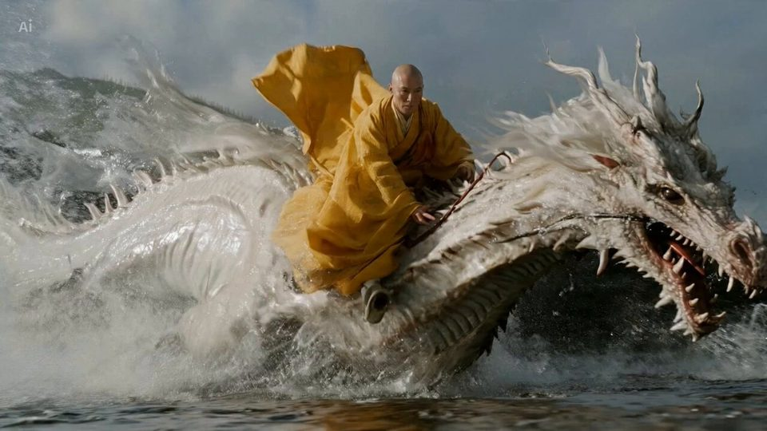</a>

- **作者:** [Stevie Mac](https://x.com/StevieMac03/status/2034340994942922852) · X · **Seedance 2.0** · ♥ 429
- **标签:** `写实电影感` `中式` `奇幻神话` `宠物动物` `紧张刺激` `慢动作` `演示教程`
- 僧人骑白色龙马在礁石海浪间与猛虎追逐扑咬，水花与毛发细节真实。

### [雨后的首尔傍晚](https://daiyixiang666.github.io/awesome-ai-video-prompts/w/x-2092472241254814024.html)

<a href="https://daiyixiang666.github.io/awesome-ai-video-prompts/w/x-2092472241254814024.html">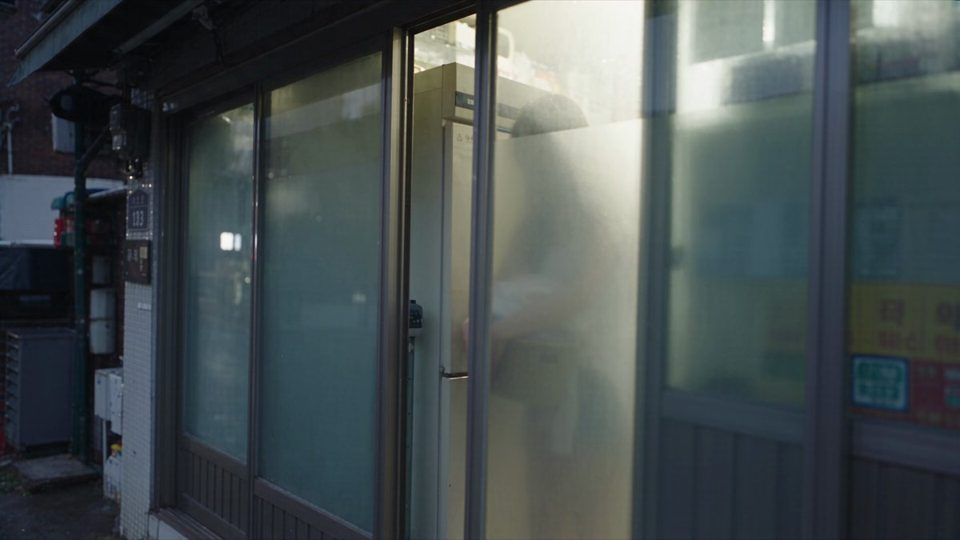</a>

- **作者:** [Oogie](https://x.com/oggii_0/status/2092472241254814024) · X · **Seedance 2.5** · ♥ 396
- **标签:** `写实电影感` `纪实手持` `韩系` `日常生活` `旅行城市` `温暖治愈` `多镜头剪辑` `角色一致性` `vlog`
- 下班后的女孩买花、在桥边看雨后的河、在便利店门口喝饮料，街灯一盏盏亮起。

<details><summary>提示词</summary>

```text
Create a 30-second, 1080p ultra-realistic personal home-video showing an ordinary evening in the life of a young Korean woman. No reference image.

MAIN SUBJECT

Young Korean woman same face as <<<image_1>>> in her early 20s, naturally pretty, realistic skin texture with visible pores and texture, minimal makeup, soft and slightly tired expression after a long day.

Long straight black hair tied in a loose low bun, a few flyaway strands near her ears, small silver hoop earrings.

Wearing an oversized beige knit cardigan over a plain black turtleneck, straight-leg dark jeans, white canvas sneakers, and carrying a small worn tote bag.

Maintain the same face, hairstyle, clothing, body proportions, and appearance throughout the entire video.

SETTING

A quiet riverside neighborhood in Seoul on a cool early-autumn evening, right after a light rain has just stopped.

Wet pavement reflecting streetlights, a small laundromat with fogged windows, a street-side flower stand closing up, a covered bus shelter, a narrow pedestrian bridge over a stream, scattered puddles, string lights above a closed market alley, a convenience store with a lit sign, and a few pigeons picking at the ground. Everything damp, quiet, and softly lit as dusk settles in.

**CAMERA / VISUAL AESTHETIC**

Raw personal footage casually recorded by a friend.

Handheld camera with natural shake, imperfect framing, occasional partial crops, autofocus hunting on reflections and wet surfaces, exposure shifts between streetlight glow and shadow, mild motion blur, soft image detail, subtle digital noise, slightly desaturated evening colors, and natural camera imperfections.

The camera operator walks with her and reacts naturally.

No stabilization, no cinematic camera movements, no dramatic lighting, no slow motion, no polished commercial appearance.

The footage should feel accidentally beautiful rather than deliberately cinematic.

---

**00:00–00:05 — LEAVING THE LAUNDROMAT**

She pushes open the laundromat door, stepping out with a small basket of folded laundry against her hip.

She glances up at the sky, checking if it's really stopped raining, and exhales a small relieved breath.

The camera follows her out, slightly unsteady on the wet step.

She glances back at the camera with a tired little smile.

**00:05–00:10 — THE FLOWER STAND**

She walks past a street-side flower stand that's closing up for the night.

She pauses, picks up a small bundle of daisies on impulse, pays the vendor, and tucks them into her tote bag.

The camera briefly focuses on the flowers before drifting back up to her face.

**00:10–00:15 — THE PEDESTRIAN BRIDGE**

She crosses a narrow footbridge over the stream, puddles reflecting the streetlights beneath her feet.

She stops halfway, resting her forearms on the railing, looking down at the water without saying anything.

The camera stays slightly shaky and imperfectly framed, as if her friend is just leaning on the railing beside her.

**00:15–00:20 — CONVENIENCE STORE STOP**

She ducks into a small convenience store, the automatic door chiming behind her.

She grabs a warm canned coffee from the heated shelf, pays, and steps back outside, cracking it open right away.

A passing scooter splashes through a puddle in the background.

The camera operator accidentally clips the doorframe while following her out, then quickly reframes.

**00:20–00:25 — BUS SHELTER**

She sits under a covered bus shelter, sipping her coffee, laundry basket beside her feet.

A few pigeons wander near the curb; she watches them idly, unbothered.

Steam rises faintly from the coffee can in the cool evening air.

The camera drifts slightly out of focus on the streetlight behind her, then refocuses.

**00:25–00:30 — FINAL MOMENT**

She notices the camera still recording and turns toward it, laundry basket now tucked under one arm.

She gives a small amused, slightly embarrassed smile and says:

*"Why are you still filming me?"*

She laughs quietly and starts walking toward the camera, waving it off with her free hand.

The camera moves backward as she approaches, and the recording abruptly cuts to black before she reaches it.

---

**AUDIO**

Natural location sound only:

Footsteps on wet pavement, distant traffic, dripping water, a scooter passing, the convenience store door chime, coins and paper bag rustling, pigeons cooing, fabric movement, a bus passing in the distance, and subtle handheld camera noise.

No music. No narration. No artificial sound effects.

Only the single spoken line: *"Why are you still filming me?"*

**FINAL FEEL**

The entire video should feel like a completely ordinary rainy evening that somehow became a quiet, beautiful memory.

Soft, feminine, tired-but-content, intimate, gently nostalgic, and unplanned.

No dramatic events. No exaggerated acting. No model poses. No cinematic hero shots.

The realism should come from tiny imperfections, damp reflections, casual body language, natural expressions, ordinary surroundings, imperfect camera operation, and moments that feel completely unposed.
```

</details>

### [第一人称跳崖](https://daiyixiang666.github.io/awesome-ai-video-prompts/w/x-2103861170625286334.html)

<a href="https://daiyixiang666.github.io/awesome-ai-video-prompts/w/x-2103861170625286334.html">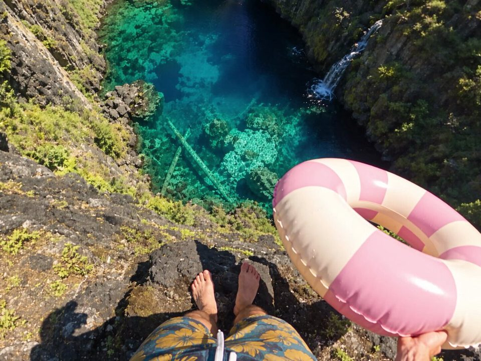</a>

- **作者:** [Abdul Shakoor](https://x.com/abxxai/status/2103861170625286334) · X · **Seedance 2.5** · ♥ 395
- **标签:** `写实电影感` `美式` `运动极限` `自然风光` `紧张刺激` `第一人称` `一镜到底` `vlog`
- 第一人称站在火山峡谷崖边，纵身跃入碧绿深潭，入水后浮出水面看见粉色泳圈。22秒单镜。

<details><summary>提示词</summary>

```text
SEEDANCE 2.5 | TEXT TO VIDEO | SINGLE CONTINUOUS TAKE | 22s | 1080x1920 | 9:16 | 30fps | 1080p

SCENE AND LOCATION
A hidden volcanic spring canyon deep in a Pacific Northwest pine forest on a bright summer day. A narrow, deep gorge with steep, very high walls of dark gray basalt made of vertical hexagonal columns, streaked with tan and rust tones and covered in patches of bright green moss, ferns and small shrubs.
At the bottom is a crystal-clear natural spring pool. The shallow edges glow bright turquoise and aqua, fading to deep sapphire blue in the center. The water is so transparent that the bottom is fully visible: honeycomb-patterned volcanic rock, mossy boulders, and two long pale submerged logs lying diagonally across the bottom.
Two white waterfalls pour into the pool: a thin one at the far back of the canyon and a larger one spilling from the right-hand cliff wall, making white foam where it hits the water. Tall dark-green conifer and pine trees line the canyon rim. Above is a vivid clear blue sky with a few small white clouds. Hard, bright midday sunlight with strong contrast, and sun sparkles on the water.

THE JUMPER
A young man seen only from his own first-person view. Tanned bare feet and lightly hairy shins, and loose navy-blue swim shorts with a large mustard-yellow hibiscus flower pattern and white drawstrings. No shirt, no shoes, no gloves. His hands and forearms appear naturally in frame when he moves them.

CAMERA AND REALISM
First-person POV from a GoPro strapped to his forehead. It looks like real action-cam footage, not a cinematic camera. 16mm-equivalent ultra-wide lens with slight barrel distortion, and saturated but natural color.
Use real action-cam behavior throughout: small head bob and micro-jitter from breathing and body weight, rolling-shutter wobble on fast moves, quick auto-exposure shifts between bright sky and the shaded canyon, a small sun flare on upward tilts, light sensor noise in the shadows, and wind buffeting that shakes the frame during the fall.
The cliff is about 35 meters high. Gravity, body motion and water physics are fully realistic.

0-2s | THE EDGE (real time)
POV looking straight down from the top of the basalt cliff. His bare feet stand on the rough, dark rock ledge at the bottom of frame, with the shorts visible at the lower edge. Both hands hover forward at the sides of frame. The turquoise pool, the submerged logs and the waterfalls are far, far below. His toes curl over the edge and small grit crumbles off. His right hand tosses a pink-and-white striped inflatable tube out over the drop; it tumbles down and lands as a tiny speck on the water far below. Wind, distant waterfall roar, upbeat chill electronic music starts.

2-4s | THE COUNTDOWN (real time)
A quick nervous tilt down at the drop, a sharp exhale, then two fast steps back from the edge, with the ledge bouncing in frame. Young male voice, hyped: "Three, two, one!"

4-7s | THE TAKEOFF (natural slow motion, about 50% speed)
Two running steps forward, then his last foot pushes off the ledge in slow motion. Rock grit kicks up and floats in the sunlight, the cliff edge slides away beneath his feet, his arms swing forward and out wide, and the whole turquoise canyon opens up below. The slow motion looks like a real high-frame-rate action-cam clip, not a frozen hang. Deep bass swell, stretched wind.

7-13s | THE FALL (real time, fast and continuous)
The speed ramps smoothly back to normal and the stomach drops.
7-9s: The frame dips and wobbles, his arms flail slightly for balance at the edges of frame, and his feet kick at the bottom of frame. A loud yell: "Woooooo!"
9-11s: The basalt column wall, moss and ferns streak upward past the lens, and the right-side waterfall rushes by with spray catching the sun. Wind roars louder and the frame shakes from air buffeting.
11-13s: The glowing turquoise water rushes up and fills the frame, and the pink tube and submerged logs grow fast. His arms snap tight to his body and his legs lock straight for a feet-first pencil dive. The music builds to the drop.

13-14s | IMPACT
A hard feet-first hit into the water and a white explosion of bubbles swallows the lens. Loud plunge splash, deep impact whoosh, and the music goes heavily muffled underwater.

14-17s | UNDERWATER (short, energetic, real time)
A violent swirl of silver bubbles clears to reveal crystal-clear blue water, bright sun shafts cutting down from the surface, the pale submerged logs and honeycomb volcanic rock bottom below, and small fish darting away. His hands push into frame for one strong breaststroke pull, then fast kicks straight up toward the bright glowing surface, with bubbles streaming past the lens. No slow sinking.

17-19s | SURFACE BREAK
The camera bursts through the surface, water droplets sliding across the lens, and bright sunlight floods in. The music snaps back to full clarity on the beat drop. His hand grabs the pink-and-white tube floating right beside him.

19-22s | THE REWARD
POV bobbing on the turquoise water holding the tube, then a sharp tilt up revealing the towering basalt cliff, the tiny ledge he jumped from far above, the pine trees on the rim and the vivid blue sky, with the waterfall splashing on the right. Same voice, out of breath and triumphant: "Yeah, dude! That was insane!" Faint distant cheering. Music plays clean to the final frame.

AUDIO
Continuous upbeat chill electronic track: a bass swell on takeoff, a fast build through the fall, muffled underwater, then a clean drop on surfacing. Real ambient layers: wind that grows with speed, fabric flapping, heavy breathing, waterfall roar, splash, bubbles. Dialogue clear over the music.

KEEP
One continuous take, first-person only. The same shorts, feet and hands throughout, and the same canyon layout with two waterfalls, turquoise pool and submerged logs. The slow motion lasts only 3 seconds at takeoff. The fall is fast, real time and builds speed without pausing. Every beat is quick and punchy.

AVOID
Extra slow motion beyond the takeoff, hovering or floating mid-air, smooth cinematic gimbal movement, cuts to third person, showing the jumper's face, extra people, distorted hands or extra fingers, morphing cliffs, changing water color, text, subtitles, watermarks.
```

</details>

### [骑龙俯冲入海](https://daiyixiang666.github.io/awesome-ai-video-prompts/w/x-2087007818721423855.html)

<a href="https://daiyixiang666.github.io/awesome-ai-video-prompts/w/x-2087007818721423855.html">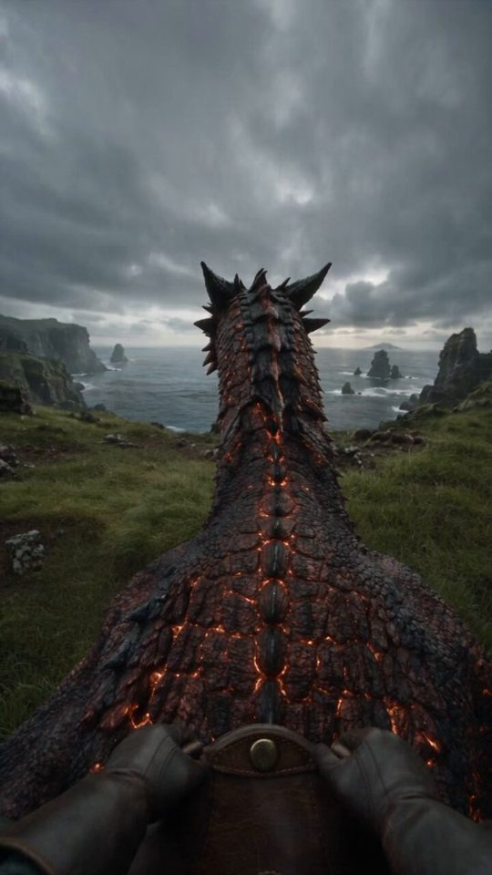</a>

- **作者:** [Nexora](https://x.com/frametheory058/status/2087007818721423855) · X · **Seedance 2.5** · ♥ 340
- **标签:** `写实电影感` `无明显地域` `奇幻神话` `史诗壮阔` `紧张刺激` `第一人称` `演示教程`
- 第一人称骑在黑红巨龙背上，从海崖起飞、穿云、俯冲入海再破水而出。竖屏30秒。

<details><summary>提示词</summary>

```text
Create a 30-second vertical 9:16, 24fps, 8K-quality photorealistic live-action fantasy sequence from a first-person rider POV. A massive original obsidian-crimson dragon with individually detailed scales, subtle dark mottling, molten-gold eyes, volcanic-black swept-back horns, blade-like dorsal fins, burgundy-red translucent wings and faint ember-like fissures across its body. Rider wears black leather gloves, dark-green sleeves and weathered leather bracers, holding heavy chain reins from a worn brown studded saddle.

Begin with the dragon calmly breathing on a wet emerald coastal cliff; it slowly turns toward camera and the rider gently pets its neck. Suddenly it lowers its body, launches across the grass and leaps from the cliff. Dive steeply toward the grey-green ocean, deploy huge wings with realistic membrane movement, then skim just above the water with spray hitting the lens. Perform a dramatic high-speed bank around a sea stack, then plunge directly underwater. Brief dark-teal underwater silence with bubbles and faint crimson glow, followed by a powerful eruption through the ocean. Finish with a calm glide above foggy water as the dragon slowly turns and looks toward the rider.

Use physically accurate anatomy, weight, gravity, wing aerodynamics, water physics, scale deformation, wind and environmental interaction. Natural rider-mounted camera movement, realistic motion blur, lens droplets, focus breathing, subtle handheld vibration, cinematic depth of field, soft overcast lighting, HDR, restrained film grain and natural cinematic color grading.

Audio: atmospheric drone → intimate cello → rising orchestral tension → massive launch/flight score → intense percussion during the bank → muffled underwater audio → epic orchestral return during emergence → soft cello/piano ending. Layer detailed ASMR/SFX: dragon breathing, scales, leather, reins, claws scraping soil, wind, wingbeats, water spray, bubbles, ocean impact and a deep natural dragon roar.

Make it indistinguishable from expensive real live-action cinema. No AI look, cartoon, anime, game CGI, plastic textures, fake physics, neon glow, oversaturation, distorted anatomy, extra limbs, text or watermark.
```

</details>

### [雨中奔跑的午后](https://daiyixiang666.github.io/awesome-ai-video-prompts/w/x-2105533415026241635.html)

<a href="https://daiyixiang666.github.io/awesome-ai-video-prompts/w/x-2105533415026241635.html">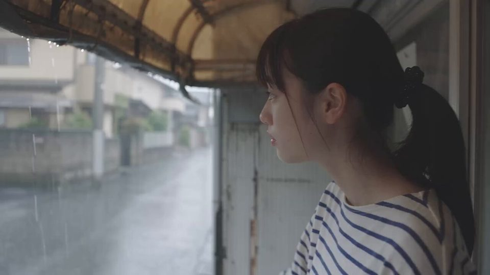</a>

- **作者:** [Ali](https://x.com/alixbuilds/status/2105533415026241635) · X · **Seedance 2.5** · ♥ 302
- **标签:** `写实电影感` `日系` `日常生活` `爱情青春` `轻松欢快` `多镜头剪辑` `vlog`
- 条纹衫女孩在屋檐下伸手接雨，随后冲进雨里沿着日本住宅区小路奔跑，躲进公园凉亭开怀大笑。

<details><summary>提示词</summary>

```text
Create an ultra-realistic cinematic Japanese lifestyle vlog featuring a young Japanese woman enjoying a peaceful rainy day in a quiet Japanese neighborhood.

A young woman with black hair tied in a neat ponytail, wearing a white and navy striped oversized T-shirt, beige shorts, and white sneakers, stands under a traditional covered bus stop during light rain. She looks outside, gently extends her hand to feel the raindrops, then turns around and runs playfully along a quiet residential street.

Show cinematic transitions of her running through the wet neighborhood, passing traditional Japanese houses, green trees, and a peaceful park. She eventually reaches a wooden shelter in the park, adjusts her ponytail, stretches her arms, and smiles naturally toward the camera.

Visual Style: Photorealistic Japanese slice-of-life cinematography, soft overcast daylight, realistic rain reflections, natural human movements, beautiful greenery, peaceful atmosphere, authentic Japanese residential environment.

Camera Direction: Start with a cinematic side-profile close-up, transition into a medium shot of her touching raindrops, followed by a smooth rear tracking shot while running. Finish with emotional close-ups and a warm natural smile.

Technical: 4K, 9:16 vertical, 24fps, realistic facial expressions, consistent character identity, smooth camera movement, natural physics, detailed environment, cinematic color grading.

Important: Maintain the same woman's face, hairstyle, outfit, and body proportions throughout every scene. No facial distortion, no outfit changes, no unnatural movements, no text or watermark.
```

</details>

### [无声的崩溃](https://daiyixiang666.github.io/awesome-ai-video-prompts/w/x-2021832164699152688.html)

<a href="https://daiyixiang666.github.io/awesome-ai-video-prompts/w/x-2021832164699152688.html">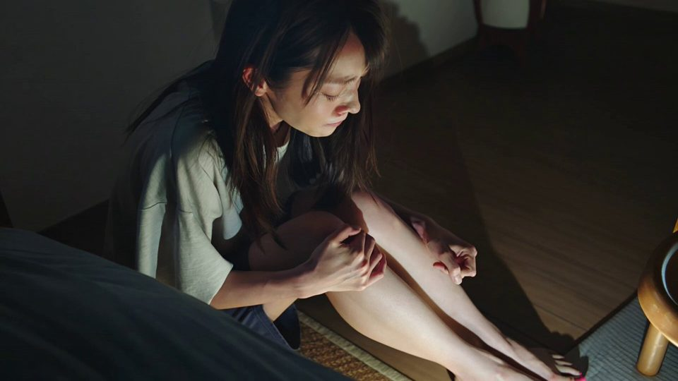</a>

- **作者:** [HAL2400 | AI Visual Creator](https://x.com/HAL2400_AI/status/2021832164699152688) · X · **Kling 3.0** · ♥ 298
- **标签:** `写实电影感` `无明显地域` `日常生活` `催泪伤感` `微表情特写` `叙事短片`
- 昏暗房间里女孩抱膝坐着，渐渐从沉默到失声痛哭，固定近景完整呈现情绪爬升。

### [樱下道口](https://daiyixiang666.github.io/awesome-ai-video-prompts/w/x-2111294203095629930.html)

<a href="https://daiyixiang666.github.io/awesome-ai-video-prompts/w/x-2111294203095629930.html">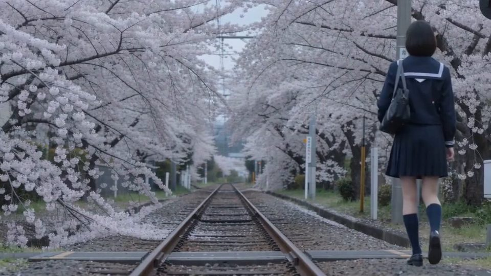</a>

- **作者:** [Maha](https://x.com/Aiwithmaha/status/2111294203095629930) · X · **Seedance 2.0** · ♥ 235
- **标签:** `写实电影感` `日系` `爱情青春` `自然风光` `孤独忧郁` `环绕运镜` `叙事短片`
- 水手服短发少女沿樱花铁轨独行，镜头从背影绕到侧脸、衣领特写，再升到俯瞰道口。

<details><summary>提示词</summary>

```text
Create a 30-second ultra-realistic cinematic video of a young Japanese schoolgirl walking along a railway crossing surrounded by breathtaking cherry blossom trees in full bloom. She wears a traditional navy-blue Japanese sailor-style school uniform with white stripes, a matching pleated skirt, black shoes, and a black shoulder bag, with a neat short black bob hairstyle and a black face mask. Begin with a wide cinematic shot from behind as she walks slowly beside the railway tracks, surrounded by delicate pale-pink and white blossoms. The camera gently follows her from behind, capturing the natural movement of her hair, school uniform, and bag as a soft breeze moves through the trees. Transition into beautiful close-up shots of her shoulders, hairstyle, and uniform while she quietly admires the cherry blossoms above her. Capture the intricate petals, delicate branches, and soft natural daylight with shallow depth of field and realistic cinematic color grading. Slowly tilt the camera upward to reveal a dreamy canopy of cherry blossoms stretching across the sky. Finish with an elevated wide aerial-style shot showing the girl walking near the railway crossing, framed by the tracks and endless blooming trees. Maintain consistent character appearance, realistic anatomy, smooth camera movements, natural lighting, and a peaceful nostalgic Japanese film atmosphere throughout the entire 30-second video, with no text, logos, or watermarks.
```

</details>

### [雨夜凶宅](https://daiyixiang666.github.io/awesome-ai-video-prompts/w/x-2093933142877036939.html)

<a href="https://daiyixiang666.github.io/awesome-ai-video-prompts/w/x-2093933142877036939.html">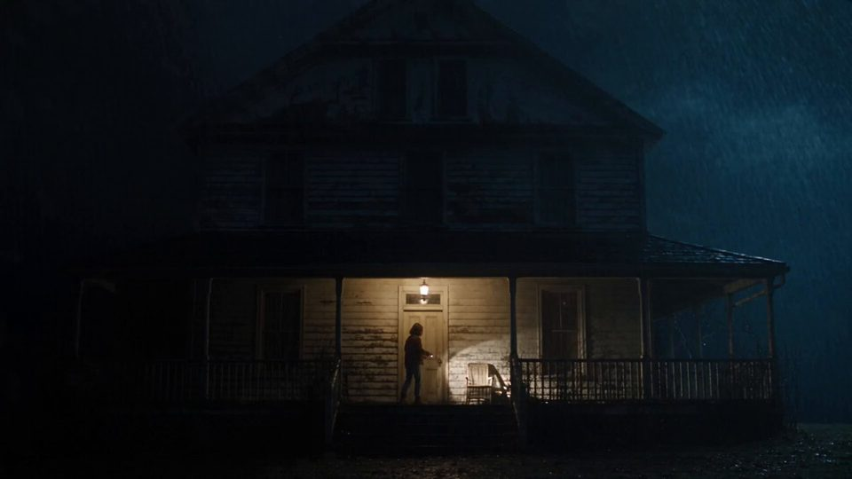</a>

- **作者:** [Sarah](https://x.com/SyntheSarah/status/2093933142877036939) · X · **Seedance 2.5** · ♥ 217
- **标签:** `写实电影感` `美式` `恐怖` `悬疑惊悚` `诡异不安` `多镜头剪辑` `角色一致性` `叙事短片`
- 暴雨夜，女子提灯走进老宅，走廊相框、摇椅、门缝一路铺垫，最后在旧照片里看见自己。

<details><summary>提示词</summary>

```text
Use the reference image only for facial identity, do not use dress or background or pose only for facial identity.

Create a 30-second ultra-realistic cinematic horror movie scene set inside an abandoned countryside house during a stormy night.
Main character: A woman in her late 20s, realistic natural appearance, shoulder-length dark brown hair, simple dark jacket, faded jeans and practical boots. She carries a small flashlight and an old key. Keep her face, hairstyle, body proportions and clothing perfectly consistent throughout the entire video.

Environment: An abandoned two-story countryside house that has been empty for decades. Cracked plaster walls, old wooden floors, dusty furniture covered with sheets, broken picture frames, peeling wallpaper, old wooden doors, narrow staircase, cobwebs and scattered debris. Heavy rain hits the windows outside. Occasional distant thunder illuminates the interior through the curtains.

The house must feel completely real and physically believable. No supernatural visual effects, no fantasy creatures, no excessive gore, no cyberpunk, no neon lights.

0–5 seconds — ARRIVAL

Start with a wide exterior shot of the abandoned house during a violent rainstorm at night.

The woman approaches the front entrance holding a flashlight.

Lightning briefly illuminates the entire house.

She unlocks the old front door.

The door slowly opens by itself with a long, realistic wooden creak.

She pauses.

After a moment, she cautiously enters.

5–10 seconds — THE HOUSE

Cut to an interior tracking shot following her from behind.

Her flashlight slowly moves across the dark hallway.

Dust particles float through the narrow beam of light.

She notices several old family photographs hanging crookedly on the wall.

She stops and examines them.

One photograph shows a family standing outside the house many years ago.

Everything looks normal.

She continues walking.

A faint sound comes from upstairs.

A single slow footstep.

She looks toward the staircase.

Silence.

10–16 seconds — SOMETHING IS THERE

She slowly walks toward the staircase.

Her flashlight beam moves up the dark stairs.

Another quiet footstep comes from above.

She whispers softly, “Hello?”

No answer.

She takes a few steps upward.

Suddenly, the hallway light flickers briefly even though the house has no electricity.

The woman freezes.

Her flashlight begins to flicker.

For one brief moment, at the very top of the staircase, a dark human silhouette appears.

The flashlight stabilizes.

The silhouette is gone.

16–22 seconds — THE BEDROOM

She cautiously reaches the second floor.

At the end of the hallway, one old bedroom door is slightly open.

A faint warm light is visible underneath it.

She slowly approaches.

She pushes the door open.

Inside is an old bedroom covered in dust.

In the center of the room sits an old wooden chair facing away from her.

The room is completely silent.

She shines her flashlight toward the chair.

Nothing happens.

She takes one step closer.

The chair slowly moves by itself with a subtle wooden creak.

22–27 seconds — THE REVEAL

The woman freezes.

The chair slowly rotates toward her.

There is no one sitting in it.

She takes a step backward.

Her flashlight suddenly falls from her hand and lands on the floor.

The beam points toward the doorway.

In the flashlight beam, the woman sees the same family photograph from downstairs.

But now there is a new figure standing in the photograph.

It is the woman herself, wearing exactly the same clothes she is wearing now.

She stares at the photograph in complete disbelief.

27–30 seconds — FINAL SHOT

A slow camera push toward the photograph.

The woman's face is visible inside the old photograph.
```

</details>

### [疲惫的上班族](https://daiyixiang666.github.io/awesome-ai-video-prompts/w/x-2110206983999726004.html)

<a href="https://daiyixiang666.github.io/awesome-ai-video-prompts/w/x-2110206983999726004.html">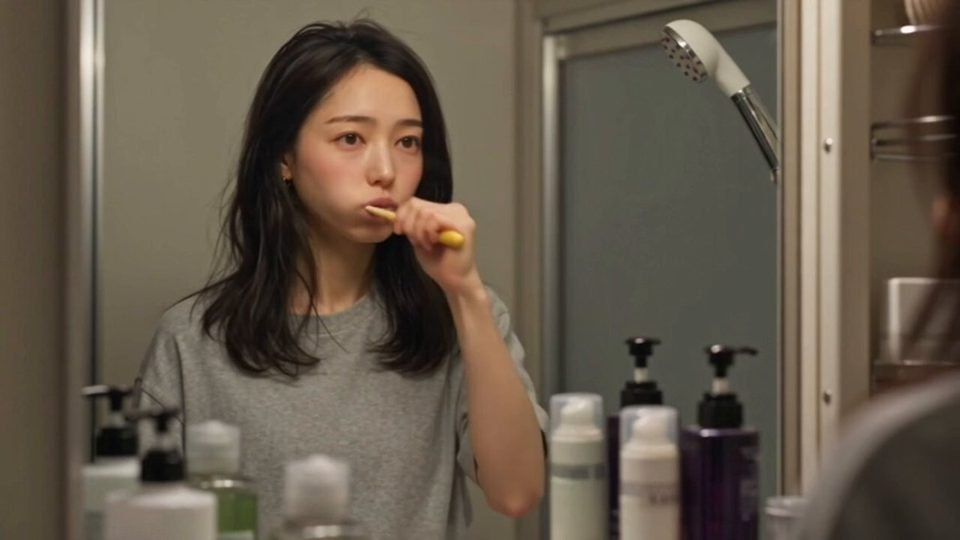</a>

- **作者:** [Maha](https://x.com/Aiwithmaha/status/2110206983999726004) · X · **Seedance 2.0** · ♥ 216
- **标签:** `写实电影感` `韩系` `日常生活` `孤独忧郁` `多镜头剪辑` `叙事短片`
- 韩国年轻上班族的一天：刷牙、通勤、加班、在食堂发呆、在地铁里睡着，最后瘫倒在沙发上。

<details><summary>提示词</summary>

```text
Create a 24-second ultra-realistic cinematic video of a young Korean office woman experiencing an exhausting day in her corporate life. Show her brushing her teeth in front of a bathroom mirror, getting ready for work, walking through a crowded Korean city crosswalk in a navy business suit, and carrying a black handbag. Then show her sitting tiredly on a crowded subway with her eyes closed, working silently at a busy office desk surrounded by computers and paperwork, and eating lunch in a crowded company cafeteria while looking emotionally drained. Capture close-up shots of her exhausted face, realistic skin texture, and subtle sadness in her eyes. End with her standing tiredly inside the subway before transitioning to her lying motionless on a couch at home, still wearing her office clothes and employee ID badge. Maintain consistent facial features, hairstyle, outfit, and body proportions throughout the video. Use realistic Korean environments, natural lighting, smooth cinematic camera movements, detailed facial expressions, and a muted color palette to convey the emotional weight of a demanding work routine. Make the entire video photorealistic, with no text, subtitles, or watermarks.
```

</details>

### [下雨天的小确幸](https://daiyixiang666.github.io/awesome-ai-video-prompts/w/x-2093236001451676015.html)

<a href="https://daiyixiang666.github.io/awesome-ai-video-prompts/w/x-2093236001451676015.html">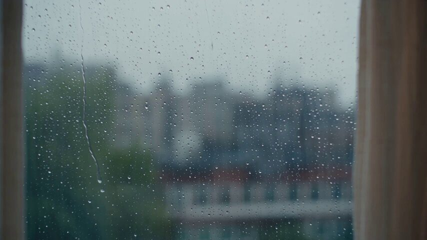</a>

- **作者:** [Sarah Parker](https://x.com/SeharShinwari/status/2093236001451676015) · X · **Seedance 2.5** · ♥ 214
- **标签:** `写实电影感` `无明显地域` `日常生活` `温暖治愈` `孤独忧郁` `多镜头剪辑` `vlog`
- 雨天清晨，女人慢慢护肤、在窗边喝咖啡，撑伞穿过湿漉漉的斑马线，坐进咖啡馆，傍晚看城市亮灯。

### [海妖之歌](https://daiyixiang666.github.io/awesome-ai-video-prompts/w/x-2088512747055309030.html)

<a href="https://daiyixiang666.github.io/awesome-ai-video-prompts/w/x-2088512747055309030.html"></a>

- **作者:** [Caden Flux](https://x.com/Caden_Flux/status/2088512747055309030) · X · **Seedance 2.5** · ♥ 198
- **标签:** `写实电影感` `欧洲` `恐怖` `奇幻神话` `诡异不安` `角色一致性` `多镜头剪辑` `预告片`
- 风暴夜的帆船上水手循歌声望向海面，船毁后海妖群在雾中现身，獠牙特写收尾。

<details><summary>提示词</summary>

```text
Create a 30-second cinematic mythological horror sequence in 16:9 widescreen.

STRICT CHARACTER CONSISTENCY:
Use the provided sailor character reference and siren character reference as absolute visual references.

LOCK BOTH CHARACTERS throughout the entire sequence:
- identical facial identity
- identical hairstyle
- identical body proportions
- identical clothing
- identical colors and materials
- identical siren design, face, hair, eyes, scales, tail, and creature features

Do not redesign either character between shots.

STYLE:
Ultra-realistic cinematic maritime mythology, dark ancient ocean, photorealistic characters, realistic water physics, practical-looking creature design, dramatic moonlight, volumetric fog, wet surfaces, atmospheric sea spray, high-end Hollywood cinematography, ARRI Alexa 65 aesthetic, anamorphic cinematic lenses, natural motion blur, deep blacks, high contrast, 4K, premium VFX, 16:9.

PACING:
Fast-paced cinematic storytelling with constant visual progression. No static shots longer than necessary. Every shot should naturally motivate the next shot through movement, sound, camera direction, lighting, or match cuts.

Avoid slow exposition. Build tension continuously.

SHOT 1 — 0–4 SEC
EXTREME WIDE ESTABLISHING SHOT.

A lone wooden sailing ship cuts rapidly through a dark ocean at night.

Huge waves crash against the hull. Thick fog moves across the water. Lightning briefly illuminates distant storm clouds.

Camera starts high above the ship and rapidly pushes downward toward the deck.

CUT smoothly into—

SHOT 2 — 4–7 SEC
HANDHELD CINEMATIC DECK SHOT.

The male sailor urgently adjusts the ship's wheel as the vessel fights the waves.

Lantern light flickers across his face.

He suddenly freezes.

The wind dies.

The violent ocean becomes unnaturally quiet.

Camera rapidly pushes toward his face as he hears something.

A faint female voice singing through the fog.

No visible siren yet.

SHOT 3 — 7–11 SEC
POV SHOT FROM THE SAILOR.

He looks toward the ocean.

Dense fog rolls across the water.

A distant silhouette briefly appears on a jagged rock.

The singing becomes clearer.

Camera slowly advances toward the silhouette while the sailor steps toward the railing.

The silhouette disappears.

A sudden wave crashes against the ship.

MATCH CUT to—

SHOT 4 — 11–15 SEC
FAST CLOSE-UP SEQUENCE.

Extreme close-up of the sailor's eyes.

Cut to his hand gripping the wet wooden railing.

Cut to the ocean.

Cut back to his face.

The singing continues.

He suddenly realizes something terrifying:

the voice sounds exactly like HIS OWN VOICE.

The singing whispers his name.

English dialogue, whispered and natural:

SIREN:
“Come closer…”

The sailor looks horrified.

SHOT 5 — 15–19 SEC
FAST TRACKING SHOT.

The sailor moves through thick fog toward the front of the ship.

Camera tracks backward in front of him.

The singing grows louder.

Fragments of old shipwrecks appear through the fog.

Broken masts.

Human bones.

Old wooden debris.

The camera whips around—

SHOT 6 — 19–23 SEC
SIREN REVEAL.

The siren is sitting completely motionless on a jagged black rock above the water.

She is beautiful from a distance but deeply unnatural up close.

Long wet black hair.

Pale cold-toned skin.

Black reflective eyes.

Subtle aquatic scales.

Sharp teeth.

Dark predatory tail partially visible through the waves.

She slowly raises her head.

She is singing in the EXACT SAME VOICE as the sailor.

The sailor stares at her in disbelief.

The siren smiles slightly.

SHOT 7 — 23–27 SEC
RAPID ESCALATION.

Close-up of the siren's mouth as she sings.

Cut to the sailor taking one involuntary step toward the edge.

Cut to his boots sliding across the wet deck.

Cut to dozens of skeletal remains scattered across the rocks beneath the siren.

Cut back to the sailor.

The siren whispers using his own voice:

SIREN:
“Come home.”

The sailor's expression changes from confusion to terror.

SHOT 8 — 27–30 SEC
FINAL CINEMATIC PAYOFF.

The sailor takes one final step toward the ocean.

Suddenly the camera swings behind him.

Hundreds of faint glowing eyes appear beneath the black water.

Multiple sirens are silently surrounding the ship.

The main siren looks directly into the camera.

Her mouth opens slightly, revealing sharp teeth.

The ocean violently surges upward.

SMASH CUT TO BLACK.

Sound of a massive wave.

Then complete silence.

FINAL AUDIO:
A faint echo of the sailor's own voice whispering:

“Help me…”

SOUND DESIGN:
Heavy ocean waves, creaking wooden ship, rope tension, distant thunder, wind abruptly stopping, subtle underwater ambience, eerie female singing, heartbeat building progressively, sudden silence before the final reveal, deep cinematic impact at the cut to black.

CAMERA:
Dynamic handheld movement during the storm, rapid push-ins, tracking shots, POV shots, whip pans, extreme close-ups, wide aerial establishing shots, smooth motivated transitions, cinematic rack focus, realistic motion blur, occasional brief slow motion only for major reveals.

NEGATIVE PROMPT:
cartoon, anime, stylized animation, generic mermaid, cute mermaid, colorful fantasy, romantic atmosphere, comedy, cheesy expressions, excessive slow motion, static camera, random scene changes, inconsistent characters, changing faces, changing clothes, changing siren design, different hairstyles, unrealistic water physics, plastic CGI, low-detail creature, excessive gore, modern objects, modern clothing, subtitles, text on screen, watermark, logo.
```

</details>

### [跨年夜的最后一面](https://daiyixiang666.github.io/awesome-ai-video-prompts/w/x-2094268943821087038.html)

<a href="https://daiyixiang666.github.io/awesome-ai-video-prompts/w/x-2094268943821087038.html"></a>

- **作者:** [Zayn](https://x.com/AIwithzayn/status/2094268943821087038) · X · **Seedance 2.5** · ♥ 185
- **标签:** `写实电影感` `日系` `爱情青春` `催泪伤感` `微表情特写` `多镜头剪辑` `叙事短片`
- 跨年夜的河边小桥，戴眼镜的女孩含泪笑着，被轻轻拭去眼泪，最后两人在烟火下各自走远。

<details><summary>提示词</summary>

```text
A quiet riverside pedestrian path or small neighborhood bridge on New Year’s Eve at night.
This is their final meeting before parting. Character A still loves Character B but knows she must leave. Emotional arc:
plea → failed smile → fragile affection → gentle cheek touch and tear wipe → immediate rejection → broken farewell → hurried departure
Character B speaks only once. Character A speaks only once.

SHOT 1 — 0s–1.2s | CLOSE-UP / PLEA
Tight close-up on Character A. Character B’s blurred shoulder remains in the right foreground.
 From the blurred foreground, Character B softly says in Japanese:
「行かないで。」
 (“Don’t go.”)
The line is quiet, intimate, and restrained.
 Character A tries to smile, but it fails almost immediately. Her eyes are wet and deeply sad. She lowers her gaze slightly.
Show:
• wet lower eyelids
• tiny lower-lip tremble
• uneven inhale
• restrained heartbreak

SHOT 2 — 1.2s–3.8s | CLOSE-UP / FRAGILE COMPOSURE
Remain in a tight emotional close-up. Character A looks back up and attempts another weaker, apologetic smile. Her eyes communicate affection, regret, and finality. She releases a tiny breathy exhale that almost becomes a laugh but breaks. She swallows, glances down briefly, then raises her gaze again.
No dialogue.

SHOT 3 — 3.8s–6.4s | GENTLE TOUCH / TEAR WIPE / REJECTION
Character B slowly raises one hand from the blurred foreground and gently touches Character A’s left cheek while softly wiping away her tears.
The moment his fingers touch:
• her breath stops
• eyes widen slightly
• fragile smile disappears
• jaw tightens
• body tenses
• more tears gather
She does not lean into the touch. After a brief beat, Character A immediately raises one hand, touches his wrist or outer hand, and firmly but carefully brushes his hand away in one clean motion.
Sequence must be clear:
gentle cheek touch → tear wipe → emotional shock → immediate rejection → his hand lowers
No slap. No aggression. No repeated touch.

SHOT 4 — 6.4s–8.2s | MEDIUM CLOSE-UP / FINAL LINE
Character A takes two quick steps backward. Camera gently pulls back to a medium close-up while keeping her sharply focused. Character B remains blurred on the right.
She looks at him with wet eyes and softly says in Japanese:
「元気でね。」
 (“Take care.”)
Delivery: quiet, broken, intimate, almost crying.
 After speaking, her lips stay slightly parted. She drops her gaze and lightly grips part of her clothing or closes one hand near her side to steady herself.

SHOT 5 — 8.2s–10s | LONG SHOT / HURRIED DEPARTURE
Cut to a long shot. Character A suddenly turns away and leaves quickly, as if she must escape before breaking down. She moves rapidly along the riverside path. Her steps are hurried and uneven, hair and clothing moving naturally. She briefly raises one hand near her mouth or chest. She never looks back.
Character B remains behind as a blurred, motionless figure. He does not follow.
End while she is still leaving.

AUDIO
Add soft sad Korean-drama romance music, low in the mix.
 Also include: quiet river ambience, distant city hum, soft winter wind, faint fireworks, breathing, subtle clothing movement, gentle cheek touch, soft fingertip tear wipe, hand brushing away, backward footsteps, hurried footsteps.
No subtitles. No narration.
```

</details>

### [京都秋日记忆](https://daiyixiang666.github.io/awesome-ai-video-prompts/w/x-2099439262106083704.html)

<a href="https://daiyixiang666.github.io/awesome-ai-video-prompts/w/x-2099439262106083704.html">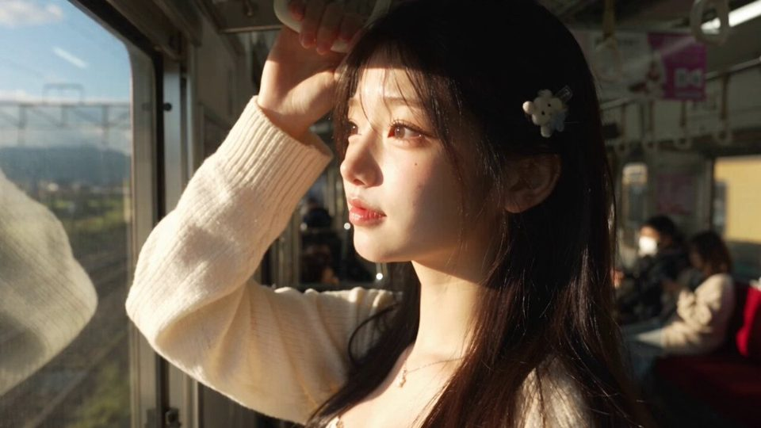</a>

- **作者:** [Mira Sterling](https://x.com/Chaemate_/status/2099439262106083704) · X · **Seedance 2.5** · ♥ 175
- **标签:** `写实电影感` `日系` `旅行城市` `爱情青春` `温暖治愈` `孤独忧郁` `角色一致性` `多镜头剪辑` `vlog`
- 车窗边整理头发的女孩，走过京都老街、鸭川和旧书店，夜里在自动售货机前买一罐饮料。

<details><summary>提示词</summary>

```text
Create a photorealistic 30-second personal travel vlog featuring the exact same woman from the reference image. Keep her face, hairstyle, physical appearance, makeup, outfit and necklace consistent throughout the entire video.

Make it feel like a real young woman casually documenting her autumn trip to Kyoto with a friend behind the camera. No commercial travel-ad look, no fast montage and no overly cinematic movements.

Keep the pacing slow and natural. Each scene should focus on one simple action. Let shots breathe and allow natural pauses. She should walk, look around and react at normal human speed. Never speed up her movement or speech to fit more into the scene.

Show quiet everyday moments around Kyoto: riding a local train in the morning, walking through a residential street, discovering a small bakery, sitting by the river, browsing a tiny stationery shop, getting caught in light rain and grabbing a warm drink from a vending machine at night.

Keep the dialogue extremely short and casual, with natural pauses. Things like “Cute…”, “So pretty”, “Mmm… good”, “Look…”, “This one?”, “Oh… rain”, “Nice…” and “One more stop.” She should never sound like she's reading a script or rushing through lines.

Use realistic handheld camera movement, subtle autofocus, natural exposure changes, real ambient sounds, natural skin texture, realistic lighting and subtle 35mm film grain. Some moments should have no dialogue at all.

The goal is simple: make it feel like an actual travel vlog someone happened to capture during a real day in Kyoto, not an AI-generated commercial.
```

</details>

### [138亿年一镜](https://daiyixiang666.github.io/awesome-ai-video-prompts/w/x-2096837494000308685.html)

<a href="https://daiyixiang666.github.io/awesome-ai-video-prompts/w/x-2096837494000308685.html"></a>

- **作者:** [Ruzaina](https://x.com/RuzainaMeer/status/2096837494000308685) · X · **Seedance 2.5** · ♥ 174
- **标签:** `写实电影感` `无明显地域` `科幻` `自然风光` `史诗壮阔` `一镜到底` `变身转场` `叙事短片`
- 从大爆炸、星系、熔岩地球、原始海洋到森林与人类，30秒走完宇宙与生命演化。

<details><summary>提示词</summary>

```text
Create a 30-second ultra-photorealistic cinematic documentary showing the evolution of the universe and life on Earth in one seamless journey.

Begin with the Big Bang and the expansion of space, then show matter forming, the first stars, galaxies, supernovae, and the birth of the Solar System and Earth. Transition to volcanic early Earth, cooling oceans, primitive single-celled life, complex marine organisms, life moving onto land, prehistoric forests, dinosaurs, early mammals, primates, hominins, and finally modern Homo sapiens.

End with a modern human looking toward the horizon as the camera rapidly pulls back from Earth to the Moon, Solar System, and Milky Way, connecting humanity to the universe.

Use continuous cinematic camera movement, seamless transitions through time and scale, realistic physics, scientifically inspired environments, natural motion, detailed animal anatomy, realistic lighting, HDR, and premium documentary cinematography.

16:9, ultra-realistic, photorealistic, emotionally powerful, scientifically grounded. No text, labels, narration, fantasy, cyberpunk, neon, or futuristic elements.
```

</details>

### [道口夕照](https://daiyixiang666.github.io/awesome-ai-video-prompts/w/x-2105508431067332749.html)

<a href="https://daiyixiang666.github.io/awesome-ai-video-prompts/w/x-2105508431067332749.html">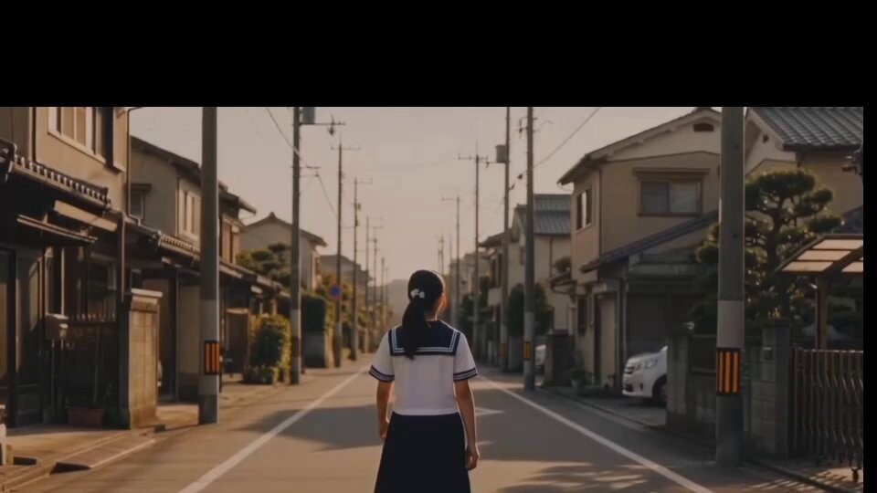</a>

- **作者:** [Maha](https://x.com/Aiwithmaha/status/2105508431067332749) · X · **Seedance 2.0** · ♥ 162
- **标签:** `写实电影感` `日系` `爱情青春` `日常生活` `温暖治愈` `多镜头剪辑` `叙事短片`
- 金色夕照下少女走过日式住宅街、铁路道口与芒草地，背影—特写—远景交替，结尾回眸一笑。

<details><summary>提示词</summary>

```text
Created a   20 seconds cinematic Japanese-style scene of a young schoolgirl walking alone through a quiet Japanese residential street during warm golden-hour sunlight, shown from behind as she slowly approaches a railway crossing with a train passing in the background, then transitioning to a close-up of her face and flower-decorated hair as she watches the train, followed by a wider shot of her standing near a quiet canal with soft evening light reflecting on the water, then showing her gently touching small white flowers in a golden field, with close-up shots of her hand and the flowers moving naturally in the breeze, gradually transitioning to a wide sunset landscape with the girl standing peacefully in the field, and finally ending with a warm close-up of her face as she softly looks toward the camera, maintaining the same character, hairstyle, school uniform, realistic skin details, natural expressions, smooth cinematic camera movement, soft depth of field, warm sunset lighting, realistic Japanese environment, subtle film grain, peaceful emotional atmosphere, and a dark fade-out at the very end.
```

</details>

### [海边起舞](https://daiyixiang666.github.io/awesome-ai-video-prompts/w/x-2088495675382394986.html)

<a href="https://daiyixiang666.github.io/awesome-ai-video-prompts/w/x-2088495675382394986.html">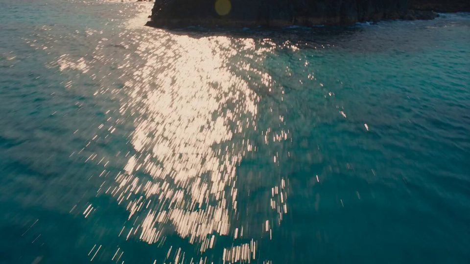</a>

- **作者:** [Julia Clark](https://x.com/JuliaClarky/status/2088495675382394986) · X · **Seedance 2.5** · ♥ 150
- **标签:** `写实电影感` `无明显地域` `爱情青春` `浪漫心动` `多镜头剪辑` `叙事短片`
- 安静海岸线上女孩赤脚在浪边转圈，男孩远远看着，夕阳下两人沿沙滩并行的远景收尾。

### [给长大后的我](https://daiyixiang666.github.io/awesome-ai-video-prompts/w/x-2092147008895426977.html)

<a href="https://daiyixiang666.github.io/awesome-ai-video-prompts/w/x-2092147008895426977.html">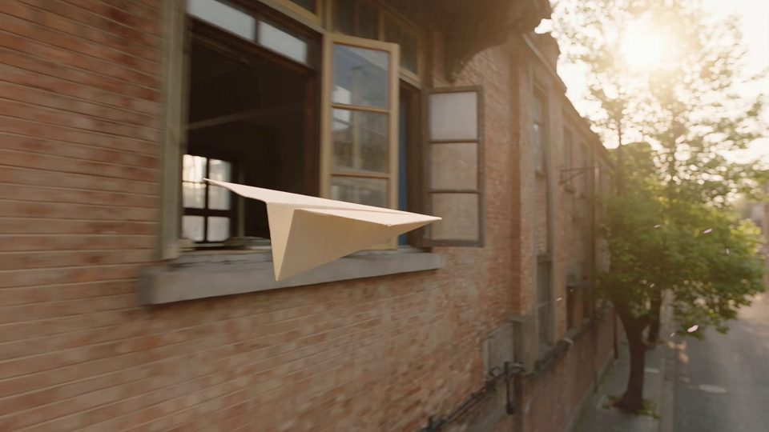</a>

- **作者:** [李岳](https://x.com/liyue_ai/status/2092147008895426977) · X · **Seedance 2.5** · ♥ 147
- **标签:** `写实电影感` `无明显地域` `日常生活` `亲情` `温暖治愈` `一镜到底` `变身转场` `叙事短片`
- 一架纸飞机穿过同一条老街的春夏秋冬，最后落进冬夜里童年自己的手中。

<details><summary>提示词</summary>

```text
生成一支15秒、16:9、720p的写实电影质感奇幻短片。全片以同一架米白色手折纸飞机为唯一主角，纸张纹理、折痕、尺寸和飞行方向始终一致。采用一镜到底的低空跟随镜头，镜头位于纸飞机后侧约半米，平稳向前移动，不突然切镜，不穿模。

0至3.5秒，清晨的老城区春日街道，樱花花瓣随微风掠过，纸飞机从一扇打开的教室窗户飞出，镜头立即跟上。柔和晨光，空气清透，只听见风声、远处鸟鸣和很轻的钢琴前奏。

3.5至7秒，纸飞机从一棵近景树冠后掠过，遮挡完成自然转场。街道进入盛夏午后，绿荫浓密，短暂阵雨落下，纸面沾上少量水珠但不破损、不变形。镜头保持相同距离和运动方向，雨声与钢琴节奏略微增强。

7至10.5秒，纸飞机贴近一辆驶过的旧公交车，利用车身遮挡转入深秋黄昏。金黄色落叶沿同一风向卷起，夕阳从画面右侧照亮纸飞机折痕。它短暂下坠后重新被气流托起，动作符合空气阻力，不瞬移。

10.5至15秒，纸飞机穿过一团近景白雾，街道进入安静冬夜，屋檐和路面覆有薄雪。镜头逐渐绕到纸飞机侧前方，露出巷口一名约八岁、穿深蓝棉衣的男孩。他抬手接住纸飞机，低头看见机翼内侧有一行稚嫩铅笔字「给长大后的我」。男孩停顿一秒，抬头望向纸飞机飞来的方向，钢琴只留下一个尾音，画面自然停住。

四季必须发生在同一条街道和同一飞行路径上，建筑空间、屏幕方向和镜头轴线连续。纸飞机全程只有一架，不改变颜色、材质、折法和大小。季节变化只通过遮挡转场、光线、植被、天气与环境声完成。禁止额外纸飞机、人物突然出现或消失、文字乱码、纸张融化、镜头跳切、画面闪烁、平台水印、字幕、旁白和多余对白。
```

</details>

### [民国窗下读书人](https://daiyixiang666.github.io/awesome-ai-video-prompts/w/x-2096836715239674181.html)

<a href="https://daiyixiang666.github.io/awesome-ai-video-prompts/w/x-2096836715239674181.html">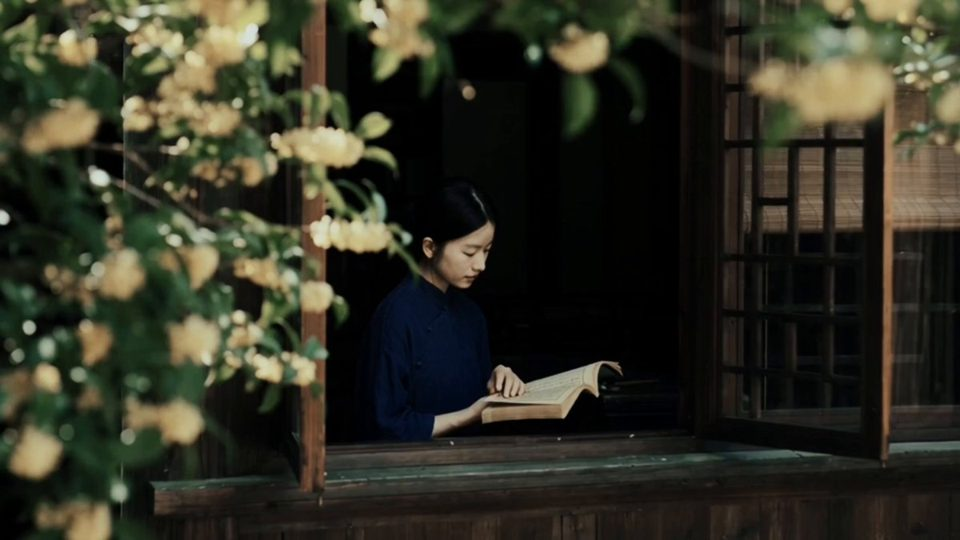</a>

- **作者:** [Harboris](https://x.com/harboriis/status/2096836715239674181) · X · **Seedance 2.5** · ♥ 123
- **标签:** `写实电影感` `中式` `历史年代` `日常生活` `孤独忧郁` `多镜头剪辑` `微表情特写` `叙事短片`
- 民国装扮的女子在花窗下读书，镜头掠过茶盏、水缸里的倒影、折扇和屋檐，最后她抬眼望向窗外。

<details><summary>提示词</summary>

```text
Subject: A graceful young East Asian woman with her hair styled in a traditional low bun, wearing a dark blue Chinese-style button-up tunic. The mood is tranquil, nostalgic, and deeply contemplative.

Style
Cinematic historical drama aesthetic. Muted, vintage color grading with deep earthy tones, soft natural shadows, and subtle film grain.

Camera & Framing
Lighting: Soft morning sunlight filtering through wooden window lattices, creating gentle dappled light patterns.

Framing: Medium framing, static window-frame shots, tracking shots across traditional courtyards, and close-ups of hands turning pages, folding fans, and pouring tea.

Effects: Shallow depth of field to isolate the subject and soft ambient blur on background foliage.

Audio
Traditional instrumental soundtrack featuring gentle Guzheng (Chinese zither) and flute melodies, layered with ambient natural sounds like wind rustling through bamboo leaves, birds chirping, and water ripples.

Realism
Photorealistic 8K rendering with authentic textures (aged paper, wooden lattices, stone tile floors, woven bamboo chairs) and natural lighting physics.

Detailed Timed Scene Breakdown

00:00 - 00:02: Medium shot of the woman sitting by an open wooden lattice window framed by blooming yellow osmanthus flowers, quietly reading a traditional thread-bound book.

00:03 - 00:03: Macro close-up of a hand gently turning the ancient textured paper page covered in Chinese characters.

00:04 - 00:05: Close-up of a white porcelain tea cup resting on a dark wooden table next to an open book and a folding hand fan, illuminated by dappled morning sunlight.

00:06 - 00:07: Medium tracking shot of her pulling back a dark blue curtain and stepping out into a covered veranda, holding her book.

00:08 - 00:09: Side profile shot as she turns her head slowly to look back over her shoulder in a traditional stone-paved courtyard.

00:10 - 00:10: Wide shot of her walking across the center of a spacious, symmetrical traditional courtyard under an overcast sky.

00:11 - 00:12: High-angle close-up looking down into a dark ceramic water jar reflecting the tile roof, with delicate osmanthus flowers floating on the water's surface.

00:13 - 00:16: Close-up of the woman gently lifting her hand to touch and smell a cluster of blooming yellow osmanthus flowers, closing her eyes as a gentle breeze moves her hair.

00:17 - 00:18: Medium shot of her standing behind a dark wooden table set with an ornate blue-and-white porcelain vase, holding a stack of books and placing a wooden bookmark.

00:19 - 00:19: Close-up of a hand snapping open a white folding paper fan.

00:20 - 00:22: Medium shot of a dense green bamboo grove swaying in the wind.

00:23 - 00:24: Medium shot of her sitting comfortably in a woven bamboo rocking chair in front of the bamboo grove, reading her book while gently fanning herself.

00:25 - 00:28: Return shot to the wooden window at dusk, where she looks directly outward holding the book as the scene softly fades out.
```

</details>

### [微缩人的家务冒险](https://daiyixiang666.github.io/awesome-ai-video-prompts/w/x-2110949238431703147.html)

<a href="https://daiyixiang666.github.io/awesome-ai-video-prompts/w/x-2110949238431703147.html">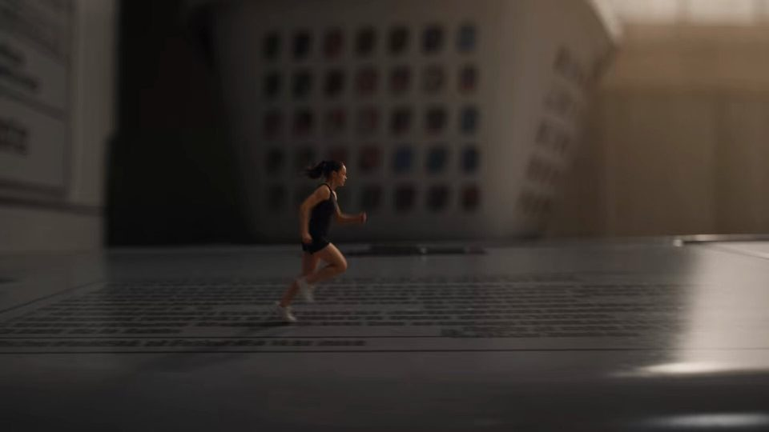</a>

- **作者:** [Duet | AI](https://x.com/Sheldon056/status/2110949238431703147) · X · **Seedance 2.5** · ♥ 114
- **标签:** `写实电影感` `无明显地域` `奇幻神话` `日常生活` `轻松欢快` `多镜头剪辑` `叙事短片`
- 微缩女孩在洗衣机、衣物堆、熨斗间奔跑攀爬，最后走钢丝般穿过晾衣绳。

### [盐原上的巨构](https://daiyixiang666.github.io/awesome-ai-video-prompts/w/x-2108047876576469260.html)

<a href="https://daiyixiang666.github.io/awesome-ai-video-prompts/w/x-2108047876576469260.html">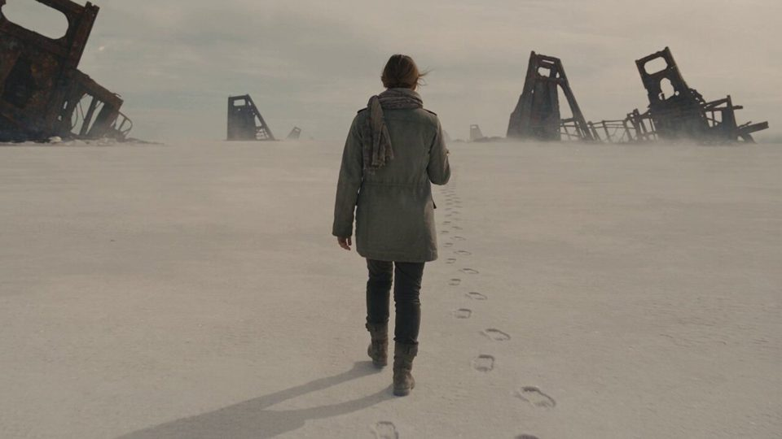</a>

- **作者:** [Johnn](https://x.com/john_my07/status/2108047876576469260) · X · **Seedance 2.5** · ♥ 109
- **标签:** `写实电影感` `无明显地域` `科幻` `悬疑惊悚` `诡异不安` `一镜到底` `叙事短片`
- 苍白盐原上，女子朝远处锈蚀巨构走去，风沙中回望，神秘科幻氛围。

<details><summary>提示词</summary>

```text
Create a 30-second ultra-realistic cinematic short film with a mysterious, surreal sci-fi atmosphere.

A vast abandoned salt plain stretches beneath a pale stormy sky. Far in the distance, enormous rusted metal structures rise from the ground like the remains of a forgotten civilization. Thin streams of glowing dust move through the air against the wind, creating an unnatural sense that time itself is behaving incorrectly.

A young woman in a simple charcoal-grey coat, dark trousers, worn leather boots, and a faded scarf walks alone across the empty landscape. She carries a small vintage mechanical compass in one hand. The camera follows her slowly from behind with natural handheld movement and subtle environmental motion.

At around 7 seconds, she notices something strange: her footprints behind her are gradually disappearing, one by one, as though the ground is erasing her past. She stops. The wind becomes almost completely silent.

She looks at the compass. Its needle spins rapidly, then suddenly points directly toward one of the distant structures.

She walks closer. As she approaches, the environment begins subtly changing around her. The sky shifts from daylight to twilight for a few seconds, then returns to daylight. Her scarf briefly moves in slow motion while everything else remains normal. Keep the transformation physically believable and understated rather than fantastical.

Cut to an intimate close-up of her face. She looks frightened but composed, realizing she has experienced this moment before. Tiny particles float past her eyes.

She slowly turns toward the camera. Behind her, the enormous structure has completely changed position without making any sound.

She gives a very slight, almost knowing smile.

Final shot: she walks toward the structure as the camera pulls far upward, revealing hundreds of identical footprints forming a massive circular pattern across the salt plain.

Photorealistic live-action cinematography, realistic human performance, natural skin texture, physically believable environments, muted grey and earth tones, soft overcast illumination, atmospheric depth, subtle film grain, restrained visual effects, realistic wind and dust simulation, cinematic lens compression, slow controlled camera movements, premium feature-film aesthetic.

Maintain consistent character identity, clothing, environment, and proportions throughout. No text, no subtitles, no logos, no artificial-looking CGI, no exaggerated fantasy effects, no montage feeling. The entire video should feel like one continuous mysterious cinematic event unfolding in real time.
```

</details>

### [烛影刀光](https://daiyixiang666.github.io/awesome-ai-video-prompts/w/x-2099319511728153007.html)

<a href="https://daiyixiang666.github.io/awesome-ai-video-prompts/w/x-2099319511728153007.html"></a>

- **作者:** [Zidan 子丹](https://x.com/liluocheng13/status/2099319511728153007) · X · **Seedance 2.5** · ♥ 88
- **标签:** `写实电影感` `中式` `武侠打斗` `紧张刺激` `多镜头剪辑` `慢动作` `叙事短片`
- 烛火与水面间，红衣女侠与斗笠刀客贴身搏杀，近身格挡寸寸见血。

<details><summary>提示词</summary>

```text
[Overall Style]
A short film that fuses Eastern wuxia aesthetics with the texture of Hollywood epic action cinema. The tone is not abstract "speed for its own sake," but rather authentic life-or-death close-quarters combat measured in inches — every dodge grazes past the opponent's blade, every counterattack carries the desperation of an all-or-nothing gamble. The camera language draws on the tight, close-combat choreography of the John Wick series and the epic scale of Game of Thrones' climactic battle episodes: high-speed exchanges interwoven with a handheld, subtly shaky live-action feel, avoiding the weightless sensation of pure CG. The pacing follows a curve of "fast — faster — a frozen instant — an explosive burst even faster — an exhausted finish," rather than sustaining a single intensity throughout. The visual tone is dark fantasy wuxia, with cold-toned lightning and warm-toned candlelight interwoven, the ring of clashing steel and the tearing of cloth running throughout — the goal is to make the audience instinctively hold their breath in the moment, not merely pile up a high volume of action information.
```

</details>

### [递过来的那瓶茶](https://daiyixiang666.github.io/awesome-ai-video-prompts/w/x-2104761209941823672.html)

<a href="https://daiyixiang666.github.io/awesome-ai-video-prompts/w/x-2104761209941823672.html">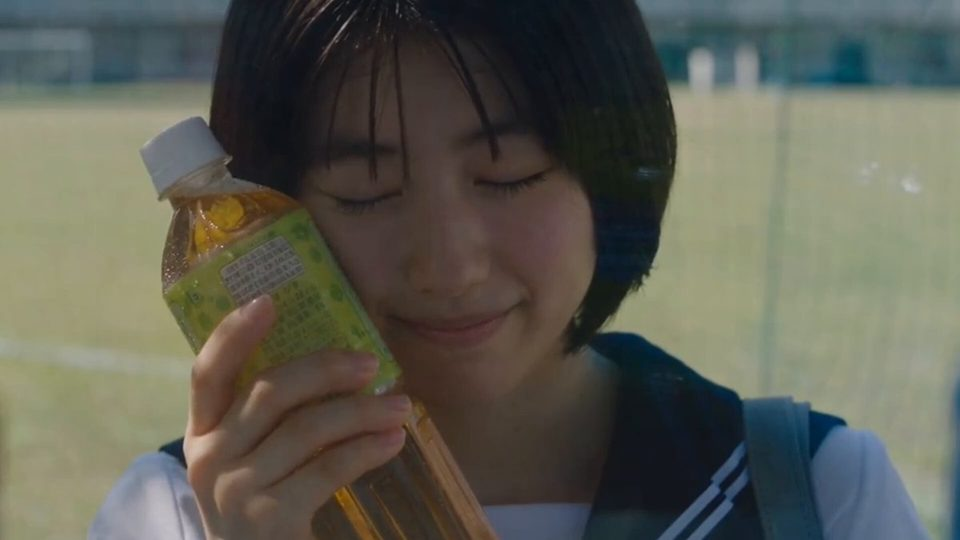</a>

- **作者:** [探路AI](https://x.com/TanLuAI/status/2104761209941823672) · X · **Seedance 2.5** · ♥ 87
- **标签:** `写实电影感` `日系` `爱情青春` `产品` `浪漫心动` `微表情特写` `多镜头剪辑` `广告TVC`
- 校园操场边，有点坏的体育生把饮料递给短发乖乖女，一来一回的眼神与小动作，结尾是饮料定格。

<details><summary>提示词</summary>

```text
参考指令：🔽 🔽 🔽
如果你是新手第一次写，可以这样下指令：

[你的剧情]+[风格]+字数限制 5000个字以上+风格，人物动作，外貌 都要细致入微的描述+ 放一段我的参考提示词

后面就是基于自己的提示词风格，做成自己的skill 进行生成即可了

完整提示词：
制作一支 30 秒、16:9 横屏、真人实拍质感的日式青春校园饮料广告。故事发生在初夏放学后，日本高中校园的足球场边。以女生为第一视觉主角，通过 “一次意外来球 — 男生带点挑衅的玩笑 — 女生漂亮回击 — 男生主动赔礼 — 两人产生好感” 的完整情绪变化，表现青春期特有的较劲、局促和心动。全片叙事清晰，动作简洁有因果，前半段有轻微冲突和运动节奏，后半段逐渐放慢，最终落到冰饮料的清凉质感与两个人之间的默契。
【整体影像风格】 真实摄影、真实校园、真实人物表演，具有日式青春运动电影的蓬勃感，以及校园爱情片细腻克制的情绪。人物之间带有一点漫画式的戏剧张力，但所有画面保持真人实拍，人体比例、足球运动、衣服摆动、汗水和光照都遵循现实物理，不出现漫画线条、卡通表情、夸张特效、速度光带或二维文字贴纸。 整体色调略微暗沉，环境采用低饱和灰绿、青蓝、藏青与暖灰，人物皮肤保持干净自然的浅暖色。树荫中的暗部轻微偏青绿，白色水手服呈柔和的米灰白，高光不刺眼，深色足球服保留织物细节。阳光照到的墙面与人物发丝带少量暖白光，避免大面积金黄、橙红和过重的青橙对比。画面具有空气感和湿润的初夏温度，但不泛灰、不糊脸、不用浓雾掩盖细节。 摄影画面清晰、细腻、低噪点。保留轻柔的镜头光学过渡与极轻微的高光晕染，不添加可见粗颗粒、老胶片划痕、脏污纹理。面部保留真实皮肤质感，但不刻意放大毛孔，不将汗水表现为密集白色颗粒。运动段的影像利落，近景的眼睛清楚，背景适度虚化，使环境依旧可辨认。
【校园环境与空间关系】 主要场景为日本高中校内的室外足球场边，时间是下午四点半左右，最后一节课结束，运动社团正在进行训练。足球场采用维护普通的短草地，局部露出被鞋底磨旧的浅色泥土；白色边线略有磨损，远处球门挂着略松的白色球网。球场外围是深绿色铁丝围网，边门敞开，边门外紧邻学生通行的小路。 自动售货机设置在球场边门外、体育器材室侧面的水泥地上，机身干净但带轻微使用痕迹，透明展示窗内排列着饮料瓶。旁边有一段膝盖到大腿高度的浅灰色矮墙，可以放饮料和学生包。女生始终位于边门外的硬质地面，男生从球场内走向她，足球从敞开的边门滚弹出来，整个故事的空间方向保持一致。 背景能看到三层浅灰白教学楼、规则排列的长窗、二楼外侧走廊、连接体育馆的有顶连廊，以及排列整齐的自行车棚。教学楼窗内偶尔有拉起的白色窗帘。少量穿白衬衫或水手服的学生结伴离校，远处足球部队员收拾训练标志盘、整理球网。背景人物自然活动，不看镜头、不抢戏，也不突然围观起哄。
【女主外貌与服装】 女主为 18 岁高中毕业年级女生，形象清秀、自然，有安静但不怯弱的气质。脸型是柔和的小椭圆脸，颧骨不突兀，下颌线自然，脸颊保留轻微的青春饱满感。深棕色眼睛清楚明亮，眼神有观察力，眉毛自然平直，眉尾柔和，没有刻意修饰的锐利眉形。鼻子比例适中，嘴唇保留自然淡粉色，表情变化主要发生在眼睛、眉梢和嘴角，不使用夸张瞪眼、鼓腮或撅嘴。 黑色齐颈短发，发尾在下颌附近自然收拢，刘海轻薄、略有不齐，侧面少量发丝随风贴近脸颊。妆容近乎素颜，没有浓眼线、假睫毛、闪亮唇釉或明显修容。额角因天气微热有一层很薄的汗意，面颊有健康的浅红色，整体清爽。 她穿白色短袖日式水手服，藏青色翻领上有两道细白线，胸前系藏青色布质领结。衣服合身但不紧绷，肩部和袖口有自然褶皱，白色布料完全不透明。深蓝百褶裙长度接近膝盖，褶线整齐，走动时轻微摆动；白色短袜搭配棕色乐福鞋，鞋面有柔和皮革光泽。左肩背深色学生包，包上只有一个小巧布质挂件。 她开场有一点被暑气困扰的疲倦，遭到足球打断后露出真实的不满，随后用行动回应男生的挑衅。她的反击干脆、有分寸，完成后只挑一下眉，不做胜利手势。结尾的笑容从忍住到轻轻浮现，带一点 “你也有今天” 的得意。 【男主外貌与服装】 男主为 18 岁高中毕业年级男生，足球部成员，身形修长，肩膀舒展，四肢有运动形成的紧实感，保持高中运动员的自然体态，不是健美式肌肉。面部轮廓清爽，脸型略长，眉毛偏浓但自然，眼睛明亮，目光自信，嘴角习惯微微偏向一侧，形成一点不太服气的坏笑。 黑色短碎发，顶部稍蓬松，额前几缕头发被汗打湿，发梢自然垂落，不使用发胶塑造硬刺。额角、鼻梁和颈部有少量汗水，脸颊因训练微微泛红。没有胡须、浓妆或刻意成熟的造型。他的 “小坏” 来自散漫站姿、带笑的目光和喜欢逗人的性格，不表现为凶狠、轻浮或故意伤害女生。 穿深蓝色短袖足球训练服，白色领边和袖口，胸前印一个简洁的白色数字 “7”，没有真实球队标识。下身为同色足球短裤，白色长球袜，其中一侧袜口比另一侧略低，白色足球鞋带少量草屑与泥痕。领口和后背有训练形成的汗湿痕迹。跑来时呼吸略急，停下后肩膀逐渐放松。 他发现球碰到女生后，先举手表达歉意，却因为对方盯着自己的表情而忍不住笑，随即用轻微挑衅的动作请她回球。被穿裆后立刻露出意外和好笑，最后主动买饮料赔礼，神情比开场认真。
【饮料与道具】 使用同一款虚构品牌的冰镇柑橘气泡饮料，500 毫升透明瓶，瓶内为极浅的淡黄色液体，白色瓶盖，淡青绿色简洁标签。标签保留清晰的品牌展示区，不使用真实品牌标识。瓶身有自然冷凝水，较大的水珠缓缓滑落，瓶内可见细小气泡。女主开场购买的饮料与男主后面购买的饮料包装完全一致。 足球为正常尺寸的白色与深蓝色拼块足球，有轻微草地使用痕迹。足球与饮料的尺寸在所有镜头中保持不变。女生的饮料放到矮墙上后，再由她本人拿回；男生购买的新饮料始终由男生持有，避免出现凭空增加或消失的瓶子。
【摄影与剪辑原则】 采用 24fps 电影运动质感，人物近景使用 50mm 至 85mm 焦段，空间建立与运动全景使用 35mm 焦段，产品细节使用 85mm 至 100mm 近摄。动作与反应交替剪辑：先展示来球，再展示女生反应；先展示男生挑衅，再展示女生处理球；穿裆动作完成后再切男生表情。关键足球动作必须在一个连续镜头中看清，不用快速碎切掩盖动作关系。 女生踢球时采用侧前方的正常低机位，完整看到鞋、足球和男生双腿之间的空间，不从裙底方向拍摄，不使用具有窥视感的角度。两个人产生好感的段落使用正面上半身双人近景，让双方的面部表情都清楚可见。
【声音总要求】 全片无背景音乐、无旋律、无钢琴、无弦乐、无电子音垫、无节奏鼓点、无旁白、无对白、无夸张卡通音效。仅使用蝉鸣、树叶声、远处模糊校园活动声、足球落地、鞋底摩擦、投币、瓶子落入取物槽、呼吸、衣料摩擦、塑料瓶轻碰、拧盖和气泡泄压声。校园环境声不出现可辨认台词，不使用带旋律的上下课铃。
[00:00–00:04] 镜头一：女生的清凉瞬间被打断 85mm 正面面部近景开场，女生站在售货机旁的树荫边缘，白色水手领与藏青领结清晰可见。她刚从取物口拿出一瓶冰饮料，将瓶身轻轻贴向右侧脸颊，眼睛短暂放松地眯起，嘴角带一点舒服的弧度。瓶身上的冷凝水在散射光下清楚可见，背景是模糊的绿色围网与浅白教学楼。 切侧前方下半身中近景：一只足球从球场边门方向低低滚弹过来，轻轻碰到她小腿外侧，然后落地停在鞋边。接触力量有限，女生只下意识缩了一下腿，身体略微后移，没有跌倒。她拿着饮料的手停住，低头看球，再迅速抬眼看向球场方向。 音效：近处轻微蝉鸣，瓶身与手指摩擦的声音，足球滚弹的两下闷响，碰到小腿的一声轻响，以及女生短促的吸气。
[00:04–00:08] 镜头二：带点坏笑的足球部男生 50mm 中景，男生从敞开的球场边门慢跑过来，鞋底带起极少量草屑。他停在距离女生约三米的位置，先举起右手，掌心朝外，表示歉意，胸口因刚跑过来轻微起伏。 切男生面部近景。他看到女生不高兴地盯着自己，嘴角忍不住偏向一侧，露出一点顽皮的笑。他用眼神指向她脚边的足球，随后手掌朝上，手指轻轻向自己勾一下，示意她把球踢回来。 切女生近景。女生没有立刻回应，视线先落在他的坏笑上，再落向足球，眉梢极轻微地扬起。她将贴在脸边的饮料放下，表情从不满变成已经有了主意的平静。 音效：足球鞋从草地踏上硬地的声音，男生轻微喘气，远处球场传来一声模糊的传球撞击声。没有口哨、挑衅台词或喜剧提示音。
[00:08–00:14] 镜头三：一脚穿裆，漂亮回击 先给 50mm 腰部以上中近景，女生把饮料稳稳放在身旁矮墙上，瓶底接触墙面发出轻响。她将左肩的学生包向上提稳，站直身体，目光落向男生两脚之间。 切 35mm 侧前方动作镜头，保留两个人的完整下半身与足球运动路径。女生用右脚鞋底轻轻踩住足球，将球向后拉十厘米左右，左脚站在球侧作为支撑。她的动作熟练而简洁，没有大幅摆腿，没有炫技盘带。男生仍然松松地站着，两脚之间留有足够空隙，以为她只会普通地把球送回来。 女生右脚抬起后，用脚内侧将球平稳而突然地推向前方。足球紧贴地面沿直线穿过男生两脚之间。男生察觉后才急忙夹腿，慢了半拍，足球已经滚到他身后。完整保留 “出脚 — 足球通过 — 男生反应” 的连续关系，球不飞起、不拐弯、不穿过身体。 音效：皮鞋底与足球表面的轻微摩擦声、一次清楚的踢球闷响、足球在硬地上快速滚动的声音、男生脚步突然调整产生的两下鞋底摩擦。
[00:14–00:18] 镜头四：他的坏笑变成服气 85mm 男生近景，他先低头看一眼自己的双腿，再回头看向已经滚远的足球，眉毛微抬，嘴角的自信停顿半拍。随后他转回头看女生，短促地呼出一口气，露出带一点无奈的笑，轻轻点头，像是承认这次输给了她。 切女生近景。她没有大笑，只微微抬起下巴，眼睛看着他，嘴角出现一个很小的得意弧度。她转身拿回矮墙上的饮料，准备离开，动作从容。 镜头保持轻盈，不加入围观学生起哄，不出现夸张受辱表情。两人的较劲是青春期的玩笑，情绪已经从小冲突转向互相注意。 音效：男生短促的呼气声、女生拿起饮料时瓶底擦过墙面的轻响、学生包带与校服的摩擦声。蝉鸣持续，但音量低于人物动作。
[00:18–00:22] 镜头五：这一瓶，算我赔礼 50mm 中近景，男生跨到紧邻的售货机前，从短裤口袋取出硬币，投入投币口，按下同款饮料的按钮。动作通过三次清楚的细节剪辑完成：硬币进入、手指按键、饮料落入取物槽。随后他俯身取出饮料，直起身，转向还未走远的女生。 切正面双人中近景。男生将新买的饮料伸向女生，伸手的幅度自然，瓶身停在她身前，不碰到她。他不再坏笑，先用眼神看向她刚被足球碰到的小腿，再看回她的脸，轻轻低一下头，以一个认真但有点不好意思的表情表达歉意。 女生看向递来的饮料，目光在新瓶子与自己手中的瓶子之间移动，嘴角渐渐松开。 音效：连续但不机械密集的投币声、按钮轻响、饮料落槽的闷响、塑料瓶被拿起的摩擦声。避免把售货机音效处理成音乐节拍。
[00:22–00:26] 镜头六：两瓶刚刚好 85mm 正面上半身双人近景，女生在画面左侧，男生在右侧，两人胸前都能看到饮料瓶。女生没有接走他的新饮料，而是举起自己原有的那瓶，轻轻碰一下他递来的瓶身，动作短小、准确。 她看着他，露出一个真正放松的笑。男生先微微怔住，随后眉眼舒展开，嘴角自然上扬。他收回瓶子，两人分别拧开自己的瓶盖，男生的动作稍早，女生紧接着完成。短暂的气泡泄压声先后响起，空气里的尴尬随之松开。 保持两个人眼神之间的联系，不突然拥抱、不牵手、不摆拍。女生的笑有一点胜利后的得意，男生的笑有一点被她吸引后的局促，情感停留在刚刚开始的校园好感。 音效：两只塑料瓶轻轻相碰的闷脆声，瓶盖螺纹转动声，两次自然的 “嘶” 声，微弱呼吸与衣料声。没有额外心跳声或浪漫音乐。
[00:26–00:30] 镜头七：冰饮料与青春的广告定格 通过瓶身近景自然切入产品画面。两瓶同款饮料并排放在浅灰色矮墙上，标签朝向镜头，冷凝水清晰，瓶内细小气泡缓缓上升。使用 85mm 至 100mm 近摄，焦点锁定前方饮料，背景适度虚化但保留校园信息。 背景中，女生坐在矮墙稍远的位置，双腿自然垂下，学生包放在身旁；男生已回到草地边缘，用脚背轻轻颠起足球，再稳稳停住，偏头看向女生，像是在试图挽回刚才的面子。女生轻轻笑起来。两个人的动作保持次要，产品始终占据主要视觉位置。 画面右侧留出干净空间，以纤细、清楚的深灰色字体出现： “
［品牌名］柑橘气泡饮” “这一口，青春来电。” 文字在第 27 秒前完整出现，持续至第 30 秒。最后构图保持稳定，允许冷凝水滑动、树叶轻晃和背景人物轻微动作，不再切换画面。品牌名称使用待替换占位，不生成真实品牌或未经确认的功能宣称。 音效：清楚但柔和的气泡细响，远处一次颠球声，树叶沙沙声与蝉鸣。结尾自然结束，不添加音乐落点。
【必须保持的执行约束】 第一幕始终先展示女生，男生在足球碰到她之后才出现。足球只轻碰小腿，不砸脸、不撞倒人物。男生的顽皮通过表情和姿态表达，不主动再次踢球攻击女生。女生的穿裆回球必须真实可见，左右脚动作连贯，足球轨迹稳定。全片只有两瓶主角饮料：女生一瓶、男生一瓶，包装一致，位置连续。人物面貌、发型、校服、球衣号码和鞋袜保持一致。 日本校园氛围贯穿每个镜头，至少在开场、运动镜头与结尾保留教学楼、绿色围网、足球场、学生制服或社团活动中的两项环境信息。画面维持略暗的青绿色阴影、柔和灰白高光和干净自然的肤色，不增加明显颗粒。全片只有环境音、动作拟音与呼吸声，不出现任何带旋律或节奏铺底的背景音乐。
```

</details>

### [雪夜牵手](https://daiyixiang666.github.io/awesome-ai-video-prompts/w/x-2108920160090272138.html)

<a href="https://daiyixiang666.github.io/awesome-ai-video-prompts/w/x-2108920160090272138.html">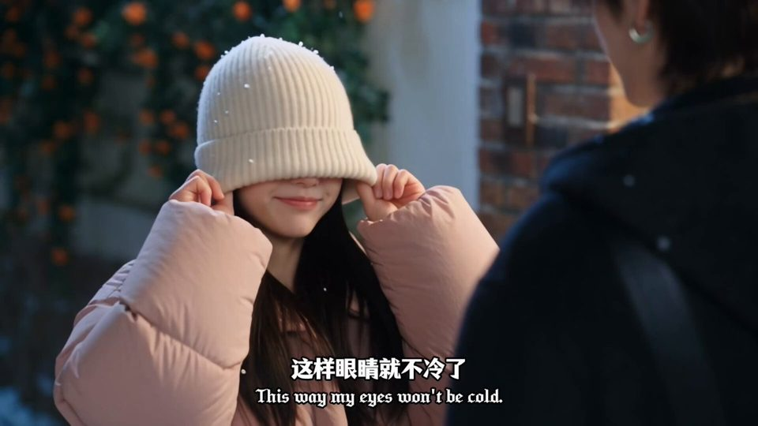</a>

- **作者:** [John](https://x.com/johnAGI168/status/2108920160090272138) · X · **Seedance 2.5** · ♥ 87
- **标签:** `写实电影感` `韩系` `爱情青春` `浪漫心动` `多镜头剪辑` `对白口型` `叙事短片`
- 冬夜小巷，戴毛线帽的女孩与男孩对话、牵手、在蓝色铁门前接吻，最后拉远成雪中远景，带双语字幕。

### [雪国车站的信](https://daiyixiang666.github.io/awesome-ai-video-prompts/w/x-2088254424510837230.html)

<a href="https://daiyixiang666.github.io/awesome-ai-video-prompts/w/x-2088254424510837230.html">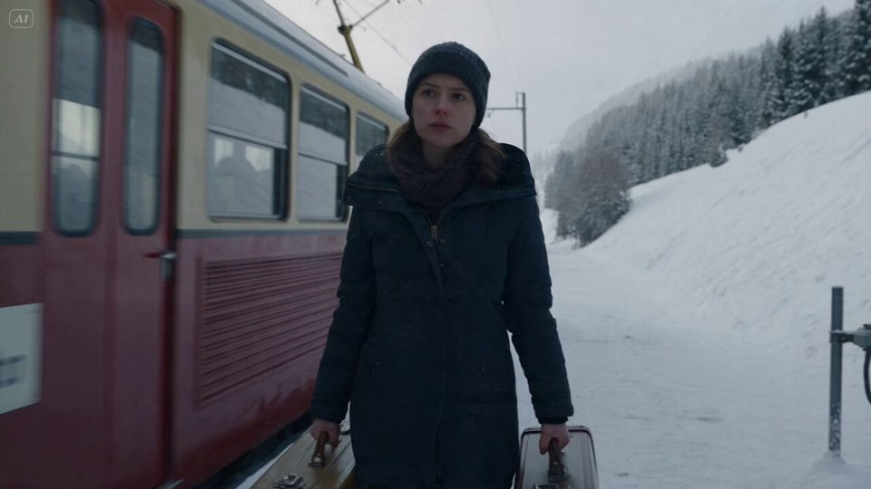</a>

- **作者:** [M-studioAi](https://x.com/Strength04_X/status/2088254424510837230) · X · **Seedance 2.5** · ♥ 83
- **标签:** `写实电影感` `欧洲` `悬疑惊悚` `亲情` `孤独忧郁` `多镜头剪辑` `叙事短片`
- 清晨小站飘着雪，女人从列车下来，在老站长的木信箱里找到一封泛黄的信，最后火车驶离雪原。

<details><summary>提示词</summary>

```text
FORMAT: 30-second realistic emotional mystery film, 4K UHD, 24fps, photorealistic European live action

TIME: 6:40 AM–7:10 AM, winter morning, light snowfall

LOCATION: Small Swiss mountain railway station, snow-covered platform, pine forest, distant mountains, old station building

CHARACTER: Woman, 30, dark winter coat, small suitcase, traveling alone

STORY: She arrives at an almost empty station and realizes the old man waiting beside her knows exactly why she came.

SEQUENCE:

00:00–00:05 → Woman steps onto the snowy platform carrying a suitcase. A small local train departs behind her.

00:05–00:09 → She checks the station sign and realizes there are no other passengers.

00:09–00:13 → An elderly man sitting on a bench looks at her suitcase and says, “Your father carried the same one.”

00:13–00:17 → She stops and looks at him. He points toward an old station locker.

00:17–00:21 → She opens the locker using a small key from her pocket. Inside is an old envelope addressed to her.

00:21–00:25 → She opens it and reads silently while snow collects on her coat.

00:25–00:28 → She looks toward the bench again. The old man is gone.

00:28–00:30 → A train approaches through the snowy valley. She holds the letter tightly and steps toward the platform edge.

CAMERA: Natural handheld European travel-documentary style, 35mm lens, controlled tracking, realistic depth, snow occasionally hitting lens, no slow motion.

PHYSICS: Snow accumulates on surfaces, suitcase wheels struggle slightly through snow, train produces displaced air and loose snow movement as it approaches.

AUDIO: Train brakes, snow crunching, wind, station announcement, paper unfolding, distant train horn.

REALISM: Authentic Swiss railway environment, realistic mountain scale, natural snowfall, believable train movement and restrained emotional performance.
```

</details>

### [窗边那封旧信](https://daiyixiang666.github.io/awesome-ai-video-prompts/w/x-2087880517819756621.html)

<a href="https://daiyixiang666.github.io/awesome-ai-video-prompts/w/x-2087880517819756621.html">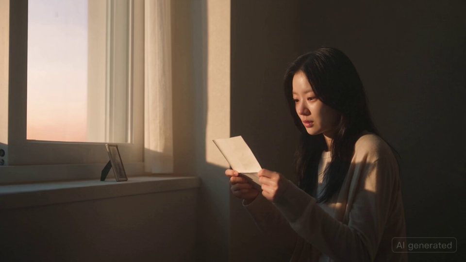</a>

- **作者:** [Sheikh Sharik 2.0](https://x.com/NoOneIsHere2603/status/2087880517819756621) · X · **Seedance 2.5** · ♥ 82
- **标签:** `写实电影感` `韩系` `爱情青春` `催泪伤感` `微表情特写` `多镜头剪辑` `叙事短片`
- 女孩在黄昏窗边读一封手写信，指尖抚过相框里的合照，泪水落下，窗外天色由粉转蓝。

<details><summary>提示词</summary>

```text
0–2 sec: A beautiful Korean girl sits alone beside a window in a quiet room, holding an old handwritten letter from her boyfriend. Soft evening light, emotional cinematic atmosphere.

3–4 sec: Close-up of her trembling hands slowly opening the letter, revealing familiar handwriting. Her eyes begin to fill with tears.

4–6 sec: She reads the letter silently, remembering beautiful moments with him through subtle cinematic flashbacks—walking together, laughing, holding hands.

7–8 sec: Her expression suddenly changes as she reads a line that says he no longer remembers her. A tear rolls down her cheek.

9–10 sec: She looks at an old photo of them together, gently touching his face in the photograph while quietly crying.

11–12 sec: She presses the letter against her chest and closes her eyes, overwhelmed by love, sadness, and memories he has forgotten.

13–15 sec: Wide cinematic shot from behind as she sits alone by the window, holding the letter. Sunset light fades around her, creating a heartbreaking, emotional ending. Realistic Korean actress, natural expressions, cinematic lighting, shallow depth of field, smooth camera movement, photorealistic, emotional storytelling, consistent character and clothing throughout.
```

</details>

### [海边小镇的夏天](https://daiyixiang666.github.io/awesome-ai-video-prompts/w/x-2100889014891168060.html)

<a href="https://daiyixiang666.github.io/awesome-ai-video-prompts/w/x-2100889014891168060.html"></a>

- **作者:** [GENEL | リアルなAI動画制作](https://x.com/genel_ai/status/2100889014891168060) · X · **Seedance 2.5** · ♥ 47
- **标签:** `写实电影感` `日系` `旅行城市` `自然风光` `温暖治愈` `多镜头剪辑` `vlog`
- 从电车车窗望见海边小镇，沿坡道、港口到道口电车，阳光通透。

### [秋刀鲑鱼的炭烤](https://daiyixiang666.github.io/awesome-ai-video-prompts/w/x-2105972717598150941.html)

<a href="https://daiyixiang666.github.io/awesome-ai-video-prompts/w/x-2105972717598150941.html">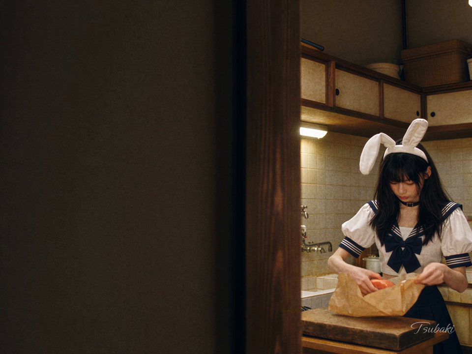</a>

- **作者:** [TSUBAKI](https://x.com/AI__TSUBAKI/status/2105972717598150941) · X · **Seedance 2.5** · ♥ 38
- **标签:** `写实电影感` `日系` `美食` `日常生活` `温暖治愈` `多镜头剪辑` `叙事短片`
- 和风料理短片：切鲑鱼、炭火烤制、配饭上桌，结尾一只兔子在院里吃菜。

### [整段路都没说出口](https://daiyixiang666.github.io/awesome-ai-video-prompts/w/tt-7697120613227416845.html)

<a href="https://daiyixiang666.github.io/awesome-ai-video-prompts/w/tt-7697120613227416845.html">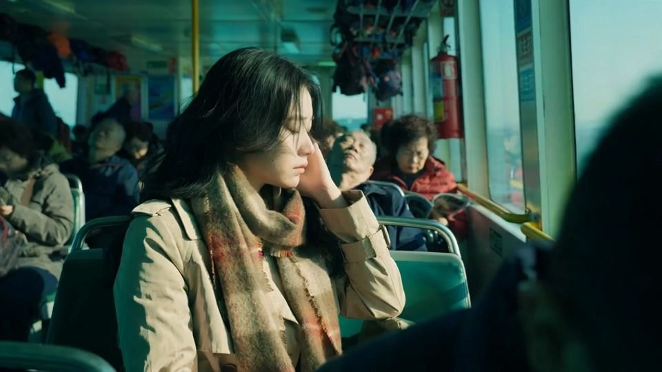</a>

- **作者:** [Fafa](https://www.tiktok.com/@jj573961/video/7697120613227416845) · TikTok · ♥ 0
- **标签:** `写实电影感` `欧洲` `爱情青春` `日常生活` `孤独忧郁` `微表情特写` `叙事短片`
- 公交车窗边围着格子围巾的女孩，车厢里的冬日光线和人群，文案是“她有一整段路可以说，却始终没说”。

### [时停回溯的餐馆](https://daiyixiang666.github.io/awesome-ai-video-prompts/w/x-2083389002552664385.html)

<a href="https://daiyixiang666.github.io/awesome-ai-video-prompts/w/x-2083389002552664385.html"></a>

- **作者:** [TechHalla](https://x.com/techhalla/status/2083389002552664385) · X · **Seedance 2.5** · ♥ 2875
- **标签:** `写实电影感` `美式` `历史年代` `轻松欢快` `时间冻结倒放` `一镜到底` `叙事短片`
- 1950年代美式餐馆里，侍者打翻托盘的瞬间时间冻结，飞溅的奶昔、煎蛋悬在空中，镜头穿行其间后整段倒带复原。

<details><summary>提示词</summary>

```text
Photorealistic cinematic 1950s American diner, chrome stools, red vinyl, neon glow and checkerboard floor, shot with modern lived-in realism and soft natural window light. Subtle handheld texture, warm practicals, rich period detail, heavy film grain.

0-4s: [Medium Wide] A striking young woman in her early 20s sits alone at the counter, calm and slightly amused, slowly sipping a tall thick milkshake through a straw. Behind her a young waitress in classic uniform approaches with a tray of eggs and bacon in one hand and a full glass coffee pot in the other. An older lady starts rising from a nearby booth.

4-8s: [Dynamic Tracking] The older lady collides hard into the waitress. Tray, plate, eggs, bacon and coffee pot explode upward in chaotic slow motion. Coffee erupts into long liquid ribbons and perfect suspended droplets. Camera immediately begins a smooth continuous orbit around the impact. Time locks completely at the peak of the spill. Every face freezes in pure shock. Only the girl at the counter keeps moving, completely unfazed.

8-17s: [Slow 360° Orbital] Camera glides in a full elegant orbit through the frozen diner. Coffee hangs in mid-air as glassy ribbons and spheres with perfect volume and surface tension. Bacon strips, eggs and the spinning tray float weightlessly. Patrons and waitress remain locked in startled expressions. The girl at the counter takes one slow, deliberate sip, eyes half-lidded, almost bored, while the entire frozen world (except her) begins an elegant reverse: every droplet, every piece of food and every person rewinds smoothly back to the exact starting positions.

17-24s: [Medium Shot] Rewind lands perfectly. Waitress stands balanced again with tray and coffee pot. The girl lifts her eyes, raises two fingers in a small casual gesture and softly calls the waitress by name. The waitress turns toward her just before the older lady begins to stand, completely avoiding the collision. A tiny private smile crosses the girl’s face.

24-30s: [Extreme Close-Up] Hard cut to her face as she takes one last slow sip. Soft knowing smile, eyes almost closed in quiet satisfaction, like she has done this a hundred times. Shallow depth of field, creamy bokeh of the neon diner behind her.

Photorealistic, ultra-detailed fluid physics, perfect motion blur only on moving elements, stable characters, cinematic lighting, heavy natural film grain, no artifacts, movie-level temporal coherence, high rewatch value.
```

</details>

### [爱德华时代的新娘枪战](https://daiyixiang666.github.io/awesome-ai-video-prompts/w/x-2113468132866355641.html)

<a href="https://daiyixiang666.github.io/awesome-ai-video-prompts/w/x-2113468132866355641.html"></a>

- **作者:** [Shami](https://x.com/ShamiWeb3/status/2113468132866355641) · X · **Seedance 2.5** · ♥ 414
- **标签:** `写实电影感` `欧洲` `历史年代` `武侠打斗` `紧张刺激` `多镜头剪辑` `预告片`
- 雾中马车追逐，穿婚纱的新娘探身开枪，骑手落马，最后新娘站在街灯下。

### [维多利亚的草地梦](https://daiyixiang666.github.io/awesome-ai-video-prompts/w/x-2111638394233045069.html)

<a href="https://daiyixiang666.github.io/awesome-ai-video-prompts/w/x-2111638394233045069.html"></a>

- **作者:** [Maria](https://x.com/thisismariaa25/status/2111638394233045069) · X · **Seedance 2.5** · ♥ 164
- **标签:** `写实电影感` `欧洲` `历史年代` `时尚美妆` `浪漫心动` `慢动作` `MV`
- 身着玫红维多利亚长裙的女孩在草地上躺卧、吹肥皂泡、俯身看水塘，背景有奶牛与古宅。

### [海边的放学路](https://daiyixiang666.github.io/awesome-ai-video-prompts/w/x-2111654730028196093.html)

<a href="https://daiyixiang666.github.io/awesome-ai-video-prompts/w/x-2111654730028196093.html"></a>

- **作者:** [GENEL | リアルなAI動画制作](https://x.com/genel_ai/status/2111654730028196093) · X · **Kling 4.0** · ♥ 110
- **标签:** `写实电影感` `日系` `爱情青春` `浪漫心动` `孤独忧郁` `对白口型` `叙事短片`
- 日本高中生男女在黄昏海边并肩走，聊着未来的志愿，女生笑着回头，日文字幕。

### [瑞士山道速降](https://daiyixiang666.github.io/awesome-ai-video-prompts/w/x-2111553161525964874.html)

<a href="https://daiyixiang666.github.io/awesome-ai-video-prompts/w/x-2111553161525964874.html"></a>

- **作者:** [TSUBAKI](https://x.com/AI__TSUBAKI/status/2111553161525964874) · X · **Seedance 2.5** · ♥ 13
- **标签:** `写实电影感` `欧洲` `运动极限` `紧张刺激` `一镜到底` `vlog`
- 一镜到底：长板选手在瑞士阿尔卑斯山谷的双车道上高速速降，跟拍镜头贴地追随。

<details><summary>提示词</summary>

```text
A single continuous 30-second take with no cuts. Rider, an adult male downhill longboarder, bombs a two-lane mountain road down a green Swiss alpine valley at extreme speed. The road is smooth grey asphalt with a white dashed centre line, a metal guardrail on the valley side, and white-and-black roadside marker posts. On one side, a steep bright-green meadow rises with old wooden Swiss chalets with red-brown shutters and dark timber barns. On the other side, dense dark conifer forest falls away into the valley. Forested mountains with green pasture clearings fill the distance, with low white clouds drifting across the peaks under a bright overcast sky. There are wooden utility poles along the road.

[Rider]
Rider wears a white full-face downhill helmet with a dark visor, so his face is never visible. He wears a plain white T-shirt, slim grey pants and black-and-white low-top skate shoes. He wears black slide gloves with round white hard pucks on the palms. He rides a long downhill board with black grip tape and bright red urethane wheels.

[Image Quality]
Ultra-high-definition 8K, with crisp, razor-sharp detail on Rider, his clothing folds, the glove pucks, the board and the red wheels. The asphalt grain, the meadow grass, the chalet wood and the distant tree lines are finely resolved. It has a clean, high-end action-camera look with no compression artifacts, no noise and no smearing. Rider stays sharp while the roadside streaks with strong directional motion blur.

[Camera and Look]
A low chase camera follows him like real raw-run footage: a wide-angle action lens about 1.5 meters off the ground, 3 to 4 meters behind, with natural high-frequency vibration from the road. The camera never stays dead-centre. It drifts left and right with each corner and keeps Rider on the left or right third, so the next corner and the open road ahead are always readable. The look is ultra-realistic documentary sports footage in natural soft overcast daylight, with no slow motion.

[Speed Rule]
Speed is everything in this video. From the first frame Rider is already travelling at over 100 km/h, and he never visibly slows down. Every corner is taken at full speed. His hand touches the asphalt only as a light, fast dab for balance and grip, never as a braking slide, and the board stays nearly straight. Immediately after each corner he snaps back into a deep tuck and keeps accelerating, so each straight is faster than the last. The motion blur, the white dashes flicking past rapidly and the wind tearing at his T-shirt never ease off.

[Stage 1 / approx. 0–3s] Instant corner
The video opens mid-run at full speed with a fast right-hand curve already arriving. Rider leans hard into it in a low crouch, dabs his gloved right hand on the asphalt with a quick scrape and sweeps through the apex without losing speed. The camera swings around the outside of the curve, and the guardrail whips past in the foreground.
End state: Rider exiting the curve, still at full speed.

[Stage 2 / approx. 3–10s] Acceleration straight
Continue from the previous stage. Rider snaps into a deep aero tuck: front knee bent, back knee tucked behind the front calf, chest low, hands clasped behind his back. The road drops steeply down the valley. The chalets on the meadow side and the utility poles flash past one after another, and the white centre dashes strobe under the camera. His T-shirt ripples violently in the wind.
End state: Rider at an even higher speed, with a left-hand curve rushing toward him.

[Stage 3 / approx. 10–17s] Corner with oncoming car
Continue from the previous stage. Rider dives into the left-hand curve at full speed, dabs his left hand on the asphalt and holds a tight inside line. Right at the exit, a white compact car appears coming uphill in the opposite lane and passes within a few meters in a heavy rush of wind. Rider stays low and committed in his own lane, without flinching or braking. The camera lets the car pass through the edge of the frame and then settles back behind him.
End state: The car is gone and Rider is back in his tuck, still accelerating.

[Stage 4 / approx. 17–23s] Right-left switchback
Continue from the previous stage. A quick right curve flows straight into a left curve. Rider carves through both at full speed, with one fast hand dab on each side and his shoulders rolling with the road. The camera follows close, its horizon tilting slightly with each lean.
End state: Rider exits onto the longest, steepest straight of the run.

[Stage 5 / approx. 23–30s] Top speed
Continue from the previous stage. Rider is in his deepest, tightest tuck, and this is the fastest moment of the whole video. The roadside smears into pure streaks of green and grey while the valley and mountains ahead stay steady. The wheels hum at a high pitch, and the board is perfectly stable.
End state: Rider at absolute top speed, small against the huge green valley, still pulling away down the road.

[Maintain Consistency]
One rider only, always the same Rider with the same white helmet with the visor down, white T-shirt, grey pants, black gloves and red-wheeled board. His face is never shown. He always rides downhill in the same direction of travel. The car stays in the opposite lane and passes once. The take is one continuous shot with no cuts, no slow motion, no slowing down and no on-screen text.

Audio is raw on-board sound only, with no music: <roaring wind buffeting the camera>, <constant hard rumble of urethane wheels on asphalt>, <quick gritty scrapes of the glove pucks on the road>, <a car engine growing louder then a sharp whoosh as it passes>, <the wheel hum rising in pitch as the speed climbs>.
```

</details>

### [冬日唱片店](https://daiyixiang666.github.io/awesome-ai-video-prompts/w/x-2114729417218167119.html)

<a href="https://daiyixiang666.github.io/awesome-ai-video-prompts/w/x-2114729417218167119.html"></a>

- **作者:** [TSUBAKI](https://x.com/AI__TSUBAKI/status/2114729417218167119) · X · **Kling 4.0** · ♥ 7
- **标签:** `写实电影感` `日系` `音乐舞蹈` `日常生活` `温暖治愈` `多镜头剪辑` `叙事短片`
- 雪夜的唱片店：唱针落下、手指划过唱片架、窗外飘雪、暖色灯光下的室内。

### [屋顶之战](https://daiyixiang666.github.io/awesome-ai-video-prompts/w/x-2021394940757209134.html)

<a href="https://daiyixiang666.github.io/awesome-ai-video-prompts/w/x-2021394940757209134.html"></a>

- **作者:** [Ruairi Robinson](https://x.com/RuairiRobinson/status/2021394940757209134) · X · **Seedance 2.0** · ♥ 8863
- **标签:** `写实电影感` `美式` `武侠打斗` `紧张刺激` `热血燃` `多镜头剪辑` `预告片`
- 两位好莱坞巨星脸的角色在洛杉矶天台对打，动作和镜头接近大片。

### [雨中 F1](https://daiyixiang666.github.io/awesome-ai-video-prompts/w/x-2046730453139276011.html)

<a href="https://daiyixiang666.github.io/awesome-ai-video-prompts/w/x-2046730453139276011.html"></a>

- **作者:** [TechHalla](https://x.com/techhalla/status/2046730453139276011) · X · **Seedance 2.0** · ♥ 8683
- **标签:** `写实电影感` `欧洲` `运动极限` `汽车` `喜剧搞笑` `紧张刺激` `变身转场` `梗段子`
- 暴雨中的 F1 赛道转播画面，赛车变成气垫船，最后鳄鱼爬上赛道追车手。

<details><summary>提示词</summary>

```text
[CINEMATIC SETUP]
Real TV Broadcast style. Shot on 35mm lenses with high-shutter speed to capture water droplets.

Color grade: Natural, overcast race aesthetic matching the lighting in [ref img] .

Audio: Immersive spatial sound with high-pitched engine whirring, heavy water splashing, and dramatic sports commentary muffled by engine noise.

[IMAGE REFERENCES / LEGEND] 
[ref img] : The starting grid at Autodromo Nazionale Monza. Use this for the exact hovercraft designs, the wet track texture, and the "LIVE SPORTS" UI overlay.    

[TIMELINE SECOND BY SECOND] 

0-3s: [Wide shot] Match [ref img]  perfectly. The red lights vanish; the hovercrafts accelerate instantly with massive "rooster tail" water spray. Realistic physics as the crafts lift off the wet asphalt.

3-7s: [Aerial Drone tracking shot] High-angle view following the pack into a sharp curve. Two hovercrafts   lose stability, skip across the water's surface, and land into the grass/mud runoff, creating a debris cloud.

7-11s: [Close-up tracking shot] Focus on the head of the race. A blue "TechHalla Aqua" craft attempts an aggressive overtake. Suddenly, a large crocodile lunges from the trackside water, biting into the thick rubber tire of the chasing craft. The craft jerks and spins out of control.

11-15s: [Ground-level wide shot] The hovercraft comes to a stop. The bald with beard pilot frantically climbs out of the cockpit. The crocodile crawls onto the track toward him. The shot ends with the pilot running toward the camera as the crocodile pursues.
```

</details>

### [Kalshi 疯狂广告](https://daiyixiang666.github.io/awesome-ai-video-prompts/w/x-1932893260399456513.html)

<a href="https://daiyixiang666.github.io/awesome-ai-video-prompts/w/x-1932893260399456513.html"></a>

- **作者:** [PJ Ace](https://x.com/PJaccetturo/status/1932893260399456513) · X · **Veo 3** · ♥ 4365
- **标签:** `写实电影感` `广告大片` `美式` `喜剧搞笑` `运动极限` `热血燃` `轻松欢快` `多镜头剪辑` `广告TVC`
- GTA 风格的 NBA 总决赛广告，十个疯癫角色轮番登场，真的在电视网播出。

### [面条宗师](https://daiyixiang666.github.io/awesome-ai-video-prompts/w/x-2036407484836094014.html)

<a href="https://daiyixiang666.github.io/awesome-ai-video-prompts/w/x-2036407484836094014.html"></a>

- **作者:** [Latte](https://x.com/0xbisc/status/2036407484836094014) · X · **Seedance 2.0** · ♥ 3121
- **标签:** `写实电影感` `中式` `美食` `武侠打斗` `热血燃` `多镜头剪辑` `慢动作` `叙事短片`
- 功夫厨师在暗调厨房里拉面、甩锅，动作如武打，蒸汽淡出收尾。

<details><summary>提示词</summary>

```text
SUBJECTS:
Subject 1: Lean kung fu chef with short, sharp-cut hair and defined jawline. Wears a modernized Chinese chef outfit fused with martial arts attire: fitted sleeveless upper garment with mandarin collar, dark matte fabric with subtle sheen; forearms wrapped with cloth bands for grip; loose tapered pants allowing wide stances; soft-soled shoes for silent footwork. Limbs slightly exaggerated in length; wrists highly flexible, elbows explosive. Movements follow clear martial rhythm (pause → burst → lock), with grounded footwork and fast pivots.

ENVIRONMENT:
Traditional Chinese open-fire stove setup; iron wok fixed on stove; reflective metal counter; blue-and-white porcelain bowl placed in foreground center. Warm overhead light combined with intense dynamic firelight; light oil smoke and visible heat distortion.

MOOD:
High tension, aggressive, but controlled and precise; performance feels intentional and elegant rather than chaotic.

TIMELINE:
0:00-0:02: Extreme close-up, wide-angle POV. The chef stands on the ground behind the counter (counter always between camera and chef), steps in, compresses posture, then snaps his head up to lock eyes with camera. Both hands grip dough—he stretches it in one clean pull, folds once, then pulls again. The dough transitions from a single mass into a small number of even strands.

0:02-0:05: Cut. Slight handheld motion. The chef keeps full control of the noodle bundle in both hands, stretching and aligning the strands into clean, parallel lines through fold → align → stretch cycles. Around 8–12 thin strands extend in smooth arcs, passing close to the lens in clean, readable motion. He finishes the pull and places the aligned noodle bundle neatly onto the counter in front of him.

0:05-0:07: Move (slight recoil then stabilize). The chef lowers into a sliding step behind the counter. One palm sweeps across the surface—shrimp and greens lift and travel in a controlled arc into the wok. The wok remains on the stove; the chef grips only the handle. Any stray ingredient is clearly caught and redirected into the wok.

0:07-0:10: Continuous shot. The chef controls the wok only through handle movement and qi force—no hands enter the wok. He lifts, tilts, and snaps the wok using wrist power; ingredients rise, rotate, and fall back into the wok. His elbow strikes the stove edge—sparks burst. He compresses the wok into the flame, then reverses to pull the flame upward into a second controlled flare.

0:10-0:12: Match move tracking. The chef pivots while holding the wok handle. With the other hand, he picks up the same noodle bundle from the counter and feeds it directly into the wok in one controlled motion. He immediately resumes tossing using the wok—three clean toss cycles (fast → faster → stop). Shrimp, greens, and noodles integrate visibly; sauce coats evenly.

0:12-0:15: Cut to stabilized POV. Sudden full stop. The chef tilts the wok and slides the finished dish into the porcelain bowl—visible: evenly coated noodles, plump shrimp, glossy greens. He lifts and presents the bowl directly toward the camera until it fills the frame. A finger taps the rim—subtle vibration. Steam rises rapidly, expanding until it fully covers the lens for a clean fade-out.
```

</details>

<a id="video-surreal-dream"></a>
## 视频 · 超现实梦境

### [坠入木构要塞](https://daiyixiang666.github.io/awesome-ai-video-prompts/w/x-2013359530919223703.html)

<a href="https://daiyixiang666.github.io/awesome-ai-video-prompts/w/x-2013359530919223703.html">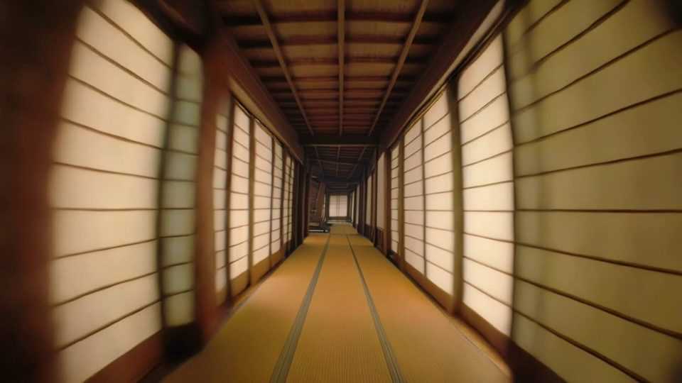</a>

- **作者:** [MayorkingAI](https://x.com/MayorKingAI/status/2013359530919223703) · X · **Kling 2.6** · ♥ 777
- **标签:** `超现实梦境` `游戏CG` `日系` `奇幻神话` `紧张刺激` `第一人称` `一镜到底` `演示教程`
- FPV镜头从和室走廊坠入无尽的木构要塞，楼梯翻转、房间旋转，灯笼螺旋掠过。

<details><summary>提示词</summary>

```text
Inside a colossal Japanese-inspired fortress suspended in darkness, endless wooden halls with shoji screens, torii-like beams, tatami floors, and layered staircases stack vertically in impossible symmetry. The Hyperspeed FPV camera drops instantly into a vertical free fall, accelerating brutally through the core of the structure. Lantern-lit corridors slide past sideways, staircases invert, and entire rooms rotate as the camera descends. A fast but controlled spin blends into the fall, twisting red paper lanterns, carved wooden pillars, and sliding doors into precise cinematic spirals while preserving spatial clarity. The environment feels heavy and real—aged wood textures, rice paper walls flexing in the wind, massive support beams rushing inches from the lens. Motion blur remains intense yet readable, anchored by warm lantern light and deep shadows. Audio is grounded and immersive: roaring wind, creaking timber, sharp air-cutting whooshes synced to acceleration, and a dark cinematic score with Japanese-inspired percussion driving relentless momentum. Realistic lighting, dramatic contrast, epic scale, one-shot cinematic realism
```

</details>

### [报纸过山车](https://daiyixiang666.github.io/awesome-ai-video-prompts/w/x-2111381027008688393.html)

<a href="https://daiyixiang666.github.io/awesome-ai-video-prompts/w/x-2111381027008688393.html">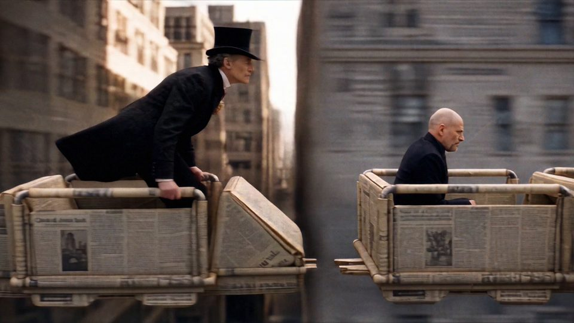</a>

- **作者:** [Lisa Rodin](https://x.com/Lisa__Rodin/status/2111381027008688393) · X · **Kling 4.0** · ♥ 637
- **标签:** `超现实梦境` `美式` `旅行城市` `喜剧搞笑` `轻松欢快` `多镜头剪辑` `叙事短片`
- 穿礼服的男人坐在报纸折成的过山车上穿越纽约高楼。

### [云端孤峰之家](https://daiyixiang666.github.io/awesome-ai-video-prompts/w/x-2107096810783461509.html)

<a href="https://daiyixiang666.github.io/awesome-ai-video-prompts/w/x-2107096810783461509.html">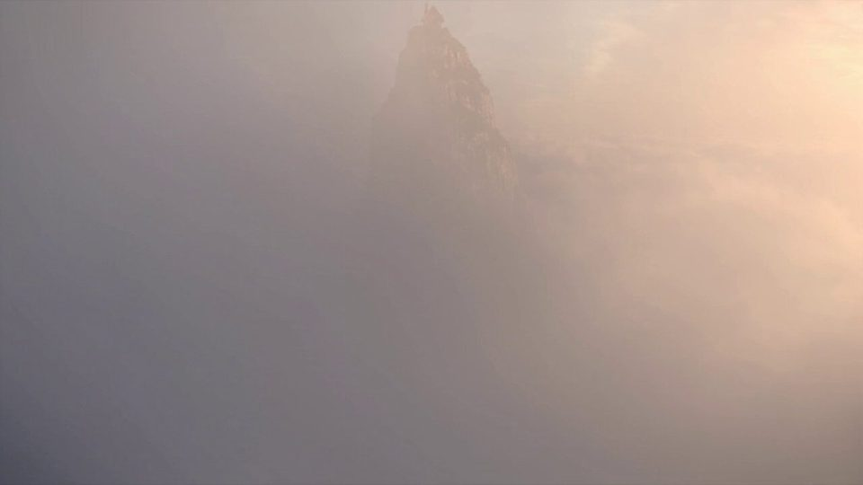</a>

- **作者:** [Sophia](https://x.com/sophiaparkerr_/status/2107096810783461509) · X · **Seedance 2.5** · ♥ 310
- **标签:** `超现实梦境` `无明显地域` `日常生活` `奇幻神话` `温暖治愈` `角色一致性` `多镜头剪辑` `叙事短片`
- 红裙女子拎着面包爬上云海孤峰石阶，推门进入小屋，倚窗看云。

<details><summary>提示词</summary>

```text
Create a cinematic, photorealistic 30-second vertical video using the provided girl reference image as the strict character reference.

Preserve her exact facial identity, facial structure, skin tone, hairstyle, age, and natural proportions throughout the entire video. Do not change her identity or facial features.

Character: The same woman from the reference image, wearing an elegant deep burgundy/red long-sleeve midi dress with a subtle vintage pattern, a matching belt, and elegant burgundy high heels. She carries a simple brown kraft-paper grocery bag containing a few visible groceries.

Shot 1 — 0–5 sec

Begin with a breathtaking aerial establishing shot high above the clouds. A gigantic, extremely tall, narrow rocky mountain spire rises vertically through a sea of white clouds. The peak is covered with patches of green vegetation, with a tiny charming house perched impossibly at the very top.

Slow cinematic drone movement toward the mountain. Bright blue sky, warm sunlight, soft atmospheric haze, realistic clouds, immense sense of scale.

Shot 2 — 5–10 sec

Cut to a close-up of the woman's feet as she carefully climbs uneven stone steps carved into the side of the mountain.

Her burgundy high heels step naturally from one stone ledge to another. The hem of her dress moves gently in the wind. Far below, clouds and the distant landscape are visible.

Use realistic foot movement, natural weight, physically accurate fabric motion, shallow depth of field, cinematic lens.

Shot 3 — 10–15 sec

Reveal the woman from a side/back angle as she continues climbing toward the summit.

She carries the brown grocery bag naturally in one hand. Her burgundy dress flows slightly in the strong mountain breeze.

The camera slowly tracks beside her, revealing the enormous drop and clouds stretching endlessly below. She remains calm and composed despite the surreal height.

Shot 4 — 15–20 sec

The woman reaches the tiny house at the summit and walks through its doorway while still holding the grocery bag.

Transition from the bright outdoor environment into a warm, cozy interior. Golden sunlight enters through the doorway. She walks naturally through the small home and places the grocery bag inside.

Maintain the exact same character appearance, dress, hairstyle, and proportions.

Shot 5 — 20–26 sec

Show the woman standing inside the cozy house beside a huge floor-to-ceiling window overlooking the clouds.

She pauses with a cup in her hand and looks peacefully toward the breathtaking view. The camera slowly moves backward, revealing the warm interior, wooden furniture, soft curtains, and the enormous mountain landscape outside.

Golden-hour lighting, subtle curtain movement, realistic shadows, cinematic atmosphere.

Shot 6 — 26–30 sec

Return to a spectacular wide aerial shot of the entire impossibly tall mountain spire rising above the clouds.

The tiny house is visible at the very top, emphasizing the incredible scale. Slowly pull the camera farther away until the mountain becomes surrounded by an endless sea of clouds.

End on a beautiful cinematic wide shot.

Visual style: ultra-realistic cinematic photography, premium film look, natural skin texture, realistic physics, realistic fabric and hair movement, volumetric sunlight, atmospheric perspective, detailed environments, subtle film grain, shallow depth of field where appropriate, high dynamic range, smooth camera motion, believable lighting.

Camera: cinematic drone shots, slow tracking shots, low-angle detail shots, gentle push-ins, smooth aerial pullback, realistic handheld micro-movements only when appropriate.

Important: Keep the woman's identity perfectly consistent across every shot. No face morphing, no character changes, no extra fingers, no distorted hands, no warped feet, no duplicated objects, no floating objects, no unnatural body movement, no cartoon or CGI appearance, no text, no subtitles, no logos.
```

</details>

### [倒悬威尼斯](https://daiyixiang666.github.io/awesome-ai-video-prompts/w/x-2101881835290845251.html)

<a href="https://daiyixiang666.github.io/awesome-ai-video-prompts/w/x-2101881835290845251.html">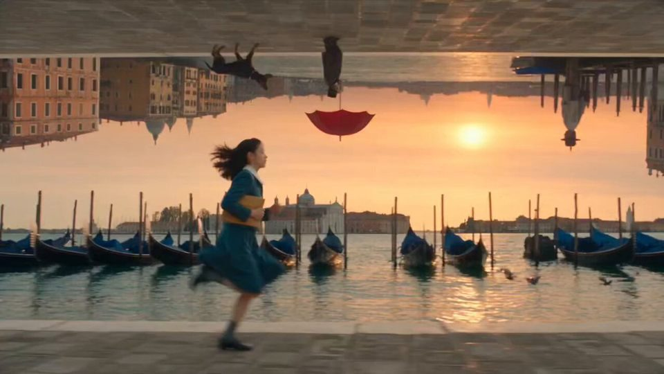</a>

- **作者:** [Lavinia](https://x.com/laviniavelle/status/2101881835290845251) · X · **Seedance 2.5** · ♥ 248
- **标签:** `超现实梦境` `欧洲` `奇幻神话` `旅行城市` `紧张刺激` `多镜头剪辑` `叙事短片`
- 女子握黄色信封奔跑，头顶倒挂着威尼斯，穿过埃舍尔式阶梯、水果市场与红瓦屋顶。

<details><summary>提示词</summary>

```text
A cinematic dynamic action video prompt visual surrealism a young East Asian woman in a classic vintage teal dress holding a yellow envelope running fast through a dreamlike surreal Venice dynamic camera movement upside down reflection of Venice city hanging from the sky creating a mind bending mirror dimension illusion running across Venetian brick alleys climbing M.C Escher style twisting stone staircases leaping over a massive gap with a bright rainbow in the golden hour sky sprinting past a busy outdoor fruit market with red apples falling standing on classic red-tile rooftops at golden sunset, dynamic fast tracking shot cinematic lighting, 8k resolution, ultra-detailed photorealistic shot on 35mm lens, depth of field masterpiece.
```

</details>

### [海啸漩涡吞城](https://daiyixiang666.github.io/awesome-ai-video-prompts/w/x-2079876385477480645.html)

<a href="https://daiyixiang666.github.io/awesome-ai-video-prompts/w/x-2079876385477480645.html"></a>

- **作者:** [Noura](https://x.com/noorwithwifi/status/2079876385477480645) · X · **Seedance 2.0** · ♥ 243
- **标签:** `超现实梦境` `写实电影感` `无明显地域` `灾难` `史诗壮阔` `紧张刺激` `一镜到底` `演示教程`
- 巨浪卷成漩涡把摩天楼裹进浪壁，城市倒悬，镜头被吸入燃烧的漩涡中心。

<details><summary>提示词</summary>

```text
A surreal apocalyptic cinematic sequence where reality folds in on itself: a colossal tsunami curls into a gigantic ocean vortex with skyscrapers embedded inside its walls, fires, explosions, and a tilting cargo ship caught in the chaos. The sky transforms into an upside-down floating metropolis while smoke, clouds, and glowing fires engulf the streets below. A mirrored city hangs above a modern skyline as black smoke, falling debris, and massive explosions connect both worlds. The camera races through a colossal portal-like vortex formed by curved bridges, swirling oceans, fractured land, and spinning skyscrapers, ending in a blazing fireball at the eye of the storm. Ultra-realistic, hyper-detailed, cinematic lighting, volumetric clouds, dynamic camera movement, epic scale, IMAX quality, 8K.
```

</details>

### [通往2001年的门](https://daiyixiang666.github.io/awesome-ai-video-prompts/w/tt-7532877935301135647.html)

<a href="https://daiyixiang666.github.io/awesome-ai-video-prompts/w/tt-7532877935301135647.html">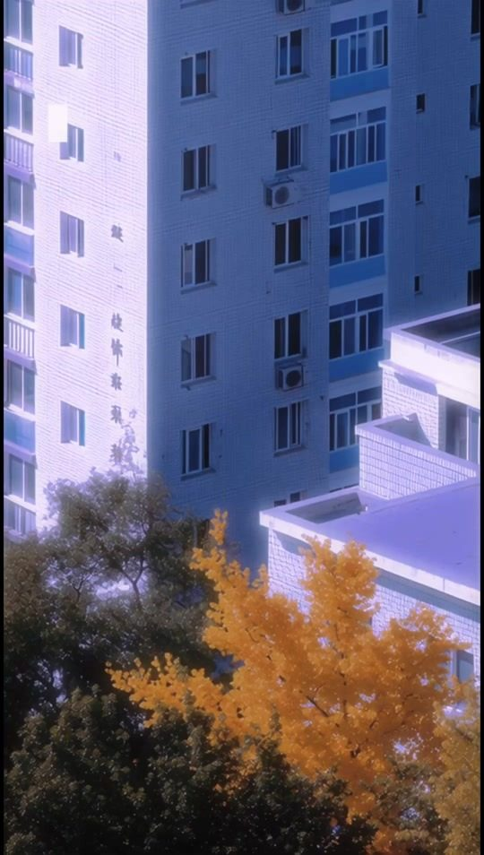</a>

- **作者:** [weirdo_chen](https://www.tiktok.com/@weirdochen433/video/7532877935301135647) · TikTok · **即梦** · ♥ 26
- **标签:** `超现实梦境` `胶片复古` `中式` `日常生活` `孤独忧郁` `第一人称` `变身转场` `叙事短片`
- 梦核POV：推开家里厨房的门就是童年的游乐园和信息课教室，千禧年的记忆片段在梦的逻辑里串起来。

### [黑暗奇幻·写实](https://daiyixiang666.github.io/awesome-ai-video-prompts/w/tt-7501787033094917406.html)

<a href="https://daiyixiang666.github.io/awesome-ai-video-prompts/w/tt-7501787033094917406.html"></a>

- **作者:** [Morgath](https://www.tiktok.com/@morgath_/video/7501787033094917406) · TikTok · **Midjourney** · ♥ 160万
- **标签:** `超现实梦境` `欧洲` `奇幻神话` `孤独忧郁` `诡异不安` `MV`
- Morgath 的黑暗奇幻怀旧短片：深蓝洞穴中静坐的黑骑士，配氛围音乐。

### [宇宙碎片](https://daiyixiang666.github.io/awesome-ai-video-prompts/w/tt-7611466285204950285.html)

<a href="https://daiyixiang666.github.io/awesome-ai-video-prompts/w/tt-7611466285204950285.html"></a>

- **作者:** [Enter The Void](https://www.tiktok.com/@enterthevoidstudio/video/7611466285204950285) · TikTok · **Midjourney** · ♥ 13.3万
- **标签:** `超现实梦境` `无明显地域` `科幻` `史诗壮阔` `孤独忧郁` `MV`
- Enter The Void 的清醒梦风格短片：沙漠中的红袍人仰望裂开的星云墙。

### [万神殿陨落](https://daiyixiang666.github.io/awesome-ai-video-prompts/w/x-2089362073021300852.html)

<a href="https://daiyixiang666.github.io/awesome-ai-video-prompts/w/x-2089362073021300852.html"></a>

- **作者:** [Timeless](https://x.com/Timeless_aiart/status/2089362073021300852) · X · **Midjourney + Seedance 2.5** · ♥ 2881
- **标签:** `超现实梦境` `无明显地域` `科幻` `灾难` `史诗壮阔` `多镜头剪辑` `预告片`
- 15 秒的末日城市段落，飞行器掠过高楼，淡彩画风极具氛围。

<a id="video-game-cg"></a>
## 视频 · 游戏CG

### [浮岛集市俯冲](https://daiyixiang666.github.io/awesome-ai-video-prompts/w/x-2039723026124575231.html)

<a href="https://daiyixiang666.github.io/awesome-ai-video-prompts/w/x-2039723026124575231.html"></a>

- **作者:** [Pan](https://x.com/sebatheepan/status/2039723026124575231) · X · **Seedance 2.0** · ♥ 715
- **标签:** `游戏CG` `其他地域` `奇幻神话` `紧张刺激` `史诗壮阔` `一镜到底` `第一人称` `演示教程`
- 滑翔者驾生物机械翼俯冲穿过悬浮岛屿集市，掠过飞艇、狮鹫与商贩，云海间连续穿梭。2K原片。

<details><summary>提示词</summary>

```text
A daring aerial rogue diving on a bio-mechanical glider through a chaotic floating-island bazaar, weaving effortlessly through airborne merchants, dodging passing airships, flocking griffins, and tethered trading posts. He plummets past crumbling stone arches, busy rope bridges, and cascading waterfalls, barrel-rolling through narrow gaps with precision and style. Cinematic tracking shots follow his descent, enhanced by dynamic motion blur and ethereal dappled sunlight reflecting off crystal formations and mist. The sky-city pulses with an energetic fantasy vibe—flapping wings, shouting vendors, and nonstop vertical motion. Ultra-realistic detail with an epic high-fantasy action aesthetic, capturing speed, agility, and fearless momentum through the clouds.
```

</details>

### [高处不胜寒](https://daiyixiang666.github.io/awesome-ai-video-prompts/w/x-2043735288938426416.html)

<a href="https://daiyixiang666.github.io/awesome-ai-video-prompts/w/x-2043735288938426416.html">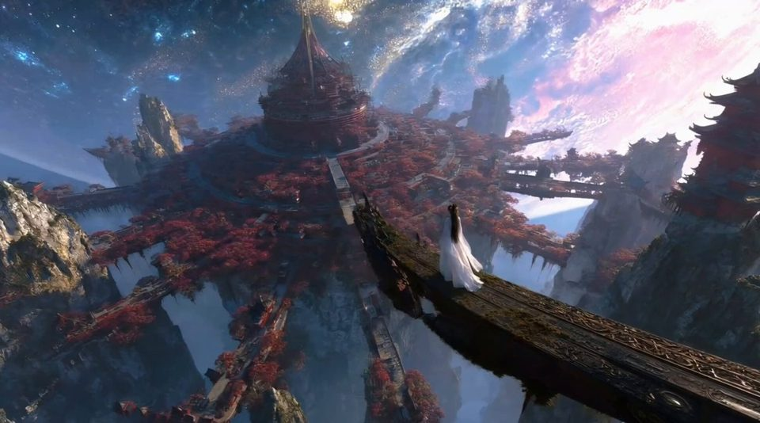</a>

- **作者:** [blackhumor](https://x.com/blackym25/status/2043735288938426416) · X · ♥ 654
- **标签:** `游戏CG` `国风水墨` `中式` `奇幻神话` `史诗壮阔` `环绕运镜` `预告片`
- 白衣人立于云端仙山栈道，镜头从星空与行星间缓缓推过红叶楼阁与悬空岩峰。

### [潜入教室](https://daiyixiang666.github.io/awesome-ai-video-prompts/w/x-2098766209839923543.html)

<a href="https://daiyixiang666.github.io/awesome-ai-video-prompts/w/x-2098766209839923543.html"></a>

- **作者:** [TSUBAKI](https://x.com/AI__TSUBAKI/status/2098766209839923543) · X · **Seedance 2.5** · ♥ 9983
- **标签:** `游戏CG` `日系` `游戏电竞` `喜剧搞笑` `紧张刺激` `一镜到底` `梗段子`
- 把迟到溜进教室拍成 3A 第三人称潜行游戏画面，HUD、镜头跟随都很到位。

<details><summary>提示词</summary>

```text
SCENE CONTEXT
A 30-second realistic AAA third-person stealth-action game sequence set in a Japanese high school on a bright weekday morning. The player character, NAGI, arrived 12 minutes late and must reach her classroom seat without being spotted by any teacher.

ACTIVE REFERENCES

@Image1
 = NAGI. 
@Image1
 defines NAGI's face, hairstyle and uniform: Japanese high-school girl, 17, long straight black hair with blunt bangs, white short-sleeve sailor blouse with pink collar stripes and a satin pink ribbon, grey pleated skirt, black knee-high socks, white sneakers. Voice: light, breathy young female voice, speaking Japanese in a hushed whisper. 100% matches the reference. Use only her appearance — do not use the grey studio background.

CAST SEPARATION
Four distinct adults appear, each with a different silhouette, age and hair so they read as four separate people:
- GATE TEACHER: man in his 40s, 170 cm, average build, full head of short black hair parted at the side, thin metal-framed glasses, white dress shirt with a loosened navy tie. Appears only at the gate.
- LOCKER TEACHER: woman in her 20s, 160 cm, slim, brown hair in a high ponytail, beige cardigan over a white blouse, carrying printouts. Appears only in the shoe-locker bay.
- PRINCIPAL: man in his 60s, 160 cm, stout and round-shouldered, completely bald with a shiny scalp and a fringe of white hair above the ears, round gold-rimmed glasses, charcoal three-piece suit with a lapel badge. Appears only at the corridor T-junction.
- HOMEROOM TEACHER: man in his early 30s, 182 cm, lean and broad-shouldered, thick full black hair swept back, short beard, navy tracksuit with two white side stripes, chalk dust on his sleeve, no glasses. Appears only in the classroom.
The PRINCIPAL is the only bald character in the entire video. The HOMEROOM TEACHER keeps a full head of thick black hair and a beard, stands more than 20 cm taller than the PRINCIPAL, and is clearly a different, much younger man.

LOCATION MAP
One unbroken spatial route the camera travels with her: front gate hedge → gate gap → shoe-locker bay → corridor T-junction → cleaning-locker alcove → classroom rear sliding door → her desk. Foreground: polished linoleum floor and steel shoe lockers, sunlit and reflective. Background: window wall on camera-right onto a sports ground, dust suspended in the sunbeams. Light enters from camera-right through the windows along the entire route.

CLASSROOM GEOMETRY
The classroom is oriented like a standard Japanese classroom: the blackboard and the teacher's lectern are at the FRONT of the room, the window wall runs along one side, and the rear sliding door, the back wall bulletin board and the cleaning lockers are at the BACK. Every student desk faces the blackboard. NAGI enters through the rear door and sits at a back-row desk, facing forward toward the blackboard for the whole classroom section — the blackboard is always in front of her, never behind her.

FIRST FRAME / BLOCKING
First frame is already in motion: NAGI sprints in from lower-left toward camera-right, school bag clutched to her chest, and drops into a crouch-slide behind a trimmed hedge beside the closed school gate. Camera behind her right shoulder. Game HUD fully visible from frame one.

FORMAT MODE
One continuous unbroken take from 0.0s to 27.0s with no cuts of any kind, then a single HARD CUT at 27.0s to one final locked reverse shot that runs to 30.0s. Exactly one cut exists in the whole video, at 27.0s. The camera does not cut anywhere else.

OPTICS
One lens for the continuous section: 47° third-person over-the-shoulder framing as the baseline, breathing in to 29° on reaction beats and out to 63° for the corridor takedown and the cardboard box. All FOV changes in that section happen as smooth continuous zoom breathing, never as a jump. The final shot after the cut is a fixed 29° frontal framing of NAGI, no drift.

CAMERA
For the continuous section the camera is a physical object flying with her. Chest-height, 1.5 meters behind NAGI, slightly camera-right of her spine, swinging with a soft spring delay half a beat behind her turns like an analog-stick gameplay camera. It dips to knee height when she crouches, rises when she stands, slides sideways along the locker wall with her, swings wide to the corridor-left to open up the takedown, drifts back behind her for the box, and follows her low through the classroom rear door gap to settle behind her shoulder as she sits. After the cut, the camera is repositioned to the FRONT of the classroom, standing beside the teacher's lectern next to the blackboard and looking back down the aisle at NAGI — locked off, eye level, completely static, no movement.

ACTION

[Beat 1 — 0.0s to 6.0s] NAGI crouch-slides behind the hedge, back flat to the leaves, chest heaving. She leans out 20 cm to peek at the GATE TEACHER checking his watch, then pulls back. She whispers in Japanese: {ちこく…バレたら終わりだ}. HUD flashes 【LATE — 12 MIN】 and the mission banner 【OBJECTIVE: REACH CLASS 2-B UNDETECTED】. She slips through the gate gap behind his back while he faces away, and the camera follows her through the gap without stopping.

[Beat 2 — 6.0s to 12.0s] The camera stays with her into the shoe-locker bay. NAGI presses her spine flat against the steel lockers and shuffles sideways at 2 km/h, sneakers rolling heel-to-toe in silence; the camera tracks sideways with her at the same speed. The LOCKER TEACHER walks past the end of the row carrying printouts. NAGI holds her breath, pupils tracking her without moving her head, and whispers: {止まって…気づかないで}. The minimap vision cone sweeps past NAGI's marker and turns away. HUD shows 【SNEAKING MODE】. The LOCKER TEACHER exits frame-left, NAGI exhales and moves on into the corridor with the camera still on her shoulder.

[Beat 3 — 12.0s to 18.0s] The PRINCIPAL steps around the T-junction two meters in front of her. A red exclamation marker snaps above his bald head with a sharp alert sting, the HUD edge pulses red, 【ALERT】. The camera swings wide to corridor-left as NAGI reacts in one motion: drops her bag, steps inside his guard, hooks his right wrist, spins under his arm into a soft CQC hold around his shoulders, then lowers him carefully to the floor and props him seated against the wall, asleep with his gold-rimmed glasses askew. She bows quickly and whispers: {ごめんなさい、校長先生！}. HUD prints 【CQC TAKEDOWN】 and 【PRINCIPAL: Z z z】. She scoops her bag back up and the camera falls in behind her again.

[Beat 4 — 18.0s to 24.0s] Two office staff in grey work vests, both with short dark hair, turn into the far end of the corridor walking toward camera. NAGI grabs a flattened cardboard box by the cleaning-locker alcove, pops it open and drops it over herself in one second, freezing dead still mid-corridor; the camera drifts to a stop with her, still running. Only her white sneakers show under the cardboard rim. The two staff walk past; one slows, looks at the box for a full beat, shrugs and keeps walking. From inside the box NAGI whispers: {箱…最強}. HUD prints 【BOX EQUIPPED】 then 【ENEMY LOST CONTACT】, alert bar drains to green. The box shuffles forward on two sneakered feet and the camera moves with it.

[Beat 5 — 24.0s to 27.0s] She ditches the box behind a pillar, slides the classroom rear door open 15 cm and crawls low along the back row under the window line; the camera drops low and slips through the same door gap with her, staying behind her shoulder. She folds into an empty back-row desk facing forward toward the blackboard. Over her shoulder in the far distance, the HOMEROOM TEACHER stands at the blackboard writing, his back to the room. She sits bolt upright, hands flat on the desk.

27.0s HARD CUT

[Beat 6 — 27.0s to 30.0s] Locked static reverse shot from the front of the classroom beside the lectern, looking back down the aisle: NAGI sits at her back-row desk facing camera, shoulders squared, hands flat on the desk, chest still rising fast. Behind her are rows of empty student desks, the back wall bulletin board and the closed rear sliding door — no blackboard behind her. Off camera behind the lens, the HOMEROOM TEACHER says in Japanese: {なぎ、出席とるぞ}. NAGI answers brightly, looking straight down the lens: {はい！}. HUD prints 【MISSION COMPLETE】, 【STEALTH RANK: S】, 【ADRENALINE +150】. Final frame: NAGI facing camera, a tiny triumphant smile pulling at one corner of her mouth.

PERFORMANCE
Photographic human realism indistinguishable from live-action footage: skin with visible pores, fine vellus hair catching the light, subsurface scattering in the earlobes and fingertips, capillary flush across her cheeks and ears from running, individual flyaway strands lifting off her hair, wet living eyes with true window catch-lights and a faint red inner rim, clean matte skin. Visible fast breathing at the collarbone, eyes darting a half-second before her head turns. Tension shown by muscle: shoulders drawn up to her ears, fingers clamped white on the bag strap, jaw set, then a full-body shoulder drop on each escape. All adults have equally real skin, real hair follicles and natural asymmetric faces.

PHYSICS
Her skirt pleats swing and settle with inertia on every stop; hair lags and sweeps across her face on fast turns. The cardboard box has real mass — it wobbles when it lands on her shoulders and its bottom edge drags with a light scrape. The PRINCIPAL's body has believable weight as she lowers him; his shoes squeak once on the linoleum. Contact shadows stay glued under every foot, every knee, every box corner.

LIGHTING
One continuous light logic across the whole video: hard morning sun at 5600K entering from the window wall on camera-right, throwing long window-frame stripes across the floor that NAGI passes through light and shadow as she travels the route. Soft bounce fill off the pale linoleum lifts her face. In the final reverse shot the same window wall now sits on camera-left, raking light across her cheek from that side, with soft bounce off the desks. Fine dust suspended in the sunbeams. Exposure rolls smoothly as she moves between bright and shadowed stretches, and the color temperature matches exactly across the cut.

HUD
GTA-style real-time game HUD locked to fixed screen positions for the whole 30 seconds, with every on-screen word written in English: circular minimap bottom-left with the player arrow and yellow vision cones for each adult, health and stamina bars top-left, alert-state bar shifting green to amber to red, controller button prompts bottom-right, English mission objective text top-center, floating red exclamation markers over alerted characters, notification cards sliding in from screen-right. The HUD stays in the same screen positions across the cut. No subtitles or caption bars anywhere on screen. The HUD is a clean flat graphic overlay composited on top of fully photographic live-action-grade footage.

AUDIO
(tense minimalist stealth synth loop with a pulsing heartbeat under it, running unbroken across the cut and resolving to a short bright victory fanfare at the end) <sneaker squeaks on linoleum> <steel locker creak> <sharp alert sting on the exclamation marker> <cardboard rustle and scrape> <chalk on blackboard> <distant volleyball whistle from the sports ground> <fast heartbeat rising through the takedown and the box>. Ambience carries continuously through the cut. All dialogue is spoken in Japanese.

STYLE
Photoreal live-action realism, real human beings and real fabric, natural skin tones with true-to-life color science, physically correct materials, realistic human proportions and anatomy, real optical depth of field, real floor reflections, subtle handheld gameplay motion blur, fine film grain at 5%, sharp detail intent.

OUTPUT SETTINGS
16:9, real-time speed throughout, one continuous 27-second take plus one 3-second locked shot after a single hard cut.

POSITIVE LOCKS
Exactly one cut in the entire video, at 27.0s — everything before it is a single unbroken take with the camera connected to NAGI. NAGI keeps the same face, long black hair with blunt bangs, white pink-striped sailor uniform, grey pleated skirt, black knee-highs and white sneakers throughout, with dry clean skin. The school bag stays with her except during the takedown, then returns to her arms. The cardboard box appears only in the corridor beat. The bald PRINCIPAL in the charcoal suit appears only at the T-junction; the tall bearded HOMEROOM TEACHER with thick black hair in the navy tracksuit appears only in the classroom, and the two are unmistakably different men. In the classroom NAGI always faces the blackboard; in the final shot the camera stands at the blackboard end of the room, so empty desks and the rear door fill the space behind her. All on-screen text is English. The last 3 seconds hold a locked frontal eye-level shot of NAGI facing camera. HUD elements stay in the same screen corners throughout. One single NAGI on screen at all times. All spoken lines are in Japanese. Sunlight direction stays consistent for all 30 seconds.
```

</details>

### [浮岛废墟](https://daiyixiang666.github.io/awesome-ai-video-prompts/w/x-2022996066472513856.html)

<a href="https://daiyixiang666.github.io/awesome-ai-video-prompts/w/x-2022996066472513856.html"></a>

- **作者:** [padphone](https://x.com/lepadphone/status/2022996066472513856) · X · **Seedance 2.0** · ♥ 3051
- **标签:** `游戏CG` `日系` `奇幻神话` `史诗壮阔` `叙事短片`
- 武士穿行于漂浮的城市废墟之间，奇幻世界观的大场面。

<a id="video-documentary-handheld"></a>
## 视频 · 纪实手持

### [翼装掠海](https://daiyixiang666.github.io/awesome-ai-video-prompts/w/x-2085996752809927146.html)

<a href="https://daiyixiang666.github.io/awesome-ai-video-prompts/w/x-2085996752809927146.html">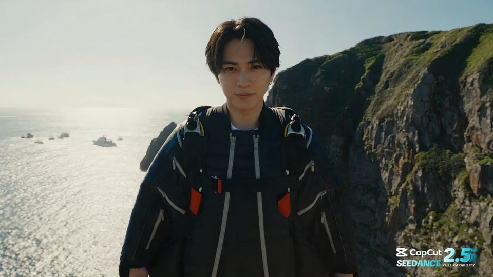</a>

- **作者:** [MrDejie](https://x.com/mrdejie/status/2085996752809927146) · X · **Seedance 2.5** · ♥ 585
- **标签:** `纪实手持` `胶片复古` `欧洲` `运动极限` `紧张刺激` `一镜到底` `演示教程`
- 翼装飞行者从海崖跃下，贴着海面掠过游艇，落在沙滩后买了根热狗。4K单镜。

<details><summary>提示词</summary>

```text
[STYLE + CAMERA + ATMOSPHERE] Gritty, raw handheld 35mm film aesthetic with natural film grain. Harsh direct sunlight creating high-contrast shadows over a dramatic coastal cliff and open ocean. Continuous single-take handheld tracking shot (3rd-person / over-the-shoulder) with no cuts. Atmosphere: high-altitude wind, realistic coastal cliff and ocean physics, sudden wingsuit deployment. Audio: heavy rhythmic breathing, intense wind howl, fabric snap of wingsuit opening, high-speed air rush over open water, near-miss whooshes past yachts, soft landing roll on sand, distant ocean waves and beach ambient noise, final bite sounds.
[IMAGE REFERENCES] Use the provided Hoshino character sheet as the single strict visual reference for the male character. Exact face, black hair, dark brown eyes, lean athletic build (178 cm), gold earrings, and overall facial structure locked from the reference. Outfit: modern high-performance cliff-jumping wingsuit — sleek, form-fitting design in matte charcoal black with sharp white paneling and subtle gold zipper accents (matching his minimalist aesthetic). The wingsuit is worn from the start with a matching technical backpack. Body proportions, posture, and face remain fully locked to the Hoshino reference.
[TIMELINE SECOND BY SECOND] 0-3s: [Handheld medium] Hoshino stands on the edge of a high rocky cliff overlooking the open ocean, wearing his charcoal-and-white wingsuit and technical backpack. He looks straight into the camera with calm, confident intensity, then turns and launches into a clear, controlled forward somersault in slow motion as he leaves the cliff edge.
3-5s: [Continuous freefall] He completes the somersault and falls head-first toward the sea. At exactly 1.5 seconds into the fall he fully deploys the wingsuit with a sharp snap. The wing membranes inflate and he levels out into a smooth glide.
5-12s: [High-speed tracking] Camera stays locked behind him as he rockets at full speed just above the ocean surface along the coastline. He weaves tightly past sheer cliff faces, banking hard left and right, turquoise water and rocky walls streaking past at extreme velocity.
12-18s: [Low-level chaos] He drops lower, flying just above the water. He almost collides with a large luxury yacht that suddenly turns, banks hard to avoid it, then narrowly misses a smaller motor yacht. He dips under a yacht’s outstretched boom and threads between two more vessels.
18-23s: [Water-level action] Still flying extremely low over the sea, he dodges a startled seabird that dives across his path, skims past a group of people on a nearby yacht who scatter in surprise, and banks sharply to avoid an open yacht swim platform. The camera stays locked behind him through every near-miss.
23-26s: [Landing] He flares the wingsuit hard, touches down with both feet on the soft beach sand and immediately rolls forward to kill the speed. He stands up, peels off the wingsuit in one fluid motion and drops it on the sand beside him, revealing a clean fitted white undershirt underneath.
26-28s: [Beach level] He walks a few steps still wearing the backpack and stops right in front of a classic beachside hot-dog cart. The vendor hands him a steaming hot dog fresh off the grill.
28-30s: [Close continuous] He turns, looks directly into the camera, takes a big bite of the hot dog and chews with a calm, satisfied expression as the shot holds.
[STYLE & QUALITY BOOSTERS] Photorealistic 8K, ultra-detailed textures, cinematic lighting, perfect motion blur, high dynamic range, coherent physics (fabric, air, wingsuit membranes, impact, roll, near-misses with yachts, water spray), stable character locked to the Hoshino reference, realistic ocean reflections, cliff rock textures and wind, no artifacts, movie-level stability, pure single continuous take.
```

</details>

### [意大利农妇的DV午后](https://daiyixiang666.github.io/awesome-ai-video-prompts/w/x-2107530733212590250.html)

<a href="https://daiyixiang666.github.io/awesome-ai-video-prompts/w/x-2107530733212590250.html">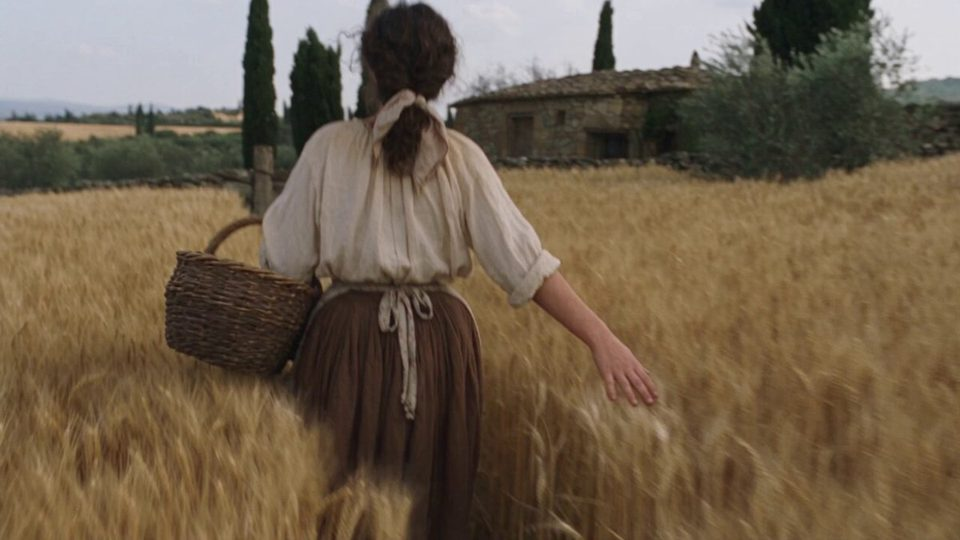</a>

- **作者:** [Saul Goodman](https://x.com/Goodmanprotocol/status/2107530733212590250) · X · **Seedance 2.5** · ♥ 443
- **标签:** `纪实手持` `欧洲` `日常生活` `自然风光` `温暖治愈` `一镜到底` `vlog`
- early-2000s DV 质感的意大利乡村纪实：农妇穿过麦田、打水、喂驴、回到石屋，全程手持跟拍。

<details><summary>提示词</summary>

```text
30-second ultra-realistic documentary slice-of-life video, early-2000s consumer DV camcorder aesthetic. A young Italian peasant woman in her early 20s, sun-weathered olive skin with freckles, dark brown wavy hair loosely tied with a faded scarf, worn off-white linen blouse, earth-brown patched wool skirt, faded floral apron and muddy leather boots. Rural Tuscany in the late 1800s. Golden wheat fields, olive trees, stone farmhouse, cypress trees, stone walls, chickens, donkey and old stone well. No modern objects or machinery.

[0–6s]
Handheld camera follows her naturally along a dirt path through golden wheat fields. She carries a woven basket on her hip and brushes her free hand across the wheat. Wind moves the stalks and her loose hair.

[6–12s]
She reaches a wooden fence, sets down the basket and feeds scraps to several chickens gathered around her boots. The camera stays close and imperfect, briefly adjusting focus as she moves.

[12–18s]
She continues toward an old stone well. She lowers a wooden bucket on a rope, pulls it up with effort, then drinks fresh water from a small ladle. Water runs down her chin and she wipes it away with her sleeve.

[18–24s]
A donkey approaches. She smiles softly, pats its muzzle, then picks a small wildflower from the field and tucks it behind her ear. She lifts the basket and walks toward the farmhouse.

[24–30s]
Near the heavy wooden doorway, she notices the person filming. She gives a tired but warm smile and a small wave, then opens the door. She looks back once before stepping inside. The camera remains outside as the door slowly closes.

STYLE: photorealistic historical documentary, authentic 1800s Tuscany, early-2000s consumer DV look, handheld shake, imperfect framing, autofocus hunting, slight exposure pumping, faded colors, soft contrast, mild digital compression and sensor noise. No stabilization, no cinematic camera moves, no modern color grading. One continuous fluid shot, no cuts, no captions, no music.

AUDIO: natural ambience only -wind through wheat, birds, chickens, footsteps on dry earth, rope and wooden bucket creaking, water splashing, donkey sounds, distant countryside atmosphere and the wooden door closing.
```

</details>

### [京都寻常一天](https://daiyixiang666.github.io/awesome-ai-video-prompts/w/x-2096109540924141746.html)

<a href="https://daiyixiang666.github.io/awesome-ai-video-prompts/w/x-2096109540924141746.html">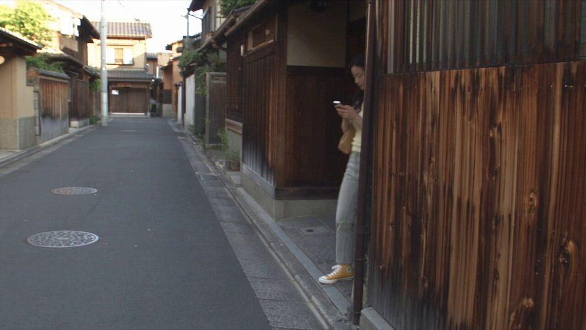</a>

- **作者:** [Sharon Riley](https://x.com/Just_sharon7/status/2096109540924141746) · X · **Seedance 2.5** · ♥ 295
- **标签:** `纪实手持` `写实电影感` `日系` `旅行城市` `日常生活` `温暖治愈` `多镜头剪辑` `角色一致性` `vlog`
- 年轻女子在京都巷弄买面包、坐电车看窗外，傍晚坐在鸭川边吹风，夕阳从背后漫过来。

<details><summary>提示词</summary>

```text
Create a 30-second, 16:9 ultra-realistic handheld lifestyle vlog following the young Japanese woman in her 20s through an ordinary day in Kyoto. Keep her face, identity, hairstyle, body, outfit, accessories, and proportions perfectly consistent.

She wears a fitted pastel yellow short top, straight-leg light denim jeans, yellow canvas sneakers, a small tan tote bag, and thin gold hoop earrings throughout.

Style: Genuine footage filmed casually by a close friend on a smartphone/compact camera. Handheld shake, imperfect framing, autofocus/exposure shifts, natural motion blur, mild digital noise, realistic skin texture, occasional late camera reactions. No gimbal, drone, cinematic choreography, slow motion, beauty filter, or commercial look.

0–5s: Quiet residential Kyoto street, narrow lane with wooden facades. She steps out of her apartment, glances at her phone, notices the camera, smiles softly, tucks her hair behind her ear and says naturally: "今日も一緒に行こう。"

5–11s: Enters a small neighborhood bakery/konbini-style shop, notices a fresh melon pan and says: "これ、いい匂いがする。" Buys it, takes a bite outside, and smiles at the camera.

11–17s: Boards a local city bus and sits by the window. Kyoto streets and old buildings pass outside with realistic reflections and sunlight. She quietly says: "こういう日は、歩きたくなるな。"

17–23s: Gets off near a canal-side walking path. Buys a drink from a small vending machine or cart. A cyclist passes unexpectedly close; she steps aside, laughs, and says: "今、ちょっとびっくりした。"

23–27s: Golden-hour canal-side scene. She sits on a low stone ledge or bench, places her drink beside her, removes one earbud, watches the water, and gives a small genuine smile as the wind moves her hair.

27–30s: She stands and walks away. After a few steps, looks back and says: "次は一緒に来てね。" She continues walking as the camera follows behind. Recording naturally ends around 29.5s.

REALISM: Accurate human biomechanics, grounded feet, continuous objects, realistic bus movement, natural walking/eating/sitting, consistent architecture and wardrobe. No teleportation, morphing, identity drift, duplicated/disappearing objects, distorted hands or limbs.

AUDIO: Natural Japanese dialogue with accurate lip-sync, phone-mic quality, footsteps, traffic, birds, bakery sounds, bus engine, bicycle bell, wind and city ambience. No music, narrator, or cinematic SFX.

Absolutely no subtitles, captions, on-screen text, logos, watermarks, or UI.
```

</details>

### [另一个人生的夏夜](https://daiyixiang666.github.io/awesome-ai-video-prompts/w/x-2097564633242779830.html)

<a href="https://daiyixiang666.github.io/awesome-ai-video-prompts/w/x-2097564633242779830.html">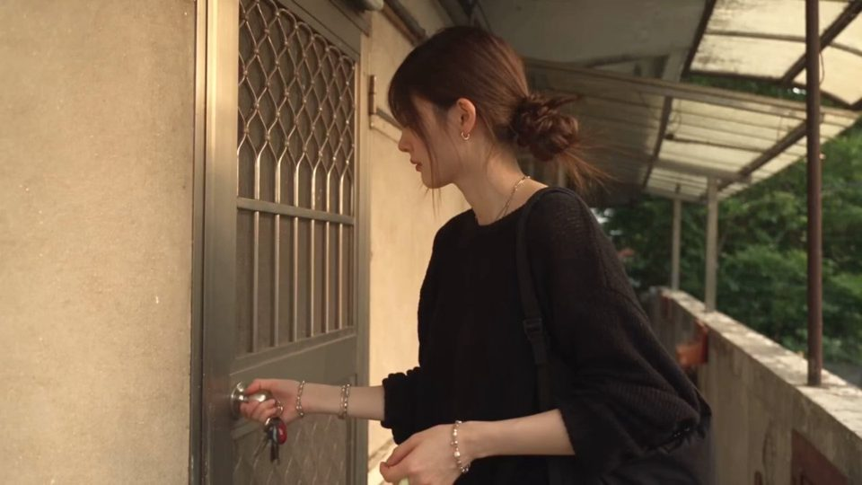</a>

- **作者:** [Harboris](https://x.com/harboriis/status/2097564633242779830) · X · **Seedance 2.5** · ♥ 217
- **标签:** `纪实手持` `中式` `日常生活` `温暖治愈` `第一人称` `vlog`
- 2000 年代家用录像风格：女孩在巷口小卖部买东西、蹲下逗狗、在傍晚的老巷里慢慢走回家。

<details><summary>提示词</summary>

```text
Create a 30-second, 1080p, 16:9 ultra-realistic 2000s-style home video recording style video, featuring an ordinary Taiwanese summer evening.

Main subject: The entire video is shot from the perspective of a young Taiwanese woman in her early 20s, with natural, realistic skin tone, light makeup, dark brown long hair styled in a low bun, with a few strands of hair. She is wearing a soft black long-sleeved knitted top, wide-leg light gray shorts, white vintage sneakers, carrying a dark black backpack, and wearing a silver bracelet. Please ensure that the face, hairstyle, clothing, proportions, and accessories remain completely consistent.

Setting: A quiet old residential alley in Taipei, with small apartments, potted plants, bicycles, old walls, power poles, and a small snack shop, a water dispenser, and potted plants. Full of life, peaceful, and real; no brands, advertisements, tourist attractions, or elaborate commercial activities.

Photography: The original consumer DV shooting style from the early 2000s, intense hand-held shaking, imperfect composition, search for autofocus, exposure changes, dynamic blur, faded colors, soft digital details, slight noise, and unexpected zoom. Stabilizer, sky lanterns, drones, cinematic lenses.

Timeline:
00:00-00:05: Take out an eco-friendly shopping bag, lock the door, check the keys, tidy up hair, smile at the camera, and walk down the alley.

00:05-00:10: Buy a small bag of green grapes from a small grocery store. Take a bite, react to the sour taste, make a funny face, laugh, and hand the fruit to the camera.

00:10-00:15: Walk and eat the fruit. A little dog notices her and wags its tail, she crouches down to let it smell her hand. The dog follows her for a short distance before leaving.

00:15-00:20: The dry leaves on the tree fall on her shoulders and hair. She looks up, shakes off the leaves, and the camera zooms in and gets close to her face. She says: Here it comes again?

00:20-00:25: Sit briefly on the low wall, finish eating the fruit, and a taxi passes by. The neighbor is watering the flowers. The wind blows her hair and clothes; she wipes her hands and adjusts her bag.

00:25-00:30: Walk to the end of the alley, turn around with a playful smile, say: Let's go. Turn the corner; the camera follows; suddenly switches to black screen.

Sound: Only natural ambient sounds, bird songs, insect sounds, footsteps, bicycle bells, distant motorcycle sounds, tree leaves, store sounds, dog movements, neighborhood sounds, and the noise of operating a camera. No music, voiceover, subtitles, titles, logos, watermarks, or special effects.

Continuity: Real dogs and environmental actions. No repeated characters, distorted faces, deformed hands, extra fingers, instant movements, or clothing changes. Warm, leisurely, feminine, playful, intimate, with a nostalgic feeling of forgotten summer memories.
```

</details>

### [旅途的你](https://daiyixiang666.github.io/awesome-ai-video-prompts/w/x-2099002039141626186.html)

<a href="https://daiyixiang666.github.io/awesome-ai-video-prompts/w/x-2099002039141626186.html">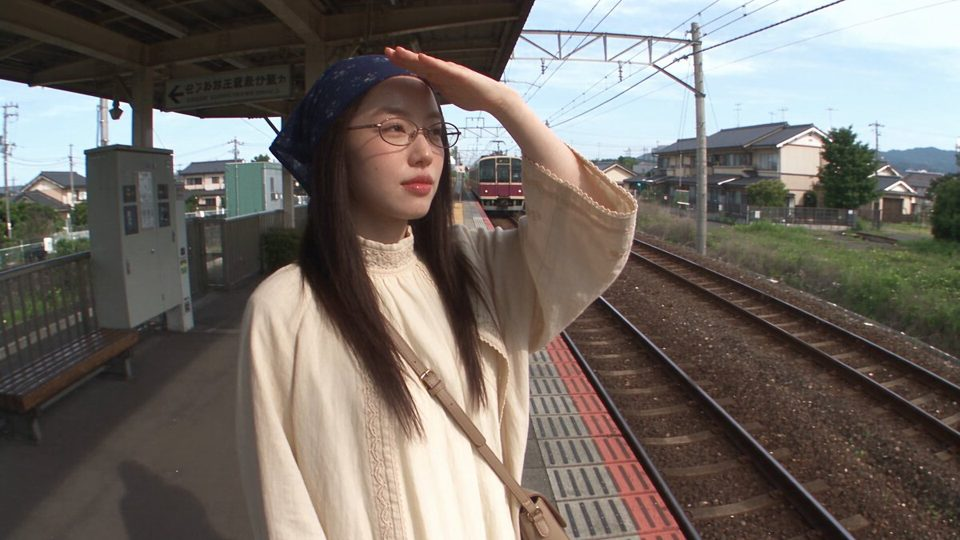</a>

- **作者:** [Oogie](https://x.com/oggii_0/status/2099002039141626186) · X · **Seedance 2.5** · ♥ 189
- **标签:** `纪实手持` `日系` `爱情青春` `旅行城市` `浪漫心动` `第一人称` `多镜头剪辑` `叙事短片`
- 男友第一视角的日本旅行记忆：站台、书店、夕阳河岸、神社栈桥、夜里递来的手帕，快剪蒙太奇。

<details><summary>提示词</summary>

```text
Create exactly 30 seconds of photorealistic live-action Japanese travel memories, edited with quick hard cuts, seen through an affectionate adult boyfriend's first-person handheld consumer camcorder. This is a MULTI-SCENE MONTAGE, NOT one continuous take. Begin with a frightening cinematic near-miss at a suburban railway platform, then move immediately into warm, playful, intimate everyday travel. The emotional arc is alarm → relief → affectionate curiosity → golden-hour quiet → joyful night → tender laughter. No disaster imagery. No dramatic movie grading. Output ultrawide 21:9, requested 1080p, high-bitrate encode, with deliberately authentic early-2000s MiniDV aesthetics baked into the image. Use the full wide frame, no 4:3 pillarboxes.

SAME ADULT HEROINE IN EVERY SHOT:
SAME ADULT HEROINE IN EVERY SHOT:
A very beautiful young adult Korean woman, age 25–28, with luminous fair warm-toned skin and realistic pores, expressive dark-brown eyes, softly sculpted youthful cheeks, naturally beautiful full rose-pink lips with a subtle satin finish, natural understated Korean makeup, and a warm spontaneous smile. Preserve her facial geometry, body proportions and identity across every cut, without idealized plastic smoothing. Thin dark-metal oval prescription glasses with clear lenses, eyes always readable. Long, naturally dark-brown to soft-black hair, smooth and healthy with subtle natural movement; no blonde hair, no bangs.

One consistent modern Korean Gen Z outfit: an elegant loose ivory ankle-length A-line dress with full-length sleeves and a high neckline, subtle delicate embroidery, paired with a lightweight oversized beige cardigan jacket, clean cream sneakers, and a small structured taupe crossbody bag. Fabric remains naturally flowing, fully opaque and modest during movement. Glasses, hairstyle, outfit and bag remain identical throughout. Contemporary Korean styling, youthful, effortlessly elegant and understated. No spaghetti straps, revealing neckline, exposed midriff, or body-hugging styling. There is no supplied reference image: establish this original Korean heroine from these text details and maintain her exact identity. Never morph into another woman, change her ethnicity, facial features, hairstyle, or body proportions.

MINIDV STYLE LOCK:
Feels like a cherished home-video cassette recorded around 2003, not polished cinema pretending to be vintage. Gentle optical softness, low contrast, softly washed highlights, warm natural skin, fine luma noise, mild color bleed, subtle consumer-camera edge enhancement, restrained DV compression texture, slightly faded blues and greens, soft halation, occasional exposure pumping when moving between shade and sunlight.

Real handheld wide-angle proximity, uncentered composition, brief autofocus searching that settles on her face. Noticeable motion smear on fast pans and night lights, but keep expressions legible. No heavy glitch overlays, fake VHS tracking bars, film burns between scenes, timestamps, captions, subtitles, logos, or excessive chromatic aberration. Noon feels airy, sunset feels honey-gold, night feels softly smeared and imperfect. Do not use green-noir grading or glossy blockbuster teal-orange.

POV AND EDIT RULES:
The camera operator is her adult boyfriend, mostly unseen, occasionally one anatomically correct forearm or hand enters. She repeatedly checks where he is, leans toward him, looks back, shares a discovery, and smiles directly into the lens. Small natural gestures, no fashion posing, no slow-motion beauty commercial. Hold each simple action long enough to read. Hard cuts between locations, no morphing transitions.

Geography evokes a remembered Kansai day through Uji and Nara, with ordinary bookshops and shopping streets between famous places. Late spring or early summer green foliage; no contradictory autumn leaves, snow or cherry blossoms. Do not squeeze in extra landmarks or relocate Mount Fuji into Nara.

EXACT 30-SECOND EDIT:

00.00–04.00 — SUBURBAN PLATFORM, DANGER THEN RELIEF
Open with danger already readable: she has distractedly stepped too near the platform edge while peering down the line, one hand shading her eyes. She remains on the platform, never on the rails. An approaching maroon-and-cream commuter train is already visible behind her and rapidly grows larger.

From first-person POV, one boyfriend hand reaches to her upper arm; upon contact, the arm immediately retracts in ONE continuous movement, pulling her backward toward the lens and behind the tactile safety strip. She visibly moves back one or two quick steps; camera operator steps back naturally with her. Only once she is clear does the train rush past behind her.

Its wind flutters her overshirt and dress hem, never lifts or removes her hijab or exposes her body. Her eyes widen behind glasses, lips part with a brief startled gasp, then relief begins in her expression. No contact with the train, injuries, lingering on the edge, or repeated pulling motion. Believable distances and train direction; staged fictional action with a clearly successful rescue. Keep one continuous shot for this opening.

04.00–06.00 — SUNNY GRASS
Abrupt warm hard cut: first-person handholding as she guides the viewer along a grassy path. She turns toward the camera with a relieved bright laugh. Sunlight catches her ivory sleeves and navy floral hijab pin; green grass drifts softly behind. One hand linked naturally with the operator, no duplicate fingers.

06.00–07.50 — OLD BOOKSHOP
Shoot through a gap between shelves of well-used Japanese books. She playfully bends into the gap from the far side, notices the lens, gives a small conspiratorial smile. Dusty window light, crowded wooden shelves, autofocus briefly catches book spines before her eyes. Avoid legible invented titles.

07.50–09.00 — QUIET STREET CROSSING
Low, casual waist-to-shoe framing of her walking across an ordinary Japanese zebra crossing on a pedestrian signal. Ivory dress hem sways over trainers. Tilt just enough to glimpse her looking back. No fetishized body framing; modest everyday clothing detail and footsteps are the focus.

09.00–10.50 — NARROW LANE
She walks ahead between traditional wooden storefronts, potted plants and hanging fabric curtains. Her eyes glance sideways first, then she turns her face back to find the camera, smiling softly. Overhead cables and bicycles at the side establish lived-in Japan; no staged crowd.

10.50–12.50 — UJI RIVERSIDE, ADDED RESEARCHED SCENE
At the scenic Uji River in Kyoto Prefecture, film her by a pedestrian riverbank with the historic bridge in the background. Begin with sunlight moving on water, tilt casually to her leaning lightly on the safe railing. A breeze moves her cuff; she points out the view, then looks at the operator rather than posing for the landscape. Keep her face central to the memory, river sound underneath.

12.50–14.00 — UJI MATCHA, ADDED RESEARCHED SCENE
Close handheld view of her holding a simple matcha soft-serve outside a small tea shop. She takes a tiny taste, raises her eyebrows appreciatively, then offers the cone toward the lens with a playful smile. Rich natural tea-green against ivory fabric; mild sunlight overexposure, soft storefront background. No visible brand text.

14.00–15.50 — SMALL RAMEN SHOP
Close-up of steaming vegetarian mushroom-and-vegetable ramen on a wooden counter or small table, then a quick natural focus pull to her sitting opposite, smiling through wisps of steam. Cozy lamps, spoon and bowl sounds, genuine restaurant ambience. No pork slices or alcohol props. Camera remains handheld, not a glossy food advertisement.

15.50–17.00 — MANGA SHOP
She draws one manga volume from a shelf, opens it and lowers her eyes with a curious smile. Brief close shot of hands and page texture; no readable dialogue or famous copyrighted character emphasis. Maintain same glasses and floral pin.

17.00–18.50 — NARA PARK DEER
Boyfriend POV offers one designated deer cracker, held flat and released gently to a deer in Nara Park. The woman is softly out of focus a few steps behind on green grass, laughing at the deer's polite approach. No grabbing antlers, hugging or chasing wildlife. Mild camera wobble as the deer approaches.

18.50–20.00 — QUIET READING
Sitting on a park bench, she flips a manga page. Close details of her hands, gold botanical embroidery and lace cuff, then tilt to her peaceful face behind her glasses. Rustle of paper, leaves and distant birds. Natural, modest, unposed.

20.00–22.50 — UKIMIDO PAVILION, ADDED RESEARCHED SCENE
Nara Park's hexagonal wooden Ukimido pavilion with its cypress-bark roof on Sagiike Pond, reached by a wooden bridge. From the public bridge, she pauses safely by the railing and turns back toward the camera; warm light and green trees reflect in still water. Start wide enough to read the actual pavilion silhouette, then walk a little closer as she extends her hand toward the viewer. Quiet water, wooden footfalls, no temple ritual invented. Intimate location memory rather than a drone tourism shot.

22.50–24.50 — GOLDEN-HOUR MEADOW
In Nara's grassy park with deer grazing at a respectful distance, honey-gold backlight edges her hijab and sleeves. She turns gently toward the camera, dress fabric swaying with the evening breeze. A small genuine smile, peaceful eye contact, slight exposure bloom. No spinning near deer, no flying fabric revealing skin.

24.50–27.00 — LIVELY NIGHT SHOPPING STREET
Blue-hour-to-night hard cut. Warm shop lanterns, illuminated signs and pedestrians in a Kansai shopping street. She suddenly jogs lightly several steps ahead, then looks back laughing, waiting for the operator. He follows; handheld camera movement leaves convincing soft DV light streaks. No vehicles in her running path; stay in a pedestrian area. Preserve facial readability between movement smears.

27.00–28.00 — TACTILE MEMORY INSERT
One brief close handheld detail of her hand adjusting her embroidered cuff beside her taupe bag, ivory skirt hanging naturally; warm shop light blooms softly off the stitching. A casual recorded detail, not an erotic crop.
28.00–30.00 — CAMCORDER MEMORY ENDING
A second small silver early-2000s consumer camcorder is held into the foreground by the operator's free hand, its side LCD flipped outward. Current POV remains on the original recording camera; make this a clearly separate physical device, not an impossible view of itself.

The second camcorder points toward the woman; its LCD shows the same woman in the same pose at the same moment, synchronized without a duplicate person standing nearby. She notices that he is still filming, briefly gives a playful tiny pout with her naturally rose-toned lips, then breaks into a real warm laugh looking directly at him. Frame drifts toward a bright shop lamp and highlights bloom to soft white over the final fraction of a second. End on warmth, not alarm.

AUDIO:
Real synchronized location sound ONLY, no background music, no soundtrack, no narration, no scripted dialogue.

Opening: rolling rail clatter, approaching train rush, wind blast, a single surprised gasp, shoes stepping back.

Then light footsteps, grass and breeze, natural soft laughter, book pages, distant shop ambience, river water, ice-cream wrapper rustle if present, ramen bowls and chopsticks, park birds, deer footsteps, wooden bridge creaks, evening breeze, night crowd and distant vehicles.

Audio hard-cuts naturally with each location; subtle room-tone tails are acceptable. Finish with her authentic laugh. No artificial whooshes between edits or dramatic suspense score.

FINAL QUALITY RULES:
Exactly one stable adult heroine, full modest coverage, consistent hijab and glasses, anatomically natural hands, no face drift or changing ethnicity, no glossy skin filter. Requested high-bitrate file must preserve intentional MiniDV texture rather than remove it. The viewer should feel these are precious imperfect memories from a real day together, not a compilation of polished commercial travel footage.
```

</details>

### [DV自拍的卧室改造](https://daiyixiang666.github.io/awesome-ai-video-prompts/w/x-2107718872707080432.html)

<a href="https://daiyixiang666.github.io/awesome-ai-video-prompts/w/x-2107718872707080432.html">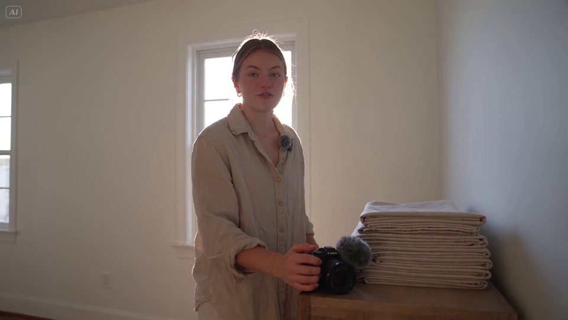</a>

- **作者:** [M-studioAi](https://x.com/Strength04_X/status/2107718872707080432) · X · **Seedance 2.5** · ♥ 165
- **标签:** `纪实手持` `美式` `日常生活` `温暖治愈` `第一人称` `vlog`
- 女孩用手持 DV 记录自己布置卧室：挂窗帘、装灯、最后对镜头微笑。

<details><summary>提示词</summary>

```text
CAMERA / LOOK: Handheld mini DV camcorder footage filmed by the subject herself. Slight hand shake, occasional focus hunting, imperfect framing, natural zoom adjustments, soft tape-like image quality, subtle grain, realistic auto-exposure shifts from bright afternoon window light. Natural skin tones, mild motion blur, authentic consumer camcorder aesthetic rather than polished cinematic footage. STYLE: Cozy home-update vlog with gentle ASMR elements. Relaxed pacing, minimal dialogue, candid moments, natural pauses. Focus on satisfying everyday sounds: curtain rings sliding, fabric unfolding, rod clicking into place, step stool shifting, fabric swishing closed. SUBJECT: Young woman in her mid-20s, plain oversized shirt, hair tied back, minimal jewelry, no visible logos or branded items. Calm, satisfied energy while updating her space. SETTING: Small bedroom window on a bright afternoon. Natural daylight, a plain curtain rod, folded new curtains nearby, no visible brand names or logos in frame. STORYBOARD: → (3s, propped medium shot) Places camera on a dresser, unfolds the new curtains. "Finally replacing these old curtains." → (3s, close-up) Threads curtain rings onto the rod one by one. → (3s, handheld shot) Steps onto a small stool, lifts the rod into place. "Almost got it level." → (3s, detail shot) Clicks the rod into the bracket securely. No dialogue. → (3s, medium shot) Steps down, smooths the fabric out. "That already looks so much better." → (3s, macro shot) Curtain fabric catching soft afternoon light. → (3s, propped shot) Pulls the curtains closed, then open again to test. → (3s, warm ending shot) Steps back, admires the new look, happy smile. "Such a simple change." → (6s, final shot) Reaches toward camera. "See you next update." Hand covers lens as recording ends. AUDIO NOTES: Natural ambience — curtain rings sliding, fabric unfolding, rod clicking should be clearly audible. Dialogue quiet and casual, as if speaking to a small personal audience. REALISM NOTES: Authentic body language, natural blinking, genuine happy smiles, occasional careful pauses while adjusting, imperfect framing, focus breathing, bright afternoon light shifts. No copyrighted characters, logos, brand names, or recognizable public figures anywhere in frame. Fully original personal vlog content, not AI-generated or commercial in style.
```

</details>

### [一九九〇外滩码头](https://daiyixiang666.github.io/awesome-ai-video-prompts/w/x-2075599634475667748.html)

<a href="https://daiyixiang666.github.io/awesome-ai-video-prompts/w/x-2075599634475667748.html">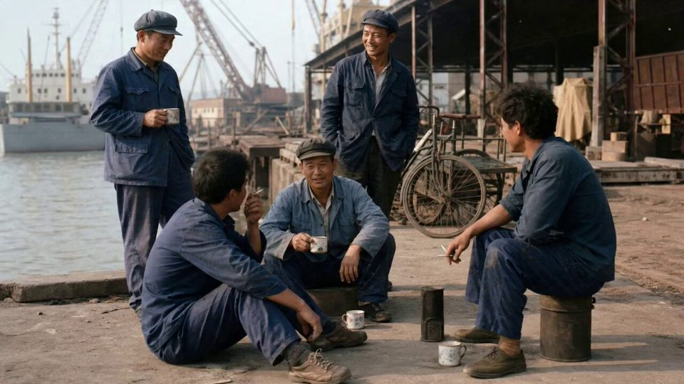</a>

- **作者:** [underwood](https://x.com/underwoodxie96/status/2075599634475667748) · X · **Seedance 2.0** · ♥ 76
- **标签:** `纪实手持` `胶片复古` `中式` `历史年代` `孤独忧郁` `多镜头剪辑` `叙事短片`
- 1990年上海黄浦江码头，工人蹲坐喝茶闲聊，自行车前景、货轮与吊车在晨雾里，纪实质感。

<details><summary>提示词</summary>

```text
Use GPT Image 2.0 to generate a reference image of a Shanghai dock in 1990
Image prompt: https://promptsref.com/tool/AI-Image-Generator/share/5be99a73771b254ee0af23ad2ce914f5

DIRECTIVE: Generate a single hyper-realistic documentary photograph. The main subject is a group of Chinese dock workers resting and talking near the Huangpu River docks in Shanghai, China, in 1990. Natural and unposed. Shot on 35mm film with a Leica M6. No text or overlays.  SCENE: Several Chinese men sitting and standing near a working dock along the Huangpu River in Shanghai. Cargo ships, cranes, warehouses, bicycles, handcarts, and industrial elements are visible in the background. The environment should accurately reflect an ordinary Chinese port area in 1990, with an authentic working-class atmosphere and no modern elements.  PEOPLE: A group of Chinese male dock workers in their 30s and 40s, wearing practical, slightly worn work clothes typical of China in 1990: faded blue or gray work jackets, simple shirts, loose trousers, cloth shoes, and work caps. They are resting, smoking, drinking tea from enamel mugs, and talking casually after work. Their expressions, poses, and interactions are natural and unposed.  COMPOSITION: Medium shot from a low angle, giving presence and dignity to the workers. The port elements are softly out of focus in the background. Direct but respectful framing, with the spontaneous feeling of a photograph captured during an ordinary moment of working life.  TECHNICAL SPECIFICATIONS: - Camera: Leica M6, 35mm film - Film stock: Kodak Gold 200 - Style: Humanistic documentary photography with strong natural light and an authentic depiction of Chinese working-class life in 1990 - Lighting: Bright, slightly harsh natural sunlight typical of an industrial riverside port - Color: Slightly faded warm tones, restrained saturation, subtle color shifts, and authentic 1990-era film grain - Quality: Natural skin textures, realistic worn work clothing, imperfect exposure, and subtle analog-film softness - Historical accuracy: Architecture, clothing, hairstyles, bicycles, ships, tools, and industrial equipment must be appropriate to China in 1990 - Prohibitions: No text, no logos, no overlays, no smartphones, no modern vehicles, no contemporary fashion, no futuristic architecture, and no modern infrastructure

Use the reference image with Seedance 2.0 to generate the video
Video prompt:https://promptsref.com/tool/AI-Video-Generator/share/5af0f6b26a8e926869ba756ae2e7f641
Create 15 seconds of authentic documentary footage set at the Huangpu River docks in Shanghai, China, in 1990. Use the reference image as the exact visual foundation. Preserve the same people, faces, clothing, body proportions, spatial arrangement, architecture, lighting, colors, ships, bicycles, handcarts, industrial equipment, and working-class atmosphere.  Bring the photograph naturally to life. Chinese dock workers rest after work, talk quietly, smoke cigarettes, drink tea from enamel mugs, and observe the port. Their gestures are subtle, relaxed, realistic, and unposed. Keep all faces and identities consistent with the reference image. In the background, workers move cargo, bicycles pass, ships drift slowly, cranes operate in the distance, and ropes and clothing move gently in the river breeze. Everything must be historically accurate to Shanghai in 1990.  Use natural documentary cuts every 1.5–2.5 seconds, showing different workers, small groups, faces, hands, cigarettes, enamel mugs, bicycles, cargo, and wider views of the same dock from varied angles. All shots remain in the same location, time, lighting, and continuous moment.  The camera is handheld and slightly shaky, with constant organic movement, imperfect framing, subtle focus breathing, occasional motion blur, and minor exposure changes, as if the filmmaker is walking through the dock. Use direct, respectful framing. No smooth stabilization, dramatic camera moves, slow motion, or polished commercial cinematography.  The footage looks like genuine 35mm color film from 1990: visible grain, slightly faded warm colors, restrained saturation, soft contrast, subtle flicker, natural skin texture, imperfect exposure, and occasional dust or scratches. It must not look digitally sharp, glossy, modern, or AI-generated.  Natural location sound only: quiet Mandarin and Shanghainese conversations, ship horns, river water, bicycle bells, footsteps, cargo, metal tools, cranes, and wind. No music, narration, subtitles, or artificial sound effects.  The result must feel like recently discovered archival footage of everyday Chinese dock workers in Shanghai in 1990. No text, logos, modern clothing, smartphones, contemporary vehicles, modern skyline, facial distortion, identity changes, duplicated people, morphing bodies, artificial gestures, or anachronistic objects.
```

</details>

### [2004 年的翻盖手机](https://daiyixiang666.github.io/awesome-ai-video-prompts/w/x-2107486015636275458.html)

<a href="https://daiyixiang666.github.io/awesome-ai-video-prompts/w/x-2107486015636275458.html">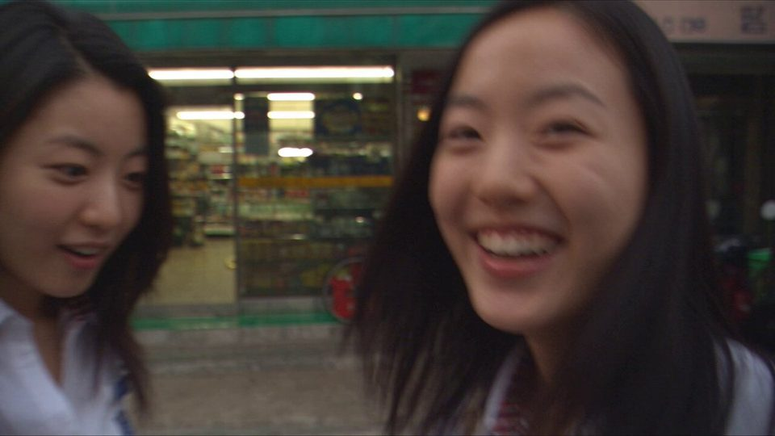</a>

- **作者:** [Johnn](https://x.com/john_my07/status/2107486015636275458) · X · **Seedance 2.5** · ♥ 60
- **标签:** `纪实手持` `韩系` `爱情青春` `历史年代` `孤独忧郁` `温暖治愈` `第一人称` `vlog`
- 2004 年首尔，两个穿校服的女孩挤在一起看翻盖手机，傍晚的巷口打电话、回头张望，像一段被翻出来的旧录像。

<details><summary>提示词</summary>

```text
Create a 30-second ultra-realistic personal home video set in South Korea in 2004. It should look genuinely recorded on a consumer MiniDV camcorder of that era. The camera itself is NEVER visible. Natural handheld movement, imperfect autofocus, slight exposure changes, authentic DV texture and colors, ordinary real-life framing. No cinematic shots or modern-looking visuals.

A Korean woman in her early 20s excitedly shows her brand-new silver flip phone to her female friend outside a small neighborhood convenience store. They laugh and examine it.

Girl: “나 핸드폰 생겼어!”
Friend: “진짜? 보여줘!”

The girl opens and closes the phone, takes a blurry photo of her friend, and proudly shows it to her. They laugh.

They walk together through a quiet Korean residential neighborhood. Old cars, small shops, apartment buildings, bicycles and pedestrians in the background. The girl keeps checking her new phone.

At a street corner, they say goodbye.

Friend: “집에 도착하면 전화해.”
Girl: “알았어.”

They walk in opposite directions.

The girl continues home while casually filming her surroundings. A few seconds later, her new phone suddenly rings. She looks excited and answers.

“여보세요?”

She listens. Her smile slowly disappears.

She looks across the street.

Her friend is standing there, completely still, holding a phone to her ear and looking directly at her.

The girl looks down at her own phone. The call is still connected.

She slowly looks back across the street.

Her friend is now gone.

The girl remains frozen and confused as the MiniDV recording continues for a few seconds.

Cut to black.

Keep the entire video feeling like a genuine forgotten personal recording from 2004, with natural Korean dialogue and no obvious AI-generated look.
```

</details>

### [整理榻榭米卧室](https://daiyixiang666.github.io/awesome-ai-video-prompts/w/x-2109135117834989699.html)

<a href="https://daiyixiang666.github.io/awesome-ai-video-prompts/w/x-2109135117834989699.html"></a>

- **作者:** [𝗦𝗮𝗻𝗶𝗮](https://x.com/saniaspeaks_/status/2109135117834989699) · X · **Seedance 2.5** · ♥ 2284
- **标签:** `纪实手持` `胶片复古` `日系` `日常生活` `温暖治愈` `多镜头剪辑` `vlog`
- 早年 DV 视角里，日本女孩把凌乱的被褥抖开、叠好、卷起，扫地后拉开拉门，卧室焕然一新。

<details><summary>提示词</summary>

```text
Create a 30-second ultra-realistic early-2000s Japanese home vlog featuring the same young Japanese girl with consistent face, hairstyle, and outfit.

Scene 1: She enters her bedroom and finds messy futon bedding, twisted blankets, and scattered pillows.

Scene 2: She removes the pillows, folds the blanket neatly, then folds and rolls the futon mattress and puts it away.

Scene 3: She removes the old pillow covers, replaces them with clean ones, fluffs the pillows, and arranges them neatly.

Scene 4: She sweeps the entire bedroom floor, including corners, then wipes away the remaining dust with a cloth.

Scene 5: She straightens the room, opens the curtains, and admires her clean, peaceful bedroom with a satisfied smile. End with a clear wide shot revealing the finished room.

Keep every scene in exact order. Show each action completely with no skipped steps, sudden transitions, or magically moving objects. Maintain consistent props and room layout. Use authentic 2003 Japanese furniture and handheld MiniDV footage with natural lighting, slight camera shake, autofocus shifts, and mild digital noise. Realistic movements and a satisfying final reveal.
```

</details>

### [东京旅行 Vlog](https://daiyixiang666.github.io/awesome-ai-video-prompts/w/x-2071191480215969845.html)

<a href="https://daiyixiang666.github.io/awesome-ai-video-prompts/w/x-2071191480215969845.html"></a>

- **作者:** [TSUBAKI](https://x.com/AI__TSUBAKI/status/2071191480215969845) · X · **Seedance 2.0** · ♥ 1043
- **标签:** `纪实手持` `日系` `旅行城市` `轻松欢快` `第一人称` `卡点节奏` `vlog`
- 韩系女孩用自拍视角游东京：东京塔、公园长椅、夜里自动贩卖机、高达像、夜景、奈良小鹿，快节奏音乐剪辑。

<details><summary>提示词</summary>

```text
TOKYO TRAVEL VLOG — 15 SEC MUSIC CUT

Subject: Same girl as the reference images. Young Korean idol-like woman in her early 20s. Long straight black hair with soft natural volume, fair porcelain skin, large bright expressive eyes, delicate V-line face, small nose, natural glossy lips, fresh minimal makeup, effortlessly cute and approachable expression. Casual Japanese streetwear (white hoodie / dark oversized hoodie / oversized jacket). 26mm phone lens, deep focus, realistic skin texture, mild HDR, neutral iPhone color science, unedited candid, no cinematic grading, no studio lighting, no light trails, no motion blur effects.

(0:00–0:01) — walking shot, Tokyo Tower reveal Selfie, low angle. Tower behind her, sky overexposed. Natural smile. Neutral daylight, deep focus. Dialogue: "드디어 도쿄에 왔어요...!" Transition: Hard cut / beat drop

(0:01–0:02) — Shibuya Crossing Mid-stride into crowd. Turns head toward camera. Neon signs sharp behind her. Real night exposure. Transition: Fast cut on beat

(0:02–0:03) — Convenience Store Holds onigiri up to camera, eyebrows raised. Harsh fluorescent interior. Cool white light, realistic skin. Transition: Snap cut on beat

(0:03–0:04) — Yoyogi Park Seated, looking away. Dappled light, lens smudge visible. Music drops one beat — wind, birds — snaps back. Transition: Cut on natural movement

(0:04–0:06) — Takoyaki Reaction Bites, eyes wide, pulls back laughing. Warm practical lantern light. Realistic skin in amber. Dialogue: "뜨거워! 진짜 맛있어!" Transition: Cut on laugh end

(0:06–0:07) — Vending Machine Night Stands before glowing vending machine. Mixed LED light on face. Slight smirk. No glow fx. Transition: Single beat cut

(0:07–0:08) — Train Window Face reflected in window. City blurred naturally outside. She looks out, not at camera. Transition: Snap cut

(0:08–0:09) — Torii Gate Low angle. Walks toward and through shrine gate. Gate fills top of frame. Natural daylight. Transition: Snap cut

(0:09–0:11) — Digital Light Exhibit ★ SIGNATURE Looks up slowly. Blue, violet, gold projection on face. Rack focus — face sharp, lights diffused. Just projection on skin, no bloom. Speed: ~60% slow motion Transition: Soft cut mid-upward motion

(0:11–0:12) — Gundam Reveal Face → camera tilts up → full statue in frame. Small impressed smile. Wide angle, natural daylight. Transition: Sharp cut after smile

(0:12–0:13) — Lantern Alley Follow from behind. Lanterns warm, shadows dark. Natural low light. She glances back once. Transition: Cut on forward movement

(0:13–0:14) — Rooftop Skyline Close selfie → arm extends → skyline revealed. Wind moves hair. Natural night phone exposure. Dialogue: "이런 야경은 처음 보는 것 같아요." Transition: Hard cut on last word

(0:14–0:15) — Nara Deer Park, She crouches, holds out a deer cracker. Deer bows toward her — she bursts out laughing. Another nudges her from behind, she nearly topples. Handheld, slightly off-balance. All real. Dialogue: "잠깐! 진짜 절했어!" Transition: Fade to black
```

</details>

### [首尔巷口的午前](https://daiyixiang666.github.io/awesome-ai-video-prompts/w/x-2086806078105551218.html)

<a href="https://daiyixiang666.github.io/awesome-ai-video-prompts/w/x-2086806078105551218.html"></a>

- **作者:** [Saul Goodman](https://x.com/Goodmanprotocol/status/2086806078105551218) · X · **Seedance 2.5** · ♥ 1004
- **标签:** `纪实手持` `韩系` `日常生活` `温暖治愈` `多镜头剪辑` `vlog`
- 韩国女孩在老旧住宅区的普通上午：拢头发、逗猫、晾衣服、在屋顶喝咖啡、走回小巷，朋友随手跟拍。

<details><summary>提示词</summary>

```text
Create a 30-second ultra-realistic candid home-video sequence of a young Korean woman in her early 20s living an ordinary late morning in a quiet Korean residential neighborhood.

SUBJECT:
Young Korean woman, natural everyday appearance, realistic skin texture, minimal makeup, black wavy hair in a messy side ponytail with wispy bangs. Faded charcoal-grey sleeveless crop top, loose high-waisted light-wash jeans, black canvas sneakers, simple black cord necklace. Warm, relaxed personality. Keep her face, body, hairstyle, clothing, and appearance perfectly consistent throughout.

SETTING:
Authentic Korean residential neighborhood — narrow concrete alleys, low-rise homes, small terraces, potted plants, laundry lines, bicycles, utility poles, overhead wires and mature trees. Quiet, lived-in atmosphere. No shops, advertisements, crowds, cafés, or commercial activity.

VISUAL STYLE:
Ultra-realistic documentary home-video footage from an early-2000s consumer DV camcorder. Imperfect handheld operation, natural camera shake, awkward framing, occasional reframing, autofocus hunting, slight lens breathing, exposure pumping between sunlight and shade, subtle motion blur, mild rolling shutter, faded colors, soft contrast, slight digital compression and sensor noise. No stabilization, no cinematic camera moves, no modern color grading. Everything must feel genuinely captured, not AI-generated.

TIMELINE:
00:00–00:05 — Outside her small house, she sits on a low concrete wall adjusting her messy ponytail. Wind moves loose strands of hair. She casually smiles while the camera struggles to lock focus.

00:05–00:10 — She walks into a narrow residential alley. A stray cat approaches. She crouches naturally, pets it and gently feeds it. Autofocus shifts imperfectly between her face and the cat.

00:10–00:15 — In a small front yard, she hangs laundry on a clothesline. Fabric moves naturally in the breeze while sunlight and cloud shadows subtly change the exposure.

00:15–00:20 — She sits on a quiet terrace with a simple ceramic coffee cup, casually watching the neighborhood and brushing loose hair behind her ear. Handheld side angle with natural camera drift.

00:20–00:25 — Close side profile. Someone off-camera casually greets her. She turns, smiles warmly, raises her hand and naturally says, “Annyeong.” The camera reacts slightly late.

00:25–00:30 — She walks slowly down a tree-lined residential lane holding her coffee. She notices the camera, gives a small genuine smile, then looks away and continues walking. The recording abruptly cuts to black mid-motion like an old camcorder being switched off.

AUDIO:
Only authentic location sound: birds, distant motorcycles, light wind, rustling leaves, faint neighborhood chatter, cat sounds, footsteps on concrete, laundry moving on the clothesline and subtle residential ambience. Natural Korean speech only. No music, narration, cinematic sound effects, or artificial sound design.

GOAL:
Make it feel like a forgotten personal home video from the early 2000s — intimate, spontaneous, imperfect, warm, mundane and deeply believable. Prioritize realistic human motion, natural facial expressions, physical interaction, environmental detail and consistent identity over cinematic beauty.
```

</details>

### [2000年代的生日](https://daiyixiang666.github.io/awesome-ai-video-prompts/w/x-2105146792681832481.html)

<a href="https://daiyixiang666.github.io/awesome-ai-video-prompts/w/x-2105146792681832481.html"></a>

- **作者:** [𝗦𝗮𝗻𝗶𝗮](https://x.com/saniaspeaks_/status/2105146792681832481) · X · **Seedance 2.5** · ♥ 918
- **标签:** `纪实手持` `胶片复古` `韩系` `日常生活` `温暖治愈` `多镜头剪辑` `vlog`
- 早年 DV 拍下的韩国女生生日：闺蜜拥抱、面包店买蛋糕、吹蜡烛、分蛋糕、傍晚街头散步。

<details><summary>提示词</summary>

```text
Create a 30-second ultra-realistic Korean birthday vlog set in South Korea in the early 2000s, filmed casually by a friend on an authentic consumer DV camcorder. It must feel like genuine home-video footage, not a modern video with a retro filter.

EXACT ORDER — 7 SCENES:

0–4s — GETTING READY: The same young Korean birthday girl gets ready in her early-2000s bedroom, fixes her hair, adjusts makeup, picks up her handbag and smiles toward the camera.

4–8s — MEETING FRIENDS: She walks through an authentic Korean neighborhood, meets the same 2–3 friends, they congratulate her and walk together toward a bakery.

8–11s — BAKERY: They enter a small early-2000s Korean bakery, browse cakes and choose one birthday cake.

11–14s — BUYING CAKE: A friend pays with cash. The worker puts the cake into a box and hands it over. The same cake box remains visible as they walk to the café.

14–23s — CAFÉ CELEBRATION: They sit in a cozy early-2000s café. The cake is opened, a candle is lit, everyone sings Happy Birthday, the girl makes a wish and blows it out. They clap and laugh. She then cuts the cake, places pieces on plates, personally gives a piece to each friend, watches them eat, then takes a piece herself. Keep the entire sequence clearly visible and in order.

23–26s — PHOTOS: After eating, they take group photos using a small early-2000s disposable film camera. No smartphones or modern digital cameras. They pose, the shutter clicks and they laugh afterward.

26–30s — EVENING WALK: They leave the café and walk through the same neighborhood as it becomes evening. The girl carries her handbag, a friend carries the empty cake box/bag, and they chat and laugh while the camera follows from behind.

CONTINUITY: Same girl, friends, outfits, hairstyles, handbag and cake throughout. No teleporting, identity drift, outfit changes, disappearing props or reordered actions.

ERA: Everything must look authentically early 2000s Korean—fashion, hair, bakery, café, cars, signs, furniture, cake packaging and technology. No smartphones, AirPods, modern cars, LED screens or contemporary interiors.

CAMERA: Raw consumer DV footage with subtle handheld shake, imperfect framing, autofocus hunting, exposure shifts, soft digital detail, mild CCD/DV noise, motion blur, compression and occasional awkward zooms. Natural candid behavior, realistic skin and movement. No cinematic stabilization, 4K sharpness, beauty filters, VHS effects or professional filmmaking.

FINAL FEEL: A genuine Korean birthday memory from the early 2000s, with every scene and action clearly shown in the exact requested order.
```

</details>

### [一次小小的兜风](https://daiyixiang666.github.io/awesome-ai-video-prompts/w/x-2104776214066188611.html)

<a href="https://daiyixiang666.github.io/awesome-ai-video-prompts/w/x-2104776214066188611.html"></a>

- **作者:** [Smiling Khan](https://x.com/AIwithkhan/status/2104776214066188611) · X · **Seedance 2.5** · ♥ 611
- **标签:** `纪实手持` `胶片复古` `韩系` `爱情青春` `浪漫心动` `多镜头剪辑` `vlog`
- DV 记录的情侣午后兜风：上车、便利店买饮料、河堤边停车，男生替女生擦嘴角后轻吻。

<details><summary>提示词</summary>

```text
Create a 30-second, 1080p ultra-realistic early-2000s consumer DV camcorder home video of a young Korean couple going for a casual afternoon drive through Seoul. The footage should feel like a genuine memory recorded by a friend, imperfect and spontaneous rather than a polished commercial.

=== CHARACTERS ===

GIRL: Young adult Korean woman in her early 20s, naturally beautiful, realistic skin, minimal makeup, long slightly wavy dark hair tied loosely with a few strands framing her face. Ll

BOYFRIEND: Young adult Korean man in his early 20s, natural hairstyle, realistic skin, relaxed expression, wearing a loose white T-shirt, dark jeans and white sneakers. Keep his appearance consistent.

=== STORY ===

She waits outside her apartment building with a small shoulder bag, checking her phone and looking down the street. Her boyfriend arrives in an older compact car and smiles when he sees her. She opens the passenger door, gets inside and playfully looks toward the camera as if embarrassed about being filmed.

They drive slowly through an older Seoul neighborhood. She sits in the passenger seat with the window slightly open, enjoying the breeze while her hair moves naturally. Her boyfriend occasionally glances at her and smiles while keeping his attention on the road.

They stop at a small neighborhood convenience store. She gets out, buys two cold drinks and returns to the car. She hands one to her boyfriend, keeps the other for herself, and they laugh together before continuing the drive.

Later, they park near a quiet riverside road. They get out and walk beside the parked car, talking casually. She takes a sip of her drink, makes a playful expression at the taste, and he laughs. She lightly pushes his shoulder and they continue walking together.

A gentle breeze moves through her hair. He notices a strand across her face and gently moves it aside. She smiles and looks at him for a moment. They stand close together beside the car, sharing a quiet romantic moment.

Near the end, she looks toward the camera and laughs shyly, then turns back toward her boyfriend. He steps closer, she smiles, and they share a brief, natural kiss. They pull back, laugh softly and remain standing close together as the camera keeps recording.

The boyfriend looks toward the camera and jokingly shakes his head while she hides her face against his shoulder, laughing.

=== CAMERA / DV FEEL ===

Raw early-2000s consumer DV camcorder footage. Handheld camera operated by a friend sitting in the back seat and later walking with them. Imperfect framing, subtle handheld shake, autofocus hunting, occasional exposure shifts, faded summer colors, soft digital detail, mild sensor noise, natural motion blur and occasional accidental zooms. No stabilization and no polished cinematic movement.

=== AUDIO ===

Built-in camcorder microphone only. Car engine, road noise, turn signals, window breeze, distant Seoul traffic, convenience-store door chime, refrigerator hum, footsteps, birds, neighborhood voices, fabric movement and natural laughter. Their dialogue should feel casual and partially imperfect like a real home video. No music, no narration, no subtitles.

=== REALISM / CONTINUITY ===

Keep the same couple, faces, hairstyles, outfits, accessories and car throughout. Natural Korean facial features, realistic hands and fingers, believable walking, sitting, driving and kissing. Hair and clothing react naturally to the breeze and movement. Genuine expressions rather than exaggerated acting.

=== NEGATIVE ===

No cinematic commercial look, no gimbal shots, no drone shots, no dramatic lighting, no beauty filters, no plastic skin, no CGI appearance, no anime, no cartoon
```

</details>

### [商场里的日系 Vlog](https://daiyixiang666.github.io/awesome-ai-video-prompts/w/x-2092560049189351476.html)

<a href="https://daiyixiang666.github.io/awesome-ai-video-prompts/w/x-2092560049189351476.html"></a>

- **作者:** [Sharon Riley](https://x.com/Just_sharon7/status/2092560049189351476) · X · **Seedance 2.5** · ♥ 591
- **标签:** `纪实手持` `日系` `旅行城市` `时尚美妆` `轻松欢快` `多镜头剪辑` `vlog`
- 日本生活方式博主 AOI 逛商场：杂货店、首饰台、点心铺试吃，日落时在广场收尾，配英文字幕。

<details><summary>提示词</summary>

```text
Generate a 30-second horizontal 16:9 ultra-realistic Japanese lifestyle influencer vlog based on the provided first frame and storyboard. ## Overall Concept A warm, realistic Japanese daily vlog following **AOI**, a young lifestyle influencer, during a relaxed afternoon-to-evening shopping trip. She walks through a modern Japanese shopping mall, explores stylish lifestyle and fashion stores, discovers cute everyday products, stops at a café-style food counter, talks naturally to the camera, and ends the vlog outside the mall as the evening lights begin to glow. The atmosphere should feel like an authentic Japanese influencer vlog rather than a commercial: intimate, candid, relaxed, observational, and naturally filmed. ## Main Character Lock Only one main female character: **AOI**. AOI is a young Japanese woman in her mid-20s with dark brown hair tied in a loose low ponytail, soft face-framing bangs, natural makeup, warm expressive eyes, small gold hoop earrings, and a delicate gold necklace. She wears a **light green loose linen overshirt with rolled-up sleeves, a white fitted tank top, beige high-waisted pants, and a cream canvas shoulder bag**. Keep her face, hairstyle, outfit, body proportions, bag, accessories, and personality perfectly consistent throughout the entire video. ## Branded Prop Continuity The phrase **“EASE MATE”** should appear naturally as a fictional lifestyle brand printed on selected products inside the mall and on objects AOI carries. Use tasteful, realistic product branding such as: * A reusable cream-colored **EASE MATE** water bottle * An **EASE MATE** travel tumbler * Small **EASE MATE** packaging on a lifestyle-store shelf * An **EASE MATE** canvas pouch or accessory * A small **EASE MATE** label on one product she briefly examines The branding should look physically printed or embossed onto the products, not like floating text. Keep spelling exactly **EASE MATE**. Do not place the logo everywhere. It should feel like a subtle recurring lifestyle brand. AOI eventually carries the **EASE MATE 📷Screenshot 2026-08-22 at 2.45.33 AM.png bottle** in her free hand during the later scenes while still wearing her cream canvas shoulder bag. ## Visual Style Ultra-realistic Japanese lifestyle vlog. Natural handheld camera, realistic skin texture, soft cinematic lighting, authentic Japanese shopping-mall interiors, warm ambient illumination, realistic reflections, shallow depth of field, subtle background activity, calm intimate daily-life mood. Avoid a glossy advertisement appearance. It should look like a real influencer filmed a casual shopping-day vlog with a high-quality camera. ## Camera Style Mix: * Third-person handheld walking shots * Selfie-style talking shots * Medium observational shots * Close-up product details * Over-the-shoulder shopping shots * Natural focus pulls Camera movement should feel like a real lifestyle influencer vlog: gentle handheld movement, subtle walking motion, natural reframing, realistic autofocus, smooth focus transitions, and motivated camera movement. No sudden impossible camera movements. --- ## Scene and Timing ### 0.0s – 2.5s **Exterior entrance of a modern Japanese shopping mall during late afternoon.** Third-person rear follow shot. AOI walks toward the mall entrance carrying her cream canvas shoulder bag. Warm afternoon sunlight reflects across the glass architecture. Other shoppers move naturally in the distant background. She casually carries a cream-colored reusable bottle with a subtle **EASE MATE** logo in her right hand. She glances briefly toward the camera. **AOI dialogue:** > “I finally made it. I think I’m going to do a little shopping today.” **English subtitle:** > “I finally made it. I think I’m going to do a little shopping today.” Keep subtitles clean and minimal at the bottom of the frame. --- ### 2.5s – 5.0s AOI enters the shopping mall. The camera follows from behind and slightly to the side as automatic glass doors open. Reveal a bright but cozy Japanese mall interior with polished floors, warm storefront lighting, plants, lifestyle shops, fashion boutiques, and small groups of shoppers. AOI looks around naturally. She raises her bottle slightly while walking. The **EASE MATE** branding remains clearly but naturally visible. --- ### 5.0s – 7.5s AOI enters a stylish Japanese lifestyle store. Medium side shot. She slowly browses shelves filled with ceramic mugs, bottles, candles, notebooks, small home accessories, and travel products. She notices an elegant cream-colored **EASE MATE** tumbler. She reaches toward it naturally with her right hand. **AOI dialogue:** > “Oh, this is actually really cute.” **English subtitle:** > “Oh, this is actually really cute.” Natural facial expression and understated smile. --- ### 7.5s – 9.5s Close-up product shot. AOI holds the **EASE MATE** tumbler in both hands. Show realistic stainless-steel or ceramic texture, subtle reflections, small printed **EASE MATE** branding, realistic fingers, and natural hand positioning. She rotates the tumbler slightly to inspect it. The background shelves fall into a soft cinematic blur. --- ### 9.5s – 12.0s Selfie-style close-up. AOI turns the camera toward herself while standing inside the lifestyle store. She holds the EASE MATE tumbler beside her face. She speaks naturally in Japanese. **AOI dialogue:** > “I came in just to look, but now I kind of want this.” **English subtitle:** > “I came in just to look, but now I kind of want this.” She gives a small amused smile. Natural blinking, subtle head movement, realistic mouth motion. --- ### 12.0s – 14.0s Cut to another section of the mall. AOI walks past a fashionable Japanese clothing store. She pauses beside a display table containing small accessories. She notices an **EASE MATE** canvas pouch. Close-up of her hand picking it up. She examines the stitched logo. The camera performs a gentle rack focus from AOI's fingers to the **EASE MATE** branding. --- ### 14.0s – 16.5s Medium shot. AOI walks toward a mall café and food area carrying: * Cream canvas shoulder bag * EASE MATE bottle * Small EASE MATE shopping item She looks toward the food counters. **AOI dialogue:** > “Okay, shopping makes me hungry.” **English subtitle:** > “Okay, shopping makes me hungry.” She gives the camera a playful but subtle smile. --- ### 16.5s – 19.0s Warm Japanese café-style food counter. A vendor prepares a freshly cooked round golden-brown street-style snack. Steam rises naturally from the cooking surface. Warm amber lighting illuminates the food. AOI waits beside the counter, watching with interest. The EASE MATE bottle remains naturally visible in her hand or placed beside her bag. No exaggerated food movements. --- ### 19.0s – 21.0s Close-up of AOI receiving the freshly cooked snack in a small paper wrapper. She carefully holds it with both hands. Steam rises naturally. The snack remains consistent in shape, color, texture, and size. AOI looks toward the camera with a quiet smile. **AOI dialogue:** > “This smells so good.” **English subtitle:** > “This smells so good.” --- ### 21.0s – 23.5s Selfie-style close-up. AOI takes a small bite of the snack. She pauses naturally and reacts with a soft happy expression. No exaggerated reaction. **AOI dialogue:** > “Mmm... that’s really good.” **English subtitle:** > “Mmm... that’s really good.” Natural chewing, realistic mouth movement, subtle eye expression. --- ### 23.5s – 26.0s Third-person medium walking shot. AOI walks through the mall toward the exterior exit. She carries the snack in one hand and the **EASE MATE bottle** in the other. Her cream canvas shoulder bag remains on her shoulder. Mall lights reflect softly across the polished floor. She passes storefronts and distant shoppers. The camera follows smoothly from behind and slightly to the side. --- ### 26.0s – 28.0s Exterior evening shot. AOI exits the shopping mall. The sky is transitioning from late afternoon to evening. Streetlights, storefronts, passing pedestrians, and mall signage create soft cinematic bokeh. AOI slows down and turns toward the camera. She holds up the EASE MATE bottle casually. **AOI dialogue:** > “Not a bad little shopping trip.” **English subtitle:** > “Not a bad little shopping trip.” --- ### 28.0s – 30.0s Final selfie-style close-up. AOI stands outside the mall under warm evening lights. She smiles naturally at the camera and gives a small gentle wave. Her **EASE MATE** bottle is visible near the lower edge of the frame. Warm Japanese city lights create soft background bokeh. **AOI dialogue:** > “See you next time.” **English subtitle:** > “See you next time.” Hold the final expression for a moment before ending naturally. --- ## Dialogue and Subtitle Rules All spoken dialogue should sound like **natural conversational Japanese**, with realistic Japanese pronunciation and believable mouth movement. The English subtitles should communicate the exact meaning of AOI's dialogue and remain short enough to read comfortably. Subtitles should be clean, small, unobtrusive, and positioned near the bottom center. No additional captions, titles, UI elements, or decorative text. The only visible product text should be naturally occurring **EASE MATE** branding on products and packaging. ## Continuity Rules Keep AOI as exactly the same person throughout the entire video. Keep the same: * Face * Hairstyle * Hair color * Outfit * Body proportions * Gold earrings * Gold necklace * Cream canvas shoulder bag * EASE MATE bottle Maintain logical object placement. Do not teleport objects between hands. Do not make objects disappear without a motivated action. The EASE MATE products must remain physically consistent. The snack must retain the same shape and appearance after AOI receives it. Supporting shoppers and staff may appear naturally in the background, but they must remain secondary. No additional main female character. ## Motion Quality Natural walking. Natural hand gestures. Correct finger and hand anatomy. Realistic object interaction. Believable Japanese speech and lip movement. Natural blinking. Subtle facial expressions. Smooth handheld camera motion. Realistic autofocus behavior. Soft cinematic focus pulls. Continuous motivated transitions. No jittery cuts. No sudden teleportation. No morphing. ## Negative Prompt No anime, no cartoon, no fantasy, no dancing, no action scene, no duplicate AOI, no face changing, no identity drift, no hairstyle changing, no outfit changing, no extra main woman, no warped hands, no extra fingers, no broken fingers, no floating objects, no object teleportation, no unstable products, no changing product designs, no changing EASE MATE spelling, no food morphing, no exaggerated lip-sync, no exaggerated acting, no subtitles other than the specified English dialogue subtitles, no random text, no watermark, no commercial over-polish, no artificial glossy skin, no plastic-looking face, no unnatural camera movement.
```

</details>

### [农场的一个夏日午后](https://daiyixiang666.github.io/awesome-ai-video-prompts/w/x-2098742251472261330.html)

<a href="https://daiyixiang666.github.io/awesome-ai-video-prompts/w/x-2098742251472261330.html"></a>

- **作者:** [𝗦𝗮𝗻𝗶𝗮](https://x.com/saniaspeaks_/status/2098742251472261330) · X · **Seedance 2.5** · ♥ 421
- **标签:** `纪实手持` `韩系` `日常生活` `宠物动物` `温暖治愈` `多镜头剪辑` `vlog`
- 韩国女孩探访传统农场：喂鸡、给奶牛喂饲料、摘番茄、提着篮子笑着回头。

<details><summary>提示词</summary>

```text
Create a 30-second, 1080p ultra-realistic personal home-video showing an ordinary summer afternoon in the life of a young Korean woman visiting a small traditional farm and helping with the animals. No reference image.

A naturally pretty beautiful Korean woman in her early 20s, realistic natural skin texture, minimal makeup, relaxed and cheerful personality. Long black hair tied in a loose low ponytail. She wears a loose white cotton T-shirt, light olive-green cargo pants, brown ankle boots, and a beige canvas crossbody bag. Keep the same face, hairstyle, clothing, body proportions, and overall appearance throughout the entire video.

A small traditional countryside farm outside Seoul during a warm summer afternoon. Wooden fences, green fields, an old farmhouse, barn, hay bales, vegetable patches, chickens, cows, buckets, farming tools, trees and natural countryside surroundings. The farm feels ordinary and lived-in, not like a tourist attraction.

The camera is ALWAYS positioned IN FRONT OF THE GIRL, never behind her. A friend stands or walks in front of her, casually filming her with a handheld consumer DV camcorder/smartphone. Her front face must remain clearly visible during the important moments. The camera naturally moves backward while she walks toward it. Use imperfect handheld movement, small shakes, slightly uneven framing, autofocus hunting, occasional exposure changes, natural motion blur, soft digital detail, mild image noise, faded early-2000s home-video colors, and occasional accidental zooms.

Absolutely NO rear-view shots, NO filming from behind, NO drone, NO gimbal, NO cinematic tracking shots, NO polished commercial look, NO beauty filter. It should genuinely feel like a friend casually recorded this afternoon.

TIMELINE

0:00–0:05 — Arriving at the Farm

The girl walks toward the farm entrance while the friend walks backward in front of her filming. She smiles naturally and looks around at the animals and fields. She says casually in Korean:

“오늘 농장에 왔어요.”

Natural footsteps, birds, insects and distant farm sounds.

0:05–0:10 — Feeding the Cow

Still filmed from the front, the girl approaches a calm cow and holds out fresh vegetables. The cow gently eats from her hand. She laughs naturally and looks at the camera, then back at the cow.

0:10–0:15 — Helping With Vegetables

Hard cut. The camera remains in front of her as she walks through a vegetable patch and picks fresh vegetables. She holds them up toward the camera with a happy smile.

0:15–0:20 — Chickens

Hard cut. Several chickens suddenly walk across the path in front of her. The camera stays facing her from the front as she laughs and carefully steps around them. One chicken comes close to her boots.

0:20–0:25 — Farmhouse Break

She sits outside the farmhouse with a basket of freshly picked vegetables and eats a piece of fresh fruit. She looks relaxed and slightly tired from working. She smiles at the camera and says:

“생각보다 재밌어요.”

0:25–0:30 — Walking Away / Goodbye
She gets up and walks toward the camera, then stops near the farm entrance. The friend keeps filming from directly in front of her. She gives a small wave and says:

“다음에 또 올게요. 안녕!”

She walks past the camera as the recording ends naturally.

AUDIO:
Only authentic location sound: birds, chickens, cows, insects, footsteps, leaves, distant farm activity and natural conversation. No background music, no narration, no artificial sound effects.

FINAL LOOK:
Completely believable real-life home-video footage. Slightly imperfect, spontaneous, unpolished and human. Front-facing camera coverage throughout the story, with the girl's face clearly visible.
```

</details>

### [修好了旧电视](https://daiyixiang666.github.io/awesome-ai-video-prompts/w/x-2108414240721916212.html)

<a href="https://daiyixiang666.github.io/awesome-ai-video-prompts/w/x-2108414240721916212.html"></a>

- **作者:** [𝗦𝗮𝗻𝗶𝗮](https://x.com/saniaspeaks_/status/2108414240721916212) · X · **Seedance 2.5** · ♥ 391
- **标签:** `纪实手持` `日系` `日常生活` `温暖治愈` `多镜头剪辑` `vlog`
- 日本公寓里，女孩打开老式显像管电视却黑屏，检查插头、重接线缆，最后电视亮起，她满意地拿着遥控器。

<details><summary>提示词</summary>

```text
Create a highly realistic early-2000s Japanese home vlog featuring the same Japanese girl in her cozy apartment. She tries turning on an old CRT television, but the screen stays black. She checks the plug, unplugs the TV, and carefully inspects the cable. Her first attempt to reconnect it fails, so she tries again and realizes the cable needs proper replacement. After fixing it safely, she plugs the TV back in and presses the power button. The screen lights up, and she smiles with relief. Keep every action in chronological order, with authentic 2003-era furniture, clothing, and electronics. Use handheld MiniDV camcorder footage, natural lighting, slight camera shake, realistic movements, and consistent character appearance throughout.
```

</details>

### [气球挂在树上](https://daiyixiang666.github.io/awesome-ai-video-prompts/w/x-2110752410021044724.html)

<a href="https://daiyixiang666.github.io/awesome-ai-video-prompts/w/x-2110752410021044724.html"></a>

- **作者:** [TSUBAKI](https://x.com/AI__TSUBAKI/status/2110752410021044724) · X · **Kling 4.0** · ♥ 173
- **标签:** `纪实手持` `胶片复古` `韩系` `日常生活` `温暖治愈` `多镜头剪辑` `vlog`
- DV 记录的首尔周日午后：女孩走在住宅区，帮小女孩够下卡在树上的红气球，然后回家关门。

<details><summary>提示词</summary>

```text
30-second, 4K, 16:9 ultra-realistic home video shot on an early-2000s consumer DV camcorder.

A quiet Sunday afternoon in an older Seoul residential neighborhood, filmed by a friend walking with her.

One continuous handheld recording with a couple of casual cuts, like someone pausing and restarting the tape.

SUBJECT
A young Korean woman in her early 20s, the same person in every moment.
Natural beauty, realistic skin texture, minimal makeup.
Black wavy hair in a messy side ponytail over her left shoulder.
Fitted pastel-blue short top, loose cream pajama-style pants, black sneakers, a thin simple silver necklace.
A small beige reusable canvas shopping bag hangs on her left shoulder the whole time.
Her face, hair, outfit and bag stay exactly the same throughout.

LITTLE GIRL
A Korean girl about 6 years old, short bob haircut, yellow T-shirt, denim shorts, small pink sneakers.

THE BALLOON
One round red helium balloon on a thin white string.
Only one balloon exists in the video.

LOCATION
A quiet older Seoul neighborhood on a mild sunny afternoon.
Narrow residential lane, low brick houses, red-brick villas, potted plants by doorways, parked bicycles, utility poles with tangled overhead wires, mature trees.
A small neighborhood playground with a slide, a sandbox and a few low trees along a short fence.

CAMERA & LOOK
Raw handheld early-2000s DV camcorder footage.
Shaky hand movement, autofocus hunting, faded slightly cyan-tinted colors, exposure shifts between sun and shade, motion blur, soft standard-definition-like detail upscaled, occasional accidental zoom in and out, imperfect off-center framing.
The camera operator sometimes reacts a little late.

AUDIO
Natural neighborhood ambience recorded by the camcorder mic: birds, children playing in the distance, a bicycle bell, footsteps on asphalt, wind hitting the mic, faint distant traffic.
No music.

0–5s — LANE
She walks slowly through the quiet residential lane, shopping bag on her left shoulder, the camera following slightly behind and to her right.
Sunlight flickers through the trees.

5–10s — PLAYGROUND
She passes the small playground.
The camera accidentally zooms in and finds the little girl on tiptoe under a low tree branch, reaching up but unable to touch the red balloon caught in the leaves, its string dangling just out of reach.
The woman slows down, notices her, and walks over.

10–17s — FREEING THE BALLOON
Medium shot from the side.
Standing beside the girl, the woman reaches up with her right hand, gently untangles the string from the branch and pulls the red balloon down.
The string is clearly held in her right hand.
She bends down and places the string into the girl's small hand; the girl grips it tightly and the balloon floats above her head.

17–21s — THANK YOU
Same continuous shot, both of them in frame, the camera slightly off to the side.
The girl looks up holding the balloon and says brightly in English: "Thank you!"
The woman smiles and replies softly: "You're welcome."
The girl runs back toward the slide, still holding the balloon string, the red balloon bobbing above her.

21–26s — WALKING HOME
Cut.
The woman walks on down the lane, smiling to herself, bag on her left shoulder.
A light breeze moves loose strands of her hair, and a few dry leaves skitter across the street.
The camera follows a few steps behind, wobbling.

26–30s — HOME
She reaches the gate of a small red-brick house, opens it, then turns back toward the camera and says with a relaxed smile: "Pretty nice Sunday."
She steps inside and the gate swings shut.
Hard cut to black.
```

</details>

### [首尔漫游三十秒](https://daiyixiang666.github.io/awesome-ai-video-prompts/w/x-2108376905678291065.html)

<a href="https://daiyixiang666.github.io/awesome-ai-video-prompts/w/x-2108376905678291065.html"></a>

- **作者:** [Maria](https://x.com/thisismariaa25/status/2108376905678291065) · X · **Seedance 2.5** · ♥ 136
- **标签:** `纪实手持` `韩系` `旅行城市` `轻松欢快` `多镜头剪辑` `vlog`
- 外国女孩在首尔一日游：出门、街角咖啡、市场吃小吃、韩屋小店、汉江边转圈。

### [深夜厨房的手机录像](https://daiyixiang666.github.io/awesome-ai-video-prompts/w/x-2087544594384773346.html)

<a href="https://daiyixiang666.github.io/awesome-ai-video-prompts/w/x-2087544594384773346.html"></a>

- **作者:** [Ray](https://x.com/AIWithRay/status/2087544594384773346) · X · **Seedance 2.5** · ♥ 93
- **标签:** `纪实手持` `无明显地域` `美食` `日常生活` `孤独忧郁` `多镜头剪辑` `vlog`
- 深夜男生在厨房做饭：切菜、下锅翻炒、盛盘，最后坐到镜头前大口吃，像手机随手放在台面录的。

<details><summary>提示词</summary>

```text
FORMAT: 30-second horizontal 16:9 realistic smartphone video.

Create an authentic, imperfect everyday late-night kitchen phone recording, as if a friend casually left a phone recording on the counter. Use a standard smartphone camera with mild autofocus hunting, subtle exposure shifts, natural motion blur, compression artifacts, and slightly uneven handheld framing. No polished commercial look.

00–05s — WALKING IN

The character walks into a quiet home kitchen carrying a small grocery bag. They set it on the counter, sigh quietly, and pull out a few simple ingredients.

They glance at the phone for a second before turning back toward the counter.

Camera remains several feet away at counter height, as if casually recording from a nearby surface.

05–10s — GETTING STARTED

They wash their hands, turn on the kitchen light, and begin preparing the ingredients.

A cutting board shifts slightly against the counter. They pause to move it into a better position.

The character looks tired but relaxed, occasionally brushing their hair away from their forehead.

10–15s — COOKING

They place a pan on the stove and begin cooking.

Steam gradually becomes visible. The phone autofocus briefly shifts between the character and the foreground pan before settling again.

They stir the food, taste a tiny amount, think for a moment, then add a little more seasoning.

No readable labels or packaging should be visible.

15–20s — SMALL MISTAKE

The character gets distracted for a moment and notices the food starting to cook more quickly than expected.

They immediately lower the heat and give a small amused shake of their head.

They quietly mutter something like:

“Yeah… almost forgot about that.”

The delivery should feel spontaneous and understated.

20–25s — FINISHING

They finish preparing the food, turn off the stove, and carefully transfer the meal onto a plate.

They wipe a small splash from the counter with a paper towel.

Natural movements only—nothing overly choreographed.

25–30s — QUIET ENDING

They sit at the kitchen table with the finished meal.

They take one bite, pause, and give a small satisfied smile.

They look toward the phone and quietly say:

“Honestly… not bad.”

They pick up the fork again and continue eating as the camera keeps recording for another moment before the clip naturally ends.

AUDIO

Natural kitchen ambience only: refrigerator hum, ventilation, running water, utensil sounds, pan sizzling, footsteps, clothing movement, cupboard and drawer sounds, plate and fork noises, and subtle room ambience.

No music.

Dialogue should sound spontaneous and conversational, with natural pauses and imperfect delivery.

VISUAL REALISM

Authentic smartphone footage, ordinary warm household lighting, realistic skin texture, natural shadows, mild phone-camera sharpening, subtle compression noise, imperfect exposure, slight autofocus changes, believable reflections, natural steam, realistic food textures, and ordinary kitchen imperfections.

STRICTLY AVOID: cinematic color grading, beauty filters, artificial skin smoothing, dramatic slow motion, music, subtitles, captions, logos, readable text, perfect lighting, excessive camera shake, exaggerated acting, unrealistic food or steam, duplicated objects, warped hands, unnatural facial expressions, scene cuts, time jumps, or skipping the described actions.
```

</details>

### [清晨五点半的涩谷](https://daiyixiang666.github.io/awesome-ai-video-prompts/w/x-2111601335884005519.html)

<a href="https://daiyixiang666.github.io/awesome-ai-video-prompts/w/x-2111601335884005519.html"></a>

- **作者:** [TSUBAKI](https://x.com/AI__TSUBAKI/status/2111601335884005519) · X · **Seedance 2.5** · ♥ 58
- **标签:** `纪实手持` `日系` `运动极限` `旅行城市` `热血燃` `多镜头剪辑` `vlog`
- 黎明时分的街头滑板：女孩在空旷的车站与高架下滑行、跳台阶、越过栏杆，最后对镜头笑。

<details><summary>提示词</summary>

```text
@Image1
 = the skater (character sheet)

Use the character sheet as the strict reference for the skater's identity, facial features, hairstyle, body type, outfit, and personality. Keep the face, proportions, outfit silhouette, hairstyle, and natural imperfections exactly as shown.

IMPORTANT:
Do not redesign the outfit.
Do not over-stylize the skater.
Do not make the skater look like a fashion model or a superhero.
The skater must feel like an ordinary, real person pulling off insane skateboard tricks.

Create a 15-second, 16:9 widescreen, ultra-cinematic street skateboarding video set in Shibuya, Tokyo, in late October, at blue-hour dawn around 5:30 AM.

ONE CONTINUOUS TAKE. No cuts, no edits, no transitions — a single unbroken handheld shot from start to finish.

The skater rides only on the sidewalk the entire time, never on the roadway.

The city is almost empty and silent.
Shop shutters are still down. An occasional Tokyo taxi glides past on the road beside the sidewalk.
The sidewalk tiles are still wet from overnight rain, and the first morning light slowly spreads across them.
Crisp, cool autumn air. A few fallen yellow ginkgo leaves scattered on the wet sidewalk.

IMPORTANT:
The environment must feel unmistakably like real Shibuya.

Include:
Wide Shibuya sidewalks with wet paving tiles and yellow tactile paving strips
Metal guardrails and bollards along the curb
Dark navy Tokyo taxis (JPN Taxi) passing on the road alongside
The empty Shibuya Scramble Crossing visible in the distance
Pedestrian signals and traffic lights
Closed metal shutters along the storefronts
Dense mixed-use buildings with exterior emergency stairs
Giant switched-off billboard screens
A Tokyo Metro station entrance on the sidewalk
Stickers and graffiti on utility poles and shutters
Overhead power lines
Cool, slightly damp late-autumn dawn atmosphere

Core feeling:
Extreme speed
Urban freedom
Youthful energy
Raw realism
Dangerous momentum
A playful face reveal at the very end

Camera work:
Extremely immersive handheld chase shot from BEHIND the skater, low-angle throughout.
From 0 to 12 seconds, the camera operator sprints along the sidewalk at full speed, chasing the skater from behind at close range, with the lens kept low — just above the sidewalk tiles to knee height — looking forward past the skater's legs and board toward the empty sidewalk ahead. We see the skater's back, hair whipping in the wind, and the board, with the buildings and the brightening sky ahead.

IMPORTANT:
Until the final moment, the camera stays behind the skater — directly behind, or rear three-quarter at most. It never overtakes the skater, never runs ahead, and never shoots from the front or the side. The skater's face is not shown until the final moment.

Techniques, all within the single continuous take:
Ultra-low-angle rear tracking, the lens skimming just above the wet tiles
Following close behind the board, with the wheels and tail filling the foreground
Shifting between directly-behind and rear three-quarter angles
Dynamic reframing as the skater swerves left and right
Motion blur
Impact shake on every landing
Imperfect, reactive framing
Camera chasing dangerously close behind the skater down the stairs alongside the handrail, brushing past guardrails and walls

The viewer should physically feel speed, danger, and momentum.

Avoid perfectly centered framing. Use the width of the 16:9 frame: keep the skater on the left or right third, with the sidewalk ahead opening up on the other side, and let the tactile paving strips, the tile joints, the curb line, the guardrails, and the rail converge toward the vanishing point as strong diagonal leading lines.

Allowed:
Momentary cropping
Framing drift
Chaotic handheld movement
Aggressive camera corrections

Action — a continuous line of tricks down the empty Shibuya sidewalk, one flowing into the next without stopping, all seen from behind until the final moment:

0–2s: The skater pushes hard down the sidewalk, building dangerous speed past the closed shutters, hair streaming back toward the lens.
2–4s: Kickflip over a fallen ginkgo-leaf patch, the board flipping right in front of the low camera, clean catch, lands rolling.
4–6s: Long nose manual balanced along the yellow tactile paving strip, then pops out.
6–9s: Approaches a long metal handrail beside a set of concrete stairs, pops into the air, and lands a perfect boardslide down the full length of the rail, the camera chasing down the stairs right behind.
9–10s: Pops out of the rail with a 360 shove-it — the board spins a full turn beneath the skater's feet while the body keeps facing forward — and lands hard on the sidewalk below.
10–12s: Rolls straight into a quick 360 flip, lands it, and carves into a sharp powerslide across the wet tiles, spraying a thin mist of water, coming to a stop.
12–15s: The face reveal. The skater stomps on the tail so the board pops up into their hand, then turns around to face back toward the camera. The camera catches up and stops at close range, still slightly low. The skater looks straight into the lens, breaks into a big, genuine smile, and flashes a cute peace sign with a slight playful head tilt. The face is sharp and fully visible for the first time, framed on the right third, with the long Shibuya sidewalk and the glowing dawn sky behind.

Every trick must be landed cleanly with real weight and board contact.
The peace-sign moment must feel natural and spontaneous, like a real person goofing for a friend's camera — not a posed model shot.

Trick feeling:
Real, dangerous, world-class, varied.

Physics:
No floaty physics.
No superhero movement.
No anime-style exaggeration.
Realistic hang time, realistic board flip speed, wheels and trucks clearly hitting the ground on each landing.

Lighting:
Cinematic late-October blue-hour dawn in Shibuya.
Combine:
Cool early-morning ambient light
Soft sunrise glow on the upper floors of the buildings, and soft dawn light falling on the skater's face in the final moment
Reflections of leftover neon and signal lights on the wet sidewalk tiles
Cool, damp autumn air
Realistic dawn exposure

Texture:
Realistic skin pores
Realistic wet paving-tile texture
Slight sweat
Sensor noise
Cinematic grain
Natural clothing movement

Sound:
Hip-hop music: a hard-hitting boom-bap / trap-influenced instrumental with heavy kicks, crisp snares, and a deep bassline, cinematic and gritty.
Tricks hit on the beat — each landing syncs with a kick or snare.
A massive beat drop exactly at the moment the skater lands on the handrail boardslide.
The beat hits one final accent exactly as the peace sign goes up.
Layered with real diegetic sound: wheels rolling on wet tiles, the pop of the tail, trucks grinding on the metal rail, hard landings, the skater's heavy breathing and a short laugh at the end.

Overall vibe:
A legendary viral Shibuya skate clip, secretly shot at dawn.
```

</details>

### [2000年代的校园祭](https://daiyixiang666.github.io/awesome-ai-video-prompts/w/x-2113603516866384168.html)

<a href="https://daiyixiang666.github.io/awesome-ai-video-prompts/w/x-2113603516866384168.html"></a>

- **作者:** [𝗦𝗮𝗻𝗶𝗮](https://x.com/saniaspeaks_/status/2113603516866384168) · X · **Seedance 2.5** · ♥ 57
- **标签:** `纪实手持` `胶片复古` `韩系` `爱情青春` `日常生活` `轻松欢快` `多镜头剪辑` `vlog`
- 韩国高中校园祭：学生入场、投币小游戏、套圈摊位、闺蜜合影，夜晚灯串下的操场。

### [车窗外的长板速降](https://daiyixiang666.github.io/awesome-ai-video-prompts/w/x-2102710980257947902.html)

<a href="https://daiyixiang666.github.io/awesome-ai-video-prompts/w/x-2102710980257947902.html"></a>

- **作者:** [Matthieu](https://x.com/matthieu_ai/status/2102710980257947902) · X · ♥ 11
- **标签:** `纪实手持` `无明显地域` `运动极限` `紧张刺激` `一镜到底` `vlog`
- 从行驶车辆的副驾用手机跟拍三名长板选手在海岸山路上速降。

<details><summary>提示词</summary>

```text
VERTICAL 3:4 smartphone video filmed HANDHELD from inside a moving car, passenger seat, following three longboarders racing downhill on a winding coastal mountain road. The phone is held by a real person, not mounted: subtle arm movement, natural breathing shake, tiny framing corrections, windshield edge and A-pillar occasionally visible, a thin slice of dashboard and hood at the bottom of frame. Consumer smartphone camera look, realistic JPEG processing, natural sharpening, slight HDR, autofocus breathing and occasional focus hunting, subtle rolling-shutter distortion, realistic exposure shifts, imperfect but believable stabilization.

CONTINUOUS SINGLE TAKE — no cuts, no transitions. The car is moving downhill behind the riders throughout the shot. We begin slightly farther away as the three riders enter a sweeping downhill section, then the car gradually closes the distance. The riders become larger in frame as they accelerate. The camera operator instinctively tracks them with small handheld movements.

The three young longboarders race together at high speed, performing realistic downhill carving. Their bodies lean deeply into each corner, knees compressing naturally, shoulders and hips shifting with their boards, arms adjusting for balance. Wheels spin rapidly and realistically. Clothing and hair react naturally to the wind. Their movements obey believable weight, momentum, traction and gravity — no exaggerated or impossible motion.

The road winds dramatically along a lush coastal mountain above a breathtaking turquoise ocean and vibrant seaside city. Green hills descend toward the water, with buildings visible far below. Bright natural daylight, blue sky with detailed clouds, sparkling ocean, atmospheric coastal haze.

Throughout the SINGLE TAKE, use subtle DIGITAL PINCH-ZOOMS only, as if the person filming is instinctively trying to capture the action. Start with a relatively wide view showing the riders and landscape. Slowly punch in as they approach a fast corner. Briefly zoom closer onto the lead rider's wheels carving across the asphalt, then follow the three riders as they sweep through the turn. Zoom back out naturally when the landscape opens up again.

The camera occasionally struggles to keep perfect framing because the car and riders are moving quickly. Slight motion blur, realistic shutter behavior, small focus shifts, exposure adaptation, lens flare from sunlight, windshield reflections and tiny imperfections reinforce the feeling that this was genuinely captured on a consumer smartphone rather than professionally filmed.

Camera perspective remains physically plausible for someone filming from inside a moving car. The road, car movement and riders maintain consistent relative motion. No impossible drone movement, no floating camera, no cinematic crane shots, no cuts.

The final section becomes more spectacular as the three riders accelerate toward a long downhill straight overlooking the ocean. The car follows behind while the riders gradually pull farther ahead. The phone operator zooms out slightly to reveal the enormous coastal landscape, allowing the riders to become smaller against the turquoise sea and city below.

Photorealistic live-action footage. Real-world physics. Authentic smartphone optics. Natural daylight. Consumer phone camera. Handheld imperfections. Realistic motion blur. Realistic wheel rotation. Realistic wind interaction. Natural skin, clothing and environmental textures. Immersive and spontaneous rather than polished commercial footage.

15 seconds, 24fps, vertical 3:4, high-detail photorealism, realistic smartphone dynamic range, no text, no subtitles, no logos, no watermark, no CGI look, no artificial slow motion, no cuts.
```

</details>

### [首尔小巷日常](https://daiyixiang666.github.io/awesome-ai-video-prompts/w/x-2071977017474789557.html)

<a href="https://daiyixiang666.github.io/awesome-ai-video-prompts/w/x-2071977017474789557.html"></a>

- **作者:** [Johnn](https://x.com/john_my07/status/2071977017474789557) · X · **Seedance 2.0** · ♥ 1.6万
- **标签:** `纪实手持` `韩系` `日常生活` `轻松欢快` `一镜到底` `vlog`
- 韩国居民区小巷里的年轻女生日常 vlog，光影、皮肤和手持感几乎无法分辨真假。

<details><summary>提示词</summary>

```text
Main subject: young Korean woman, early 20s, natural everyday appearance, faded charcoal-grey sleeveless crop top, loose high-waisted light-wash jeans, black canvas sneakers, black cord necklace, black wavy hair in a messy side ponytail with wispy bangs. Realistic skin texture, minimal makeup, warm and approachable personality. Maintain consistent identity, clothing, hairstyle, and appearance throughout the entire video.
Location: Authentic Korean residential neighborhood during a calm late morning. Narrow concrete alleys, low-rise homes, small terraces, potted plants, laundry lines, bicycles, utility poles, overhead wires, mature trees casting moving shadows, quiet residential atmosphere. No stores, advertisements, cafés, crowds, or commercial activity.
Visual Style: Ultra-realistic documentary realism. Genuine candid behavior. Natural body language. Unscripted slice-of-life feeling. Strong environmental authenticity. Rich real-world details and believable human motion.
Camera Style: Early-2000s consumer DV camcorder aesthetic. Friend casually recording everyday moments. Heavy handheld shake, imperfect framing, frequent autofocus hunting, lens breathing, exposure pumping when moving between sun and shade, occasional motion blur, subtle rolling shutter, mild digital compression artifacts, faded colors, soft contrast, slight sensor noise. No stabilization. No cinematic camera moves. No modern color grading.
00:00–00:02
Outside a small house entrance. She sits on a low concrete wall adjusting her ponytail with both hands raised. A light breeze moves loose strands of hair. She smiles naturally while the camera struggles to hold focus.
00:02–00:04
The camera follows her into a narrow alley lined with potted plants and concrete walls. She notices a stray cat approaching and crouches down. Framing drifts off-center as the operator tries to keep up.
00:04–00:06
She gently pets and feeds the cat. Autofocus repeatedly shifts between her face and the animal. Morning sunlight flickers through leaves overhead.
00:06–00:08
Small front yard beside her house. She hangs laundry on a clothesline while fabrics sway in the breeze. Exposure changes as clouds briefly pass overhead.
00:08–00:10
On a quiet terrace with a ceramic coffee cup. She sits comfortably watching the neighborhood, occasionally brushing hair behind her ear. Loose handheld side angle with natural camera drift.
00:10–00:12
Close side profile. Someone off-camera greets her. She turns, raises her hand, smiles warmly, and casually says, “Annyeong.” The camera catches the moment slightly late.
00:12–00:15
Walking slowly down a tree-lined residential lane holding her coffee cup. She notices the camera, gives a small genuine smile, then looks away and continues walking. Recording cuts abruptly to black mid-motion as if the camcorder was switched off.

Audio: Natural ambient sound only — morning birds, distant motorcycles, light wind, leaves rustling, faint neighborhood chatter, cat sounds, footsteps on concrete, fabric moving on clotheslines, subtle residential ambience. No music. No sound design. No narration.

Goal: Authentic Korean neighborhood life captured like a forgotten home video from the early 2000s — candid, imperfect, realistic, warm, and deeply believable.
```

</details>

### [千禧DV家务日](https://daiyixiang666.github.io/awesome-ai-video-prompts/w/dy-7685295396415098491.html)

<a href="https://daiyixiang666.github.io/awesome-ai-video-prompts/w/dy-7685295396415098491.html"></a>

- **作者:** [Noema.form](https://www.douyin.com/video/7685295396415098491) · 抖音 · **Seedance 2.5** · ♥ 1.3万
- **标签:** `纪实手持` `胶片复古` `中式` `日常生活` `温暖治愈` `多镜头剪辑` `vlog`
- 2000年代初家用DV质感，一位年轻女性在老街区家门口扫地、喂猫、浇花的周日。

<details><summary>提示词</summary>

```text
创建一个30秒、1080p、超写实的2000年代初DV家庭录像，记录一位年轻东亚女性在一个老街区的家中安静地做着周日家务。纯观察视角，无对话，无叙事起伏——仅展现富有节奏与肌理感的日常写实生活。
主体人物
年轻东亚女性，与参考一致，20岁出头，自然清秀，真实的皮肤肌理，素颜，黑发用抓夹随意挽在脑后，身穿宽松褪色T恤、挽起裤脚的卫裤、光脚或穿居家拖鞋。全程保持其身份、服装、发型和身形比例高度一致。
场景设定
一栋老屋门前的台阶与狭小的院子/巷道。水泥台阶、低矮的门、盆栽植物、花园水管、垃圾桶、零散的落叶。充满平凡的生活气息，无地标建筑或品牌标识。
动作时序（富有节奏感，无对话）
她用一把短扫帚清扫门前台阶，灰尘与落叶在光线中散落飞扬。
她蹲下身，往碗里倒入少量猫粮，喂给在近旁等待的流浪猫；小猫吃着，她静静看了一会儿。
她站起身，用小洒水壶给靠墙的盆栽浇水，水分肉眼可见地浸深了土壤的颜色。
她提起一袋打包好的垃圾，走了几步放到路边/垃圾桶旁。
她在衣服上擦了擦手，环顾打扫整洁的台阶和院子片刻，随后呼出一口气、舒展了一下身体。
她短暂地看了一眼镜头，露出一抹略显疲惫的淡淡微笑——没有说话——随后转身走回屋内。
镜头在扫干净的空台阶上停留片刻，随后黑屏切断。
镜头风格
早期2000年代原汁原味的手持DV摄像机质感：画面晃动、自动对焦拉风箱、褪色、曝光跳变、动态模糊、偏软的数字细节、偶发性意外变焦。纯观察式、纪录片风格的构图——长镜头凝视，单一动作内部不切镜头，拒绝精致修饰的电影感摄影。
音频
仅限自然环境音——扫帚刷毛摩擦水泥地面的声音、倒水声、小猫进食声、远方的鸟鸣、风声、远处的踏板摩托车声或狗吠、塑料袋窸窣声、轻微的脚步声。无对话，无配乐。
前后连贯性
扫帚、洒水壶和垃圾袋在各自的动作中保持道具一致。小猫进食时始终留在画面内，不消失、不出现克隆双胞胎。道具无瞬间传送或凭空消失。全程保持平滑、写实、从容不迫的动作动态。
```

</details>

### [乡间周末Vlog](https://daiyixiang666.github.io/awesome-ai-video-prompts/w/dy-7697901110615801061.html)

<a href="https://daiyixiang666.github.io/awesome-ai-video-prompts/w/dy-7697901110615801061.html"></a>

- **作者:** [Noema.form](https://www.douyin.com/video/7697901110615801061) · 抖音 · **Seedance 2.5** · ♥ 1.1万
- **标签:** `纪实手持` `中式` `旅行城市` `日常生活` `轻松欢快` `多镜头剪辑` `角色一致性` `vlog`
- 朋友手持跟拍的乡间周末：出发、小镇买水、田埂看蝴蝶、河边日落。

<details><summary>提示词</summary>

```text
一段30秒、16:9、超写实的日常旅行 Vlog，由一位朋友手持智能手机或微单相机，全程跟随女主角拍摄，记录她在乡间度过的轻松周末。
使用图片的女性作为唯一固定女主角。整段视频严格保持她的面部身份、五官特征、发型、身材比例和整体气质一致。女主角穿着舒适的浅色休闲上衣、宽松牛仔裤，背着小巧的帆布包，服装在所有镜头中保持一致。
摄影机像真实朋友随手拍摄的旅行记录，而不是专业摄影团队的商业作品。允许自然的手持晃动、随意的构图、短暂失焦、曝光微调与不完美的镜头移动。人物不刻意表演，不持续看向镜头，所有行为都像真实旅行过程中自然发生。
（0–5秒）：出发的早晨
清晨，女主角站在一辆停靠路边的普通轿车旁，低头整理帆布包里的随身物品。
摄影机从朋友的视角慢慢靠近。她察觉有人拍摄，抬头笑了一下，随手将被风吹乱的头发别到耳后，然后打开车门坐进副驾驶。
镜头切换到车内，透过前挡风玻璃看到郊区道路与远处的绿树。阳光自然地掠过她的侧脸，汽车平稳行驶。
（5–12秒）：抵达乡间小镇
女主角来到一座安静的小镇，沿着普通的街道慢慢散步。
道路两旁是低矮的居民住宅、开着门的杂货铺和停放的电动车。偶尔有当地居民骑车经过。
她在一家路边小店买了一瓶冰镇饮料，接过饮料后低头查看瓶身，随后回头对着摄影机笑着说了句什么。
朋友一边走一边跟拍，她突然加快两步走向路边摆放的水果摊，拿起一颗桃子仔细看了看，随后放回原处。
摄影机偶尔被经过的行人短暂遮挡，画面像未经精心剪辑的私人旅行记录。
（12–20秒）：乡间午后
午后的阳光照在乡间小路上，女主角沿着一条狭窄的田间道路行走。
道路旁是大片绿色农田、低矮的树木与零散的乡村住宅。
摄影机从她身后跟随，微风吹动她的头发与衣角。她突然停下，转身示意朋友看远处的景色，脸上带着自然兴奋的笑容。
随后，她蹲在路边观察一只停留在草叶上的蝴蝶。摄影机也跟着俯下，短暂失焦后重新对准她的侧脸。
她起身时因为蹲得太久稍微踉跄了一下，自己忍不住笑了出来，朋友也轻轻笑起来。
（20–27秒）：傍晚的自由时光
女主角与两位朋友来到乡间的一处小河边。
几个人坐在草地上，旁边放着简单的零食、饮料和随身背包。
摄影机从朋友视角随意扫过大家聊天的画面。一位朋友递给女主角一包零食，她接过后笑着摇摇头，又把零食递给身旁的人。
随后，她站起来，沿着河岸慢慢行走。朋友拿着相机跟上，她突然转身面向镜头，倒退着走了两步，笑着提醒拍摄者注意脚下。
镜头微微晃动，捕捉到真实朋友之间轻松自然的互动。
（27–30秒）：一天的结束
接近日落时分，女主角坐在一处低矮的河岸台阶上，双手抱着膝盖，安静地看着远方。
温暖的夕阳照亮她的侧脸，微风轻轻吹动头发。
摄影机从朋友站立的位置缓缓后退，稍微调整构图，将她、河面、远处的树木与傍晚天空一起收入画面。
她忽然回头看向拍摄的朋友，露出一个轻松的笑容。
画面自然结束，仿佛一段真实旅行记忆中偶然保留下来的最后几秒钟。
视觉风格与拍摄要求：
真实的朋友跟拍旅行 Vlog，智能手机或轻便微单的日常拍摄质感。自然日光、真实肤色、适度的动态范围、轻微传感器噪点与正常的自动曝光变化。保留真实镜头中偶尔出现的失焦、运动模糊和微小构图误差。拍摄视角始终来自同行朋友，采用自然的手持跟拍、侧面记录、短暂近景和随意的环境扫拍。人物的动作、表情、视线与反应自然连贯。保留真实生活中的动作停顿、无意识的小动作和朋友之间即兴的互动。所有场景均处于真实合理的生活空间中，人物与环境比例准确，物体交互符合真实物理规律。不使用电影化灯光、广告级调色、夸张景深、慢动作、无人机镜头、稳定器式丝滑运镜或人工设计的转场。
```

</details>

### [韩国男生的夏天](https://daiyixiang666.github.io/awesome-ai-video-prompts/w/x-2091396663718117706.html)

<a href="https://daiyixiang666.github.io/awesome-ai-video-prompts/w/x-2091396663718117706.html"></a>

- **作者:** [Duet | AI](https://x.com/Sheldon056/status/2091396663718117706) · X · **Seedance 2.5** · ♥ 7048
- **标签:** `纪实手持` `韩系` `日常生活` `温暖治愈` `多镜头剪辑` `vlog`
- 韩国年轻男生平凡夏日的家庭录像，屋顶、街巷、慵懒的午后，私密又松弛。

<details><summary>提示词</summary>

```text
Create a 30-second, 1080p ultra-realistic documentary-style personal home video showing an ordinary summer day in the life of a young Korean man. The footage should feel spontaneous, intimate, imperfect, and genuinely observed rather than performed.
MAIN SUBJECT
The same young Korean man in his early 20s throughout the entire video.
Naturally handsome, realistic skin texture, minimal styling, relaxed expression, slightly tired but peaceful eyes.
He has naturally messy medium-length dark hair with a few strands falling over his forehead and very subtle stubble.
He wears a loose washed-black T-shirt, relaxed olive-beige trousers, worn white sneakers, and a simple silver wristwatch.
Keep his face, identity, body proportions, hairstyle, clothing, watch, and overall appearance completely consistent from beginning to end.
LOCATION
A quiet older residential neighborhood in Seoul during a warm summer afternoon.
Narrow concrete alleys, low-rise homes, rooftop terraces, external staircases, potted plants, laundry lines, parked bicycles, utility poles, overhead wires, mature trees, concrete walls, small residential courtyards, and distant city sounds.
The neighborhood should feel authentic and lived-in.
No crowds, tourist attractions, advertisements, recognizable brands, or commercial activity.
CAMERA / VISUAL STYLE
Authentic casual personal-video footage captured with an older consumer digital camera.
Handheld camera operated by a friend walking nearby.
Natural camera shake, imperfect framing, occasional autofocus changes, slight exposure adjustments when moving between sunlight and shade, soft image detail, mild motion blur, subtle digital noise, slightly muted colors, imperfect white balance, and natural compression.
The camera operator occasionally reacts a little late, cuts off part of the subject, or briefly loses focus.
No stabilization, gimbal movement, drone shots, cinematic camera choreography, dramatic lighting, slow motion, modern commercial color grading, or polished cinematography.
The footage should feel like someone simply decided to record his friend during an ordinary day.
---
00:00–00:05 — MORNING ROOFTOP
He sits casually on a small rooftop beside an old plastic chair.
A cold bottled drink rests beside him.
He looks quietly across the neighborhood while the wind moves his hair and T-shirt.
He takes a sip, notices something happening in the distance, and smiles faintly.
He briefly notices the camera and gives a subtle nod before looking away.
The camera takes a moment to find focus on his face.
---
00:05–00:10 — WALKING THROUGH THE ALLEY
He gets up and walks downstairs into the neighborhood.
He walks casually through a narrow concrete alley with his hands in his pockets.
He passes parked bicycles, potted plants, laundry hanging from balconies, and old residential walls.
The camera follows several steps behind him.
He occasionally looks back toward the camera but never deliberately poses.
His footsteps remain naturally synchronized with his movement.
---
00:10–00:14 — SMALL EVERYDAY MOMENT
He notices an old basketball resting near a wall.
He picks it up, casually bounces it twice, then takes a simple shot toward a nearby hoop.
The shot misses.
He laughs quietly, shakes his head, and leaves the ball where he found it.
The camera briefly loses focus during the movement and recovers naturally.
No exaggerated athletic movement.
---
00:14–00:19 — LOCAL SHOP
He walks to a tiny neighborhood shop and buys a cold drink.
He exchanges a few natural words with the shopkeeper but the conversation is not clearly audible.
He steps outside, opens the bottle, takes a drink, and leans casually against the wall.
He watches bicycles and pedestrians passing in the distance.
The camera remains handheld and slightly imperfect.
---
00:19–00:23 — SUMMER RAIN
A sudden summer shower begins.
He looks toward the sky with mild surprise.
Instead of immediately running for shelter, he smiles and slowly walks into the rain.
The rain becomes heavier.
His hair becomes wet and falls naturally across his forehead.
He eventually starts running down the alley, laughing genuinely.
He briefly spins around while running, then continues toward a covered walkway.
His clothes become visibly damp.
Maintain realistic rain interaction, wet fabric, wet hair, reflections, and foot contact with the ground.
---
00:23–00:27 — QUIET MOMENT
He reaches the covered walkway and catches his breath.
Rain falls heavily behind him.
He wipes water from his forehead and looks quietly toward the street.
For a moment, everything becomes still.
He notices the camera again.
He gives a small genuine smile, not a posed expression.
---
00:27–00:30 — WALKING AWAY
The rain becomes lighter.
He walks away down the wet residential lane.
The camera follows from behind.
Reflections shimmer across the concrete.
He turns his head once, gives a tiny wave toward the camera, smiles, and continues walking.
The camera remains pointed toward the empty street for a brief moment.
At approximately 00:29, the recording abruptly cuts to black mid-motion.
No fade-out.
---
PHYSICAL REALISM
Maintain believable real-world physics throughout.
Hands, fingers, feet, clothing, hair, rain, bottle, basketball, and background objects must behave naturally.
No extra fingers, fused hands, duplicated limbs, distorted anatomy, floating objects, teleportation, disappearing objects, or sudden transformations.
The bottle remains a separate physical object and never intersects with his face.
The basketball behaves naturally and remains where it lands.
Parked bicycles and background objects remain stationary unless physically moved.
His feet remain properly connected to the ground while walking and running.
Keep the environment and subject consistent between shots.
---
AUDIO
Natural environmental audio only.
Footsteps on concrete, distant traffic, birds, leaves moving in the wind, bicycles, faint neighborhood conversations, shop sounds, bottle opening, basketball bouncing, rain hitting concrete, water dripping from rooftops, and subtle camera-handling noise.
No music.
No narration.
No soundtrack.
No artificial sound effects.
No spoken dialogue is necessary.
---
FINAL FEEL
The result should feel like a forgotten personal recording of an ordinary summer day.
Not a commercial.
Not a fashion film.
Not a music video.
Not a professional cinematic production.
The emotional appeal should come from small human moments: sitting alone, wandering through familiar streets, missing a basketball shot, drinking something cold, getting caught in the rain, laughing, and walking home.
Quiet, masculine, youthful, nostalgic, slightly melancholic, warm, spontaneous, and deeply human.
Prioritize natural behavior, consistent identity, believable physics, imperfect handheld framing, authentic environmental details, and the feeling that the camera happened to be there.
```

</details>

<a id="video-3d-cartoon"></a>
## 视频 · 3D卡通

### [乘着日光冲浪](https://daiyixiang666.github.io/awesome-ai-video-prompts/w/x-2112880213877293192.html)

<a href="https://daiyixiang666.github.io/awesome-ai-video-prompts/w/x-2112880213877293192.html">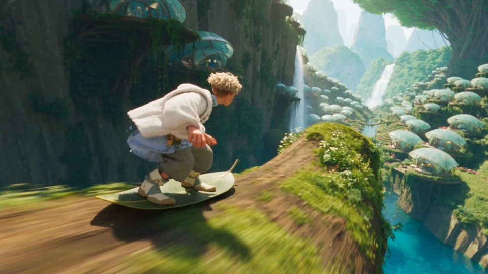</a>

- **作者:** [Latte](https://x.com/0xbisc/status/2112880213877293192) · X · **Seedance 2.5** · ♥ 493
- **标签:** `3D卡通` `无明显地域` `奇幻神话` `运动极限` `热血燃` `多镜头剪辑` `叙事短片`
- 少年踩着一片叶子在森林溪流与瀑布间冲浪飞驰。

### [疾速憨豆](https://daiyixiang666.github.io/awesome-ai-video-prompts/w/x-2106342374805057562.html)

<a href="https://daiyixiang666.github.io/awesome-ai-video-prompts/w/x-2106342374805057562.html"></a>

- **作者:** [TechieSA](https://x.com/TechieBySA/status/2106342374805057562) · X · **Seedance 2.5** · ♥ 2.1万
- **标签:** `3D卡通` `欧洲` `喜剧搞笑` `武侠打斗` `轻松欢快` `多镜头剪辑` `梗段子`
- 约翰·威克遇上憨豆先生，卡通渲染风的 20 秒动作喜剧，角色反差笑点密集。

<details><summary>提示词</summary>

```text
Cinematic anime clip, 20 seconds. Narrow London street at midday — bright clear sunshine, warm golden daylight, brick walls, puddles on the ground, quiet street.
JOHN WICK: Tall lean athletic male, long dark slightly messy hair, short dark beard, black suit, white shirt open at collar. Cold, precise, deadly serious. Increasingly frustrated and confused throughout.
MR BEAN: Use uploaded character sheet as strict visual reference. Fights completely seriously like this is totally normal. Never scared, never panicking.
0:00–0:02 — Wick and Bean facing each other on the sunny street. Wick throwing a combat knife precisely at Bean. Bean bending down to tie his shoelace at the exact moment — knife embedding into the brick wall directly behind where his head just was. Bean standing back up, noticing the knife, touching it curiously, shrugging. Looking at Wick.
0:02–0:04 — Both facing each other properly. Wick raising his fists in a precise fighting stance. Bean raising his fists too — completely wrong technique, elbows out, chin up. Wick driving a fast combination at Bean. Bean raising his umbrella — umbrella opening automatically on impact with a loud pop, blocking everything. Bean looking at the umbrella impressed.
0:04–0:06 — Wick grabbing the umbrella, throwing it aside. Bean pulling out his teddy bear, holding it up like a shield. Close up on Wick's face — staring at the teddy bear. Swinging a punch anyway, connecting with it. Bean stumbling back, checking the bear for damage, looking at Wick with genuine indignation.
0:06–0:08 — Bean swinging the teddy bear at Wick like a club. Wick catching it. Brief tug of war in broad daylight. Bean wrenching it back, tucking it safely inside his jacket. Wick lunging, grabbing Bean's collar. Bean pulling out a large raw fish, slapping Wick directly across the face. Loud wet slap. Fish scales on Wick's cheek. Expression of a man processing something that has never happened to him before.
0:08–0:11 — Wick wiping his face, charging furiously. Bean struggling to pull something from his jacket. Bean pulling out an enormous raw turkey, stumbling from the weight, holding it up just as Wick reaches him — Wick running directly into the turkey at full speed. Bean swinging the turkey like a club. Wick backing up dodging left right, genuinely unable to get past a man swinging a raw turkey in broad daylight.
0:11–0:13 — Wick catching the turkey, wrestling it away, hurling it aside. Both standing facing each other breathing hard. Bright sunshine above. Wick raising his pistol at Bean's face. Bean completely calm, nodding to himself, reaching slowly into his jacket with both hands.
0:13–0:15 — Bean pulling out a full bazooka from inside his jacket with great effort, hoisting it onto his shoulder, aiming directly at Wick. Bright sunshine catching the barrel. Close up on Wick's face — eyes moving from the bazooka to Bean's face. Complete and total disbelief.
0:15–0:17 — Wide from above. Both standing in bright London sunshine. Wick with his pistol. Bean with a bazooka. Neither moving. Close up on Bean's face — tongue poking out in concentration, one eye closed, aiming carefully. Pulling the trigger.
0:17–0:19 — Extreme close up on Wick's face. Eyes going wide. Rocket light reflecting in his eyes. Mouth opening very slightly.
0:19–0:20 — Cut to black. Enormous explosion. Silence. Then Bean's teddy bear squeaking once in the darkness.
Cel-shaded 3D anime, Unreal Engine quality, narrow London street midday bright clear sunshine warm golden daylight brick walls throughout, bold flat color blocking, hard edge shadows, thick black outlines, film grain, orchestral score switching constantly between deadly serious and absurd comedy building to absolute chaos then cutting to silence on black, camera switching constantly — wide from above, medium side shots, extreme close ups on faces and weapons, behind shots — Wick always black suit white shirt cold precise deadly serious.
```

</details>

<a id="video-film-retro"></a>
## 视频 · 胶片复古

### [电话亭的罐头](https://daiyixiang666.github.io/awesome-ai-video-prompts/w/x-2020415877993156966.html)

<a href="https://daiyixiang666.github.io/awesome-ai-video-prompts/w/x-2020415877993156966.html"></a>

- **作者:** [John](https://x.com/johnAGI168/status/2020415877993156966) · X · **Seedance 2.0** · ♥ 213
- **标签:** `胶片复古` `港风` `爱情青春` `孤独忧郁` `多镜头剪辑` `微表情特写` `叙事短片`
- 雨夜红色电话亭里风衣男人握着听筒沉默，唇部特写后转身没入霓虹人群，抽帧拖影。

<details><summary>提示词</summary>

```text
【电影风格】：90年代香港文艺片风格（90s Hong Kong Art Cinema），复古胶片感，高感光度噪点（High ISO Grain），暧昧的黄绿色调（Yellow-Green Tint），抽帧效果（Step-printing），忧郁氛围。

【核心台词（用于控制情绪）】：“如果记忆是一个罐头，我希望它永远不会过期。”

【视频时长】：10秒
【分镜脚本】：

[00:00-00:04] 镜头1：隔着玻璃的窥视（Through the Glass）。
画面：一个满是雨水的红色公用电话亭。
人物：一位穿着卡其色风衣的男士（或女士），手里紧握着听筒，并没有说话，只是在听。
情绪表演：通过玻璃的折射，看到他/她的眼神空洞而深情。雨水在玻璃上流淌，把他的脸扭曲得像一幅油画。
字幕/旁白感：画面仿佛凝固，只有雨声。

[00:04-00:07] 镜头2：极度特写与微表情（Extreme Close-up & Micro-expression）。
画面：聚焦于人物的嘴唇和半张脸。
动作：他/她轻轻对着话筒低语。嘴唇微微颤动，似乎想说什么又咽了回去。
光影：路边的霓虹灯光斑（Bokeh）在他的脸上流转，忽明忽暗。
台词情绪映射：表现出一种“想触碰又收回手”的极致克制和孤独。

[00:07-00:10] 镜头3：标志性的慢快门拖影（Signature Smeary Slow Motion）。
画面：人物挂断电话，转身走入雨夜的人群中。
视觉特效：使用抽帧效果（Stop-motion feel），人物的背影变得模糊且有拖影（Motion Blur），仿佛灵魂留在了原地，只有身体在走。
环境：背景是流动的城市车灯，形成拉长的光轨。

【技术参数】：模拟手持摄影（Handheld Camera），浅景深，色彩偏移，情感浓郁。
```

</details>

### [东京胶片漫游](https://daiyixiang666.github.io/awesome-ai-video-prompts/w/x-2110597035502272787.html)

<a href="https://daiyixiang666.github.io/awesome-ai-video-prompts/w/x-2110597035502272787.html"></a>

- **作者:** [Maha](https://x.com/Aiwithmaha/status/2110597035502272787) · X · **Seedance 2.0** · ♥ 189
- **标签:** `胶片复古` `写实电影感` `日系` `旅行城市` `孤独忧郁` `多镜头剪辑` `vlog`
- 女孩在东京的便利店、自动售货机、鸟居、书店之间游荡，傍晚坐在河堤上看城市灯火。

<details><summary>提示词</summary>

```text
Create a 26-second ultra-realistic cinematic travel video featuring a beautiful young Korean woman exploring the streets of Tokyo, Japan, at night and during sunset, wearing a stylish black leather jacket with natural makeup and soft, wavy black hair. Begin with a rear-view shot of her walking across a busy Tokyo intersection surrounded by colorful neon signs, wet streets, and glowing city lights. Show her smiling warmly while holding a cute Japanese rice ball inside a brightly lit convenience store, followed by a candid moment of her buying a drink from a vending machine. Capture her walking beneath a traditional red Japanese torii gate, then turning back toward the camera with a playful smile in a narrow street decorated with glowing Japanese lanterns. Show her taking a casual selfie on a peaceful residential street and enjoying the riverside scenery as a train passes in the background. Include a cozy bookstore scene where she excitedly opens a travel book and smiles at the camera, followed by a peaceful sunset moment sitting beside the river with a takeaway drink. End with beautiful nighttime city lights, a joyful handheld selfie on an elevated bridge, and her smiling with the Tokyo skyline behind her. Use natural handheld smartphone camera movements, smooth cinematic transitions, authentic candid expressions, realistic skin texture, soft film grain, nostalgic early-2000s MiniDV aesthetics, moody teal-green night tones, warm sunset lighting, and shallow depth of field. Maintain consistent facial identity, hairstyle, outfit, and body proportions throughout the entire video, with realistic movements and a spontaneous travel-diary feeling, in a 16:9 widescreen aspect ratio.
```

</details>

### [夏夜饭桌](https://daiyixiang666.github.io/awesome-ai-video-prompts/w/x-2080239457828311110.html)

<a href="https://daiyixiang666.github.io/awesome-ai-video-prompts/w/x-2080239457828311110.html"></a>

- **作者:** [Ali](https://x.com/aiwithaly/status/2080239457828311110) · X · **Seedance 2.0** · ♥ 156
- **标签:** `胶片复古` `日系` `日常生活` `美食` `温暖治愈` `轻松欢快` `多镜头剪辑` `叙事短片`
- 日式老宅里两个年轻人吃晚饭，抢一块烤鱼、筷子打闹、碰杯，再拉到屋外看灯下的小屋。

<details><summary>提示词</summary>

```text
A Summer Night at the Dinner Table 👇

Inside a traditional Japanese farmhouse, two young friends turn an ordinary dinner into a memory they'll never forget. A stolen bite of grilled fish sparks a playful chopstick battle, laughter fills the room, and the evening ends with a simple toast and a shared strawberry. Shot with nostalgic handheld framing, warm lantern light, vintage film texture, and the gentle atmosphere of a classic Japanese slice-of-life film.

The smallest moments often tell the biggest stories.
```

</details>

### [夏日的少年](https://daiyixiang666.github.io/awesome-ai-video-prompts/w/x-2048297082591834587.html)

<a href="https://daiyixiang666.github.io/awesome-ai-video-prompts/w/x-2048297082591834587.html"></a>

- **作者:** [AI社員研究所｜どこまで任せられる？](https://x.com/tsumichi_app/status/2048297082591834587) · X · **Grok Imagine** · ♥ 84
- **标签:** `胶片复古` `日系` `日常生活` `爱情青春` `温暖治愈` `多镜头剪辑` `卡点节奏` `叙事短片`
- 六秒里闪过西瓜、冰棍、捕虫网、木地板午睡、溪水与夏祭仙女棒——日本乡下童年的夏天。

### [雪地里的耳机与相机](https://daiyixiang666.github.io/awesome-ai-video-prompts/w/x-2090085230942310756.html)

<a href="https://daiyixiang666.github.io/awesome-ai-video-prompts/w/x-2090085230942310756.html"></a>

- **作者:** [探路AI](https://x.com/TanLuAI/status/2090085230942310756) · X · **MiniMax Hailuo H3** · ♥ 71
- **标签:** `胶片复古` `日系` `爱情青春` `孤独忧郁` `浪漫心动` `多镜头剪辑` `宫格分镜` `叙事短片`
- 九十年代日式冬日青春：少年举着相机拍围红围巾、戴耳机的少女，雪原里两人隔着雪花相视，最后相机和耳机静静落在雪地。

<details><summary>提示词</summary>

```text
故事板图片提示词：（可参考）
整体构图与布局：  生成一张极致精细、完整的专业短片分镜故事板（Storyboard），画面比例为 横版，项目总时长严格为 30 秒。  
画面内容风格（不作为故事板内文字出现）： 90 年代日式冬日青春独立电影的抽象电影语言：空灵、克制、怀旧、略带忧郁，极强的雪景空气感、冷调通透光影、日系冬季穿搭、诗意留白。35mm 胶片质感、复古人像镜头、自然细腻胶片颗粒、低对比度、低饱和度、冷霜白与胶片青蓝阴影、轻微高光晕染、奶油般浅景深焦外。雪地全环境漫反射布光，人物面部通透、无生硬阴影。真实电影写实风格，不是动漫、插画、商业广告或 K-pop 偶像精修。  人物完全新生成，不参考任何输入图片、真人、明星或具体导演。  
故事板背景采用带有极细腻 35mm Film Grain 的冷霜白（Cold White）高级相纸纹理。顶部横幅只包含清晰易读英文：  “WINTER ECHOES” “30s | 16:9 | COLOR” “Japanese Youth Cinema × Winter Romance × Snow Aesthetic × Precise 15s Audio Split × Pure Sound (No VO)”  禁止出现额外大段文字、乱码、水印或品牌 Logo。  分镜网格系统：  
画面中心严格由两排、共八个独立分镜模块组成（SCENE 01–08）。每个模块包含：  - 顶部：场景编号、精确时间轴、简短场景名； - 中部：两个并列真实电影画面，明确标注“START FRAME”和“END FRAME”； - 下方：简洁、规整、易读的三行信息栏：“CAMERA”“MOVEMENT”“ACTION / SOUND”。  文字保持极简，画面优先保证人物一致性、连续动作与镜头关系。  
人物设定：  全片只有同一对、完全新生成的成年日本青年，约二十出头；八个场景里脸、发型、身材和服装必须保持一致。人物拥有自然、低修饰、真实日语青春电影年轻演员的选角感，正常五官比例与真实皮肤纹理，无网红滤镜、无偶像妆。  女主： 自然直黑长发，未经刻意打理；深藏青牛角扣呢子大衣，领口微露水手服灵感白领；格纹百褶裙、黑色厚防寒打底袜、暗红色厚围巾、黑色复古头戴耳机。脸部素净通透，脸颊因低温微红。  男主： 自然微乱的中分或偏分黑发，不喷发胶；炭灰色羊毛双排扣短大衣、深色高领校服灵感内搭、灰色围巾；使用无品牌、磨砂黑色单反相机。 
连续动作锁定：  Scene 03、Scene 04、Scene 05 必须是同一段连续动作。  相机先掉进松软雪地；随后两人都蹲下捡相机；相机在 Scene 04 中始终停留在雪地上，绝不被拿起。Scene 05 两人对视时仍保持蹲姿，绝不站起。  Scene 04 中，女主的手在下方、已经放在相机上；男主的手从上方伸入，刚好轻轻碰到女主的手。两只手必须是正常真实成年人手部，每只手准确五根手指，手掌、指节、指甲、手套边缘和受力关系自然；禁止多手指、融合手指、畸形手、牵手姿势或多余肢体。  

视觉叙事内容：  
- Scene 01（0–3.0s）【雪中的独行】  镜头一采用 35mm 焦段，缓慢平移。START FRAME：女主上半身与侧脸近景，黑色耳机、深藏青大衣、暗红围巾、发丝上的雪花与清晰白气可见；她微微眯眼，沉浸在音乐中。  END FRAME：低角度下半身近景，格纹裙摆、黑色厚冬袜与靴子踩进厚积雪。  【音频设计】：ASMR 级踩雪“咯吱咯吱”声，微弱耳机漏音，远处风雪白噪音。 
 - Scene 02（3.0–6.0s）【取景框里的定格】  镜头一采用 50mm 标准焦段，固定机位带极轻微呼吸感。START FRAME：男主蹲在松软雪地里，双手举着黑色单反拍摄落雪的中近景；必须明确是蹲姿。  END FRAME：极平滑 Rack Focus，焦点从沾雪的相机镜头转换到男主专注的侧脸近景，背景自然虚化。  【音频设计】：轻微快门试拍声，雪花落在相机上的细微声响。  
- Scene 03（6.0–9.0s）【意外的碰撞】  START FRAME：85mm 低机位紧凑近景，只聚焦女主冬装下半身与男主蹲着的上半身。女主向前走时，裙摆、厚冬袜和大衣下摆轻轻碰到正蹲着拍雪的男主肩膀或背部；这是非性化、自然的意外碰撞，男主仍明显处于蹲姿。  END FRAME：100mm 紧凑特写。黑色单反水平掉进两人脚边松软雪地，机身半陷雪坑，镜头朝侧方，细碎雪粉溅起。画面只出现相机、雪和少量靴子边缘，绝不出现手。  【台词/音效】：女主同期声「あっ、ごめんなさい！」，伴随相机落入厚雪的闷响。  
- Scene 04（9.0–12.0s）【指尖的温度】  采用 100mm 微距镜头，极慢推镜。  START FRAME：雪地相机与女主右手的微距特写。女主已经蹲下，戴半指毛线手套的右手从画面下方伸向仍躺在雪坑中的相机；她的手尚未触碰相机，冻红指尖距离相机仅几厘米。  END FRAME：更紧凑的微距特写。女主的右手已经自然放在黑色相机机身上，手指清楚接触相机顶盖与握柄；男主的右手从画面上方自然伸入，手掌向下，指尖刚好、极轻微地碰到女主手背，同时轻轻护住相机。女主手在下，男主手在上；相机清晰可见，仍半陷在雪地里，绝不被拿起。  【手部真实感要求】：每只手准确五根手指；女主手套纤维、冻红指尖、男主指节与指甲真实自然；禁止牵手、交叉缠绕、手掌扭曲、多余手指、畸形手或多余手臂。  【音频设计】：衣料摩擦、近距离呼吸、雪花落在手套与相机上的细微声响。  - Scene 05（12.0–15.0s）【蹲着的对视】  采用 85mm 焦段、f/1.4 极浅景深、缓慢推轨。  START FRAME：女主害羞泛红的脸部近景。她仍蹲在雪地中，黑色耳机、暗红围巾、发丝上的雪花和冷空气白气清晰可见；她先微微低头，再害羞地抬眼，眼神带着歉意、慌乱与克制的心动。画面不出现手和相机。  END FRAME：两人仍保持蹲姿的双人上半身与面部近景，摄影机处于蹲姿眼平高度。女主和男主在近距离害羞对视，巨大雪花从两人脸之间缓慢飘过，背景化为冷白色柔和散景。画面不出现手、不出现相机、不出现其他人物，绝不站立。  【音频设计】：放大的环境白噪音、近距离呼吸、远处风雪声。  
- Scene 06（15.0–21.0s）【定格的冬日】  采用 50mm 焦段，平滑横向摇摄。  START FRAME：男主举起同一台单反，对准站在雪松下的女主按下快门；女主害羞地笑着，用粗线围巾挡住半张脸。  END FRAME：视角互换，女主笨拙地举着同一台单反，拍摄男主在漫天飞雪中回头微笑的瞬间。  【音频设计】：从 15 秒开始，顺滑切入极简、清冷的 Lo-fi 独立钢琴器乐。  
- Scene 07（21.0–26.0s）【冬日的喧闹】  采用 35mm 广角镜头，动感手持跟拍。  START FRAME：两人在齐踝深的广阔雪地里追逐、互相抛掷雪球，沿画面对角线跑过，保留真实运动模糊与自然失焦。  END FRAME：雪球在画面前景半空炸开化作雪粉，透过飘散的雪渣看到两人自然、肆意的笑脸。  【音频设计】：清澈笑声、急促呼吸、踏雪奔跑声与极简钢琴。  
- Scene 08（26.0–30.0s）【雪地留白】  采用 85mm 焦段，缓慢拉镜。  START FRAME：松软洁白无瑕的雪地上，黑色单反与黑色头戴式耳机静静并排放置，晶莹雪花一点一点落在它们上面。  END FRAME：绝对不出现任何片尾文字。焦点极慢地完全虚化，相机与耳机消融在极浅景深外，最终成为柔和、闪烁的白色雪地 Bokeh。  【音频设计】：钢琴自然淡出，只留风雪声。  

底层设计规范：  - 色板（Key Color）： 五个清晰色块并标注： 冷霜雪白 #F4F7F6 忧郁胶片青蓝 #8FA8B4 厚重深藏青 #2C3E50 单反磨砂黑 #1A1A1A 低饱和初樱粉 #FFB7C5  - 音频（Audio Design）： 全片绝对禁止旁白。 0–15 秒：踩雪、衣料摩擦、呼吸、相机快门、雪与风的环境白噪音。 15–30 秒：极简清冷 Lo-fi 钢琴、笑声、跑雪声与风雪；结尾钢琴淡出，只留风雪。  - 技术与光影： 底栏以简洁图标与小号英文标注： “24fps” “1920×1080” “35mm Film” “Snow Bounce Ambient Lighting”  严禁： 动漫、插画、K-pop 偶像精修、商业时尚广告感、强烈青橙调色、过密雪花、3D UI、重复镜头、单张海报布局、水印、品牌 Logo、乱码、站立对视、相机被提前拿起、错误手指或畸形手。

视频提示词：
基础设定：基于这张分镜故事板的信息，生成一段16:9的充满日式电影美学与叙事感的 青春短片。仅生成下面描述的画面内容有的scene。
风格提示词：90 年代日式冬日青春独立电影的抽象电影语言：空灵、克制、怀旧、略带忧郁，极强的雪景空气感、冷调通透光影、日系冬季穿搭、诗意留白。35mm 胶片质感、复古人像镜头、自然细腻胶片颗粒、低对比度、低饱和度、冷霜白与胶片青蓝阴影、轻微高光晕染、奶油般浅景深焦外。雪地全环境漫反射布光，人物面部通透、无生硬阴影。真实电影写实风格。
画面内容：（生成哪段写哪段）
```

</details>

### [胶片相机的一天](https://daiyixiang666.github.io/awesome-ai-video-prompts/w/x-2085684722860978256.html)

<a href="https://daiyixiang666.github.io/awesome-ai-video-prompts/w/x-2085684722860978256.html"></a>

- **作者:** [Elisia](https://x.com/AiwithElisia/status/2085684722860978256) · X · **Seedance 2.0** · ♥ 66
- **标签:** `胶片复古` `无明显地域` `日常生活` `温暖治愈` `宫格分镜` `多镜头剪辑` `vlog`
- 女孩背着旧胶片相机走街串巷：拍墙角小花、逛相机店、在咖啡馆翻看冲洗的照片，逆光树影里回头一笑。

<details><summary>提示词</summary>

```text
A beautiful 22-year-old Asian woman with a natural smile, messy ponytail, wearing an oversized white T-shirt, blue denim jeans, and white sneakers, carrying a vintage film camera around her neck. She walks through charming city streets during golden hour, explores a cozy vintage camera shop, picks up and admires classic cameras, takes candid street photos, relaxes in a warm café while looking at instant film prints, and ends in a beautiful green park holding the camera toward the viewer. Cinematic storytelling, nostalgic travel aesthetic, Kodak Portra 400 film look, warm golden-hour lighting, soft film grain, realistic skin texture, natural facial expressions, handheld camera movement, shallow depth of field, dreamy bokeh, smooth transitions, premium lifestyle photography, ultra-realistic, HDR, 8K, professional cinematography.

Negative Prompt: AI text, watermark, logo, captions, blurry, low quality, noise, artifacts, flickering, distorted face, extra fingers, duplicate people, oversaturated colors, cartoon, CGI, low resolution, compression artifacts.
```

</details>

### [1920年代大阪集市](https://daiyixiang666.github.io/awesome-ai-video-prompts/w/x-2106808379658428801.html)

<a href="https://daiyixiang666.github.io/awesome-ai-video-prompts/w/x-2106808379658428801.html"></a>

- **作者:** [Saul Goodman](https://x.com/Goodmanprotocol/status/2106808379658428801) · X · **Seedance 2.5** · ♥ 47
- **标签:** `胶片复古` `写实电影感` `日系` `历史年代` `悬疑惊悚` `紧张刺激` `多镜头剪辑` `叙事短片`
- 1920 年代大阪市场里一名女子在人群与蒸汽中躲避追查，最终藏身暗处。

<details><summary>提示词</summary>

```text
Create a 30-second ultra-realistic cinematic sequence set in a 1920s Osaka market. Preserve authentic period details: wooden storefronts, narrow market lanes, traditional Japanese clothing, handwritten shop signs, lanterns, food stalls, bicycles, and historically accurate props. Photorealistic people, skin, fabrics, wood, steam, and natural lighting. Use a subtle vintage analog-camera character without sacrificing realism. No modern objects, text overlays, logos, or watermarks.

[0–5s] — SNEAKING THROUGH THE MARKET
Yuki quietly moves through a crowded 1920s Osaka market, staying close to wooden stalls and avoiding attention. She wears historically accurate Japanese clothing. The camera follows at shoulder height with subtle handheld movement as vendors and shoppers pass naturally around her.

[5–10s] — THROUGH THE CROWD
Yuki pauses beside a food stall and looks carefully over her shoulder. Steam rises from cooking pots while warm lantern light falls across her face. She slips between two stalls, moving quickly but cautiously as the camera tracks beside her.

[10–15s] — SOMETHING IS WRONG
She reaches a darker section of the market and notices a suspicious movement inside a wooden shop. She slowly peers around the corner. A distant figure briefly appears through the crowd. Yuki freezes, then immediately blends back into the moving crowd.

[15–20s] — BEING FOLLOWED
Yuki walks faster through the narrow market street, repeatedly glancing behind her. A mysterious figure follows at a distance. The camera tracks backward in front of her, capturing her increasingly nervous expression while maintaining realistic crowd movement.

[20–25s] — THE ALLEY
Yuki suddenly turns into a narrow alley beside the market. She presses against the wooden wall and listens. Footsteps approach from behind. She notices a partially open doorway and quietly slips inside.

[25–30s] — HIDING
Inside a dim wooden room, Yuki hides behind stacked crates. The camera slowly pushes toward her face as footsteps pass outside. She holds her breath, listening. The footsteps gradually disappear. She carefully looks toward the doorway as the scene cuts to black.

STYLE: ultra-realistic historical cinematography, photorealistic 1920s Osaka, authentic Japanese architecture and clothing, realistic human faces and skin texture, natural crowd behavior, physically accurate lighting, detailed wood and fabric textures, atmospheric steam, subtle handheld camera movement, cinematic depth of field, realistic shadows, natural color grading, high-detail 4K HDR.

Add only a very subtle vintage analog-camera texture—light grain, slight softness, and restrained color fading—while keeping the overall image highly realistic and detailed.
```

</details>

### [1974年的苏联夏天](https://daiyixiang666.github.io/awesome-ai-video-prompts/w/x-2108014516789563534.html)

<a href="https://daiyixiang666.github.io/awesome-ai-video-prompts/w/x-2108014516789563534.html"></a>

- **作者:** [Maria](https://x.com/thisismariaa25/status/2108014516789563534) · X · **Seedance 2.5** · ♥ 247
- **标签:** `胶片复古` `欧洲` `历史年代` `日常生活` `温暖治愈` `多镜头剪辑` `叙事短片`
- 苏联乡村的一天：清晨窗边、骑车的邻居、门廊吃面包喂猫、田间骑行、河边泡脚、日落回家。

### [送错了](https://daiyixiang666.github.io/awesome-ai-video-prompts/w/tt-7690981557946961182.html)

<a href="https://daiyixiang666.github.io/awesome-ai-video-prompts/w/tt-7690981557946961182.html"></a>

- **作者:** [dreamfall.art](https://www.tiktok.com/@dreamfall.art/video/7690981557946961182) · TikTok · ♥ 34.3万
- **标签:** `胶片复古` `美式` `爱情青春` `浪漫心动` `微表情特写` `叙事短片`
- 90年代纽约质感的都市爱情小品：一次送错的快递引出的心动瞬间。

### [另一种人生](https://daiyixiang666.github.io/awesome-ai-video-prompts/w/tt-7679822438661704990.html)

<a href="https://daiyixiang666.github.io/awesome-ai-video-prompts/w/tt-7679822438661704990.html"></a>

- **作者:** [dreamfall.art](https://www.tiktok.com/@dreamfall.art/video/7679822438661704990) · TikTok · ♥ 8.6万
- **标签:** `胶片复古` `写实电影感` `美式` `爱情青春` `孤独忧郁` `浪漫心动` `多镜头剪辑` `叙事短片`
- 90年代纽约街头，一张名片、一辆出租车与错过的缘分。

<a id="video-anime"></a>
## 视频 · 日系动漫

### [机场魔法笔](https://daiyixiang666.github.io/awesome-ai-video-prompts/w/x-2104794578952011784.html)

<a href="https://daiyixiang666.github.io/awesome-ai-video-prompts/w/x-2104794578952011784.html"></a>

- **作者:** [M-studioAi](https://x.com/Strength04_X/status/2104794578952011784) · X · **Seedance 2.5** · ♥ 202
- **标签:** `日系动漫` `写实电影感` `无明显地域` `旅行城市` `奇幻神话` `轻松欢快` `第一人称` `变身转场` `vlog`
- 第一人称在机场用一支笔把行李箱、看板、飞机都画成二次元贴纸，最后写下 THE END。

<details><summary>提示词</summary>

```text
Magic Pen Airport Vlog · 20 Seconds · Vertical 9:16

[STYLE]
Live-action + flat 2D anime sticker compositing, first-person airport magic vlog. 8K photorealistic detail with the authentic look of a real smartphone rear-camera recording. Strong visual contrast between the photorealistic airport and flat cartoon objects. One continuous handheld smartphone shot. No cuts. No scene transitions.

[CAMERA]
Raw, unstabilized handheld smartphone footage throughout: natural walking shake, subtle arm movement, occasional autofocus hunting, realistic exposure shifts between bright terminal lighting and window sunlight, and slight rolling-shutter jelly during fast pans. Natural smartphone HDR colors with soft realistic tones. The camera quickly whip-pans to follow the marker and each target.

[LIGHTING]
Bright natural daylight enters through large airport windows, mixed with soft indoor lighting. Every real object and animated character maintains soft contact shadows matching the environment.

[SETTING]
One continuous walk through a modern Korean airport terminal. Large glass windows, check-in counters, luggage carts, digital displays, passengers, and polished floors create a premium realistic environment. Background travelers move naturally.

[PEN — MAGIC RULES]
The vlogger's real hand, with photorealistic skin and visible pores, holds a black marker and remains visible throughout the entire video.

Every transformation follows the exact same sequence:

Marker points → Vlogger says “Biu!” → blue hand-drawn sketch lines wrap around the target → ink spreads → the target transforms into a lively flat 2D cel-shaded anime character with bold cartoon outlines.

The transformed target preserves its exact size, position, speed, direction, and perspective, remaining perfectly anchored in the real airport environment. Characters retain flat sticker-style shading and are never relit by the real-world lighting.

[00:00–00:04]

First-person view walking through the airport terminal. The vlogger raises the marker and points toward a large rolling suitcase beside a traveler.

“Biu!”

Blue sketch lines wrap around the suitcase. It transforms into a lively flat 2D anime suitcase while keeping its exact size and position.

It rolls forward a few steps.

SFX: Airport ambience + rolling wheels + marker whoosh.

[00:04–00:08]

The marker quickly swings toward an airport luggage cart moving through the terminal.

“Biu!”

The cart transforms into a flat 2D anime luggage cart while maintaining its exact size, speed, direction, and perspective.

Its wheels spin rapidly as it continues moving.

SFX: Wheel movement + metallic rolling sound.

[00:08–00:12]

The marker follows toward a large digital departure display.

“Biu!”

The display transforms into a flat 2D anime screen. Its visual elements become animated hand-drawn symbols that move across the screen.

SFX: Electronic beeps + sketching sound.

[00:12–00:16]

The marker swings toward an airplane visible through the terminal window.

“Biu!”

Blue sketch lines wrap around the airplane. It transforms into a giant flat 2D anime airplane while preserving its exact size, position, direction, and perspective.

It slowly moves across the distant runway.

SFX: Distant aircraft engine + magical ink transition.

[00:16–00:20]

The vlogger stops and gives one final louder:

“Biu—!”

The marker spins upward toward the airport glass ceiling. A blue ink spiral spreads across the glass, transforming the visible sky outside into a hand-drawn anime sky while the airport terminal remains completely photorealistic.

A small handwritten “THE END!” doodle appears among the illustrated clouds.

Freeze frame.

SFX: Sharp throwing whoosh + spreading watercolor bloom + felt-tip squeak writing “THE END!”
```

</details>

### [猪排饭](https://daiyixiang666.github.io/awesome-ai-video-prompts/w/x-2098845134326808734.html)

<a href="https://daiyixiang666.github.io/awesome-ai-video-prompts/w/x-2098845134326808734.html"></a>

- **作者:** [Saul Goodman](https://x.com/Goodmanprotocol/status/2098845134326808734) · X · **Seedance 2.5** · ♥ 4937
- **标签:** `日系动漫` `日系` `美食` `温暖治愈` `卡点节奏` `多镜头剪辑` `叙事短片`
- 日式动画风的快节奏猪排饭烹饪短片，食物特写、蒸汽与匹配剪辑俱佳。

<details><summary>提示词</summary>

```text
Create a 30-second fast-paced cinematic Japanese anime cooking video showing the preparation of authentic katsudon, entirely from the text description below.

IMPORTANT: Do not display, recreate, trace, reference, or imitate any storyboard, sketch, reference image, panel, annotation, or source material. Generate only original anime-style animation.

STYLE

High-quality Japanese anime film style, cinematic summer lighting, ultra-detailed food textures, realistic cooking physics, visible steam and moisture, shallow depth of field, macro close-ups, smooth camera movement, warm Japanese kitchen atmosphere. Fast rhythmic editing with natural match cuts based on movement, shape, texture, and composition.

TIMELINE

0–2.5s — Prepare Pork
Close-up of hands pounding a thick pork loin with a wooden mallet on a cutting board. The meat gradually flattens and its fibers loosen. Sprinkle salt and pepper evenly. Crisp rhythmic impacts.

2.5–5s — Bread the Pork
Quick match cuts: press the pork into flour, dip into beaten egg, then firmly coat with coarse panko breadcrumbs. Show realistic egg dripping and breadcrumbs adhering to the surface.

5–7.5s — Fry
Lower the breaded pork into hot golden oil. Intense bubbling surrounds the cutlet as the crust turns golden brown and crispy. Warm cinematic lighting and detailed oil movement.

7.5–9.5s — Slice
Place the fried tonkatsu on a wooden board. A sharp knife cuts it into even strips. The crispy crust cracks naturally, revealing juicy white pork with gentle steam escaping.

9.5–12s — Simmer Dashi & Onion
Thinly sliced onions gently simmer in amber dashi inside a shallow pan. Small bubbles rise while the onions become translucent. Chopsticks gently move them through the broth.

12–14s — Add Tonkatsu
Place the sliced tonkatsu carefully over the simmering onions using chopsticks. The broth begins soaking into the crispy edges while steam rises.

14–16.5s — Pour Egg
Slowly pour beaten golden egg over the tonkatsu and onions. The egg spreads naturally through the gaps and begins setting around the hot edges.

16.5–19s — Set the Egg
Close-up of the egg gently coagulating over low heat. Edges become soft and golden while the center remains glossy, slightly runny, and trembling. No stirring.

19–21s — Prepare Rice
A white ceramic donburi bowl receives a generous mound of steaming Japanese short-grain rice. The rice looks fluffy and slightly glossy.

21–24s — Assemble
Carefully slide the egg-and-tonkatsu mixture from the pan onto the rice. The egg settles naturally in a soft wave while dashi lightly absorbs into the rice.

24–26s — Final Close-Up
The finished katsudon rests on the counter. Glossy egg slowly settles over the tonkatsu and rice, gently trembling. Slow cinematic push-in.

26–30s — Hero Reveal
Present the finished katsudon in a traditional blue-and-white ceramic bowl on a wooden surface. Golden egg covers crispy tonkatsu over glossy rice, topped with fresh mitsuba. Steam rises as the camera slowly arcs around the bowl for a beautiful anime-food-film ending.

AUDIO

Bright 1980s-inspired Japanese city-pop instrumental, 110–120 BPM, with subtle koto and light chime percussion. Synchronize realistic ASMR cooking sounds: mallet impacts, knife slicing, frying sizzle, bubbling dashi, chopsticks, egg pouring, steam, and a soft ceramic clink.

End with one delicate wind-chime tone during the final reveal.

NEGATIVE

No storyboard, reference image, sketch, panels, borders, numbers, arrows, annotations, subtitles, captions, UI, logos, or text overlays. No unrelated ingredients or dishes. Katsudon only. Keep the food, hands, utensils, lighting, and environment visually consistent throughout.
```

</details>

<a id="video-black-and-white"></a>
## 视频 · 黑白影像

### [五十年代的黑白日常](https://daiyixiang666.github.io/awesome-ai-video-prompts/w/x-2091887878922174510.html)

<a href="https://daiyixiang666.github.io/awesome-ai-video-prompts/w/x-2091887878922174510.html"></a>

- **作者:** [Johnn](https://x.com/john_my07/status/2091887878922174510) · X · **Seedance 2.5** · ♥ 58
- **标签:** `黑白影像` `韩系` `历史年代` `日常生活` `孤独忧郁` `多镜头剪辑` `叙事短片`
- 黑白胶片质感里，一位年轻女子在老式韩屋叠衣、晾晒、照镜子、打水，镜头安静地跟着她走完一个午后。

<details><summary>提示词</summary>

```text
Create a highly realistic 30-second cinematic historical sequence set in Korea during the 1950s. The entire video should feel like a naturally observed fragment of ordinary life from that era — not a vlog, not a modern recording, and not a person performing for a camera.

MAIN SUBJECT:
A young Korean woman in her early 20s with a consistent, natural appearance and believable facial features. She has black hair tied loosely back, minimal makeup, natural skin texture and subtle everyday expressions.

Her outfit is period-inspired but youthful and attractive: a fitted cropped short-sleeve cotton top paired with high-waisted shorts ending around the upper thigh, simple flat leather shoes, and a small understated necklace. The clothing should look like authentic, practical 1950s cotton clothing rather than modern fashion. Natural fabric wrinkles, slightly faded colors and realistic stitching.

CONCEPT:
Show several small moments from her ordinary daily routine, progressing naturally from inside her home to the neighborhood outside. She never looks into or acknowledges the camera. There is no visible camera, filming equipment, phone or modern recording device.

SCENE 1 — MORNING AT HOME | 0–6 SEC
Inside a modest 1950s Korean home with wooden floors, simple bedding, handmade household objects and sunlight entering through a paper-covered window.

The woman folds a small stack of freshly washed clothes, then carries them outside in a woven basket. Her movements are casual and unhurried. Sunlight falls naturally across the room, revealing dust particles in the air.

SCENE 2 — HANGING LAUNDRY | 6–11 SEC
She steps into a small courtyard behind the house and hangs clothes on a simple rope line.

Show her stretching upward to place a shirt over the line, securing it with simple wooden clothespins, then smoothing another garment with her hands. A light breeze gently moves the hanging clothes and her loose hair.

Include small environmental details: clay pots, wooden walls, stone ground, a water basin and neighboring rooftops in the background.

SCENE 3 — PREPARING TO GO OUT | 11–16 SEC
She returns inside and quickly prepares to leave. She picks up a small woven shoulder bag, checks herself naturally in a small old-fashioned mirror, adjusts her hair and puts on her simple shoes.

Her expression is relaxed and spontaneous — never posed.

SCENE 4 — WALKING THROUGH THE NEIGHBORHOOD | 16–22 SEC
She walks out through a wooden gate into a quiet 1950s Korean residential lane.

Show traditional houses, stone walls, bicycles, wooden carts, laundry lines, children playing farther away and neighbors performing ordinary chores. She walks naturally through the scene carrying her small bag.

SCENE 5 — EVERYDAY ERRAND | 22–27 SEC
She approaches a small public water pump or communal washing area. She briefly fills a small metal container, adjusts her grip and continues walking.

Keep the interaction simple and believable. No vendor, no market performance and no staged interaction.

SCENE 6 — FINAL MOMENT | 27–30 SEC
She walks along a sunlit lane bordered by old Korean houses and trees. A breeze moves her clothes naturally as she passes through patches of sunlight and shadow.

She briefly pauses to look toward something happening farther down the street, smiles subtly, then continues walking out of frame.

VISUAL STYLE:
Authentic 1950s Korean period-film aesthetic. Photorealistic historical reconstruction with soft natural daylight, slightly faded monochrome or extremely subtle muted color, fine analog film grain, gentle halation, slight lens softness, natural exposure fluctuations and occasional tiny imperfections characteristic of period film.

The image must NOT look like a modern video with a generic "vintage filter." Architecture, clothing, props, materials and human behavior should all convincingly belong to 1950s Korea.

CAMERA:
Observational period cinematography. The camera exists as an unseen observer rather than a participant. Use carefully composed static shots mixed with very slow natural camera movement. No handheld vlog movement, no selfie perspective, no modern stabilization, no dramatic zooms and no shots where the subject appears aware of being filmed.

AUDIO:
Pure environmental sound: birds, distant voices, footsteps, fabric moving in the breeze, wooden doors, water flowing from the pump, distant bicycles and neighborhood activity. No music, no narration, no modern sound effects.

REALISM:
Every movement must obey real-world physics. Natural hands and fingers, realistic walking, believable fabric deformation, consistent shadows, physically accurate sunlight, authentic facial expressions and continuous character identity. No extra fingers, warped hands, floating objects, distorted faces, modern objects or AI-looking motion.

The final result should feel like a genuine 30-second fragment of everyday Korean life from the 1950s — intimate, quiet, observational and historically believable, with the woman's ordinary routine providing the visual story.

FORMAT:
30 seconds, Seedance 2.5, 16:9, ultra-high-quality photorealism, cinematic historical realism, consistent character identity, coherent transitions, natural motion and authentic 1950s Korean atmosphere.
```

</details>

### [白教堂华尔兹](https://daiyixiang666.github.io/awesome-ai-video-prompts/w/x-2088546485982171432.html)

<a href="https://daiyixiang666.github.io/awesome-ai-video-prompts/w/x-2088546485982171432.html"></a>

- **作者:** [Timeless](https://x.com/Timeless_aiart/status/2088546485982171432) · X · **Midjourney + Seedance 2.5** · ♥ 1.1万
- **标签:** `黑白影像` `欧洲` `历史年代` `音乐舞蹈` `诡异不安` `多镜头剪辑` `MV`
- 维多利亚伦敦街头的黑白哥特华尔兹，构图和服装像插画动起来。

### [消失的华沙](https://daiyixiang666.github.io/awesome-ai-video-prompts/w/x-2088148361903824927.html)

<a href="https://daiyixiang666.github.io/awesome-ai-video-prompts/w/x-2088148361903824927.html"></a>

- **作者:** [Maciej Dobrodziej](https://x.com/M_Dobrodziej/status/2088148361903824927) · X · **Seedance 2.5** · ♥ 2944
- **标签:** `黑白影像` `欧洲` `历史年代` `孤独忧郁` `时间冻结倒放` `一镜到底` `叙事短片`
- 用一张 1930 年代华沙老照片，冻结整条街，镜头穿行于行人、电车和招牌之间。

<a id="video-cyberpunk-neon"></a>
## 视频 · 赛博霓虹

### [午夜青蛙](https://daiyixiang666.github.io/awesome-ai-video-prompts/w/tt-7630157915751451926.html)

<a href="https://daiyixiang666.github.io/awesome-ai-video-prompts/w/tt-7630157915751451926.html"></a>

- **作者:** [melogix](https://www.tiktok.com/@melogixx/video/7630157915751451926) · TikTok · **Midjourney** · ♥ 3.9万
- **标签:** `赛博霓虹` `超现实梦境` `无明显地域` `宠物动物` `轻松欢快` `MV`
- 80年代霓虹夜景下，穿亮片外套的青蛙在城市上空慵懒躺着。

<a id="video-watercolor-storybook"></a>
## 视频 · 水彩绘本

### [林中奔逃](https://daiyixiang666.github.io/awesome-ai-video-prompts/w/x-2021299278455681206.html)

<a href="https://daiyixiang666.github.io/awesome-ai-video-prompts/w/x-2021299278455681206.html"></a>

- **作者:** [Brett Stuart](https://x.com/bstuartTI/status/2021299278455681206) · X · **Seedance 2.0** · ♥ 5366
- **标签:** `水彩绘本` `无明显地域` `奇幻神话` `紧张刺激` `多镜头剪辑` `叙事短片`
- 一张起始图+一条含 5 个分镜的提示词生成的手绘水彩风逃亡段落。

<a id="image-surreal-dream"></a>
## 图片 · 超现实梦境

### [特洛伊之战](https://daiyixiang666.github.io/awesome-ai-video-prompts/w/img-x-2085072970129576086.html)

<a href="https://daiyixiang666.github.io/awesome-ai-video-prompts/w/img-x-2085072970129576086.html"></a>

- **作者:** [Keskin](https://x.com/craftian_keskin/status/2085072970129576086) · X · ♥ 3.7万
- **标签:** `超现实梦境` `欧洲` `历史年代` `奇幻神话` `史诗壮阔`
- 橙黑两色的史诗画面：沙丘上的战士、燃烧的天际线、巨大的落日剪影。

### [星环之下](https://daiyixiang666.github.io/awesome-ai-video-prompts/w/img-x-2098815974858281039.html)

<a href="https://daiyixiang666.github.io/awesome-ai-video-prompts/w/img-x-2098815974858281039.html"></a>

- **作者:** [Dogan Ural](https://x.com/doganuraldesign/status/2098815974858281039) · X · ♥ 3.1万
- **标签:** `超现实梦境` `无明显地域` `科幻` `孤独忧郁` `史诗壮阔`
- 一个人站在地平线上，头顶是红白蓝的巨大星环，四张图拼成一幅连续全景（封面为拼接）。

### [合成地板运动场](https://daiyixiang666.github.io/awesome-ai-video-prompts/w/img-x-2067609069947420761.html)

<a href="https://daiyixiang666.github.io/awesome-ai-video-prompts/w/img-x-2067609069947420761.html"></a>

- **作者:** [Sycomore](https://x.com/The_Sycomore/status/2067609069947420761) · X · **Midjourney V8.1** · ♥ 2282
- **标签:** `超现实梦境` `无明显地域` `运动极限` `轻松欢快`
- 草地、红土网球场、蓝色跑道被卷成巨型丝带，运动员在上面奔跑。

### [雨窗外的印象派](https://daiyixiang666.github.io/awesome-ai-video-prompts/w/img-x-1912220087232168092.html)

<a href="https://daiyixiang666.github.io/awesome-ai-video-prompts/w/img-x-1912220087232168092.html"></a>

- **作者:** [Nick St. Pierre](https://x.com/nickfloats/status/1912220087232168092) · X · **Midjourney v7** · ♥ 1018
- **标签:** `超现实梦境` `欧洲` `自然风光` `孤独忧郁`
- 透过湿玻璃看到的野花、白马、红伞人和小屋，景深极浅，色彩像莫奈。

### [巨石雕塑](https://daiyixiang666.github.io/awesome-ai-video-prompts/w/img-x-2051243489594081694.html)

<a href="https://daiyixiang666.github.io/awesome-ai-video-prompts/w/img-x-2051243489594081694.html"></a>

- **作者:** [Sycomore](https://x.com/The_Sycomore/status/2051243489594081694) · X · **Midjourney v8.1** · ♥ 240
- **标签:** `超现实梦境` `无明显地域` `产品` `史诗壮阔`
- 沙漠里的巨石被雕成头像、靴子和带窗的建筑，暖棕色调像产品广告。

<details><summary>提示词</summary>

```text
--sref 520517274 --profile 72xonyq --hd --v 8.1
```

</details>

<a id="image-commercial"></a>
## 图片 · 广告大片

### [越来越多的铬](https://daiyixiang666.github.io/awesome-ai-video-prompts/w/img-x-2087569736582258701.html)

<a href="https://daiyixiang666.github.io/awesome-ai-video-prompts/w/img-x-2087569736582258701.html"></a>

- **作者:** [Sycomore](https://x.com/The_Sycomore/status/2087569736582258701) · X · **Midjourney** · ♥ 1.1万
- **标签:** `广告大片` `无明显地域` `时尚美妆` `史诗壮阔`
- 火焰形金属头饰、羽毛长裙、金色高跟鞋，白底高定时装大片。

### [Crocs 超现实广告](https://daiyixiang666.github.io/awesome-ai-video-prompts/w/img-x-2047629543608025121.html)

<a href="https://daiyixiang666.github.io/awesome-ai-video-prompts/w/img-x-2047629543608025121.html"></a>

- **作者:** [Heisenberg](https://x.com/rovvmut_/status/2047629543608025121) · X · **GPT Image 2** · ♥ 2031
- **标签:** `广告大片` `美式` `产品` `时尚美妆` `轻松欢快`
- 模特靠在巨大的白色洞洞鞋上，浅蓝背景配巨型品牌字，干净的时装广告海报。

<details><summary>提示词</summary>

```text
A high-fashion surrealist advertising poster for Crocs. The scene is set in a minimalist, monochrome light blue studio with a semi-reflective floor. 
The central focus is an oversized, giant white Croc clog positioned on its heel at a diagonal angle, serving as a backrest. A fashion model with long dark hair, dressed in a clean, all-white coordinated sweatshirt and wide-leg trousers, leans her entire back against the giant shoe in a relaxed, leaning posture. She is facing right in profile, looking ahead with a serene expression, and wearing standard-sized white Crocs.
In the background, the word "CROCS" is written in massive, bold, white condensed sans-serif typography, partially occluded by the giant shoe and the model to create a sense of depth. At the  top right, "Designed with ChatGPT" 
At the bottom center, a white sans-serif tagline reads: "Made for comfort, worn for confidence. Because life feels better when your feet stop complaining." The lighting is soft, cool, and even, casting gentle shadows and a soft reflection of the subjects on the glossy blue floor. The overall aesthetic is clean, modern, and high-concept.

Make the aspect ratio 3:4
```

</details>

### [库布里克的橙](https://daiyixiang666.github.io/awesome-ai-video-prompts/w/img-x-2074505526927355926.html)

<a href="https://daiyixiang666.github.io/awesome-ai-video-prompts/w/img-x-2074505526927355926.html"></a>

- **作者:** [Sycomore](https://x.com/The_Sycomore/status/2074505526927355926) · X · **Midjourney** · ♥ 1305
- **标签:** `广告大片` `无明显地域` `科幻` `史诗壮阔`
- 橙红宇航服、对称的未来主义走廊、圆形舱门里漂浮的人，致敬《2001太空漫游》。

### [草本茶包装](https://daiyixiang666.github.io/awesome-ai-video-prompts/w/img-x-2024485371715924273.html)

<a href="https://daiyixiang666.github.io/awesome-ai-video-prompts/w/img-x-2024485371715924273.html"></a>

- **作者:** [Daria_Surkova](https://x.com/Dari_Designs/status/2024485371715924273) · X · **Midjourney + Nano Banana + Photoshop** · ♥ 833
- **标签:** `广告大片` `无明显地域` `产品` `轻松欢快`
- 红底和蓝底上的花卉图案茶盒，手绘纹样印在纸盒上，质感真实。

### [天生不同](https://daiyixiang666.github.io/awesome-ai-video-prompts/w/img-x-2052970867655893294.html)

<a href="https://daiyixiang666.github.io/awesome-ai-video-prompts/w/img-x-2052970867655893294.html"></a>

- **作者:** [Synthia](https://x.com/AIwithSynthia/status/2052970867655893294) · X · **GPT Image 2** · ♥ 532
- **标签:** `广告大片` `美式` `运动极限` `热血燃`
- 红色主色的篮球女运动员海报，巨型米色字体 BUILT DIFFERENT，三联运动广告版式。

<details><summary>提示词</summary>

```text
Ultra-premium sports editorial poster collage of a powerful female basketball athlete in a red and white uniform, cinematic Nike-style campaign aesthetic, glossy indoor basketball court reflections, dramatic studio lighting, bold oversized typography in background saying “BUILT DIFFERENT”, clean luxury sports branding, intense confident poses.

Top panel: athlete sitting on polished court floor with one knee raised, basketball beside her, looking sideways with dominant confident expression, deep red seamless background, giant cream-colored typography behind subject, cinematic shadows, hyper realistic skin texture, sweat glow, high-fashion sports photography.

Bottom left panel: close-up beauty portrait of the athlete with eyes closed, glowing skin, slick hair, athletic elegance, minimal typography saying “PREPARE” and “PERFORM”.

Bottom right panel: dynamic low stance dribbling pose, action energy, motivational text saying “TRAIN HARD STAY HUNGRY”, luxury sports ad composition, reflective floor details.

Color palette: deep crimson red, white accents, cream typography, glossy hardwood reflections. Style: modern sports magazine cover, luxury athletic campaign, ultra detailed, photorealistic, sharp focus, symmetrical grid layout, cinematic contrast, commercial photography, 4:3 aspect ratio, premium typography design, editorial poster aesthetic.
```

</details>

### [动态模糊的蓝](https://daiyixiang666.github.io/awesome-ai-video-prompts/w/img-x-2038610121077481803.html)

<a href="https://daiyixiang666.github.io/awesome-ai-video-prompts/w/img-x-2038610121077481803.html"></a>

- **作者:** [Daria_Surkova](https://x.com/Dari_Designs/status/2038610121077481803) · X · **Midjourney V8** · ♥ 372
- **标签:** `广告大片` `无明显地域` `时尚美妆` `紧张刺激`
- 强烈径向模糊里的人脸、金鱼、香水瓶，蓝橙对比像实验时装摄影。

<details><summary>提示词</summary>

```text
--sref 2615644653
```

</details>

### [零食盒子里的超现实](https://daiyixiang666.github.io/awesome-ai-video-prompts/w/img-x-2057098989455954344.html)

<a href="https://daiyixiang666.github.io/awesome-ai-video-prompts/w/img-x-2057098989455954344.html"></a>

- **作者:** [Mira](https://x.com/miratechtool/status/2057098989455954344) · X · **GPT Image 2** · ♥ 317
- **标签:** `广告大片` `无明显地域` `产品` `美食` `轻松欢快`
- KitKat、Cadbury、Pringles 各自装进一个盒式布景，梯子、云朵、伞，像奢侈品橱窗。

<details><summary>提示词</summary>

```text
ACT AS:
A world-class luxury commercial art director, surreal product photographer, cinematic set designer, and premium AI advertising stylist creating hyper-detailed boxed-diorama brand ads for famous snack and candy brands.

STYLE DIRECTION:
Luxury surrealism × editorial product photography × miniature cinematic world × modern premium advertising

CORE CONCEPT:
Create a highly stylized premium advertisement for [BRAND NAME OR PRODUCT] designed entirely inside a cinematic shadow-box / miniature display box. 
The product must feel like the hero object of a tiny surreal world filled with strange, playful, luxurious, and visually addictive storytelling details.

VISUAL STYLE:
- Matte color palette with ultra-rich vibrant tones
- Dynamic contrasting colors
- Show-off luxury color combinations
- Deep cinematic shadows
- Soft volumetric lighting
- Hyper-detailed textures
- Premium studio photography look
- Sharp focus with subtle depth of field
- Editorial-level composition
- Clean but complex
- Minimal text only
- Every corner should contain visual storytelling

COMPOSITION:
- Entire ad built inside a realistic boxed diorama
- Product placed hero-center
- Multiple tiny surreal objects surrounding the product
- Add weird playful objects related to the brand theme
- Include hidden storytelling details
- Use layered depth and asymmetrical balance
- Make the scene feel handcrafted and immersive

OBJECT IDEAS:
- Floating clouds
- Tiny ladders
- Mini doors
- Hands coming from walls
- Floating eyes
- Tiny workers
- Melting chocolate streams
- Surreal pipes
- Small creatures
- Mini staircases
- Oversized buttons
- Floating geometric objects
- Tiny furniture
- Funny miniature scenes
- Strange holes in walls
- Retro lamps
- Floating smoke
- Hidden characters

LIGHTING:
- Dramatic studio spotlight
- Warm cinematic highlights
- Matte reflections
- Soft ambient glow
- Rich shadows
- Luxury commercial lighting

TEXT:
- Very minimal typography
- One short slogan only
- Sharp and memorable
- Integrated naturally into the environment

QUALITY:
Ultra realistic, hyper detailed, cinematic, premium advertising quality, editorial product photography, surreal realism, 8K, extremely polished, visually addictive, modern luxury ad campaign aesthetic.

NEGATIVE PROMPT:
No cheap layouts, no clutter, no low detail, no flat lighting, no generic stock look, no empty background, no blurry product, no random unrelated colors, no messy composition.

EXAMPLE BRANDS:
KitKat, Hershey’s Kisses, Pringles, Oreo, Coca-Cola, Pepsi, Nutella, Cadbury, McDonald’s, Starbucks, Doritos
```

</details>

<a id="image-cinematic-realism"></a>
## 图片 · 写实电影感

### [超市里的一见钟情](https://daiyixiang666.github.io/awesome-ai-video-prompts/w/img-x-1592949889008533509.html)

<a href="https://daiyixiang666.github.io/awesome-ai-video-prompts/w/img-x-1592949889008533509.html"></a>

- **作者:** [Julie W. Design](https://x.com/juliewdesign_/status/1592949889008533509) · X · **Midjourney v4 + DALL·E 2** · ♥ 3004
- **标签:** `写实电影感` `欧洲` `爱情青春` `浪漫心动`
- 标题叫 coup de foudre，超市货架间的少年与少女，绿色日光灯和冷暖对撞，像一部法式青春片的海报。

### [花影里的少女](https://daiyixiang666.github.io/awesome-ai-video-prompts/w/img-x-1745381736811475159.html)

<a href="https://daiyixiang666.github.io/awesome-ai-video-prompts/w/img-x-1745381736811475159.html"></a>

- **作者:** [haru wagnus](https://x.com/HaRu_Nus/status/1745381736811475159) · X · **Midjourney** · ♥ 2364
- **标签:** `写实电影感` `日系` `时尚美妆` `浪漫心动`
- 短发少女脸上落着花的光影，暖粉色调，作者说之前发的「照片」其实是 AI。

### [黄昏公路九宫格](https://daiyixiang666.github.io/awesome-ai-video-prompts/w/img-x-2000059750013456402.html)

<a href="https://daiyixiang666.github.io/awesome-ai-video-prompts/w/img-x-2000059750013456402.html"></a>

- **作者:** [K](https://x.com/ChillaiKalan__/status/2000059750013456402) · X · **Nano Banana Pro** · ♥ 764
- **标签:** `写实电影感` `欧洲` `日常生活` `孤独忧郁` `宫格分镜` `角色一致性`
- 同一个女孩在乡间公路蓝调时刻的九个机位：特写、过肩、俯拍、背影，一张图就是完整分镜。

<details><summary>提示词</summary>

```text
A cinematic 3×3 grid presenting multiple camera angles of the same female subject outdoors at dusk. A young woman wearing a patterned black shirt stands beside a car on a rural road, surrounded by open fields and distant hills. Each frame shows a distinct shot: extreme close-up, medium shot, over-the-shoulder, wide shot, high-angle top-down, low-angle, profile, three-quarter rear view, and full back view. Natural blue-hour lighting, soft sky gradients, realistic colors, shallow depth of field, cinematic framing. Consistent subject appearance across all frames, film-still aesthetic, professional cinematography reference sheet style, ultra-realistic photography.
```

</details>

### [日系杂志封面](https://daiyixiang666.github.io/awesome-ai-video-prompts/w/img-x-1966768012792389858.html)

<a href="https://daiyixiang666.github.io/awesome-ai-video-prompts/w/img-x-1966768012792389858.html"></a>

- **作者:** [DStudioproject](https://x.com/D_studioproject/status/1966768012792389858) · X · **Seedream 4.0** · ♥ 744
- **标签:** `写实电影感` `日系` `时尚美妆` `轻松欢快`
- DSTUDIO 杂志封面：吃意面的短发女孩、举着眼镜的少女，日式排版与生活感人像。

### [中世纪的叹息](https://daiyixiang666.github.io/awesome-ai-video-prompts/w/img-x-2024959912078414202.html)

<a href="https://daiyixiang666.github.io/awesome-ai-video-prompts/w/img-x-2024959912078414202.html"></a>

- **作者:** [Nick St. Pierre](https://x.com/nickfloats/status/2024959912078414202) · X · **Midjourney v8 (对比 Nano Banana)** · ♥ 643
- **标签:** `写实电影感` `欧洲` `历史年代` `催泪伤感`
- 褪色长裙的女人仰头闭眼，身后男人冷漠地环着她的腰，烛光暗调像伦勃朗的油画。

<details><summary>提示词</summary>

```text
"A melancholic medieval young woman with a soft, sorrowful gaze, standing in partial profile. Her gown is slightly tattered at the edges, with a loosely draped neckline suggesting past elegance. Her head is tilted upward, yawning dramatically with her eyes closed and mouth open, eyebrows drawn with quiet distress. Behind her, a tall man stands closely, one arm placed around her waist, his expression distant and conflicted a cold, intense stare filled with superiority. The atmosphere is dim and dramatic, with soft chiaroscuro lighting, stone walls fading into shadow behind them, subtle painterly textures, historical illustration style, cinematic framing"
```

</details>

### [同一部电影的四帧](https://daiyixiang666.github.io/awesome-ai-video-prompts/w/img-x-2071362295792275577.html)

<a href="https://daiyixiang666.github.io/awesome-ai-video-prompts/w/img-x-2071362295792275577.html"></a>

- **作者:** [V](https://x.com/VictorInFocus/status/2071362295792275577) · X · **Midjourney + GPT Image 2** · ♥ 393
- **标签:** `写实电影感` `欧洲` `悬疑惊悚` `紧张刺激` `宫格分镜`
- 用 "quadriptych cinema still" 让 Midjourney 一次出同一世界的四格剧照，再交给 GPT Image 2 拆成单帧高清；红衣、雪夜、枪口，像一部没拍出来的北欧犯罪片。

<details><summary>提示词</summary>

```text
"Isolate each individual frame from the contact sheet, then recreate every frame as a separate high-resolution [aspect ratio e.g 16:9/21:9] image.

Preserve the original composition, framing, lighting, colour palette, subject placement, atmosphere, and cinematic style exactly. Do not redesign, reinterpret, crop awkwardly, or introduce new details.

Preserve the exact AESTHETIC, COLOUR PALETTE, LIGHTING, MOOD, SUBJECT DESIGN, and ENVIRONMENT from the source image.

Each extracted frame should feel like a polished standalone film still at the highest possible resolution."
```

</details>

### [烛光与走廊](https://daiyixiang666.github.io/awesome-ai-video-prompts/w/img-x-2070288112404644186.html)

<a href="https://daiyixiang666.github.io/awesome-ai-video-prompts/w/img-x-2070288112404644186.html"></a>

- **作者:** [V](https://x.com/VictorInFocus/status/2070288112404644186) · X · **Midjourney v8.2** · ♥ 327
- **标签:** `写实电影感` `欧洲` `悬疑惊悚` `历史年代` `诡异不安`
- V8.2 下的四张剧照：烛光里的修女、复古酒店长廊、炉火旁的红衣人、月光海面，每张都有明确的光源和年代感。

### [巨构与孤影](https://daiyixiang666.github.io/awesome-ai-video-prompts/w/img-x-2036131047247651069.html)

<a href="https://daiyixiang666.github.io/awesome-ai-video-prompts/w/img-x-2036131047247651069.html"></a>

- **作者:** [Benjamin Springer](https://x.com/Ben__Springer/status/2036131047247651069) · X · **Midjourney v8 Alpha** · ♥ 318
- **标签:** `写实电影感` `无明显地域` `悬疑惊悚` `孤独忧郁` `史诗壮阔`
- 巨大的建筑空间里一个小小人影、白袍人伏案、空旷体育场、一只水晶杯，暗部占画面大半。

<a id="image-black-and-white"></a>
## 图片 · 黑白影像

### [黑白雕塑感肖像](https://daiyixiang666.github.io/awesome-ai-video-prompts/w/img-x-2070438202855322089.html)

<a href="https://daiyixiang666.github.io/awesome-ai-video-prompts/w/img-x-2070438202855322089.html"></a>

- **作者:** [Sycomore](https://x.com/The_Sycomore/status/2070438202855322089) · X · **Midjourney v8.2** · ♥ 1568
- **标签:** `黑白影像` `无明显地域` `时尚美妆` `史诗壮阔`
- 白光勾边的辫子、剪影般的手、心形发型，黑白高反差的时装雕塑肖像。

### [俯拍街头的黑大衣](https://daiyixiang666.github.io/awesome-ai-video-prompts/w/img-x-2000160854155620823.html)

<a href="https://daiyixiang666.github.io/awesome-ai-video-prompts/w/img-x-2000160854155620823.html"></a>

- **作者:** [Oogie](https://x.com/oggii_0/status/2000160854155620823) · X · **Nano Banana Pro** · ♥ 917
- **标签:** `黑白影像` `欧洲` `时尚美妆` `孤独忧郁`
- 俯拍黑白街拍，长发女人穿黑大衣独自走过，头发和衣摆在风中飘动。

<details><summary>提示词</summary>

```text
black and white photograph of a vogue fashion shoot. a 20-year-old woman with dark hair walking alone down the street, wearing a black coat. strong sense of motion: her hair flowing in the wind, coat fabric lifted and moving naturally. the shot is taken from above, street photography perspective. dynamic composition, candid movement, high resolution, hyper-realistic detail, cinematic contrast, subtle film grain effect. powerful, modern, independent mood.
```

</details>

### [高领大衣后的眼神](https://daiyixiang666.github.io/awesome-ai-video-prompts/w/img-x-2002305804242989328.html)

<a href="https://daiyixiang666.github.io/awesome-ai-video-prompts/w/img-x-2002305804242989328.html"></a>

- **作者:** [Harboris](https://x.com/harboriis/status/2002305804242989328) · X · **Nano Banana Pro** · ♥ 549
- **标签:** `黑白影像` `欧洲` `时尚美妆` `孤独忧郁`
- 黑白特写，男人半张脸藏在粗呢大衣高领后，眼神直视镜头，皮肤和面料纹理清晰。

<details><summary>提示词</summary>

```text
Extreme close-up black and white portrait of a man with intense eye contact, partially hiding his face behind the high collar of a textured dark coat. His short-cropped hair and pale skin are sharply defined under dramatic lighting, creating deep shadows and high contrast across the face. The texture of the skin and fabric is clearly visible, adding a tactile, almost tangible quality. The background is completely black, focusing all attention on the expression and mood. Cinematic; bold, and mysterious. Natural light, glossy paper feel chaos 45 style raw

p.470wg66-v-7 -ar 3:4
```

</details>

### [按胶卷型号写提示词](https://daiyixiang666.github.io/awesome-ai-video-prompts/w/img-x-1676980685876129794.html)

<a href="https://daiyixiang666.github.io/awesome-ai-video-prompts/w/img-x-1676980685876129794.html"></a>

- **作者:** [Julie W. Design](https://x.com/juliewdesign_/status/1676980685876129794) · X · **Midjourney** · ♥ 338
- **标签:** `黑白影像` `无明显地域` `日常生活` `孤独忧郁`
- 黑白中画幅肖像，手捧植物的女人、西装老人，作者用 Ilford FP4 Plus 125 胶卷名驱动影调。

<a id="image-film-retro"></a>
## 图片 · 胶片复古

### [胶片情欲与静物](https://daiyixiang666.github.io/awesome-ai-video-prompts/w/img-x-1887561820400930990.html)

<a href="https://daiyixiang666.github.io/awesome-ai-video-prompts/w/img-x-1887561820400930990.html"></a>

- **作者:** [Tatiana Tsiguleva](https://x.com/ciguleva/status/1887561820400930990) · X · **Midjourney** · ♥ 1028
- **标签:** `胶片复古` `欧洲` `日常生活` `孤独忧郁`
- 四张像从七十年代欧洲艺术片里截出来的画面：暖褐肤色、深绿暗部、厚颗粒，人像、风景和花朵共享一套色彩。

<details><summary>提示词</summary>

```text
--sref 653845861 1152456500 565858048 3378444519 1566182061 3537068100 1722650334 3664696729 236306076 3534786018::2 1500906155 3105375033 1122341361 683116229 --profile ueeo8az tlsfsfo em7wa59::4 --sw 500 --stylize 1000
```

</details>

### [九十年代的胶片记忆](https://daiyixiang666.github.io/awesome-ai-video-prompts/w/img-x-1811770029719052328.html)

<a href="https://daiyixiang666.github.io/awesome-ai-video-prompts/w/img-x-1811770029719052328.html"></a>

- **作者:** [Dogan Ural](https://x.com/doganuraldesign/status/1811770029719052328) · X · **Midjourney** · ♥ 727
- **标签:** `胶片复古` `美式` `日常生活` `孤独忧郁`
- 一组 90 年代模拟摄影风格拼贴：街头、人物、汽车和城市夜色。

<details><summary>提示词</summary>

```text
--sref 296159611 // Analog Memories
```

</details>

### [直闪情绪板](https://daiyixiang666.github.io/awesome-ai-video-prompts/w/img-x-1928267607477735804.html)

<a href="https://daiyixiang666.github.io/awesome-ai-video-prompts/w/img-x-1928267607477735804.html"></a>

- **作者:** [Rory Flynn](https://x.com/Ror_Fly/status/1928267607477735804) · X · **Midjourney** · ♥ 631
- **标签:** `胶片复古` `美式` `时尚美妆` `爱情青春` `浪漫心动`
- 敞篷车后座接吻的新人、夜色里的直闪人像，35mm 胶片加直闪的时尚摄影情绪板。

<details><summary>提示词</summary>

```text
direct flash photography, wedding couple, sitting in the backseat of a convertible kissing, bokeh motion, 35mm film photography, muted teal, natural colors, and white, low light --chaos 5 --ar 3:4 --profile kma6ewh uiav56q --stylize 225

Other p codes to combo with this:
--p zrmykh6 
--p veclfmo
```

</details>

### [感恩节派对之后](https://daiyixiang666.github.io/awesome-ai-video-prompts/w/img-x-2003540610871865692.html)

<a href="https://daiyixiang666.github.io/awesome-ai-video-prompts/w/img-x-2003540610871865692.html"></a>

- **作者:** [Keskin](https://x.com/craftian_keskin/status/2003540610871865692) · X · **Midjourney (对比 Nano Banana Pro)** · ♥ 575
- **标签:** `胶片复古` `美式` `时尚美妆` `轻松欢快`
- 两位模特窝在米色沙发上，香槟、豹纹裤和软闪光，像时尚杂志的派对返场照。

<details><summary>提示词</summary>

```text
Thanksgiving after-party scene, two models sitting casually on a soft beige sofa, cozy indoor lighting. One model wearing dark wash straight-leg denim, the other wearing leopard print wide-leg pants . Both wearing chic a fitted, scoop-neck top with thin straps,. Black leather loafers on feet, legs relaxed and crossed naturally. Champagne glasses in hands, coffee table, warm ambient light, subtle reflections on leather shoes. Mood: intimate, calm, slightly messy, post-dinner vibe. 35mm film photography, warm tone, soft flash, slight grain, editorial fashion photography, natural imperfections. No high heels, no sneakers, no boots. Focus on pants texture and loafers. --chaos 5 --ar 3:4 --raw --profile jgkhnkb nfzvcko --stylize 600
```

</details>

### [九十年代日本快照](https://daiyixiang666.github.io/awesome-ai-video-prompts/w/img-x-1748276697936560440.html)

<a href="https://daiyixiang666.github.io/awesome-ai-video-prompts/w/img-x-1748276697936560440.html"></a>

- **作者:** [木内翔大＠SHIFT AI代表「日本をAI先進国に」𝕏](https://x.com/shota7180/status/1748276697936560440) · X · **Midjourney v6** · ♥ 407
- **标签:** `胶片复古` `日系` `日常生活` `孤独忧郁`
- 窗边侧脸、霓虹街头，暖色的 90 年代日本快照，情绪很「エモい」。

<details><summary>提示词</summary>

```text
[quick snap, photo, japan, 1990s]
```

</details>

### [纽约街头的胶片夏天](https://daiyixiang666.github.io/awesome-ai-video-prompts/w/img-x-2081635439044112837.html)

<a href="https://daiyixiang666.github.io/awesome-ai-video-prompts/w/img-x-2081635439044112837.html"></a>

- **作者:** [Julie W. Design](https://x.com/juliewdesign_/status/2081635439044112837) · X · **Midjourney v8.2** · ♥ 366
- **标签:** `胶片复古` `美式` `旅行城市` `日常生活` `轻松欢快`
- 奔跑的男人、逆光的街道、黄昏海里的西装背影、草地上大笑的红发女孩，全部是 35mm 胶片的质感。

### [东京街头人像](https://daiyixiang666.github.io/awesome-ai-video-prompts/w/img-x-1636186478899494912.html)

<a href="https://daiyixiang666.github.io/awesome-ai-video-prompts/w/img-x-1636186478899494912.html"></a>

- **作者:** [Yuki Homma | 本間悠暉](https://x.com/y__homm/status/1636186478899494912) · X · **Midjourney v5** · ♥ 355
- **标签:** `胶片复古` `日系` `日常生活` `孤独忧郁`
- 2023 年 v5 生成的亚洲人像：窗边的女孩、人群里的面孔，日系胶片色。

### [夏日午后的光](https://daiyixiang666.github.io/awesome-ai-video-prompts/w/img-x-2077405136356249841.html)

<a href="https://daiyixiang666.github.io/awesome-ai-video-prompts/w/img-x-2077405136356249841.html"></a>

- **作者:** [Julie W. Design](https://x.com/juliewdesign_/status/2077405136356249841) · X · **Midjourney v8.2 preview** · ♥ 344
- **标签:** `胶片复古` `美式` `日常生活` `温暖治愈`
- 树影里的逆光、骑车的情侣、池边晒太阳的老人，暖黄色调和柔焦让每张都像家庭相册里的夏天。

### [一次性相机的光晕](https://daiyixiang666.github.io/awesome-ai-video-prompts/w/img-x-1740039555066241403.html)

<a href="https://daiyixiang666.github.io/awesome-ai-video-prompts/w/img-x-1740039555066241403.html"></a>

- **作者:** [Hugo Ventura](https://x.com/hugovntr/status/1740039555066241403) · X · **Midjourney v6** · ♥ 267
- **标签:** `胶片复古` `美式` `日常生活` `孤独忧郁`
- 高光处带光晕、肤色偏暖的街头人像，像富士一次性相机拍的。

<details><summary>提示词</summary>

```text
film photography of a <subject>, radiance around highlights, shot on fujifilm disposable camera --ar 2:3 --style raw --v 6
```

</details>

<a id="image-documentary-handheld"></a>
## 图片 · 纪实手持

### [东京夜里的回头](https://daiyixiang666.github.io/awesome-ai-video-prompts/w/img-x-2070011415662842000.html)

<a href="https://daiyixiang666.github.io/awesome-ai-video-prompts/w/img-x-2070011415662842000.html"></a>

- **作者:** [WasifAI](https://x.com/doctorwasif/status/2070011415662842000) · X · **GPT Image 2** · ♥ 713
- **标签:** `纪实手持` `日系` `日常生活` `爱情青春` `浪漫心动`
- 夜晚瓷砖墙边，女孩回头笑着用手挡镜头，强闪光、重拖影和噪点，像真实手机抓拍。

<details><summary>提示词</summary>

```text
{
  "prompt": "Ultra-realistic candid smartphone photo, 3:4 vertical. Original non-identifiable young woman inspired only by general proportions/vibe. Night Tokyo sidewalk beside white ceramic tile wall. Mid-walk, half-profile, turning back in surprise, hand raised toward lens, shy restrained smile, continuing forward, imperfect framing, nearly exiting frame. Flash fired during motion. Strong handheld shake, heavy directional blur, smeared facial details, blurred hand and hair, ghosting, streaked tile wall, deep darkness around. Harsh flash highlights, blown exposure, hard shadows. Raw accidental snapshot, intrusive, playful, fleeting memory. Extremely noisy, heavily blurred, authentic phone-camera look.",
  "negative_prompt": "identity match, face copy, real person replication, anime, illustration, painting, stylized, studio lighting, beauty lighting, sharp focus, clean face, smooth skin, posed portrait, fashion editorial, cinematic, film still, tripod, professional photography"
}
```

</details>

### [烈日下的牛仔竞技](https://daiyixiang666.github.io/awesome-ai-video-prompts/w/img-x-2050628755077353863.html)

<a href="https://daiyixiang666.github.io/awesome-ai-video-prompts/w/img-x-2050628755077353863.html"></a>

- **作者:** [Sycomore](https://x.com/The_Sycomore/status/2050628755077353863) · X · **Midjourney** · ♥ 562
- **标签:** `纪实手持` `美式` `运动极限` `紧张刺激`
- 栅栏前腾空的公牛和骑手、爆起的尘土、夜场观众席，像一组纪实摄影杂志的跨页。

<a id="image-cyberpunk-neon"></a>
## 图片 · 赛博霓虹

### [暗黑时装杂志内页](https://daiyixiang666.github.io/awesome-ai-video-prompts/w/img-x-2034084826501026193.html)

<a href="https://daiyixiang666.github.io/awesome-ai-video-prompts/w/img-x-2034084826501026193.html"></a>

- **作者:** [goo.vision](https://x.com/goo_vision/status/2034084826501026193) · X · **Midjourney v8** · ♥ 652
- **标签:** `赛博霓虹` `无明显地域` `时尚美妆` `诡异不安`
- 银发武士、黑衣剑客，配荧光绿苔藓图版和小字排版，像一本先锋时装杂志的跨页。

<a id="web-game-cg"></a>
## Coding · 游戏CG

### [樱川夜舟](https://daiyixiang666.github.io/awesome-ai-video-prompts/w/web-2102760783344189761.html)

<a href="https://daiyixiang666.github.io/awesome-ai-video-prompts/w/web-2102760783344189761.html"></a>

- **作者:** [Meng To](https://x.com/MengTo/status/2102760783344189761) · X · **Claude Opus 5.5** · ♥ 6576
- **标签:** `游戏CG` `日系` `自然风光` `旅行城市` `温暖治愈`
- 撑篷小舟顺着樱花河谷漂流，薄雾、倒影、灯笼与落樱，昼夜与天气可变，是一段可游玩的浮世绘。

### [溪石夜月](https://daiyixiang666.github.io/awesome-ai-video-prompts/w/web-2107996576228753545.html)

<a href="https://daiyixiang666.github.io/awesome-ai-video-prompts/w/web-2107996576228753545.html"></a>

- **作者:** [Chetan Ankola](https://x.com/chetanankola/status/2107996576228753545) · X · **GPT-6 Astra** · ♥ 5244
- **标签:** `游戏CG` `日系` `自然风光` `温暖治愈`
- Hiroshi 的小岛：卵石溪流、林间木屋，白天波光粼粼，入夜月光在水面碎成星点。

### [苍翠之林](https://daiyixiang666.github.io/awesome-ai-video-prompts/w/web-2096263046918197609.html)

<a href="https://daiyixiang666.github.io/awesome-ai-video-prompts/w/web-2096263046918197609.html"></a>

- **作者:** [Leon Lin](https://x.com/LexnLin/status/2096263046918197609) · X · **GPT-6 Astra** · ♥ 3957
- **标签:** `游戏CG` `无明显地域` `自然风光` `温暖治愈`
- 3808 棵树、250 万丛草与近 4 万株蕨类组成的林间小径，光线透过树冠，风吹草动。

### [雅典娜之城](https://daiyixiang666.github.io/awesome-ai-video-prompts/w/web-2111582260818239777.html)

<a href="https://daiyixiang666.github.io/awesome-ai-video-prompts/w/web-2111582260818239777.html"></a>

- **作者:** [Leon Lin](https://x.com/LexnLin/status/2111582260818239777) · X · **Claude Code (Claude Opus 5.5)** · ♥ 3405
- **标签:** `游戏CG` `欧洲` `历史年代` `奇幻神话` `史诗壮阔`
- 零外部素材的古希腊世界：卫城、巨像、57 道瀑布与 14.9 万棵树全部由代码生成，再离线渲染成 4K 影片。

<details><summary>提示词</summary>

```text
Build me a massive, ultra-detailed 3D world in three.js based on the 9 reference images I attached.

Rules:
- Zero external assets. Every mesh, texture, shader and effect has to be generated in code.
- Match the references as closely as possible (aim for 99.9%): composition, scale, materials and
  especially the colors. Cinematic and realistic, not oversaturated, but also not grey or washed out.
- Detail everywhere. Nothing should look copy-pasted or simple. Every building, tree, rock and
  waterfall gets care, and the world has to read as ultra detailed even from far away.
- Waterfalls and water have to look realistic.
- My GPU is weak (integrated Radeon 780M), so keep it efficient and get the quality from offline
  rendering instead.
- Work only inside this project folder.

Process:
- Iterate for as long as it takes (hours or days). Don't stop before it matches the references.
- Render the matching shots as stills and show them to me first. Don't render the video before I approve.
- After I approve: render a cinematic ~1 minute showcase video in 4K at 30fps with slow camera moves
  through the different scenes, no text on screen, impressive from the very first frame, and free
  cinematic background music from the web (credit the artist).
```

</details>

### [等高线大地](https://daiyixiang666.github.io/awesome-ai-video-prompts/w/web-2074283600103571575.html)

<a href="https://daiyixiang666.github.io/awesome-ai-video-prompts/w/web-2074283600103571575.html"></a>

- **作者:** [Zsolt Kacso](https://x.com/kaolti/status/2074283600103571575) · X · **Claude Code (Fable)** · ♥ 1698
- **标签:** `游戏CG` `无明显地域` `自然风光` `史诗壮阔`
- 以真实地形数据生成的地形图实验 MONOLITH：纸白地面上浮起赭色山体，等高线与遥测 HUD 叠加，可沿航线巡游。

### [线描小城](https://daiyixiang666.github.io/awesome-ai-video-prompts/w/web-2106957256247902272.html)

<a href="https://daiyixiang666.github.io/awesome-ai-video-prompts/w/web-2106957256247902272.html"></a>

- **作者:** [Khalid](https://x.com/KhalidDevLog/status/2106957256247902272) · X · **Claude Opus 5.5** · ♥ 827
- **标签:** `游戏CG` `无明显地域` `旅行城市` `轻松欢快`
- 黑白线描风格的等距城市，车流与电车沿街移动，点击建筑弹出极简标签。

<a id="web-cinematic-realism"></a>
## Coding · 写实电影感

### [凪](https://daiyixiang666.github.io/awesome-ai-video-prompts/w/web-2106267572136198461.html)

<a href="https://daiyixiang666.github.io/awesome-ai-video-prompts/w/web-2106267572136198461.html"></a>

- **作者:** [Noxel](https://x.com/NoxelLab/status/2106267572136198461) · X · **OpenAI（作者称“dotくん”）** · ♥ 3622
- **标签:** `写实电影感` `日系` `自然风光` `温暖治愈`
- NAGI：三频段 FFT 海浪、泡沫与海底折射，标语“ただ、波を眺める。”——只是看海。

### [浅海之光](https://daiyixiang666.github.io/awesome-ai-video-prompts/w/web-2104381179151753464.html)

<a href="https://daiyixiang666.github.io/awesome-ai-video-prompts/w/web-2104381179151753464.html"></a>

- **作者:** [ついはじめ | Hajime Tsui](https://x.com/hajimetwi3/status/2104381179151753464) · X · **Claude Code (Claude Opus 5.5)** · ♥ 1803
- **标签:** `写实电影感` `无明显地域` `自然风光` `温暖治愈`
- 实时海岸模拟：白崖、浅滩焦散、潜入水下的光束与鱼群，镜头沾上水滴。

### [林下](https://daiyixiang666.github.io/awesome-ai-video-prompts/w/web-2077547125668188459.html)

<a href="https://daiyixiang666.github.io/awesome-ai-video-prompts/w/web-2077547125668188459.html"></a>

- **作者:** [Zsolt Kacso](https://x.com/kaolti/status/2077547125668188459) · X · **GPT-5.6 Sol** · ♥ 1381
- **标签:** `写实电影感` `无明显地域` `自然风光` `温暖治愈`
- 名为 Understory 的自然主题网页：层叠的热带叶片随鼠标拨开，露出衬线标题“The canopy has made space for you”。

<a id="web-black-and-white"></a>
## Coding · 黑白影像

### [冻结的手记](https://daiyixiang666.github.io/awesome-ai-video-prompts/w/web-2107794785188864070.html)

<a href="https://daiyixiang666.github.io/awesome-ai-video-prompts/w/web-2107794785188864070.html"></a>

- **作者:** [aicreataro](https://x.com/aicreataro/status/2107794785188864070) · X · **Claude Opus 5.5（文字与动效）+ Gemini TTS（旁白）** · ♥ 984
- **标签:** `黑白影像` `日系` `悬疑惊悚` `诡异不安` `孤独忧郁`
- 《凍った手記》：Opus 5.5 写故事并用 HTML/Three.js 编排竖排文字的出现与崩解，暴雪、叩门声，整片没有用视频生成。

<a id="web-3d-cartoon"></a>
## Coding · 3D卡通

### [松与包裹](https://daiyixiang666.github.io/awesome-ai-video-prompts/w/web-2110759896580858276.html)

<a href="https://daiyixiang666.github.io/awesome-ai-video-prompts/w/web-2110759896580858276.html"></a>

- **作者:** [Mohamed](https://x.com/zavrenn/status/2110759896580858276) · X · **Codex** · ♥ 718
- **标签:** `3D卡通` `欧洲` `旅行城市` `自然风光` `温暖治愈`
- Pine & Parcel：碧海环绕的小岛村落，红瓦木屋、麦田与礁石，以俯瞰镜头细细展开。

<a id="web-surreal-dream"></a>
## Coding · 超现实梦境

### [粒子密室](https://daiyixiang666.github.io/awesome-ai-video-prompts/w/web-2112547859333877852.html)

<a href="https://daiyixiang666.github.io/awesome-ai-video-prompts/w/web-2112547859333877852.html"></a>

- **作者:** [Brice](https://x.com/brice_deg/status/2112547859333877852) · X · **Claude** · ♥ 622
- **标签:** `超现实梦境` `无明显地域` `科幻` `孤独忧郁`
- 把 Blender 场景用 Claude 从 264 个角度渲染后，把每个像素变成 3D 点，由 three.js 驱动成飘散的粒子，向着一扇发光的门。

## 收录标准

- 只收顶级：高审美、高方法论的单条短镜头；不收梗图、软色情、搬运。
- 始终署名并链接原作者。

## 版权与下架

如权利人认为收录不当，请发邮件至 **yixiang@umich.edu** 或提 Issue，我们核实后第一时间下架。

## 机器可读

- [`works.json`](https://daiyixiang666.github.io/awesome-ai-video-prompts/works.json) · [`llms.txt`](https://daiyixiang666.github.io/awesome-ai-video-prompts/llms.txt) · [`sitemap.xml`](https://daiyixiang666.github.io/awesome-ai-video-prompts/sitemap.xml)
